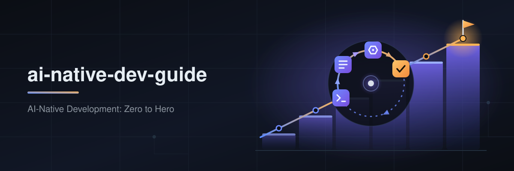

<p align="center"></p>

# AI-Native Development: Zero to Hero

<p align="center">
  <a href="https://github.com/Tamircohen28"></a>
  <a href="https://github.com/TamirCohen28/ai-native-dev-guide/actions/workflows/ci.yml"></a>
  <a href="LICENSE"></a>
  <a href="docs/CHANGELOG.md"></a>
</p>

<p align="center"><sub>AI targets: Claude Code · Cursor · Codex · Gemini CLI · OpenCode — declared, not yet version-validated (<a href="docs/engineering/build-and-release/platform-targets.json">platform-targets.json</a>)</sub></p>

A field guide to building software *with* coding agents rather than next to them. The book starts from what a token is and ends with unattended agents running behind gates in CI, using Claude Code as the worked example and showing how the same ideas carry to other agentic tools. It explains how the machinery works, shows configuration that holds up in daily use, and gives as much room to what went wrong as to what went right.

**[Start reading: the book's cover and contents page](book/README.md)** · **[Read the PDF online](https://tamircohen28.github.io/ai-native-dev-guide/ai-native-development.pdf)** · **[Download the PDF](https://tamircohen28.github.io/ai-native-dev-guide/)**, rebuilt from `main` on every push

## What is in the book

- **34 chapters in six parts**, from tokens and the context window to headless runs, security and cost, including three hands-on workshop guides that build a subagent, a skill and a plugin. Every chapter is one Markdown file you can read on GitHub or offline.
- **One fixed chapter shape**: a mental model with a diagram, the mechanics with examples you can copy, a "From the field" section, a symptom-cause-fix table, a checklist, exercises and sources.
- **Two kinds of evidence, kept apart**: dated official documentation, and one developer's field data from about four weeks of real sessions. Field numbers are labelled as one person's numbers, never as benchmarks.
- **Five appendices**: a cheat sheet, a glossary, copy-ready templates, the full bibliography, and a level-by-level learning path with a 30-day plan and capstone projects.
- **62 Mermaid diagrams and 17 SVG figures**: diagrams render inline on GitHub; the charts are static SVG files built from the field data.
- **A checker that gates every change**: `scripts/check-book.py` verifies chapter length, code fences, local links, images and Mermaid rendering before anything merges.

## Contents

| Part | What it covers |
|---|---|
| [I — Foundations](book/README.md#part-i--foundations) | What AI-native development is, tokens and the context window, the agentic loop, caching and cost, the harness architecture and what happens on each turn |
| [II — Claude Code core](book/README.md#part-ii--claude-code-core) | Install and first session, the CLI, `CLAUDE.md` and memory, settings and permissions, steering a long session |
| [III — Extending the harness](book/README.md#part-iii--extending-the-harness) | The extension model and how to choose between its pieces, the Model Context Protocol in theory and practice, subagents, skills, hooks, plugins, interface customisation, and workshop guides that build and ship a subagent, a skill and a plugin |
| [IV — Workflows](book/README.md#part-iv--workflows) | Explore-plan-implement-verify, testing, git and review, parallel work, orchestration, headless and CI, cross-tool setups |
| [V — Production concerns](book/README.md#part-v--production-concerns) | Security and guardrails, cost and observability, repo standards and team adoption |
| [VI — Field guide](book/README.md#part-vi--field-guide) | A troubleshooting catalogue, nine case studies, a prompt cookbook with anti-patterns |
| [Appendices](book/README.md#appendices) | Cheat sheet, glossary, templates, sources, learning path and exercises |

The chapter-by-chapter list, with one line on what each chapter gives you, is on the [book's contents page](book/README.md#contents).

## Prerequisites

- **To read:** a Markdown viewer that renders Mermaid diagrams. GitHub does; so do VS Code with a Mermaid extension and Obsidian.
- **To follow the exercises:** a terminal, git, and basic comfort with one programming language. No machine-learning background is assumed.
- **To build the PDF yourself (optional):** Node.js 22.12 or later and Python 3 with `pypdf`, then `make pdf`. See the [command reference](docs/user/reference/commands.md#scriptspdfbuildmjs).
- **To validate changes (optional):** Python 3 for `scripts/check-book.py`, and the Mermaid CLI (`mmdc`, from the npm package `@mermaid-js/mermaid-cli`) so `make check-book` can render every diagram.

## Quick Start

```bash
git clone https://github.com/TamirCohen28/ai-native-dev-guide.git
cd ai-native-dev-guide
make install
```

`make install` installs nothing: it checks that the tools the checks use (Python 3, jq, git, and optionally the Mermaid CLI) are present. Nothing is built and nothing runs, because the book is the Markdown under `book/`.

**Read it.** Open [`book/README.md`](book/README.md) and pick a starting point from its "Who this is for" table. New to coding agents: start at chapter 1. Stuck on something right now: go to [chapter 32](book/32-troubleshooting-common-problems.md), then the [cheat sheet](book/A-cheat-sheet.md).

**Validate it** (only needed when you change something):

```bash
make agent:check   # the repository gate that CI runs; checks the book without rendering Mermaid
make check-book    # the full book check; renders every Mermaid block when mmdc is installed
```

More detail: [docs/user/quick-start.md](docs/user/quick-start.md) for reading paths, [docs/user/reference/commands.md](docs/user/reference/commands.md) for every command and flag.

The repository also carries instructions for coding agents, so an agent that opens it knows the authoring rules before it edits a chapter. [`AGENTS.md`](AGENTS.md) is the one canonical file; each tool reaches it in its own way.

### Claude Code

Claude Code loads [`CLAUDE.md`](CLAUDE.md), whose first line imports `AGENTS.md`. It also picks up the project skill under `.claude/skills/` and the constraints rule in `.claude/rules/`.

### Cursor

Cursor applies the always-on rule [`.cursor/rules/000-project.mdc`](.cursor/rules/000-project.mdc), which points to `AGENTS.md` and adds nothing of its own.

### Codex

Codex reads the root `AGENTS.md` directly. No adapter file is needed.

## How the book was sourced

Facts about tools come from primary documentation: the official Claude Code, Claude API and Model Context Protocol docs as read on **2026-11-25**, plus engineering posts, studies and security reports. Version-sensitive facts are marked "as of Nov 2026". Observations about real use come from one developer's repositories, configuration and session transcripts, anonymised and labelled as field data. A claim that could not be confirmed on a primary page was left out or marked. [Appendix D](book/D-sources.md) lists every source and explains the method.

Coding agents change quickly. Where your installed version disagrees with a chapter, trust the tool's own help and the official docs, and treat the chapter as dated.

## Documentation

Everything about the repository around the book is in [docs/](docs/README.md): [user docs](docs/user/README.md) for readers, [engineering docs](docs/engineering/README.md) for contributors, and the [changelog](docs/CHANGELOG.md).

## Contributing

Corrections and improvements are welcome. Read [docs/CONTRIBUTING.md](docs/CONTRIBUTING.md) first: it covers branch and commit conventions and the authoring rules every chapter follows.

---

CC-BY-NC-SA-4.0 © [Tamir Cohen](https://github.com/Tamircohen28)

<p align="center"><a href="https://github.com/TamirCohen28">Have a Question?</a>&nbsp;·&nbsp;<a href="https://github.com/TamirCohen28/ai-native-dev-guide/issues/new/choose">Open an Issue</a></p>
