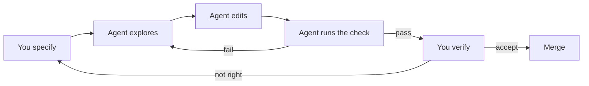
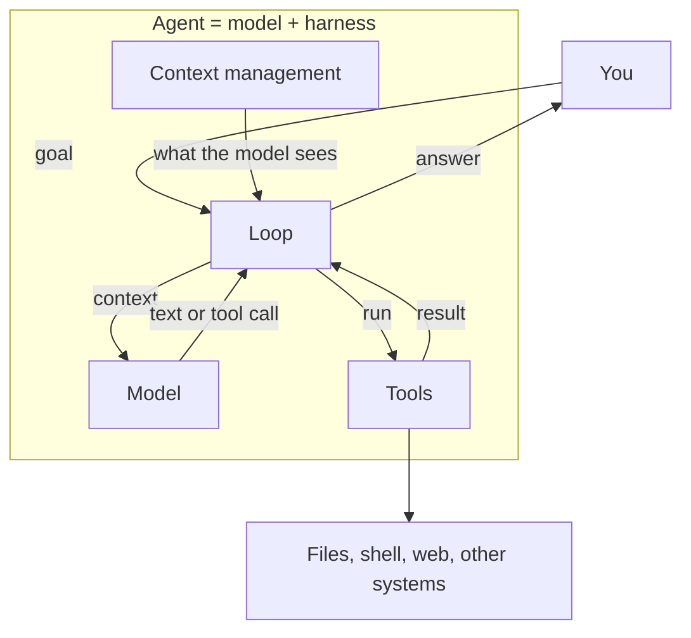
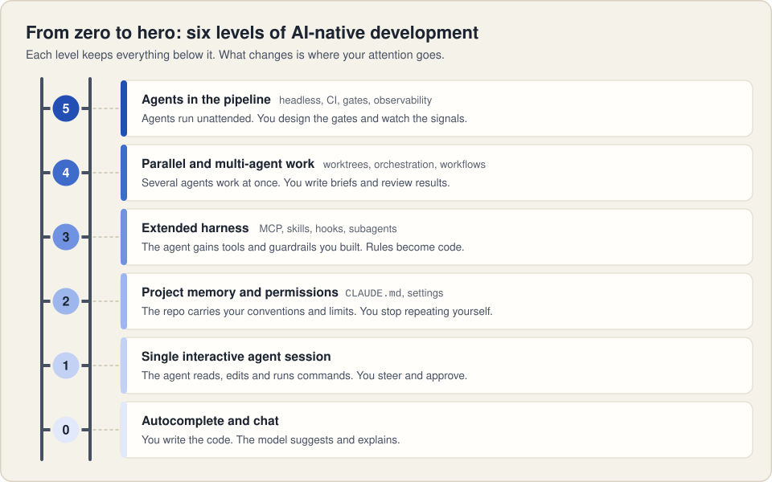
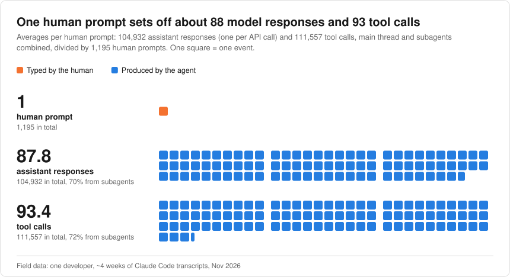
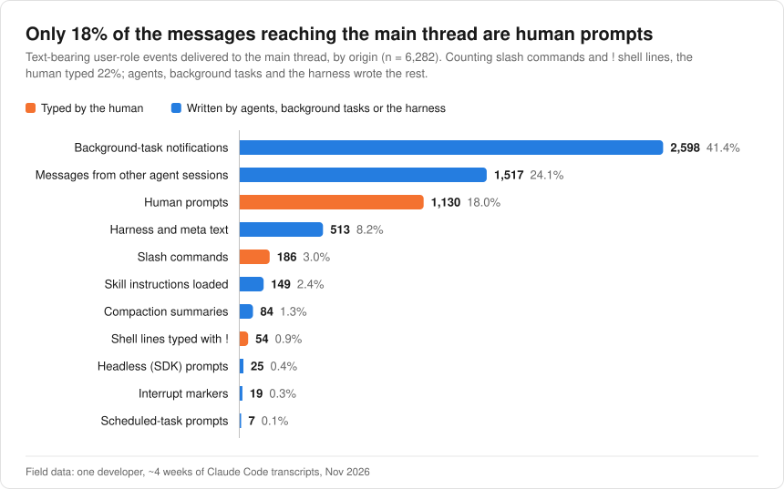

# 01 — What AI-native development is

After this chapter you can say precisely what "AI-native development" means, tell an autocomplete tool from a chat assistant from an agentic harness, and explain why your bottleneck moves from typing code to specifying and verifying it. You will also know what the productivity evidence does and does not show, and which level of this book's six-level ladder you are standing on.

## Mental model

**AI-native development** is a way of working in which you *specify* a change, *delegate* the typing to an agent, and *verify* the result. An **agent** here is a language model that reads your code, edits files and runs commands in a loop until it decides the task is finished. You stay responsible for what "done" means and for confirming it was reached.

Three verbs carry the idea:

| Verb | What you do | What happens if you skip it |
|---|---|---|
| Specify | Say what to change, where, and what "fixed" looks like | The agent builds something different from what you had in mind |
| Delegate | Let the agent explore, edit and run commands without approving every keystroke | You get an expensive autocomplete and no time back |
| Verify | Give the agent a check it can run, then look at the evidence yourself | "Looks done" is all anyone has to go on |



The inner loop (explore, edit, check) belongs to the agent and may run dozens of times without you. The outer loop (specify, verify) belongs to you. Most of this book is about making the inner loop trustworthy enough that the outer loop stays short.

> **Note:** "AI-native" does not mean "no human". It means your time goes to the two steps a model cannot own: deciding what should exist, and accepting responsibility for what ships.

## From autocomplete to agentic harness

Three generations of tooling are in use side by side. They differ in who gathers context, who runs the code, and how much happens per instruction.

| | Autocomplete | Chat assistant | Agentic harness |
|---|---|---|---|
| You give it | A cursor position | A question plus pasted code | A goal, inside a repository |
| It produces | The next few lines | An answer or a snippet | Edits, command runs and a report |
| Who gathers context | The editor, from open files | You, by copy and paste | The agent, by searching and reading |
| Who runs the code | You | You | The agent, inside permission limits |
| Unit of work | A line | A function | A task, sometimes a whole pull request |
| Your main skill | Reading suggestions fast | Asking good questions | Specifying and verifying |

Each stage hands over one more job. Autocomplete types for you. Chat also reasons for you, but you remain the hands: you carry text in and out, and you run everything. An agentic harness closes that gap by giving the model tools, so it can look things up, act, see the result and try again.

You will keep using all three. This book is about the third, because it is the one that changes the working method and not just the typing speed.

## What a harness is

A **harness** is the program around the model that turns "predict the next piece of text" into "get a task done". This book describes a working agent as four parts: the model, plus the three things the harness adds around it (tools, a loop and context management). That four-part split is this book's own framing, used to organise the chapters; it is not a definition from the official docs.



| Part | Its job | In Claude Code | Read more |
|---|---|---|---|
| Model | Predicts the next token; decides what to say or which tool to call | A Claude model, chosen with `/model` | [02](02-llms-tokens-and-the-context-window.md) |
| Tools | Let the model act: read and edit files, run shell commands, search, call other systems | Built-in tools such as Read, Edit and Bash; more through MCP servers | [03](03-the-agentic-loop-and-tool-use.md), [12](12-mcp-how-it-works.md) |
| Loop | Runs each tool call the model asks for, feeds the result back, repeats until the model stops | The session; permission checks and hooks run inside it | [03](03-the-agentic-loop-and-tool-use.md), [09](09-settings-and-permissions.md), [16](16-hooks.md) |
| Context management | Decides what the model sees on every request, and what gets dropped when space runs out | `CLAUDE.md`, memory, skills, compaction, subagents | [04](04-prompt-caching-compaction-and-cost.md), [08](08-claude-md-and-memory.md), [10](10-plan-mode-checkpoints-and-context-management.md) |

The table uses names that later chapters explain in full. In one line each: `CLAUDE.md` is a file of project instructions loaded into every session; a **skill** is a packaged prompt whose body loads only when it is invoked; a **hook** is your own script that the harness runs at a fixed point in the loop; **MCP** (Model Context Protocol) is the standard way to connect external tools; a **subagent** is a second agent that the first one starts for a side task; **compaction** replaces the older part of a conversation with a summary.

Anthropic's shortest definition of an agent is ["LLMs autonomously using tools in a loop."](https://www.anthropic.com/research/effective-context-engineering-for-ai-agents) In this book's framing, the harness is everything in that sentence except the LLM. This is why two products built on the same model can behave very differently: the tools, the loop and the context rules are not the same.

### Where Claude Code sits

Claude Code is Anthropic's harness for software work. The model is Claude; [Claude Code supplies the tools](https://code.claude.com/docs/en/how-claude-code-works), the loop, the permission system and the context management. [The official docs draw the same line](https://code.claude.com/docs/en/best-practices), and it is the most useful distinction in this book:

| Kind of instruction | Docs' wording | Examples | How strong |
|---|---|---|---|
| Non-deterministic | ["you write the instruction, and Claude (the model) reads it"](https://code.claude.com/docs/en/best-practices) | A prompt, `CLAUDE.md`, a skill | A guideline; the model may decide it does not apply |
| Deterministic | ["you configure the instruction, and Claude Code (the harness) *has* to execute this"](https://code.claude.com/docs/en/best-practices) | A hook, a deny rule, a managed setting | Enforced every time |

A deny rule is a permission setting that blocks matching tool calls; a managed setting is one your organization's administrator sets for you. The docs' advice on choosing: ["Most of the time, you want Claude to decide."](https://code.claude.com/docs/en/best-practices) But "If something has to happen every time, make it a hook, a deny rule, or a managed setting."

[The same harness runs as an interactive session](https://code.claude.com/docs/en/how-claude-code-works) (terminal, VS Code, desktop app, web) and without a UI. [The non-interactive form is one command](https://code.claude.com/docs/en/common-workflows), which is what makes agents scriptable:

```bash
# Pipe anything in, get an answer on stdout
cat error.log | claude -p "what's going on here"
git log --oneline -20 | claude -p "summarize these recent commits"
```

> **Note:** Claude Code changed a lot during 2026. Every version-sensitive fact in this book is stamped "as of Nov 2026". Before relying on a command or flag, check your own build with `claude --version`, `/help` and `claude --help`.

## What changes in your job

The docs [open their best-practices page](https://code.claude.com/docs/en/best-practices) with a reassuring claim: "Claude Code is built in a way that, in most cases, your first plain prompt in a fresh session already does the right thing, without any setup on your part." Typing is no longer the scarce resource. What is scarce is a precise description of the change and a trustworthy answer to "did it work?".

| Before | After |
|---|---|
| Most hours go to writing and editing code | Most hours go to describing the change and checking the result |
| Context lives in your head | You write down what the agent cannot see |
| Tests confirm your own work | Tests are how the agent knows it has finished |
| Review is the last step | Review is the bottleneck; small changes and evidence keep it moving |
| Conventions live in people | Conventions live in files the agent reads and rules the harness enforces |

The reason verification moves to the centre is [stated plainly in the docs](https://code.claude.com/docs/en/best-practices): "Claude stops when the work looks done. If it has nothing to run that tells it whether the work actually *is* done, "looks done" is all it has to go on. In practice that makes you the test suite, and every mistake sits there until you happen to notice it."

The same page says that when a session goes wrong, ["it's almost always one of these"](https://code.claude.com/docs/en/best-practices). Each failure has a matching habit, and each habit has a part of this book.

| What went wrong (docs' wording) | The habit | Where it is taught |
|---|---|---|
| "Claude built something different from what you had in mind, or it has to rediscover the same fact at the start of every session" | Tell Claude what it can't see | [08](08-claude-md-and-memory.md), [22](22-explore-plan-implement-verify.md) |
| "Claude said it was done and it wasn't quite" | Give Claude a check to run | [23](23-testing-and-verification-loops.md) |
| "Claude did something that must never happen in this repo, or skipped a step that must always happen" | Enforce the rules that can't have exceptions | [09](09-settings-and-permissions.md), [16](16-hooks.md) |
| "Claude got it right, but it took more time, tokens, or permission prompts than the task was worth" | Change a default | [09](09-settings-and-permissions.md), [30](30-cost-usage-and-observability.md) |

### A worked example: the same task, specified twice

A prompt that leaves the agent guessing:

```text
fix the login bug
```

The same task with [the three things the docs ask for](https://code.claude.com/docs/en/best-practices): "name the file, describe the symptom, and say what "fixed" looks like up front".

```text
Users are logged out after about 5 minutes instead of 60.
Start in src/auth/session.ts and the token refresh path.
Write a failing test that reproduces it, then fix it.
Run the auth tests after, and keep going until they pass.
Show me the test command you ran and its output.
```

The second prompt is five lines, not five paragraphs. It names a place to start, a symptom, a pass/fail check and the evidence you want back. Asking for evidence matters because, [in the docs' words](https://code.claude.com/docs/en/best-practices), "'All tests pass' on its own tells you very little".

A brief you can reuse for any delegated task:

```text
Goal:      <one sentence: what changes for the user>
Where:     <files, modules, or the command that fails today>
Done when: <a command that exits 0, or a behaviour you can observe>
Don't:     <what must not change>
Evidence:  <the command you ran and its output>
```

If you cannot fill in "Done when", you have found the real first task: build the check. Chapter [23](23-testing-and-verification-loops.md) is about that.

## Workflows versus agents

Anthropic's post ["Building effective agents"](https://www.anthropic.com/research/building-effective-agents) (Dec 2024) gives the vocabulary the rest of the field uses. Both of the following are "agentic systems":

- "**Workflows** are systems where LLMs and tools are orchestrated through predefined code paths."
- "**Agents**, on the other hand, are systems where LLMs dynamically direct their own processes and tool usage, maintaining control over how they accomplish tasks."

[The post names five workflow patterns](https://www.anthropic.com/research/building-effective-agents) before it gets to agents. The examples in the right-hand column are ours.

| Pattern | The post's description | A coding example |
|---|---|---|
| Prompt chaining | "decomposes a task into a sequence of steps, where each LLM call processes the output of the previous one" | Draft release notes, then translate them, then format them |
| Routing | "classifies an input and directs it to a specialized followup task" | Triage an issue into a bug-fix path or a docs path |
| Parallelization | "Sectioning" into independent subtasks, or "Voting" by running the same task several times | A security review and a test review of one diff, side by side |
| Orchestrator-workers | "a central LLM dynamically breaks down tasks, delegates them to worker LLMs, and synthesizes their results" | A lead agent splits a migration across modules |
| Evaluator-optimizer | "one LLM call generates a response while another provides evaluation and feedback in a loop" | A writer and a reviewer iterate until the review passes |
| Agent | "typically just LLMs using tools based on environmental feedback in a loop" | An open-ended bug hunt where the number of steps is unknown |

Two pieces of the post's advice hold up well and shape this book:

1. **Start simple.** "we recommend [finding the simplest solution possible](https://www.anthropic.com/research/building-effective-agents), and only increasing complexity when needed. This might mean not building agentic systems at all. Agentic systems often trade latency and cost for better task performance".
2. **Autonomy has a price.** ["The autonomous nature of agents means higher costs, and the potential for compounding errors."](https://www.anthropic.com/research/building-effective-agents) [A later Anthropic post puts numbers on it](https://www.anthropic.com/research/multi-agent-research-system): "agents typically use about 4× more tokens than chat interactions, and multi-agent systems use about 15× more tokens than chats."

What this means in practice: an interactive Claude Code session is an agent. When you call `claude -p` at a fixed step of a CI job, or make a hook run the type checker every time the agent tries to stop, you are wrapping that agent in a workflow, a predefined code path. Mature setups use both. The agent handles the open-ended part; deterministic paths handle the steps that must always happen. Part IV builds these up, from a single verify loop in chapter [22](22-explore-plan-implement-verify.md) to orchestrator-workers in chapter [26](26-multi-agent-orchestration.md).

> **Note:** [The post carries a banner](https://www.anthropic.com/research/building-effective-agents): "Much of the tooling landscape described in this post has changed since December 2024." The definitions are still the standard ones; the product names in it are dated. Claude Code also has a feature of its own called dynamic workflows (scripts that orchestrate many subagents), covered in Part IV. In this section the word is the general design term.

## The productivity evidence, with its caveats

You will be asked whether this makes developers faster. The honest answer has several parts, and none of the studies is a clean measurement of 2026 tools.

| Finding | Source | Caveat |
|---|---|---|
| 90% of respondents use AI at work; "More than 80% believe it has increased their productivity"; 30% report little or no trust in AI-generated code. AI adoption relates positively to throughput but "does continue to have a negative relationship with software delivery stability." | [DORA 2025 report](https://cloud.google.com/blog/products/ai-machine-learning/announcing-the-2025-dora-report) | Survey of about 5,000 people; self-reported and correlational; published by Google Cloud |
| 16 experienced open-source developers, 246 issues: with AI allowed they "take 19% longer". They forecast 24% faster and afterwards still believed about 20% faster. | [METR randomized trial, Jul 2025](https://metr.org/blog/2025-07-10-early-2025-ai-experienced-os-dev-study/) | Early-2025 tools, large mature repos, n=16. METR now marks it out of date. Its lasting value is the perception gap |
| Follow-up with 57 developers and 800+ tasks: raw estimates of −18% time for returning developers and −4% for new ones, both with confidence intervals that cross zero | [METR update, Feb 2026](https://metr.org/blog/2026-02-24-uplift-update/) | METR calls its own data "only very weak evidence": 30–50% of developers skipped tasks they would not do without AI. Not a measured speedup |
| 96 engineers at Google, one complex task: about 21% faster with AI | [Enterprise trial, arXiv 2410.12944](https://arxiv.org/abs/2410.12944) | "our confidence interval is large"; summer-2024 internal tooling; a single lab task |
| High-adoption teams: tasks completed +21%, pull requests merged +98%, **review time +91%**, **pull request size +154%**, bugs per developer +9%; no significant link to company-level throughput or quality | [Faros AI report, Jul 2025](https://www.faros.ai/blog/ai-software-engineering) | Vendor telemetry (10,000+ developers); correlations; data to June 2025 |
| AI-co-authored pull requests: 10.83 issues each against 6.45 for human-only | [CodeRabbit report, Dec 2025](https://www.coderabbit.ai/blog/state-of-ai-vs-human-code-generation-report) | The vendor sells AI review; 470 open-source pull requests; authorship was inferred |
| 2025: 46% distrust the accuracy of AI tools against 33% who trust it; 66% are frustrated by "AI solutions that are almost right, but not quite". 2026: 73% use coding assistants or agents daily; 48% trust AI when answers are easy to validate | [Stack Overflow Developer Surveys 2025](https://survey.stackoverflow.co/2025/ai) and [2026](https://survey.stackoverflow.co/2026/ai) | Self-selected respondents |

What the evidence supports, read together:

- **Individual output goes up.** More tasks, more pull requests.
- **The cost lands in review and stability.** Bigger changes, longer reviews, and DORA's negative link to delivery stability. DORA's own summary is that ["AI's primary role is as an amplifier"](https://dora.dev/research/2025/dora-report/): it magnifies the practices a team already has.
- **People over-estimate their own speedup.** The 2025 METR trial is the cleanest evidence of this.
- **Trust depends on being able to verify.** That is the Stack Overflow result, and it is the thesis of this book.
- **There is no clean 2026 trial.** METR tried and reported that it could not produce one.

So do not adopt this way of working on the promise of a percentage. Adopt it with verification built in, measure your own cycle time and review load, and treat any number without a caveat as marketing.

## The six-level ladder

"Zero to hero" in this book means climbing six levels of practice. Each level keeps everything below it; what changes is where your attention goes.



| Level | Name | What changes for you | Where the book covers it |
|---|---|---|---|
| 0 | Autocomplete and chat | You write the code; the model suggests and explains | This chapter and [02](02-llms-tokens-and-the-context-window.md) |
| 1 | Single interactive agent session | The agent reads, edits and runs commands; you steer and approve | [03](03-the-agentic-loop-and-tool-use.md) to [05](05-inside-the-harness.md) (the loop, cost and the harness itself), [06](06-install-and-first-session.md), [07](07-cli-slash-commands-and-shortcuts.md) and [10](10-plan-mode-checkpoints-and-context-management.md) |
| 2 | Project memory and permissions | The repo carries your conventions and limits, so you stop repeating yourself | [08](08-claude-md-and-memory.md) and [09](09-settings-and-permissions.md) |
| 3 | Extended harness | The agent gains tools and guardrails you built; rules become code | Part III: the extension model in [11](11-the-extension-model.md), the mechanisms in [12](12-mcp-how-it-works.md) to [18](18-output-styles-statusline-keybindings.md), and the workshop guides [19](19-guide-write-a-subagent.md) to [21](21-guide-build-and-ship-a-plugin.md) |
| 4 | Parallel and multi-agent work | Several agents work at once; you write briefs and review results | [22](22-explore-plan-implement-verify.md) to [26](26-multi-agent-orchestration.md) |
| 5 | Agents in the pipeline | Agents run unattended; you design the gates and watch the signals | [27](27-headless-ci-and-the-agent-sdk.md) to [31](31-repo-standards-and-team-adoption.md) |

Part VI, the field guide ([32](32-troubleshooting-common-problems.md) to [34](34-prompt-cookbook-and-anti-patterns.md)), applies at every level: troubleshooting, case studies and prompts.

Climbing is not the goal. Most tasks are best done at level 1 or 2, and the "start simple" rule above applies to your own setup too: add a skill, a hook or a second agent when a real problem asks for it.

## How to use this book

Every numbered chapter has the same shape: a mental model with a diagram, the core material with examples you can copy, a "From the field" section, a table of common problems, a checklist, exercises and sources.

| If you... | Read |
|---|---|
| Have never used a coding agent | Straight through Parts I and II, doing every "Try it" |
| Use Claude Code daily, but only by prompting | Skim Part I (read [05](05-inside-the-harness.md) properly), then chapters [08](08-claude-md-and-memory.md) to [10](10-plan-mode-checkpoints-and-context-management.md), then Part III |
| Want to build your own subagent, skill or plugin | Chapter [11](11-the-extension-model.md) to choose, then the workshop guides [19](19-guide-write-a-subagent.md) to [21](21-guide-build-and-ship-a-plugin.md) |
| Already write skills and hooks | Parts IV and V |
| Are introducing this to a team | Chapters [09](09-settings-and-permissions.md), [29](29-security-and-guardrails.md), [30](30-cost-usage-and-observability.md) and [31](31-repo-standards-and-team-adoption.md) |
| Have something broken right now | Chapter [32](32-troubleshooting-common-problems.md), then the [cheat sheet](A-cheat-sheet.md) |

Two kinds of evidence appear throughout, and they are kept apart:

- **Official docs**, read on 2026-11-25. Quoted text is verbatim. Where the docs do not state something, the book says so and does not fill the gap.
- **Field data**: one developer's repositories and Claude Code sessions. These are examples, never benchmarks. Each number carries its caveat.

Terms are defined on first use and collected in the [glossary](B-glossary.md). A suggested schedule is in the [learning path](E-learning-path-and-exercises.md).

## From the field

The field data in this book comes from the transcripts that were on the author's machine on 2026-11-25: 89 sessions and 1,249 subagent runs. No transcript older than about 28 days was on disk (age-based cleanup by the harness is the likely reason, not a verified one), so treat it as a rolling window of about four weeks from one developer, with heavy use of orchestration skills. It shows what delegation looks like at volume. It says nothing about whether the output was good.

**1. One prompt, about ninety responses.** In that window, 1,195 human prompts led to 104,932 assistant responses and 111,557 tool calls: 87.8 responses and 93.4 tool calls per prompt. Subagents produced 70% of the responses. 72% of the human prompts were shorter than 50 characters. Many of those were one-word status checks or accepted prompt suggestions. The rest could be short because the specification lived elsewhere: in instruction files, in skills, and in one-line commands that start a whole pipeline. The transcripts also link to 948 pull requests in 26 repositories, though what triggers such a link was not verified.



**2. The human is a minority voice in their own session.** Of 6,282 text messages that arrived on the main thread, 2,598 were background-task notifications, 1,517 came from other Claude sessions and 1,130 were human prompts. The rest were harness text (513), slash commands (186), skill bodies (149), compaction summaries (84), shell inputs (54), SDK prompts (25), interrupt markers (19) and scheduled-task prompts (7). Human prompts were 18% of the total, or 22% if you add the slash commands and shell lines the human also typed.



**3. The workflow was not designed. It accreted, one incident at a time.** Rows before October rest on memory files and file dates only; later rows are also visible in transcripts.

| When (2026) | Step | What triggered it |
|---|---|---|
| Early June | Ad-hoc prompting gets scaffolding: first hooks, first three skills (start, plan, pull request) | Nothing in particular |
| Mid June | First rules written after incidents: "always a PR", a definition-of-done check | Four incidents in one week, including a direct push to the default branch |
| July | A retro skill: friction, root cause, fix layer, and nothing written without approval | Collisions when fanning work out to several repositories |
| August to September | Enforcement: guard hooks, then hard rules with no override | A false green that shipped; an irreversible change to a test device |
| October | Several sessions at once, agents messaging each other | Scale; a weekly usage limit was hit |
| November | Standing authorizations in `CLAUDE.md`; one-line objective pipelines | "Why does every session take hours?" |

The shape of that curve is the most transferable finding: prompt, then memory note, then global rule, then hook, then skill default. Each step up happened only after the weaker one failed to hold. It also went the other way once: a guard was partly removed because carrying it cost more than it saved.

> **Field note:** The author rarely interrupted a running agent: 12 to 19 interrupted main-thread turns, depending on which of two analyses you take, against 218 "status?" pokes (rough counts, read them as plus or minus 30%). Supervision was by polling, which is why silent waits dominate the friction list. Writing the lesson into a project memory did not help: no improvement shows in the following month. The author moved to having the agent watch its own background work and report on each change. See chapter [25](25-parallel-work-worktrees-and-background-tasks.md).

One more caveat from the same analysis: the data shows which fixes were adopted and cited later, and seldom a before-and-after rate. Whether a given fix worked is mostly unmeasured.

## Common problems

| Symptom | Cause | Fix |
|---|---|---|
| The agent builds something other than what you wanted | It cannot see your intent; the prompt named no file, symptom or end state | Use the five-line brief; put recurring facts in `CLAUDE.md` ([08](08-claude-md-and-memory.md)) |
| "Done", but it is not | Nothing runnable told the agent whether the work was finished | Give a pass/fail command and ask for the command output as evidence ([23](23-testing-and-verification-loops.md)) |
| A rule in your instructions is skipped now and then | Instructions the model reads are guidelines, and the model may decide one does not apply | Move must-always rules to a hook, a deny rule or a managed setting ([16](16-hooks.md)) |
| You feel much faster but the team ships at the same pace | Review and verification became the bottleneck; people over-estimate their own speedup | Measure cycle time and review load; keep changes small ([24](24-git-prs-and-code-review.md)) |
| You built a multi-agent pipeline for a task one prompt could do | Complexity added before a problem asked for it | "finding the simplest solution possible, and only increasing complexity when needed" |
| You keep typing "status?" | The agent is silent while it waits, so quiet looks the same as stuck | Have it watch its own background work and report on each change ([25](25-parallel-work-worktrees-and-background-tasks.md)) |
| Advice from a 2024 or 2025 tutorial does not match what you see | The harness and the models changed; several old workarounds were retired | Check `claude --version` and prefer the dated facts in this book |

## Checklist

- [ ] I can explain specify, delegate and verify in one sentence each.
- [ ] I can name the model and the three parts the harness adds around it, and point to each one in Claude Code.
- [ ] I know which instructions the model reads and which the harness enforces.
- [ ] My next task has a written "Done when" that a command can check.
- [ ] I can tell a workflow from an agent and say which one my next task needs.
- [ ] I can quote one productivity finding together with its caveat.
- [ ] I know which ladder level I am on and which chapter to read next.

## Try it

1. **Sort last week's work.** List ten tasks you did. Mark each one A (autocomplete would do), C (a chat answer would do) or H (needs a harness: several files, commands to run, a check to pass). For two H tasks, fill in the five-line brief from this chapter.
2. **Write the check first.** Pick a bug you know about. Before writing any prompt, write the single command that would prove it fixed. If you cannot, note what is missing (a test, a script, a reproducible input). That gap is the first thing to build.
3. **Compare two prompts.** If Claude Code is already installed (otherwise come back after chapter [06](06-install-and-first-session.md)), give it one small task twice in fresh sessions: once as a single vague line, once with the brief. Count how many corrections each run needed.

## Sources

- Claude Code best practices — https://code.claude.com/docs/en/best-practices
- Claude Code common workflows — https://code.claude.com/docs/en/common-workflows
- How Claude Code works — https://code.claude.com/docs/en/how-claude-code-works
- Anthropic, "Building effective agents" (Dec 2024) — https://www.anthropic.com/research/building-effective-agents
- Anthropic, "Effective context engineering for AI agents" (Sep 2025) — https://www.anthropic.com/research/effective-context-engineering-for-ai-agents
- Anthropic, "How we built our multi-agent research system" (Jun 2025) — https://www.anthropic.com/research/multi-agent-research-system
- DORA 2025 report — https://dora.dev/research/2025/dora-report/ and https://cloud.google.com/blog/products/ai-machine-learning/announcing-the-2025-dora-report
- METR, early-2025 trial — https://metr.org/blog/2025-07-10-early-2025-ai-experienced-os-dev-study/
- METR, Feb 2026 update — https://metr.org/blog/2026-02-24-uplift-update/
- Enterprise trial at Google — https://arxiv.org/abs/2410.12944
- Faros AI, "The AI Productivity Paradox Report 2025" — https://www.faros.ai/blog/ai-software-engineering
- CodeRabbit, AI versus human code report — https://www.coderabbit.ai/blog/state-of-ai-vs-human-code-generation-report
- Stack Overflow Developer Survey, AI sections — https://survey.stackoverflow.co/2025/ai and https://survey.stackoverflow.co/2026/ai
- Field data: the author's Claude Code transcripts and memory files, snapshot of 2026-11-25 (not public)

---

[← Previous: Contents](README.md) · [Contents](README.md) · [Next: LLMs, tokens and the context window →](02-llms-tokens-and-the-context-window.md)
