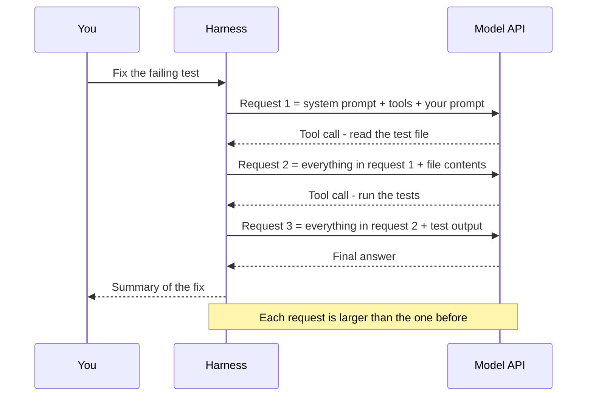
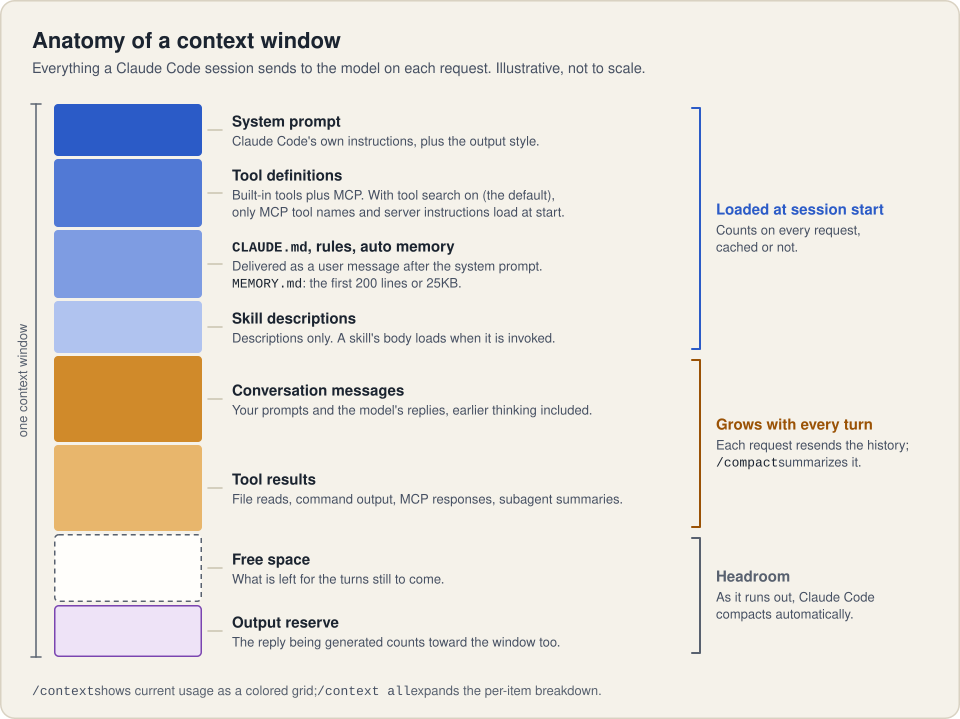
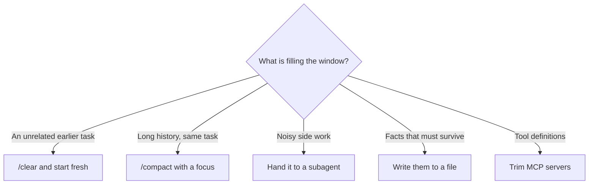

# 02 — LLMs, tokens and the context window

After this chapter you can estimate how many tokens a file, a screenshot or a whole session costs, explain why a long session gets more expensive and less precise, and choose a model and an effort level on purpose. You will also know what the 1M-token window changed in 2026 and which older advice it retired.

## Mental model

A **large language model (LLM)** does one thing: given a sequence of tokens, it predicts the next token. It repeats that until it produces a stop. Chat, tool use and "memory" are all built on top, by controlling what goes into the sequence.

Three consequences follow, and they explain most of what you will see in a coding session:

1. **The model remembers nothing between requests.** The API is *stateless*: each request must contain everything the model should know. The docs describe the input of each turn as "all previous conversation history plus the current user message".
2. **A conversation is a document that is sent again in full, and grows.** Every file the agent reads and every command output is appended, then re-sent with the next request.
3. **The document has a maximum size, the context window,** and answer quality starts to fall well before you reach it.



The figure shows what one of those requests holds in a Claude Code session (illustrative, not to scale). The **system prompt** is the harness's own standing instructions; **tool definitions** describe the tools the model may call. Those, your instruction files and the skill descriptions load at session start. Messages and tool results grow with every turn, and whatever is left is headroom for the reply.



In Claude Code you never see the re-sending; the harness does it. It is still the reason one prompt that leads to 40 tool calls is 40 requests, each a little larger than the last.

At the API level, the second turn of a chat looks like this (trimmed). The first exchange is inside it, word for word:

```json
{
  "model": "claude-opus-5-5",
  "max_tokens": 1024,
  "system": "You are a coding assistant.",
  "messages": [
    {"role": "user", "content": "What does parse_config do?"},
    {"role": "assistant", "content": "It reads config.toml and returns a dict."},
    {"role": "user", "content": "Add a test for the missing-file case."}
  ]
}
```

## Tokens

A **token** is the unit the model reads and writes. The docs: "Tokens are the smallest individual units of a language model, and can correspond to words, subwords, characters, or even bytes (in the case of Unicode)." Prices, rate limits and the context window are all measured in tokens.

### Estimating

Rules of thumb for current models, as of Nov 2026:

| What | Rough size | Basis |
|---|---|---|
| English prose | 100 words ≈ 180 tokens; 1,000 characters ≈ 400 tokens | Docs: "1M tokens is roughly 555k words or 2.5M Unicode characters on the current tokenizer" (our arithmetic) |
| The same text on models before Opus 4.7 | Noticeably fewer tokens | Docs: the newer tokenizer "produces approximately 30% more tokens for the same text" |
| Average web page (10 kB) | ~2,500 tokens | Pricing page example |
| Large documentation page (100 kB) | ~25,000 tokens | Pricing page example |
| Research paper PDF (500 kB) | ~125,000 tokens | Pricing page example |
| Image, 1000x1000 | 1,296 tokens | Vision docs |
| Screenshot, 1920x1080 | 1,560 tokens on standard-resolution models; 2,691 on high-resolution models (Claude 4.7 and later) | Vision docs |
| One small tool definition | A few hundred tokens: the docs' one-tool request counts 403 tokens, against 14 for a bare greeting | Token counting docs |

> **Warning:** These rules disagree with each other because the docs do. The models overview implies about 2.5 characters per token, the glossary's figures imply about 2.7, and the pricing page's examples imply 4 bytes per token. The docs give no ratio for source code at all. Plan with a range and count anything that matters. A count taken from a tutorial written before Opus 4.7 will be too low.

A quick range for any file, using 4 and 2.5 characters per token as the bounds:

```bash
wc -c < README.md | awk '{printf "%d to %d tokens\n", $1/4, $1/2.5}'
```

On a 7,075-byte Markdown file this prints `1768 to 2830 tokens`.

Images are priced by area, not file size. "Each patch is a 28×28-pixel block of the image, referred to as a visual token", so an image costs `⌈width / 28⌉ × ⌈height / 28⌉` tokens, with a ceiling because oversized images are downscaled.

### Counting

The API has an endpoint that counts instead of guessing. This example is from the docs:

```python
import anthropic

client = anthropic.Anthropic()
response = client.messages.count_tokens(
    model="claude-opus-5-5",
    system="You are a scientist",
    messages=[{"role": "user", "content": "Hello, Claude"}],
)
print(response.json())  # docs output: { "input_tokens": 14 }
```

Three facts about it: "The token count is an **estimate**"; it is "**free to use**", with its own rate limit; and it accepts the same input as a real request, "including support for system prompts, tools, images, and PDFs". Count against the model you will call: "Recount prompts against the model you plan to use rather than reusing counts measured against earlier models."

Inside Claude Code you do not call this yourself. `/context` shows what is using the window and `/usage` shows what the session has cost.

## The context window

The docs' definition: "The “context window” refers to all the text a language model can reference when generating a response, including the response itself." It is working memory, not training data.

What counts toward it: "Everything in the request counts toward the context window: the system prompt, every message in `messages` (including tool results, images, and documents), and your tool definitions. The output Claude generates for the turn, including its extended thinking, counts too."

### Sizes (as of Nov 2026)

| Models | Context window | Max output per request |
|---|---|---|
| Fable 5.2, Opus 5.5, Sonnet 5.5, Haiku 5.5 (the current lineup) | 1M tokens | 128K tokens |
| Fable 5.1 and 5; Opus 5, 4.8, 4.7 and 4.6; Sonnet 5 and 4.6 | 1M tokens | 128K tokens |
| Opus 4.5, Sonnet 4.5, Haiku 4.5 | 200K tokens | 64K tokens |

The large window needs no switch: "For every model with a 1M-token context window, 1M is the default: you don’t need a beta header, and long-context requests are billed at standard pricing, except on Claude Haiku 5.5, where prompts over 100,000 tokens cost more." One Claude Code exception: there, "Opus 4.6 and Sonnet 4.6 reach 1M only through their `[1m]` variant".

Caching does not make the window bigger. "Cached prompt prefixes still occupy the context window: prompt caching changes what you pay for those tokens, not whether they count."

### What fills it in a Claude Code session

| What | When it enters | Size facts (as of Nov 2026) |
|---|---|---|
| System prompt and output style | Every request | A fixed cost you pay on each request |
| Tool definitions | Session start | For MCP servers, tool search (full definitions fetched only when needed) is on by default, so "Only tool names and server instructions load at session start" |
| `CLAUDE.md` files | Session start | Loaded from the working directory "and every directory above it" and concatenated; files in subdirectories load when Claude touches a file there. Target "under 200 lines per CLAUDE.md file" |
| Auto memory | Session start | "the first 200 lines or 25KB of `MEMORY.md`, whichever comes first" |
| Skill descriptions | Session start | A skill's body is added only when the skill is invoked |
| Your prompts, `@file` mentions, images | As you type | A file you mention with `@` is included "when it fits the Read tool's token limit, 25,000 tokens by default" |
| Claude's replies and thinking | Each response | Per the API docs, current models keep earlier thinking in the history, and it counts as input |
| Tool results | Each tool call | Read returns "at most 25,000 tokens" per call; Bash output stays inline "up to roughly 30,000 characters"; MCP results warn at 10,000 tokens and are capped at 25,000 by default |
| Subagent results | When a subagent finishes | "Only the summary and a small metadata trailer come back" |

Run `/context` to see this for your own session ("Visualize current context usage as a colored grid"), or `/context all` for a per-item breakdown. Tool results add up quickly: one large file read can add up to 25,000 tokens, and it stays in the document for every later request until a compaction or a `/clear`.

### What happens at the limit

At the API level there are two cases:

- **The input alone is too big.** "the API returns a 400 `invalid_request_error` (“prompt is too long”) on every model."
- **The input fits but the output runs out of room.** On Claude 4.5 models and newer the request is accepted, and if generation then reaches the limit it stops with `stop_reason: "model_context_window_exceeded"`.

Claude Code does not let you get that far. "Claude Code compacts automatically as you approach the limit, so a full context window doesn't end your session." **Compaction** replaces the older part of the conversation with a summary. On a native 1M-token model it fires "at about 967K tokens by default"; `/autocompact 500k` moves the trigger (v2.1.221 or later), and `/compact focus on the auth bug fix` compacts now, with a focus you choose.

Compaction is lossy, and the docs say exactly where: "The summary keeps your requests and key code snippets, but detailed instructions from early in the conversation may be lost. Put persistent rules in CLAUDE.md."

| What | After compaction |
|---|---|
| System prompt and output style | "Both still apply" |
| Project-root `CLAUDE.md`, unscoped rules, auto memory, the plan from plan mode | "Re-injected from disk" |
| Nested `CLAUDE.md` files and rules with a `paths:` filter | Reloaded on demand, so gone until a matching file is touched again |
| Files Claude read or edited | "Claude Code re-reads up to five, most recently modified first" |
| Everything else in the conversation | Whatever made it into the summary |

Chapter [04](04-prompt-caching-compaction-and-cost.md) covers compaction and its cost in depth; chapter [09](09-plan-mode-checkpoints-and-context-management.md) covers the commands.

## Models and prices (as of Nov 2026)

Prices are US dollars per million tokens (MTok), as published on 2026-11-25. Check the pricing page before you budget.

| Model | API ID | Input | Output | Cache read | Latency | Docs' description |
|---|---|---|---|---|---|---|
| Claude Fable 5.2 | `claude-fable-5-2` | $8 | $40 | $0.20 | Moderate | "For demanding reasoning and long-horizon agentic work" |
| Claude Opus 5.5 | `claude-opus-5-5` | $4 | $20 | $0.20 | Moderate | "For long-running agentic coding and knowledge work" |
| Claude Sonnet 5.5 | `claude-sonnet-5-5` | $2 | $10 | $0.10 | Fast | "The best combination of speed and intelligence" |
| Claude Haiku 5.5, prompt up to 100,000 tokens | `claude-haiku-5-5` | $0.10 | $0.50 | $0.01 | Fastest | "For high-volume, latency-sensitive tasks such as classification, extraction, and routing" |
| Claude Haiku 5.5, prompt over 100,000 tokens | `claude-haiku-5-5` | $0.50 | $2.50 | $0.05 | | |

All four have a 1M-token window, 128K max output and a June 2026 knowledge cutoff. Things worth noticing:

- **Output costs five times as much as input** on every model, and thinking is billed as output.
- **A cache read costs 2.5% to 10% of the input price.** A cache read is input the API already processed for an earlier request and can reuse ([chapter 04](04-prompt-caching-compaction-and-cost.md)). That is what makes the re-sending in the mental model affordable.
- **Haiku 5.5 has two price tiers,** and the prompt length that decides the tier "counts all of its input tokens, including cache reads and cache writes".
- **A model ID is a snapshot, not a pointer.** `claude-sonnet-5-5` will not quietly become a newer model: "it is not an alias. It is the snapshot."

### Which one to pick

| Situation | Model | Docs' wording |
|---|---|---|
| Not sure; most work | Opus 5.5 | "If you’re unsure which model to use, start with Claude Opus 5.5 for most workloads." |
| Agent sessions that run for hours, deep multistep research, or Opus at higher effort still falls short | Fable 5.2 | "Use Claude Fable 5.2 for demanding reasoning and long-horizon agentic work" |
| Everyday coding where speed matters | Sonnet 5.5 | "Speed and capability for everyday coding, agent, and enterprise workloads" |
| High-volume, simple or latency-sensitive steps, including subagent tasks | Haiku 5.5 | "The lowest latency and price" |

The docs are not fully consistent: the pricing page's cost tips still say "Choose Haiku for simple tasks, Sonnet for most production workloads, and Opus for the most complex reasoning." A workable reading is to start on Opus 5.5, move down for cost or speed and up for difficulty. Before you switch model, try the other dial, effort (covered in the next section): "Tuning effort is often a better lever than switching models."

In Claude Code:

| Command | Effect |
|---|---|
| `/model` | Opens the picker. `Enter` switches and saves the choice as your default; `s` switches for this session only |
| `/model sonnet` | Switches by alias and saves it as the default for new sessions. Aliases include `opus`, `sonnet`, `haiku` and `fable`. The value `default` is not an alias: it "clears any model override and reverts to the runtime default for your account" |
| `claude --model sonnet` | Picks the model at launch |

As of Nov 2026, `default` resolves to Opus 5.5 on Pro, Max, Ultra, Team, Enterprise and Anthropic API accounts, and "No Fable model is the account-type default on any plan or provider." On some cloud providers an alias resolves to an older model, so look at the picker in your own setup.

### What one request costs

Take a turn deep in a session on Opus 5.5: 200,000 tokens of history go in and 1,500 tokens come out (our arithmetic from the table above).

| | Input | Output | Per request |
|---|---|---|---|
| No caching | 200,000 × $4 per MTok = $0.80 | 1,500 × $20 per MTok = $0.03 | $0.83 |
| History read from cache | 200,000 × $0.20 per MTok = $0.04 | $0.03 | $0.07 |

A task with 40 tool calls is about 40 such requests: roughly $33 without caching and under $3 with it, before cache writes and before the history grows. That twelve-fold gap is the subject of chapter [04](04-prompt-caching-compaction-and-cost.md).

## Thinking and effort

**Thinking** is the model working through the problem in its own words before it answers. Two facts matter to you:

- **It is output.** "the tokens Claude spends reasoning are billed as output tokens, even when the thinking text isn’t returned to you".
- **On current models it is adaptive, and mostly not optional.** The model decides how much to think, "steered by effort". In Claude Code, "You can't turn thinking off on Opus 5.5, Sonnet 5.5, Haiku 5.5, or the Fable models." The thinking is collapsed by default; `Ctrl+O` shows it.

**Effort** is the dial. "The effort parameter lets you control how many tokens Claude spends when responding to requests", and it "affects **all tokens** in the response": text, tool calls and thinking. "Lower effort also means fewer and terser tool calls."

| Level | When (docs' wording where quoted) |
|---|---|
| `low` | "Simpler tasks that need the best speed and lowest costs, such as subagents" |
| `medium` | The Claude Code default for all four current models |
| `high` | The docs' starting point for Fable 5.2: "Most of the gain in capability is already present at `high`" |
| `xhigh` | "Long-running agentic and coding tasks (over 30 minutes) with token budgets in the millions" |
| `max` | "Absolute maximum capability with no constraints on token spending." In Claude Code: "Save `max` for a hard problem you want Claude to work through without you" |

Defaults depend on where you run, as of Nov 2026. Through the API, "Most Claude models default to high effort ...; Claude Opus 5.5 and Claude Haiku 5.5 default to medium." In Claude Code, "Fable 5.2, Opus 5.5, Sonnet 5.5, and Haiku 5.5 default to `medium`".

```text
/effort            open the slider
/effort high       set a level
/effort status     show the current level
/effort auto       clear the saved level
```

```bash
claude --model sonnet --effort low
```

Three cautions:

- **Effort is a signal, not a cap.** "Effort is a behavioral signal, not a strict token budget."
- **Words in the prompt are not the dial.** Claude Code passes "think", "think hard" and "think more" through "as ordinary prompt text". The one keyword it recognises is `ultrathink`, which asks for deeper reasoning on that turn only.
- **Changing effort can cost you the cache.** The API docs warn that "Changing the top-level effort value between requests can invalidate all or part of the prompt cache", so do not flip it back and forth inside one long session.

## Context rot and context engineering

A bigger window does not make the model read better. The API docs: "more context isn’t automatically better. As token count grows, accuracy and recall degrade, a phenomenon known as *context rot*."

Anthropic's context engineering post gives the mechanism. The model has an "attention budget"; every token relates to every other ("n² pairwise relationships for n tokens"); and the result is "a performance gradient rather than a hard cliff". An independent study of 18 models found the same thing: "models do not use their context uniformly; instead, their performance grows increasingly unreliable as input length grows". In one of its tests a focused prompt of about 300 tokens beat the full 113k-token version on every model.

**Context engineering** is the response: "the set of strategies for curating and maintaining the optimal set of tokens (information) during LLM inference". Its guiding principle is worth memorising: "good context engineering means finding the smallest possible set of high-signal tokens that maximize the likelihood of some desired outcome."

The post names four techniques. Claude Code ships all four.

| Technique | In the post's words | In Claude Code | Chapter |
|---|---|---|---|
| Just-in-time retrieval | Agents "maintain lightweight identifiers (file paths, stored queries, web links, etc.) and use these references to dynamically load data into context at runtime using tools" | Claude searches and reads files when it needs them instead of relying on a pre-built index | [03](03-the-agentic-loop-and-tool-use.md) |
| Compaction | "taking a conversation nearing the context window limit, summarizing its contents, and reinitiating a new context window with the summary" | Automatic, or `/compact` with a focus | [04](04-prompt-caching-compaction-and-cost.md) |
| Structured note-taking | "the agent regularly writes notes persisted to memory outside of the context window" | `CLAUDE.md`, auto memory, a spec or progress file you ask for | [07](07-claude-md-and-memory.md) |
| Sub-agents | "Each subagent might explore extensively, using tens of thousands of tokens or more, but returns only a condensed, distilled summary of its work (often 1,000-2,000 tokens)." | Subagents and forks | [12](12-subagents.md) |

The post also says which to reach for: "Compaction maintains conversational flow for tasks requiring extensive back-and-forth;" "Note-taking excels for iterative development with clear milestones;" "Multi-agent architectures handle complex research and analysis where parallel exploration pays dividends."



> **Note:** Older guides say a subagent "sees nothing" of your session. The current docs are more precise: "A subagent starts fresh unless it's a fork, which starts with a copy of your conversation so far. Either way, the subagent's tool calls stay out of your context, and Claude gets back a summary when the subagent finishes." A fresh subagent is not empty either: it still loads your `CLAUDE.md` files, a git status snapshot and any preloaded skills. Chapter [12](12-subagents.md) has the details.

## What the 1M window changes, and what it does not

The older standard advice was to guard a 200K window carefully. The official best-practices page now files that under "The old advice":

| "The old advice" | "Why it's gone" |
|---|---|
| "The context window is your main constraint, manage it aggressively" | "Most current models have a 1M-token window and compaction happens on its own, so running out is rare. `/clear` between tasks is still worth doing, because a focused context gets you better answers and costs less." |
| "Use subagents to protect your context window" | "Running out of context is rarely the problem anymore. Subagents are still great for parallel work, keeping noisy output out of your way, and independent review, but each of those costs extra tokens." |

Read both rows closely. Each retires a *reason*, not a habit: `/clear` and subagents are still recommended, for focus and cost instead of survival.

| Changes | Does not change |
|---|---|
| Running out during a normal task is rare | Context rot: recall still degrades as the window fills |
| Large files, long logs and screenshots fit without planning | Every request still re-sends everything, so a bigger context is a bigger bill |
| No beta header and no long-context surcharge: "A 900k-token request is billed at the same per-token rate as a 9k-token request." (Haiku 5.5 above 100,000 tokens is the exception) | Long sessions still compact, and compaction is lossy (field data below) |
| You do not need a subagent just to save space | Rules that must survive belong in project-root `CLAUDE.md` or in a hook, not in the conversation |

## From the field

These numbers come from a rolling window of about four weeks of one developer's Claude Code transcripts (89 sessions, 1,249 subagent runs, snapshot of 2026-11-25). They are exact for what the harness logged and are not a benchmark for anyone else.

**1. Almost everything the model reads, it has read before.** Across 104,932 responses the transcripts record 25.37 billion tokens. Of those, 24.64 billion were cache reads, 642.6 million were cache writes, 85.8 million were output and 393 thousand were uncached input. That is the stateless API made visible: the average request carried about 240,000 input tokens (our arithmetic), nearly all of it the same history sent again. The cache-hit ratio (cache reads as a share of all input tokens) was 97.5%.

**2. Long sessions still compact on a 1M window.**

| Measure | Value |
|---|---|
| Sessions that hit main-thread compaction | 20, which is 26% of sessions with a response and 45% of interactive ones |
| Compactions in total | 84; per compacting session: median 3, p90 9, max 11 |
| Main-thread context when compaction fired | Median 423k, p90 968k, max 969k tokens |
| Context right after | Median 33k tokens |
| Subagent runs that compacted | 173 of 1,249 (281 compactions), at a median of 118k tokens |
| Peak main-thread context per session | Median 106k, p90 952k, max 967k tokens |

Every logged compaction was triggered automatically. The p90 matches the documented default of about 967K; many fired far below it, and the transcripts do not say why. Both statements in the previous section hold at once: the median session peaked at 106k tokens and never came near the limit, while the long-running sessions compacted again and again, each time dropping from hundreds of thousands of tokens to about 33k.

**3. Model and effort in practice.** Opus 5.5 accounted for 61% of all tokens and Sonnet 5.5 for 35%. Effort per response was `high` 73,217 times, `medium` 26,450, `xhigh` 4,862 and `low` 370. A thinking block was present in 58% of main-thread responses and 63% of subagent responses. These are one developer's choices, not a recommendation.

> **Field note:** The author's notes from July record duplicate agents being launched after a compaction; they give no more detail than that. The current docs describe a guard for this situation: after compaction, background commands and subagents "Keep running. Claude Code reminds Claude which ones are still running so it doesn't start a duplicate". Treat it as a reminder that a summary can lose track of work in progress, and that the harness keeps absorbing such fixes.

## Common problems

| Symptom | Cause | Fix |
|---|---|---|
| A rule is followed early in the session and ignored later | It lived only in the conversation or in a path-scoped file, and compaction summarised it away | Put it in project-root `CLAUDE.md` (under 200 lines); use a hook or deny rule if it cannot bend |
| `Autocompact is thrashing: the context refilled to the limit...` | One oversized file or tool result refills the window right after each summary | Read the file in chunks, move the work to a subagent, `/compact` with a narrow focus, or `/clear` |
| A large share of the window is used before you type | Many MCP tool definitions or a long `CLAUDE.md` loaded up front | Keep tool search on (the default), disable unused servers in `/mcp`, prefer a CLI such as `gh`, move procedures into skills |
| Answers get vaguer or repeat themselves deep into a session | Context rot: too many low-signal tokens | `/clear` between unrelated tasks; `/compact` with a focus; restart from a written spec |
| API error 400, "prompt is too long" | The input alone exceeds the model's window | Count tokens first; trim or summarise the history |
| Response ends with `model_context_window_exceeded` | Input plus output reached the window during generation | Reduce the input or compact before the next request |
| Your token estimate is well below the real count | It was made with a pre-Opus-4.7 ratio; the newer tokenizer produces about 30% more tokens | Recount against the model you actually use |
| Output cost is higher than the visible answer suggests | Thinking is billed as output even when it is not shown; effort is set high | Check `/effort status` and `/usage`; lower effort for simple work |

## Checklist

- [ ] I can estimate the tokens in a file as a range and know how to count them exactly.
- [ ] I can explain why the fortieth tool call of a task costs more than the first.
- [ ] I know the window size and max output of the model I use, from today's docs.
- [ ] I have run `/context` in a real session and can name its three largest items.
- [ ] I know my default effort level and change it on purpose.
- [ ] Rules that must survive compaction are in project-root `CLAUDE.md` or enforced by the harness.
- [ ] I run `/clear` between unrelated tasks even when the window is nowhere near full.

## Try it

1. **Estimate, then count.** Run the `wc -c` one-liner on three files from one of your repositories: prose, source code and JSON. If you have an API key, count the same files with `count_tokens` and note the real characters-per-token ratio for each. The docs give no figure for code, so yours is the one to trust.
2. **Watch a window fill.** In a fresh Claude Code session, run `/context`. Ask Claude to read two large files and run your test suite, then run `/context` again and note which categories grew. Run `/compact` with a focus of your choice and look a third time.
3. **Price a task.** Redo the per-request table for Sonnet 5.5 and for Fable 5.2 with the same 200,000 tokens in and 1,500 out, times 40 requests. Decide which of your own tasks would justify each model.

## Sources

- Glossary (tokens) — https://platform.claude.com/docs/en/about-claude/glossary
- Token counting — https://platform.claude.com/docs/en/build-with-claude/token-counting
- Context windows — https://platform.claude.com/docs/en/build-with-claude/context-windows
- Models overview — https://platform.claude.com/docs/en/models/overview
- Pricing — https://platform.claude.com/docs/en/about-claude/pricing
- Choosing a model — https://platform.claude.com/docs/en/about-claude/models/choosing-a-model
- Model IDs and versions — https://platform.claude.com/docs/en/about-claude/models/model-ids-and-versions
- Vision (image tokens) — https://platform.claude.com/docs/en/build-with-claude/vision
- Thinking — https://platform.claude.com/docs/en/build-with-claude/thinking
- Effort — https://platform.claude.com/docs/en/build-with-claude/effort
- Claude Code: context window — https://code.claude.com/docs/en/context-window
- Claude Code: how it works — https://code.claude.com/docs/en/how-claude-code-works
- Claude Code: model configuration — https://code.claude.com/docs/en/model-config
- Claude Code: memory — https://code.claude.com/docs/en/memory
- Claude Code: subagents — https://code.claude.com/docs/en/sub-agents
- Claude Code: best practices — https://code.claude.com/docs/en/best-practices
- Claude Code: troubleshooting — https://code.claude.com/docs/en/troubleshooting
- Anthropic, "Effective context engineering for AI agents" (Sep 2025) — https://www.anthropic.com/research/effective-context-engineering-for-ai-agents
- Chroma, "Context rot" study — https://www.trychroma.com/research/context-rot
- Field data: the author's Claude Code transcripts, snapshot of 2026-11-25 (not public)

---

[← Previous: What AI-native development is](01-what-is-ai-native-development.md) · [Contents](README.md) · [Next: The agentic loop and tool use →](03-the-agentic-loop-and-tool-use.md)
