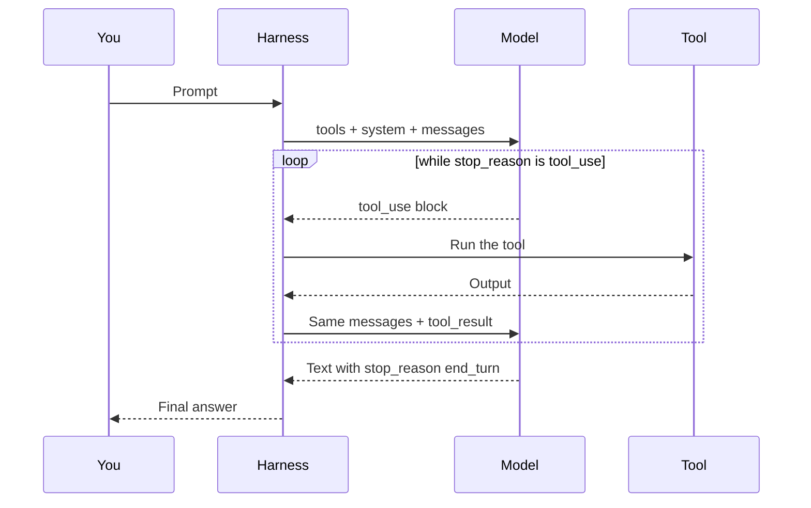
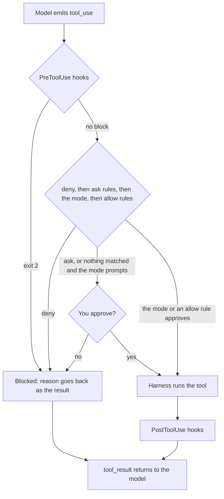
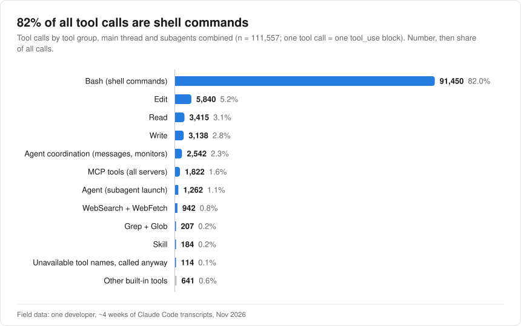

# 03 — The agentic loop and tool use

After this chapter you can explain what happens between your prompt and an agent's final answer, read
the `tool_use` and `tool_result` blocks in any transcript, and write a working tool loop in about 45
lines of Python. You will also know where Claude Code's permission check and hooks sit in that loop,
and when a fixed workflow is a better design than an agent.

## Mental model

A model cannot run anything. It only produces text. Tool use is a convention built on that limit: you
describe some functions to the model, and when it wants one it writes a structured request instead of
prose. Your program, the **harness**, runs the function and sends the output back as the next message.
The model reads the result and decides what to do next. This repeats until it answers in plain text.

The API docs put the contract this way: "The model never runs anything on its own. It emits a
structured request, your code (or Anthropic's servers) runs the operation, and the result flows back
into the conversation." That repetition is the **agentic loop**, and Anthropic's shortest definition
of an agent is "LLMs autonomously using tools in a loop." Claude Code, other coding agents and the
script below are all this loop, with different tools and different guardrails around it.



The figure draws the same loop as Claude Code runs it, including the hook and permission gates that
a later section of this chapter explains.


Two consequences follow, and the rest of the book leans on both:

- **The API is stateless.** Every pass round the loop resends the whole conversation, which is why
  caching and compaction exist ([chapter 04](04-prompt-caching-compaction-and-cost.md)).
- **The harness holds the power.** The model can only ask. Whatever decides if a request runs (a
  permission rule, a hook, a sandbox) lives in the harness.

## Three pieces of JSON

Everything in the loop is one of three shapes.

**1. A tool definition** goes from you to the model in the `tools` array: a name, a description and a
JSON Schema for the input.

```json
{
  "name": "get_weather",
  "description": "Get the current weather in a given location",
  "input_schema": {"type": "object", "required": ["location"],
                   "properties": {"location": {"type": "string", "description": "City and state"}}}
}
```

**2. A `tool_use` block** comes back from the model with an `id`, the tool `name` and the `input`.

```json
{"type": "tool_use", "id": "toolu_01", "name": "get_weather", "input": {"location": "San Francisco, CA"}}
```

**3. A `tool_result` block** goes back in the next user message with the matching `tool_use_id`, the
`content`, and optionally `is_error: true`.

```json
{"type": "tool_result", "tool_use_id": "toolu_01", "content": "Weather in San Francisco, CA: 72°F"}
```

The model never sees your code, only the name, description and schema, so write those as carefully as
a prompt. Anthropic's team says of an agent it built that "we actually spent more time optimizing
our tools than the overall prompt". One fix was to stop accepting relative paths: "we changed the
tool to always require absolute filepaths—and we found that the model used this method flawlessly."

## The loop, step by step

The client-side loop, as the docs give it:

1. Send a request with your `tools` array and the user message.
2. Claude responds with `stop_reason: "tool_use"` and one or more `tool_use` blocks.
3. Run each tool. Format the outputs as `tool_result` blocks.
4. Send a new request containing the original messages, the assistant's response, and a user message
   with the `tool_result` blocks.
5. Repeat from step 2 while `stop_reason` is `"tool_use"`.

Every response carries a `stop_reason`, and the harness branches on it:

| `stop_reason` | Meaning | What the harness does |
| :-- | :-- | :-- |
| `end_turn` | The model finished its answer | Show the text and wait for the next prompt |
| `tool_use` | It wants one or more tools run | Run them, append the results, call again |
| `max_tokens` | Output hit your `max_tokens` cap | If a `tool_use` block was cut off, "retry the request with a higher `max_tokens` value" |
| `stop_sequence` | Claude emitted one of the `stop_sequences` you set on the request | Read the response's `stop_sequence` field to see which one fired |
| `pause_turn` | "A server-tool loop reached its iteration limit" | Append the response `content` unchanged as an `assistant` message; resend with the same `tools` and no new user message |
| `refusal` | A safety classifier declined, as "a normal HTTP 200 response, not an error" | Check `stop_reason`, not only the HTTP status |
| `model_context_window_exceeded` | Generation ran into the context window limit | Shrink the context ([chapter 04](04-prompt-caching-compaction-and-cost.md)) |

## A minimal loop you can run

The script below is a complete agent with two read-only tools. Install the SDK with
`pip install anthropic`, set `ANTHROPIC_API_KEY`, and run it from inside a small project.

```python
# agent.py: a minimal agent with two read-only tools. Adapted from the manual loop in the API docs.
import pathlib
import anthropic

client = anthropic.Anthropic()
ROOT = pathlib.Path.cwd().resolve()

def schema(what):
    prop = {"type": "string", "description": f"{what}, relative to the project root"}
    return {"type": "object", "properties": {"path": prop}, "required": ["path"]}

tools = [
    {"name": "list_files", "description": "List the entries of a project directory. Use '.' for the root.",
     "input_schema": schema("Directory")},
    {"name": "read_file", "description": "Return the first 200 lines of a text file in the project.",
     "input_schema": schema("File")},
]

def execute_tool(name, tool_input):
    """Your code runs the tool. The model only ever sees the schema and this return value."""
    target = (ROOT / tool_input["path"]).resolve()
    if not target.is_relative_to(ROOT):
        raise ValueError("path is outside the project root")
    if name == "list_files":
        return "\n".join(sorted(p.name for p in target.iterdir())) or "(empty directory)"
    if name == "read_file":
        return "\n".join(target.read_text().splitlines()[:200]) or "(empty file)"
    raise ValueError(f"unknown tool: {name}")

messages = [{"role": "user", "content": "What does this project do? Look at the files before you answer."}]
for call in range(1, 21):  # hard ceiling: never leave an agent loop unbounded
    response = client.messages.create(model="claude-opus-5-5", max_tokens=16000, tools=tools, messages=messages)
    print(f"call {call}: stop_reason={response.stop_reason}")
    if response.stop_reason != "tool_use":
        break  # end_turn, max_tokens, refusal, pause_turn, model_context_window_exceeded
    messages.append({"role": "assistant", "content": response.content})  # unchanged, thinking included
    results = []
    for block in (b for b in response.content if b.type == "tool_use"):
        print(f"  tool_use: {block.name} {block.input}")
        try:
            result = {"content": execute_tool(block.name, block.input)}
        except Exception as exc:  # tell the model what went wrong so it can correct itself
            result = {"content": f"Error: {exc}", "is_error": True}
        results.append({"type": "tool_result", "tool_use_id": block.id, **result})
    messages.append({"role": "user", "content": results})  # ALL results in ONE user message, no text first

print(next((block.text for block in response.content if block.type == "text"), ""))
```

Four details in that code are rules, not style:

- **Echo the assistant message unchanged.** Current models think between tool calls, and "you must
  pass the thinking blocks from the assistant message back to the API, complete and unmodified."
- **Return every result in one user message, results first**: "return one `tool_result` for each
  `tool_use` block, all together in the next user message", each "before any text content".
- **Report failures.** `is_error: true` plus a message saying what to change lets the model fix its call.
- **Bound the loop.** Agents bring "higher costs, and the potential for compounding errors", and a
  ceiling on iterations is the cheapest guardrail there is.

> **Warning:** `read_file` returns anything under the project root, a `.env` file included, and that
> content is sent to the API. Run the script in a repository that holds no secrets.

> **Note:** The SDK can run this loop for you ("For most tool use implementations, use the tool
> runner"): `client.beta.messages.tool_runner(...)`, then `runner.until_done()`. Write it by hand once.

## Parallel tool calls

"By default, Claude may call multiple tools in a single response", and "The API doesn't prescribe an
execution order", so a harness may run them concurrently. The script above already copes: it collects
one result per `tool_use` block and sends them together.

- Sending each result in its own user message "“teaches” Claude to avoid parallel calls."
- To switch parallel calls off, "set `disable_parallel_tool_use: true` inside the `tool_choice`
  object. It is not a top-level request parameter."
- As of Nov 2026, Fable 5.2, Opus 5.5 and Sonnet 5.5 "reject forced tool use on every request with a
  400 error". Use `tool_choice: {"type": "auto"}` with strict tool use or structured outputs instead.

## Client tools and server tools

| Kind | Schema by | Runs on | Examples | What your loop sees |
| :-- | :-- | :-- | :-- | :-- |
| User-defined | You | Your machine | `list_files`, `get_weather` | `tool_use`; you return `tool_result` |
| Anthropic-schema | Anthropic | Your machine | `bash`, `text_editor`, `memory`, `computer`, `browser` | The same |
| Server-executed | Anthropic | Anthropic's servers | `web_search`, `web_fetch`, `code_execution`, `tool_search` | `server_tool_use` plus a result block such as `web_search_tool_result` |

- Anthropic-schema tools exist because "these schemas are trained-in": the model was optimised on
  many trajectories that use those exact signatures. You still execute them yourself.
- For server tools "You never construct a `tool_result` block". The API runs its own inner loop
  ("The default limit is 10 iterations for each request") and returns `pause_turn` when it runs out.
- Claude Code's shell and file tools (Bash, Read, Edit) run on your machine, and it forwards MCP tool
  calls to the MCP server ([chapter 12](12-mcp-how-it-works.md)), so it can check every call first.

## Tool definitions are context

"Tool definitions and accumulated `tool_result` blocks consume your context window." Sizes the docs
publish (as of Nov 2026):

| Item | Tokens |
| :-- | --: |
| Token-counting example without tools ("Hello, Claude" and a four-word system prompt) | 14 |
| Token-counting example with one small tool (`get_weather`) | 403 |
| Tool-use system prompt the API adds when you send `tools` (Opus 5.5, Sonnet 5.5, Haiku 5.5) | 286 |
| "A typical multiserver setup (GitHub, Slack, Sentry, Grafana, and Splunk)" | ~55,000 |

Size is not the only cost: "Claude's ability to pick the right tool degrades once you exceed 30–50
available tools." The fix is **tool search**, which defers loading. You still send every
definition, but you mark the rarely used ones `defer_loading: true` and add a search tool. A deferred
definition stays out of the context window until the model searches for it. A request fragment:

```json
{
  "tools": [
    {"type": "tool_search_tool_regex_20251119", "name": "tool_search_tool_regex"},
    {"name": "read_file", "description": "...", "input_schema": {"type": "object"}},
    {"name": "create_ticket", "description": "...", "input_schema": {"type": "object"}, "defer_loading": true}
  ]
}
```

- "`defer_loading` controls what enters the context window, not what you send in the request". Search
  hits come back as `tool_reference` blocks, which the API expands into full definitions.
- The docs report that tool search "typically reduces this by over 85 percent". Use it when "You have
  10 or more tools", and "Keep your 3–5 most frequently used tools non-deferred".
- **Claude Code does this for MCP servers by default**: "Only tool names and server instructions load
  at session start". `ENABLE_TOOL_SEARCH` changes that (`auto` loads definitions up front while they
  total under 10% of the context window, `false` always does), and `"alwaysLoad": true` on a server
  entry exempts one server ([chapter 13](13-mcp-in-practice.md)).
- Results cost context too, so harnesses cap them: Claude Code keeps Bash output inline "up to roughly
  30,000 characters", and Read returns "at most 25,000 tokens" per call.

## Where Claude Code puts its checks

Claude Code inserts gates between "the model emits `tool_use`" and "the harness runs the tool". A
`PreToolUse` **hook** is a script of yours that the harness runs just before a tool; a **permission
rule** is a setting that allows, asks about or denies matching tool calls.



- **Hooks run first.** "A hook that exits with code 2 stops the tool call before permission rules are
  evaluated". Exit 1 does not block: by default it is a non-blocking error and the call goes ahead.
- **Then permission rules.** "Rules are evaluated in order: deny, then ask, then allow." A hook cannot
  loosen them: "PreToolUse hook decisions don't bypass permission rules."
- **The permission mode sits between the ask and the allow rules.** `bypassPermissions`, and
  `acceptEdits` for file edits, approve at that step; in `default` and `dontAsk` the call goes on to
  the allow rules. Whatever is still unmatched is settled by the mode: prompt you, deny it (`dontAsk`),
  or in `auto` let a separate classifier model review it ([chapter 05](05-inside-the-harness.md)).
- **A block is a result, not a crash.** The refusal returns to the model as the tool result, and the
  model may try another route to the same effect. A guard has to cover every route, not one tool name.

Rules and modes are in [chapter 09](09-settings-and-permissions.md), hooks in [chapter 16](16-hooks.md).

## Workflows or agents

Not every LLM system needs an open-ended loop. Anthropic's "Building effective agents" (December 2024;
the tooling it lists has changed since, the vocabulary has stuck) draws the line:

- "**Workflows** are systems where LLMs and tools are orchestrated through predefined code paths."
- "**Agents**, on the other hand, are systems where LLMs dynamically direct their own processes and
  tool usage, maintaining control over how they accomplish tasks."

In a workflow your code decides the next step; in an agent the model does. The five workflow patterns:

| Pattern | How it works | Use it when |
| :-- | :-- | :-- |
| Prompt chaining | Each LLM call "processes the output of the previous one" | "the task can be easily and cleanly decomposed into fixed subtasks" |
| Routing | "classifies an input and directs it to a specialized followup task" | Inputs fall into "distinct categories that are better handled separately" |
| Parallelization | **Sectioning** splits a task into independent subtasks; **voting** runs the same task several times | Subtasks do not depend on each other, or you want several independent attempts |
| Orchestrator-workers | "a central LLM dynamically breaks down tasks, delegates them to worker LLMs, and synthesizes their results" | Subtasks "aren't pre-defined", such as a change touching an unknown set of files |
| Evaluator-optimizer | "one LLM call generates a response while another provides evaluation and feedback in a loop" | "we have clear evaluation criteria" and refinement gives measurable value |

The post's rule is to find "the simplest solution possible, and only increasing complexity when
needed", because agentic systems "often trade latency and cost for better task performance". Keep
agents "for open-ended problems where it's difficult or impossible to predict the required number of
steps". In Claude Code, subagents are orchestrator-workers ([chapter 14](14-subagents.md)) and
scripted multi-agent runs are workflows in exactly this sense
([chapter 26](26-multi-agent-orchestration.md)).

## From the field

These numbers come from one developer's Claude Code transcripts over about four weeks (89 main
sessions, 1,249 subagent runs, 111,557 tool calls). They describe one setup, not a benchmark, and 62
of 76 sessions ran in `bypassPermissions` mode, so stricter permissions may give a different mix.



| Tool group | Calls | Share | Error rate |
| :-- | --: | --: | --: |
| Bash | 91,450 | 81.98% | 2.42% |
| Edit | 5,840 | 5.23% | 2.26% |
| Read | 3,415 | 3.06% | 0.32% |
| Write | 3,138 | 2.81% | 1.34% |
| Agent coordination (messages, monitors, task stops) | 2,542 | 2.28% | 1.97% |
| MCP, all servers | 1,822 | 1.63% | 5.71% |
| Agent (subagent launch) | 1,262 | 1.13% | 1.11% |
| WebSearch and WebFetch | 942 | 0.84% | 0.74% |
| Everything else | 1,146 | 1.03% | n/a |
| **All tools** | 111,557 | 100% | 2.43% |

- **The shell is the universal tool.** Four of five calls were Bash, led by `grep` (15,208 calls),
  `sed` (15,002), inline `python3` scripts (9,381) and `cat` (7,399). The dedicated Grep and Glob
  tools got 207 calls together. What is on your `PATH` matters more than how many tools you connect.
- **One human prompt buys a lot of loop.** 1,195 human prompts produced 104,932 model responses and
  111,557 tool calls: 87.8 responses and 93.4 tool calls per prompt.
- **Parallel calls are the exception.** 86,776 responses carried exactly one tool call, 10,138 carried
  two or more (about 10%) and 8,018 none. The model batches inside Bash instead: 6.25 commands per call.
- **Errors are normal traffic.** 2.43% of calls returned `is_error: true` and the loop carried on. Of
  the 2,213 Bash errors, 17.8% were blocks by a `PreToolUse` hook, 9.2% refusals by the harness, and
  about 10% zsh quoting mistakes. In 114 calls the model asked for a tool name that did not exist
  (lowercase `bash`, for example) and got an error result every time.
- **The gates are in the hot path.** The logs hold 404,492 successful `PreToolUse` hook executions,
  3.63 per tool call, while hook blocks were 0.44% of tool calls. A slow hook taxes every call.

> **Field note:** The error rates are a floor. The harness flag misses a failure inside a command
> whose last segment succeeds (`| tail`, `|| true`), and the size of that gap was not measured.

## Common problems

| Symptom | Cause | Fix |
| :-- | :-- | :-- |
| The model ends its turn with an empty or tiny reply after tool results | A text block was added right after the `tool_result` blocks, which "sets a pattern of user input after every tool use" | Send the results alone; "Never add text blocks immediately after tool results" |
| The model stops calling tools in parallel | Each result went back in its own user message | Return all results together in one user message |
| A 400 error in the middle of a loop | The assistant message was edited, or `system` or `tools` changed mid-loop, so thinking blocks fail the prefix check | Append `response.content` unchanged; change nothing earlier in the conversation |
| `stop_reason` is `max_tokens` and the tool call is cut off | The output cap ended the `tool_use` block early | Retry with a higher `max_tokens` |
| A 400 error when you force a tool through `tool_choice` | Fable 5.2, Opus 5.5 and Sonnet 5.5 reject forced tool use (as of Nov 2026) | `tool_choice: {"type": "auto"}` plus strict tool use or structured outputs |
| Wrong tool picked, or a large context before any work starts | Too many definitions loaded up front | Tool search with `defer_loading`; fewer, clearer tools; disconnect MCP servers you do not use |
| The loop stops early with `pause_turn` | A server tool reached its 10-iteration limit | Resend with the response `content` as an `assistant` message, same `tools`, no new user message |
| Your guard hook runs but the tool call still happens | The hook exits 1, a non-blocking error | Exit 2 to block ([chapter 16](16-hooks.md)) |

## Checklist

- [ ] My loop continues only while `stop_reason` is `"tool_use"` and handles every other value.
- [ ] I append the assistant's `content` unchanged and return all results in one user message.
- [ ] A failing tool returns `is_error: true` with a message that says what to change.
- [ ] The loop has a ceiling on iterations, tokens or spend.
- [ ] I know roughly how many tokens my tool definitions cost and I defer the rarely used ones.
- [ ] I can say where hooks and permission rules run relative to a tool call in Claude Code.
- [ ] I picked a workflow instead of an agent wherever the steps are known in advance.

## Try it

1. **Run the loop.** Run `agent.py` in a small repository and count the API calls and tool calls it
   prints. Then make `read_file` raise for one file name and watch the model react to `is_error`.
2. **Price your tools.** Call `client.messages.count_tokens(...)` twice with the same `model` and
   `messages`, once with `tools=tools` and once without. The difference is paid on every call.
3. **Draw your own gate.** Pick one risky action in your project, such as deleting a directory, and
   mark on the flowchart above where you would stop it: a hook, a deny rule, or a prompt.

## Sources

- How tool use works: https://platform.claude.com/docs/en/agents-and-tools/tool-use/how-tool-use-works
- Handling stop reasons: https://platform.claude.com/docs/en/build-with-claude/handling-stop-reasons
- Parallel tool use: https://platform.claude.com/docs/en/agents-and-tools/tool-use/parallel-tool-use
- Manage tool context: https://platform.claude.com/docs/en/agents-and-tools/tool-use/manage-tool-context
- Tool search tool: https://platform.claude.com/docs/en/agents-and-tools/tool-use/tool-search-tool
- Thinking (round-tripping thinking blocks): https://platform.claude.com/docs/en/build-with-claude/thinking
- Token counting: https://platform.claude.com/docs/en/build-with-claude/token-counting
- Python SDK (`pip install anthropic`): https://platform.claude.com/docs/en/cli-sdks-libraries/sdks/python
- Pricing (tool-use token overhead): https://platform.claude.com/docs/en/about-claude/pricing
- Claude Code, MCP tool search: https://code.claude.com/docs/en/mcp#scale-with-mcp-tool-search
- Claude Code, permissions: https://code.claude.com/docs/en/permissions#precedence-among-rules-hooks-and-mods
- Claude Code, hooks: https://code.claude.com/docs/en/hooks
- Claude Code, permission modes: https://code.claude.com/docs/en/permission-modes
- Claude Code, tools reference: https://code.claude.com/docs/en/tools-reference
- Building effective agents: https://www.anthropic.com/research/building-effective-agents
- Effective context engineering for AI agents: https://www.anthropic.com/research/effective-context-engineering-for-ai-agents
- Field data: the author's Claude Code transcripts, a window of about four weeks ending 2026-11-25.

---

[← Previous: LLMs, tokens and the context window](02-llms-tokens-and-the-context-window.md) · [Contents](README.md) · [Next: Prompt caching, compaction and cost →](04-prompt-caching-compaction-and-cost.md)
