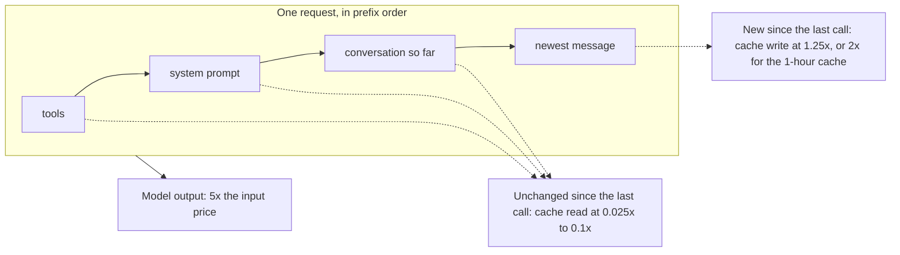
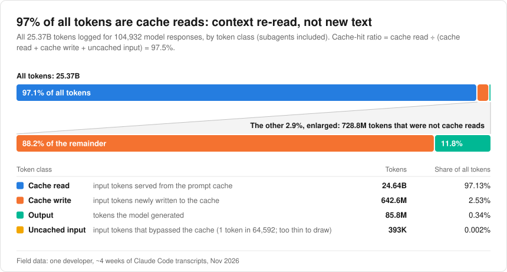
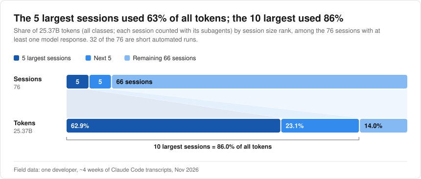

# 04 — Prompt caching, compaction and cost

After this chapter you can read the token counters in a usage report, estimate what an agent session
costs with and without caching, and say what compaction keeps and what it drops. You will also know
which everyday actions throw the cache away, and the habits that keep long sessions cheap.

## Mental model

The loop from [chapter 03](03-the-agentic-loop-and-tool-use.md) has an expensive property: the API is
stateless, so every call resends the whole conversation. Call 50 pays again for everything in calls 1
to 49, and the cost of an uncached session grows roughly with the square of its length. Three
mechanisms keep that affordable:

- **Prompt caching makes the repeated part cheap.** The API stores the processed prefix of a request.
  If the next request starts with exactly the same content, those tokens are billed at a small
  fraction of the input price. Caching changes price, not size: "[Cached prompt prefixes still occupy
  the context window](https://platform.claude.com/docs/en/build-with-claude/context-windows): prompt caching changes what you pay for those tokens, not whether they count."
- **Compaction makes the repeated part small.** Older turns are replaced by a summary. That frees the
  window and shrinks every later call, and it loses detail.
- **Effort sets how much the model writes.** Output tokens, thinking included, [cost five times the
  input price](https://platform.claude.com/docs/en/about-claude/pricing) on every current model (see the price table below).



## How prompt caching works

A request is cached as a **prefix**. [The order is fixed](https://platform.claude.com/docs/en/build-with-claude/prompt-caching): "`tools`, `system`, and `messages` (in that
order), up to and including the block designated with `cache_control`." That marker is a **cache
breakpoint**, and there are two ways to place it:

- **Automatic.** Put one `cache_control` field at the top level of the request: "[The system
  automatically applies the cache breakpoint](https://platform.claude.com/docs/en/build-with-claude/prompt-caching) to the last cacheable block and moves it forward as
  conversations grow." This is the natural choice for a tool loop.
- **Explicit.** Put `cache_control` on individual content blocks, up to 4 breakpoints per request.
  Use it when an early part of the prompt is stable and a later part is not.

```python
import anthropic

client = anthropic.Anthropic()
contract = "Here is the full text of a complex legal agreement: [paste 50 pages of text here]"
response = client.messages.create(
    model="claude-opus-5-5",
    max_tokens=16000,
    system=[
        {"type": "text", "text": "You are an AI assistant tasked with analyzing legal documents."},
        {"type": "text", "text": contract, "cache_control": {"type": "ephemeral"}},  # "ttl": "1h" for 1 hour
    ],
    messages=[{"role": "user", "content": "What are the key terms and conditions in this agreement?"}],
)
print(response.usage.model_dump_json())
# Automatic alternative: drop the block marker and pass cache_control={"type": "ephemeral"} at top level.
```

The rules behind almost every caching surprise (as of Nov 2026):

| Rule | Detail |
| :-- | :-- |
| Exact match | "[Cache hits require 100 percent identical prompt segments](https://platform.claude.com/docs/en/build-with-claude/prompt-caching), including all text and images" up to the breakpoint |
| Writes happen only at breakpoints | A marker "[writes exactly one cache entry](https://platform.claude.com/docs/en/build-with-claude/prompt-caching): a hash of the prefix ending at that block" |
| Reads look backward | From the breakpoint the API walks back up to 20 blocks, "[looking for prior writes, not for stable content](https://platform.claude.com/docs/en/build-with-claude/prompt-caching)" |
| Lifetime (TTL) | "[By default, the cache has a 5-minute lifetime.](https://platform.claude.com/docs/en/build-with-claude/prompt-caching) The cache is refreshed for no additional cost each time the cached content is used." A 1-hour option exists |
| The clock starts early | Lifetime is measured "[from the start of the request](https://platform.claude.com/docs/en/build-with-claude/prompt-caching)", so after a 4-minute response you have about 1 minute left |
| Minimum size | 512 tokens on Fable 5.2, Opus 5.5, Sonnet 5.5 and Haiku 5.5; a shorter prefix is "[processed without caching, and no error is returned](https://platform.claude.com/docs/en/build-with-claude/prompt-caching)" |
| Concurrency | "[a cache entry only becomes available after the first response starts](https://platform.claude.com/docs/en/build-with-claude/prompt-caching)", so send one request before you fan out |
| Isolation | "[Different organizations never share caches](https://platform.claude.com/docs/en/build-with-claude/prompt-caching)", and "There's no way to manually clear the cache" |

## What it costs, and how the API reports it

[Prices in USD per million tokens](https://platform.claude.com/docs/en/about-claude/pricing) (MTok), as published on 2026-11-25:

| Model | Input | Output | 5-minute cache write | 1-hour cache write | Cache read |
| :-- | --: | --: | --: | --: | --: |
| Claude Fable 5.2 | $8 | $40 | $10 | $16 | $0.20 (0.025x) |
| Claude Opus 5.5 | $4 | $20 | $5 | $8 | $0.20 (0.05x) |
| Claude Sonnet 5.5 | $2 | $10 | $2.50 | $4 | $0.10 (0.05x) |
| Claude Haiku 5.5, prompt up to 100,000 tokens | $0.10 | $0.50 | $0.125 | $0.20 | $0.01 (0.1x) |
| Claude Haiku 5.5, prompt over 100,000 tokens | $0.50 | $2.50 | $0.625 | $1 | $0.05 (0.1x) |

The pattern: a 5-minute write costs 1.25x the input price, a 1-hour write 2x, and a read 0.1x "on most
models" and less on the newest ones. A 5-minute write pays for itself "[after one cache read](https://platform.claude.com/docs/en/about-claude/pricing)", a 1-hour
write "after two cache reads".

Every response reports the split in its `usage` object:

| Field | What it counts | Billed at |
| :-- | :-- | :-- |
| `cache_read_input_tokens` | Prefix tokens found in the cache | Cache read price |
| `cache_creation_input_tokens` | Tokens this request wrote to the cache | Cache write price |
| `input_tokens` | "[only the tokens that come](https://platform.claude.com/docs/en/build-with-claude/prompt-caching) **after the last cache breakpoint**" | Input price |
| `output_tokens` | Everything the model generated, thinking included | Output price |

Total input is the sum of the first three, and all three count toward the context window. "[if both](https://platform.claude.com/docs/en/build-with-claude/prompt-caching)
`cache_creation_input_tokens` and `cache_read_input_tokens` are 0, the prompt was not cached". In this
book, **cache-hit ratio** means cache read ÷ (input + cache read + cache creation).

## Worked example: a 50-turn session

Take a small agent session on Claude Opus 5.5, where a turn is one API call: one trip round the loop.
Every dollar figure in this section is this book's own arithmetic from the price table above, not a
number the docs publish. The model is deliberately simple:

- The stable prefix (tool definitions, system prompt, project instructions) is 20,000 tokens.
- Every call adds 2,000 new tokens to the conversation: the previous reply plus fresh tool results.
- Every call produces 500 output tokens.
- There are 50 calls, each inside the cache lifetime of the one before, and the prefix never changes.

The prompt on call *n* is 20,000 + 2,000 × *n* tokens: 22,000 on call 1 and 120,000 on call 50.

**Without caching**, every call pays the input price for its whole prompt:

| Line | Arithmetic | Result |
| :-- | :-- | --: |
| Input tokens | 50 × 20,000 + 2,000 × (1 + 2 + … + 50) = 1,000,000 + 2,000 × 1,275 | 3,550,000 |
| Input cost | 3.55 MTok × $4 | $14.20 |
| Output cost | 50 × 500 = 25,000 tokens = 0.025 MTok × $20 | $0.50 |
| **Total** | | **$14.70** |

**With automatic caching**, call 1 writes its whole prompt. Every later call reads the previous call's
prompt from the cache and writes only its 2,000 new tokens:

| Line | Arithmetic | Result |
| :-- | :-- | --: |
| Cache writes | 22,000 + 49 × 2,000 | 120,000 |
| Cache reads | 49 × 20,000 + 2,000 × (1 + 2 + … + 49) = 980,000 + 2,000 × 1,225 | 3,430,000 |
| Write cost | 0.12 MTok × $5 | $0.60 |
| Read cost | 3.43 MTok × $0.20 | $0.686 |
| Output cost | unchanged | $0.50 |
| **Total** | | **$1.79** |

Check: 120,000 + 3,430,000 = 3,550,000, the same input tokens as before. Only the price changed. The
cache-hit ratio is 3,430,000 ÷ 3,550,000 = 96.6%. The same session on other models (Haiku 5.5 is left
out because this session crosses its 100,000-token price step at call 41):

| Model | Without caching | With caching | Ratio |
| :-- | --: | --: | --: |
| Claude Fable 5.2 | $29.40 | $2.89 | 10.2x |
| Claude Opus 5.5 | $14.70 | $1.79 | 8.2x |
| Claude Sonnet 5.5 | $7.35 | $0.89 | 8.2x |

1. **Caching is what makes the loop affordable.** The input side falls from $14.20 to $1.29.
2. **A miss re-buys the whole prefix.** If the cache has expired, call 51 writes all 122,000 tokens:
   0.122 MTok × $5 = $0.61. A hit would have cost 0.12 MTok × $0.20 + 0.002 MTok × $5 = $0.034. One
   miss costs as much as every cache write in the session so far.
3. **Output becomes a big line.** With input cached, 25,000 output tokens are 28% of the bill.

> **Note:** These are API list prices. On a subscription you see plan usage bars instead of a bill;
> the dollar figure Claude Code shows in `/usage` is computed locally "[from token counts at list price](https://code.claude.com/docs/en/costs)".

## What breaks the cache

The prefix is ordered `tools`, then `system`, then `messages`, and [a change at one level invalidates](https://platform.claude.com/docs/en/build-with-claude/prompt-caching)
that level and everything after it:

| What changed | What is lost |
| :-- | :-- |
| Any tool definition | Everything |
| Web search toggle, citations toggle, `speed` setting | System prompt and messages |
| `tool_choice`, `disable_parallel_tool_use`, images added or removed | Messages |
| Thinking parameters, `output_config.effort` | Messages always; tools and system too on some models |
| A timestamp or per-request value inside the cached prefix | Every request: "[You pay for a fresh cache write on every request and never get a read.](https://platform.claude.com/docs/en/build-with-claude/prompt-caching)" |
| More idle time than the TTL | Everything |

In Claude Code the same rules surface as [five documented invalidators](https://code.claude.com/docs/en/prompt-caching): "Switching models", "Changing
effort level", "Connecting or removing an MCP server", "Compacting the conversation" and "Upgrading
Claude Code". Its cache lifetime depends on how you pay: about "[an hour on a subscription and five
minutes](https://code.claude.com/docs/en/best-practices) on an API key, cloud provider, or usage credits. Subagents get five minutes unless you change
it."

Two ways to change behaviour mid-session and keep the prefix (as of Nov 2026):

- Add an instruction by appending a `{"role": "system"}` message to `messages` "[instead of editing the](https://platform.claude.com/docs/en/build-with-claude/prompt-caching)
  top-level `system` field" (Fable 5.2, Opus 5.5, Sonnet 5.5 and Haiku 5.5; not Sonnet 5).
- Add tools through tool search: "[Deferred tools are not included in the system-prompt prefix](https://platform.claude.com/docs/en/agents-and-tools/tool-use/tool-use-with-prompt-caching) ... The
  prefix is untouched, so prompt caching is preserved."

## Compaction and context editing

Caching does nothing about size. **Compaction** does: it "[replaces the older turns of a conversation
with a summary](https://platform.claude.com/docs/en/build-with-claude/compaction) that Claude writes on the server". On the API it is in beta (as of Nov 2026) in two
forms: on demand, and at a token threshold ([default trigger: 150,000 input tokens](https://platform.claude.com/docs/en/build-with-claude/compaction-threshold)).

- Everything before the summary is dropped, thinking included: "[the summary is all the model has of
  that earlier work.](https://platform.claude.com/docs/en/build-with-claude/compaction-threshold)" Images, documents and fetched URLs in the summarised range "[are gone](https://platform.claude.com/docs/en/build-with-claude/compaction-on-demand)".
- It is not free: "Compaction requires an additional sampling step, which contributes to rate limits
  and billing", and the model named in your request writes the summary.

**Context editing** is the finer tool: "[the API automatically clears the oldest tool results](https://platform.claude.com/docs/en/build-with-claude/context-editing) in
chronological order" and leaves a placeholder (defaults: trigger at 100,000 input tokens, keep the 3
most recent tool uses). It also "Invalidates cached prompt prefixes when content is cleared". The docs
call compaction "[the primary strategy](https://platform.claude.com/docs/en/build-with-claude/context-windows)" and context editing the option for fine-grained control.

### What Claude Code does

"[Claude Code compacts automatically as you approach the limit](https://code.claude.com/docs/en/context-window#what-survives-compaction), so a full context window doesn't end
your session." With a 1M window that happens "[at about 967K tokens by default](https://code.claude.com/docs/en/model-config)". You can lower the
threshold with `/autocompact` (for example `/autocompact 500k`, v2.1.221 or later), or compact when
you choose with `/compact [instructions]`, for example `/compact focus on the auth bug fix`.

"[The summary keeps your requests and key code snippets](https://code.claude.com/docs/en/how-claude-code-works#when-context-fills-up), but detailed instructions from early in the
conversation may be lost." Claude Code then [rebuilds part of the context from disk](https://code.claude.com/docs/en/context-window#what-survives-compaction):

| Item | After compaction |
| :-- | :-- |
| System prompt and output style | "Both still apply" |
| Project-root CLAUDE.md, unscoped rules, auto memory, the plan-mode plan | "Re-injected from disk" |
| Skill descriptions | Rebuilt and re-injected (v2.1.304 or later) |
| Bodies of skills you invoked | Re-injected, "capped at 5,000 tokens per skill and 25,000 tokens total; oldest dropped first" |
| Files Claude read or edited | "re-reads up to five, most recently modified first"; a file over 5,000 tokens returns as a path only |
| Path-scoped rules and nested CLAUDE.md files | Gone until a matching file is touched again |
| Context that hooks added earlier | "Summarized with the rest of the conversation" |
| Background commands and subagents | Keep running; Claude is reminded which ones |

To steer the summary, add a section like this to CLAUDE.md:

```markdown
# Compact instructions
Keep: the current plan, the list of changed files, failing test names with their error messages.
Drop: directory listings, passing test output, abandoned approaches.
```

> **Warning:** Compaction is itself a cost event. The docs call `/compact` "[a large request](https://code.claude.com/docs/en/costs)" and list
> "Compacting the conversation" among the cache invalidators, while "`/clear` costs nothing". If the
> next task is unrelated, clear instead of compacting.

## Thinking and effort

Thinking is output: "[the tokens Claude spends reasoning are billed as output tokens](https://platform.claude.com/docs/en/build-with-claude/thinking), even when the
thinking text isn't returned to you, and they count toward `max_tokens`".

- Hiding thinking saves nothing: "[Omitting reduces latency, not cost.](https://platform.claude.com/docs/en/build-with-claude/thinking)"
- On current models earlier thinking stays in the conversation, so "budget your context window as if
  thinking were ordinary conversation history, because it is."
- On the API, Fable 5.2 and Opus 5.5 reject `thinking: {type: "disabled"}`, and Claude Code cannot turn
  thinking off on any current model (as of Nov 2026). The control you have is **effort**.

Effort is `output_config.effort` on the API, with levels `low`, `medium`, `high`, `xhigh` and `max`.
It "[affects](https://platform.claude.com/docs/en/build-with-claude/effort) **all tokens** in the response" (text, tool calls and thinking), and "Lower effort also
means fewer and terser tool calls." It is guidance, not a cap: "Effort is a behavioral signal, not a
strict token budget." The hard ceiling is `max_tokens`.

| Where | Default effort (as of Nov 2026) | How to change it |
| :-- | :-- | :-- |
| [Claude API](https://platform.claude.com/docs/en/build-with-claude/effort) | `high` on Fable 5.2 and Sonnet 5.5; `medium` on Opus 5.5 and Haiku 5.5 | `output_config.effort` |
| [Claude Code](https://code.claude.com/docs/en/model-config) | `medium` on Fable 5.2, Opus 5.5, Sonnet 5.5 and Haiku 5.5 | `/effort <level>`, `claude --effort <level>`, or the `effortLevel` and per-model `modelSettings` settings (a top-level `effortLevel` in user settings "doesn't count for Opus 5.5") |

Two cost rules. First, "Tuning effort is often a better lever than switching models". Second, change
effort at a task boundary, because "[Changing the top-level effort value](https://platform.claude.com/docs/en/build-with-claude/effort) between requests can
invalidate all or part of the prompt cache". For one hard question, Claude Code's `ultrathink` keyword
requests "[deeper reasoning on that turn](https://code.claude.com/docs/en/model-config) without changing your session effort setting".

## What agents and multi-agent systems multiply

Anthropic's write-up of its multi-agent research system (June 2025) gives the reference numbers:
"[agents typically use about 4× more tokens than chat interactions](https://www.anthropic.com/research/multi-agent-research-system), and multi-agent systems use about
15× more tokens than chats." Claude Code's cost docs add one for agent teams (several sessions working
as teammates; experimental and off by default): "[approximately 7x more tokens than standard sessions](https://code.claude.com/docs/en/costs)
when teammates run in plan mode".

The post also says why anyone pays that: "[Multi-agent systems work mainly because they help spend
enough tokens](https://www.anthropic.com/research/multi-agent-research-system) to solve the problem", and on one evaluation "token usage by itself explains 80% of the
variance". It pays for "valuable tasks that involve heavy parallelization, information that exceeds
single context windows, and interfacing with numerous complex tools", and less for code, because
"most coding tasks involve fewer truly parallelizable tasks than research".

Fan-out also meets the cache. A fresh subagent has a "[Separate cache](https://code.claude.com/docs/en/prompt-caching)", so it starts cold and writes
its own prefix, while a fork (a subagent that starts with a copy of your conversation) shares the
parent's cache ([chapter 14](14-subagents.md)). For scale, the
Claude Code docs put the average at "[around $13 per developer per active day](https://code.claude.com/docs/en/costs) and $150-250 per
developer per month, with costs remaining below $30 per active day for 90% of users".

## Habits that keep sessions cheap

1. **Keep the prefix stable.** No timestamps or per-request values in anything cached; put what
   changes last. Switch model, effort and MCP servers at task boundaries, not mid-task.
2. **Respect the clock.** On API-key billing the cache lives five minutes. Ask the follow-up now, or
   accept a full re-write after the break.
3. **Clear between unrelated tasks.** "`/clear` costs nothing", and "[a focused context gets you better
   answers and costs less](https://code.claude.com/docs/en/best-practices)".
4. **Compact at a boundary you choose**, with a focus, not at 967K tokens in the middle of a change.
5. **Keep the standing load small.** CLAUDE.md under 200 lines, procedures moved into skills, unused
   MCP servers disabled, CLIs such as `gh` preferred where they do the same job.
6. **Give noisy work to a subagent** so its output stays out of your window, and use a cheaper model
   (`model: haiku`) for simple ones.
7. **Cap unattended runs.** In `claude -p`, set `--max-turns` and `--max-budget-usd` ("Spend can pass
   the cap, so leave headroom").
8. **Measure.** `/usage` shows session cost and a `Prompt cache (main)` line with [the likely cause of
   a miss](https://code.claude.com/docs/en/prompt-caching); `/context` shows what fills the window.

## From the field

These numbers come from about four weeks of one developer's Claude Code transcripts: 104,932 model
responses, subagents included. They describe one setup, not a benchmark.

**Almost every token was a cache read.** Of 25.37 billion tokens, 24.64 billion (97.1%) were cache
reads, 642.6 million (2.5%) cache writes, 85.8 million (0.3%) output and 393 thousand uncached input.
The cache-hit ratio was 97.5%.



At Nov 2026 list prices, the Opus 5.5 and Sonnet 5.5 cache reads (15.20B and 8.47B tokens) come to
about $3,900. The same tokens as uncached input would be about $77,700. Both figures are this book's
arithmetic from the logged token counts and the price table, not a bill. The harness's own cost
estimate for the window was $5,916 to $6,594, and the analysis calls that a floor.

**The documented lifetimes show in the logs.** Every main-thread cache write used the 1-hour TTL and
every subagent write the 5-minute TTL. The main thread hit 99.0% and subagents 96.1%. Subagents
produced 82% of all cache-write tokens: each one starts with a cold cache of its own.

**A few sessions are most of the total.** Among the 76 sessions with at least one response, the 5
largest held 62.9% of all tokens and the 10 largest 86.0%. The median session used 1.8M tokens and
the largest 7.75B.



**Compaction is routine in long sessions.** 20 sessions (45% of the interactive ones) compacted their
main thread, 84 times in total, always automatically. Context at compaction had a median of 423k
tokens and a 90th percentile of 968k, and fell to a median of 33k afterwards.

> **Field note:** In a product workspace, one session reached 221 MB of transcript and 214
> compactions. Tool output was the first suspect. Measurement said otherwise: injected attachments
> were 46% of the content and all tool results about 9%. A task list holding 100 completed tasks had
> been re-injected 1,263 times, and hooks had fired 33,295 times, among them a plugin registered on
> four events with no rules configured. The fix: disable unused plugins and prune finished tasks.
> "Measure before diagnosing." (Counts are as written in that project's decision log, not re-measured.)

## Common problems

| Symptom | Cause | Fix |
| :-- | :-- | :-- |
| `cache_read_input_tokens` stays 0 while `cache_creation_input_tokens` is high on every call | The breakpoint sits on a block that changes per request, or something early in the prefix changes | "[Place](https://platform.claude.com/docs/en/build-with-claude/prompt-caching) `cache_control` on the last block whose prefix is identical across the requests you want to share a cache" |
| Both cache fields are 0 | No `cache_control`, or the prefix is under the minimum (512 tokens on current models) | Add the marker; accept that short prompts are not cached |
| The first message after a break is slow and expensive | The TTL ran out: five minutes on API-key billing, about an hour on a subscription | Keep related questions together; `/clear` if the task changed |
| The cache is lost after "one small change" | You switched model, changed effort, connected or removed an MCP server, or upgraded Claude Code | Make those changes at task boundaries; read the `Prompt cache (main)` line in `/usage` |
| Parallel requests all pay the write price | "a cache entry only becomes available after the first response starts" | Send one request, wait for its response to start, then fan out |
| A rule is followed early in the session and ignored later | It lived only in the conversation or in a path-scoped file, and compaction summarised it away | Put it in project-root CLAUDE.md; if it must never bend, make it a hook or deny rule |
| `Autocompact is thrashing` error | [One oversized file or tool result](https://code.claude.com/docs/en/troubleshooting) refills the window after each summary | Read in chunks, move the work to a subagent, `/compact` with a narrow focus, or `/clear` |
| Usage limit drains fast when several agents run | Fan-out multiplies tokens and every fresh subagent starts with a cold cache | Fewer agents, `model: haiku` for simple ones, `--max-turns` and `--max-budget-usd` on unattended runs |

## Checklist

- [ ] My prompt keeps stable content first (tools, system) and volatile content last.
- [ ] I check `cache_read_input_tokens` or `/usage` instead of assuming that caching works.
- [ ] I know my cache lifetime (five minutes or one hour) and I plan breaks around it.
- [ ] I change model, effort and MCP servers at task boundaries, not in the middle of a task.
- [ ] Rules that must survive compaction live in project-root CLAUDE.md or in a hook.
- [ ] I use `/clear` between unrelated tasks and `/compact` with a focus at natural boundaries.
- [ ] Unattended and multi-agent runs have a cap on turns or budget.

## Try it

1. **Watch the cache work.** Run the caching snippet twice within five minutes with a system prompt of
   at least 512 tokens, and compare the two `usage` outputs. Then change one character at the start of
   the system prompt and run it again.
2. **Redo the arithmetic.** Reproduce the worked example in a spreadsheet or a few lines of Python,
   then change one assumption: 200 calls instead of 50, or a cache miss on every tenth call.
3. **See what survives.** In a Claude Code session with some history, run `/context`, then
   `/compact focus on <your current task>`, then `/context` again. Note what came back.

## Sources

- Prompt caching: https://platform.claude.com/docs/en/build-with-claude/prompt-caching
- Pricing: https://platform.claude.com/docs/en/about-claude/pricing
- Tool use with prompt caching: https://platform.claude.com/docs/en/agents-and-tools/tool-use/tool-use-with-prompt-caching
- Context windows: https://platform.claude.com/docs/en/build-with-claude/context-windows
- Compaction: https://platform.claude.com/docs/en/build-with-claude/compaction
- Compaction at a threshold: https://platform.claude.com/docs/en/build-with-claude/compaction-threshold
- Compaction on demand: https://platform.claude.com/docs/en/build-with-claude/compaction-on-demand
- Context editing: https://platform.claude.com/docs/en/build-with-claude/context-editing
- Thinking: https://platform.claude.com/docs/en/build-with-claude/thinking
- Effort: https://platform.claude.com/docs/en/build-with-claude/effort
- Claude Code, what survives compaction: https://code.claude.com/docs/en/context-window#what-survives-compaction
- Claude Code, when context fills up: https://code.claude.com/docs/en/how-claude-code-works#when-context-fills-up
- Claude Code, model configuration (auto-compact, effort): https://code.claude.com/docs/en/model-config
- Claude Code, costs: https://code.claude.com/docs/en/costs
- Claude Code, prompt caching: https://code.claude.com/docs/en/prompt-caching
- Claude Code, best practices: https://code.claude.com/docs/en/best-practices
- Claude Code, troubleshooting: https://code.claude.com/docs/en/troubleshooting
- How we built our multi-agent research system: https://www.anthropic.com/research/multi-agent-research-system
- Field data: the author's transcripts (about four weeks to 2026-11-25) and a product workspace's decision log.

---

[← Previous: The agentic loop and tool use](03-the-agentic-loop-and-tool-use.md) · [Contents](README.md) · [Next: Inside the harness: architecture and what happens under the hood →](05-inside-the-harness.md)
