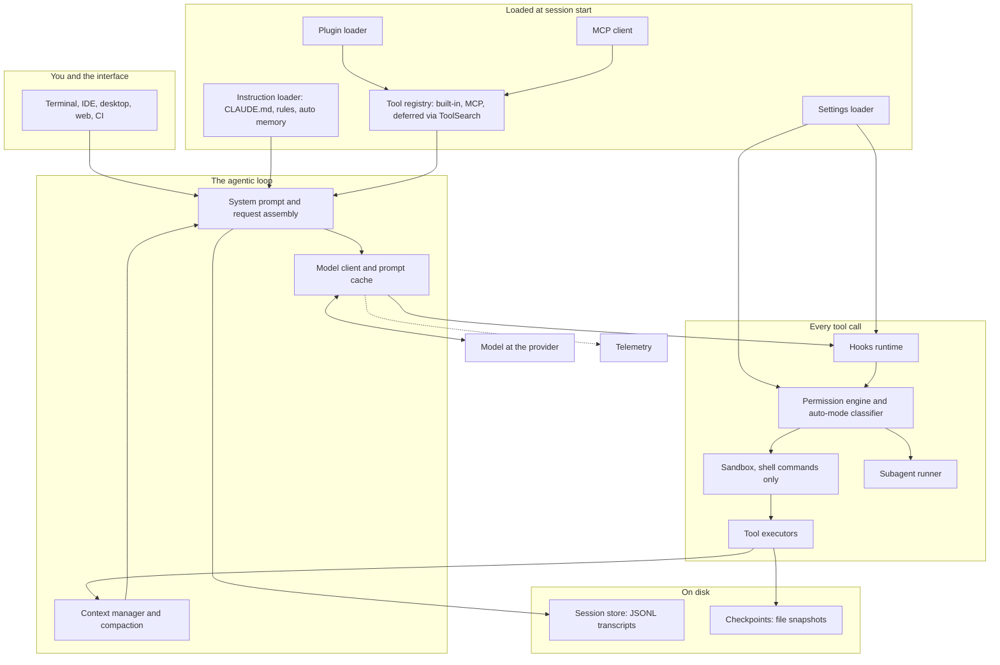
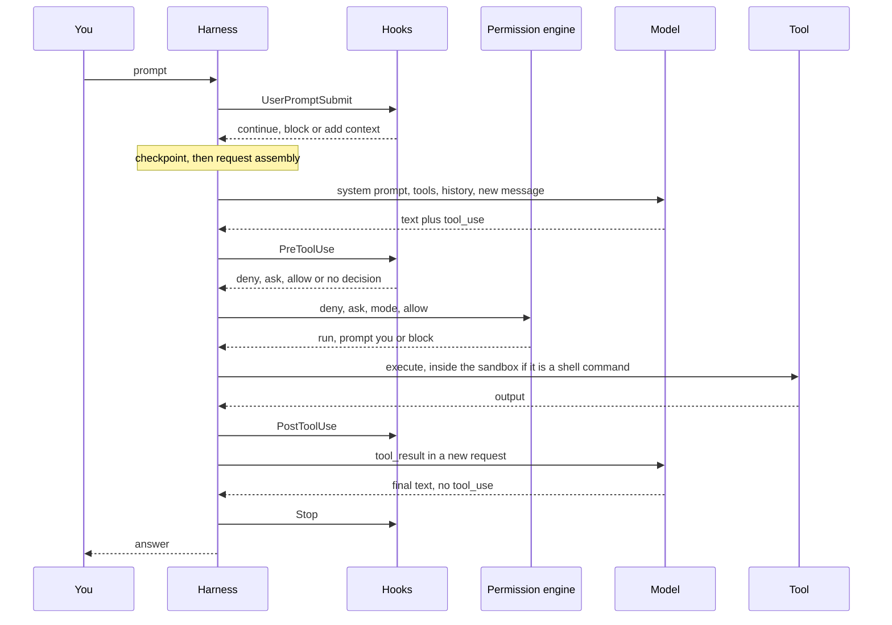
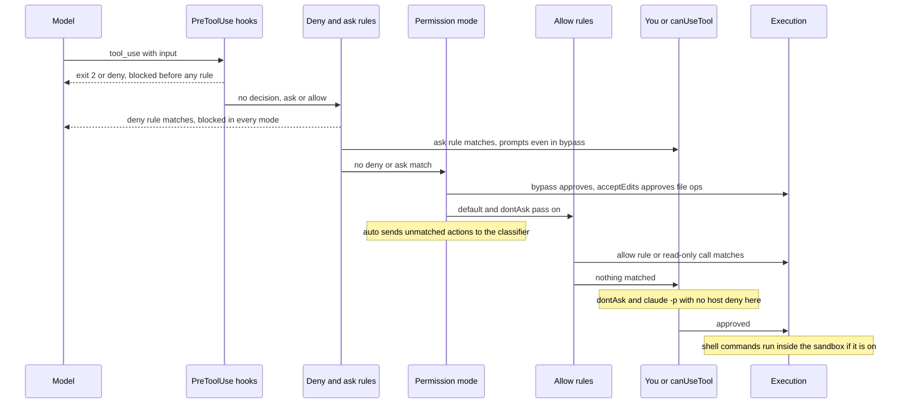

# 05 — Inside the harness: architecture and what happens under the hood

After this chapter you can name the parts of Claude Code that sit around the model, follow one prompt through every check it passes, and say what the model receives on each request. You will also know where each piece of state lives, what survives `/clear`, compaction, resume and rewind, and which guarantees hold no matter what the model decides.

## Mental model

The docs draw the line in one sentence: "Claude Code is the layer around the model that provides the tools and manages the context the model sees. This surrounding layer is what the term agentic harness refers to." The model reasons and asks for tools. The harness loads your configuration, builds every request, runs the tools, enforces the rules and writes everything to disk. "The model never runs anything on its own"; it emits a structured request, and the harness decides what happens to it.

The docs publish no component diagram and no internal module names. The boxes below use the docs' feature names, grouped by when they act. Treat it as a map of documented behaviour, not of the source code.



The figure from [chapter 03](03-the-agentic-loop-and-tool-use.md) zooms in on the loop band: your prompt joins the conversation, the model reads the whole context and replies, and each tool call it asks for passes your `PreToolUse` hooks (exit code 2 blocks the call) and then the permission check: `deny`, then `ask`, then the mode, then `allow` (each step is explained in [Settings and permissions inside the harness](#settings-and-permissions-inside-the-harness)), before the harness runs it. The result is appended and a new request goes out, until a reply contains no tool call.


## The components, one line each

| Component | What the docs say it does | Depth |
|---|---|---|
| UI / input | Terminal, IDE, desktop, web, Remote Control, CI; "the underlying agentic loop is identical". `Esc` cancels the running tool call; text typed mid-turn is read "as soon as those calls finish, within the same turn" | [06](06-install-and-first-session.md) |
| Settings loader | Merges five settings scopes; reloads `permissions` and `hooks` live | Below, [09](09-settings-and-permissions.md) |
| Instruction loader | CLAUDE.md hierarchy, `@` imports, `.claude/rules/`, `AGENTS.md` fallback, auto memory; read at session start and held in memory | [08](08-claude-md-and-memory.md) |
| System prompt and request assembly | Builds the system prompt and re-sends the full context each request; adds *system reminders*, messages wrapped in `<system-reminder>` tags carrying CLAUDE.md, skill and subagent lists, hook context and file-changed notes | Below |
| Tool registry | 53 built-in tool names as of Nov 2026; core tools load every request, MCP and other tools are deferred behind `ToolSearch` by default; skills add no tools, they run "through the existing `Skill` tool" | [03](03-the-agentic-loop-and-tool-use.md), [12](12-mcp-how-it-works.md) |
| Model client | Stateless requests, streaming, retries announced as `system/api_retry` events, `--fallback-model` when the primary is overloaded | [04](04-prompt-caching-compaction-and-cost.md) |
| Agentic loop | Repeats "until it produces a response with no tool calls"; read-only tools can run concurrently, state-changing ones run sequentially | [03](03-the-agentic-loop-and-tool-use.md) |
| Permission engine | Hooks, deny, ask, mode, allow, prompt; six modes; auto mode adds a classifier model | Below, [09](09-settings-and-permissions.md) |
| Hooks runtime | 34 events; five handler types (`command`, `http`, `mcp_tool`, `prompt`, `agent`); hooks also fire inside subagents | [16](16-hooks.md) |
| Sandbox | OS-enforced boundary (Seatbelt on macOS, bubblewrap on Linux and WSL2) around Bash, PowerShell and Monitor commands; off by default | [09](09-settings-and-permissions.md), [29](29-security-and-guardrails.md) |
| Tool executors | Built-in tools run client-side; MCP output over the cap (default 25,000 tokens) is saved to a file and replaced by its path | [13](13-mcp-in-practice.md) |
| Subagent runner | The `Agent` tool: own context window, own system prompt, filtered tools; a fork shares the parent's prefix | [14](14-subagents.md) |
| Context manager | Auto-compaction, `/compact`; the summary is produced by "a separate request" that repeats the system prompt, tools and history | [04](04-prompt-caching-compaction-and-cost.md), [10](10-plan-mode-checkpoints-and-context-management.md) |
| Checkpoints | "Before Claude edits a file, it snapshots the current contents"; separate from git | [10](10-plan-mode-checkpoints-and-context-management.md) |
| Session store | "Each message, tool use, and result is written to a plaintext JSONL file under `~/.claude/projects/`" | Below |
| Plugin loader | Loads from `installed_plugins.json` and the local cache "without using the network"; marketplaces are checked afterwards in the background | [17](17-plugins-and-marketplaces.md) |
| MCP client | Local, project and user scopes plus plugin servers; servers connect in the background | [12](12-mcp-how-it-works.md) |
| Telemetry | Two separate things: usage metrics and error reports to Anthropic (never code, prompts or file paths), and your own opt-in OpenTelemetry export | [30](30-cost-usage-and-observability.md) |

Not described in the docs: the internal rendering architecture, the retry and backoff algorithm, and whether Claude Code uses the API's context-editing strategies.

## One session, start to finish

### Startup

The docs give fragments, not one ordered startup sequence. These ordering facts are stated:

1. In an interactive terminal, an untrusted folder shows the workspace trust dialog. `claude -p` and SDK sessions never show it.
2. Settings from every scope load and merge. Managed policy always loads, even in the SDK.
3. Plugins load from the local cache with no network call; the marketplace check runs later, in the background.
4. "Before you type anything: CLAUDE.md, auto memory, MCP tool names, and skill descriptions all load into context." The subagent roster and skill list arrive as system reminders.
5. `SessionStart` hooks (matcher `startup`) fire "before the session's MCP servers are available to hooks". In an interactive launch they run in the background: you can type at once, but "Claude's first response still waits for the hooks to finish".
6. MCP servers keep connecting in the background. A request that needs a still-connecting server waits inside the `ToolSearch` call.

The relative order of steps 2 to 4 inside the process is not stated. `/status` shows what loaded; `/context` shows what it costs.

### One turn

A *turn* here is what the hooks page means by it: from your prompt to the `Stop` event. (The SDK page calls each model call a turn; same machinery, different word.)



What each step adds:

1. **`UserPromptSubmit`** fires "when a prompt is submitted, before Claude processes it". A hook can block the prompt or add `additionalContext` alongside it. It also fires for scheduled tasks, background-subagent reports and cross-session messages.
2. **Checkpoint.** "Every prompt you send that starts a turn creates a new checkpoint."
3. **Request assembly.** The whole context goes out again, in cache order (next section).
4. **`PreToolUse`** "runs after Claude creates tool parameters and before processing the tool call". With several hooks, `deny` beats `defer`, `ask` and `allow`.
5. **Permission engine**, then the **sandbox** for shell commands (next-but-one section).
6. **Execution.** Read-only tools may run in parallel; `Edit`, `Write` and `Bash` run one at a time.
7. **`PostToolUse`** (or `PostToolUseFailure`), then `PostToolBatch` once a batch of parallel calls resolves. A path-scoped rule or nested CLAUDE.md for a file just touched is injected now.
8. **Repeat** from step 3 until a reply has no tool call, then **`Stop`**. A Stop hook can block to keep the turn going, up to an 8-consecutive-continuation cap. API errors fire `StopFailure` instead.

A denied call does not end the turn: "Claude receives a rejection message as the tool result and typically attempts a different approach."

### Compaction

When the context nears its limit (or you run `/compact`), `PreCompact` fires and may block. The harness then sends a separate summarization request that reuses the cached prefix. `PostCompact` follows, and `SessionStart` hooks with matcher `compact` add their output to the new context (the docs do not state the order of those two). From disk it re-injects the project-root CLAUDE.md, unscoped rules, auto memory, the plan file, skill descriptions, up to five recent files and invoked skill bodies (capped). Thresholds and what is lost: [chapter 10](10-plan-mode-checkpoints-and-context-management.md).

### Session end

`SessionEnd` fires with a `reason`: `clear`, `resume`, `logout`, `prompt_input_exit` or `other`. `/clear` ends one session and starts another (SessionEnd `clear`, then SessionStart `clear`), and "Claude Code saves the previous session", so you can resume it.

## What the model receives on every request

"The model doesn't remember anything between requests, so Claude Code re-sends the full context": "the system prompt, your project context, every prior message and tool result, and your new message. New content is appended at the end." The prompt-caching page orders it in three layers:

| Order | Layer | Contents | Changes when |
|---|---|---|---|
| 1 | System prompt | "Core instructions, tool definitions" | "The set of loaded tool definitions changes" |
| 2 | Project context | "CLAUDE.md, auto memory, unscoped rules" | "Session starts, or after `/clear` or `/compact`" |
| 3 | Conversation | "Your messages, Claude's responses, tool results" | "Every turn" |

The order is the caching strategy. "The match is exact, so a change anywhere in the prefix recomputes everything after it. There is no per-file or per-segment caching." Stable things go first and growing things last, so each request re-reads a long cached prefix and pays full price only for the new tail. Three design choices follow from that:

- CLAUDE.md "is delivered as a user message after the system prompt", and environment details (working directory, platform, shell, OS) "don't affect the system prompt cache, because Claude Code delivers them in the conversation".
- Skills, slash commands, plan mode and output-style switches inject messages at the point of use instead of rewriting the top.
- With tool search on, Claude Code "keeps the tool list from the conversation's first request for the whole conversation", so connecting an MCP server mid-session does not rewrite layer 1.

Editing CLAUDE.md mid-session keeps the cache because the held copy is not reloaded until `/clear`, `/compact` or a restart. Switching model, changing effort on most models, toggling a plugin with upfront tools and compaction all break it. Prices, TTLs and the full list: [chapter 04](04-prompt-caching-compaction-and-cost.md).

> **Note:** The exact JSON position of each system reminder and cache breakpoint is not published, nor is the full system prompt text. To see what was really sent, capture raw request bodies with `OTEL_LOG_RAW_API_BODIES=file:<dir>`.

## Settings and permissions inside the harness

### The settings loader

The settings loader runs at startup and keeps watching. It reads five scopes, highest precedence first:

1. Managed settings (`managed-settings.json`, device management, server-managed)
2. `--settings` on the command line (other flags "aren't part of this stack")
3. `.claude/settings.local.json`
4. `.claude/settings.json`, read from the primary working directory "with no parent-directory fallback"
5. `~/.claude/settings.json`

The merge rules: a single value set higher overrides the same key lower down; list keys such as `permissions.allow` "combine" across files; and deny is sticky: "If a tool is denied at any level, no other level can allow it." A few restrictive keys win from any scope, for example `permissions.blockReadsOutsideWorkingDirectories: true`. Environment variables are not a level in this stack.

Timing matters. "Claude Code watches your settings files and reloads them when they change", including `permissions` and `hooks`; `model` and `effortLevel` are read once at start. Rules added in `/permissions` apply from Claude's next tool call, in the same turn. Check what loaded with the `Setting sources` line of `/status`. Rule syntax and file locations: [chapter 09](09-settings-and-permissions.md).

### The permission engine in the turn

Two doc pages describe the order, and they agree once you read them together. The permissions page covers rules only: "Rules are evaluated in order: deny, then ask, then allow. The first match in that order determines the outcome, and rule specificity doesn't change the order." The Agent SDK page lists the full pipeline as six steps, "1. Hooks", "2. Deny rules", "3. Ask rules", "4. Permission mode", "5. Allow rules", "6. canUseTool callback", and says at step 4: "In `default` and `dontAsk` mode, the call goes on to the allow rules", while in `bypassPermissions` "Claude Code approves each call that reaches this step" unless it is an action no mode auto-approves.

So the mode is consulted *after* ask rules and *before* allow rules. In practice the outcome rarely differs from "rules first, then the mode decides the rest": in `default` and `dontAsk` the mode step passes straight to the allow rules, bypass would have approved anyway, and auto mode's own decision order resolves calls that match an allow, ask or deny rule first. Where the step order shows is `acceptEdits`, which approves its listed file operations at step 4 before any allow rule is read.



Details that matter in the turn:

- A hook that returns `allow` "doesn't skip the deny-rule and ask-rule steps". A hook that stays silent approves nothing. Rules are matched against the hook's `updatedInput` if it set one.
- `PermissionRequest` hooks fire when Claude Code "is about to ask you for permission"; auto-mode denials fire `PermissionDenied`.
- The sandbox comes after the decision. "Sandboxed commands still go through the regular permission flow unless you choose auto-allow mode"; with `autoAllowBashIfSandboxed`, the boundary replaces the whole-tool prompt but not content-scoped ask rules such as `Bash(git push *)`.
- Approvals you save go to `.claude/settings.local.json`, which the settings watcher then reloads.

The six modes, the classifier's blocking rules and a baseline settings file: [chapter 09](09-settings-and-permissions.md).

## Where state lives

| State | Where | `/clear` | Compaction | Resume | Rewind |
|---|---|---|---|---|---|
| Conversation | Context, plus `~/.claude/projects/<project>/<session-id>.jsonl` | Leaves context; old session saved and resumable | Replaced by a summary; originals stay in the transcript | Restored; after a compaction, the summary plus later messages only | Cut back to the chosen point |
| File snapshots | `~/.claude/file-history/<session>/`, 100 most recent | Previous session's still reachable | Not affected | "remain available when you resume" | Restores file-tool edits only, not Bash changes |
| CLAUDE.md and rules | Repo and `~/.claude/` | Reloaded | Root file and unscoped rules re-injected; path-scoped ones on demand | Reloaded | On disk, unaffected |
| Auto memory | `~/.claude/projects/<project>/memory/` | Kept | Re-injected | Kept | Not stated in docs |
| Settings | Five scopes | Kept | Kept | Some flags must be passed again | n/a |
| Subagent transcripts | `.../<session>/subagents/` | Not stated | "unaffected" by main compaction | Resumable by ID | Edits usually not captured |
| Large tool outputs | `.../<session>/tool-results/` | n/a | n/a | n/a | n/a |
| Plugin cache | `~/.claude/plugins/` | Kept | Kept | Kept | n/a |
| MCP config | `.mcp.json`; local and user scope in `~/.claude.json` | Kept | Kept | `--mcp-config` must be passed again | n/a |

Transcripts and session folders are swept after `cleanupPeriodDays` (default 30); auto memory is exempt, and `--bare` skips the sweep. The transcript format "is internal to Claude Code and changes between versions", so do not build tools that depend on it.

> **Warning:** "These files are plaintext. Anything that passes through a tool is written to a transcript on disk." A secret that a command printed, or a file Claude read, now sits in `~/.claude/projects/`. The transcript can also hold the system prompt, tool definitions and the instruction files loaded.

## Trust boundaries

**What the model controls:** which tools to call, their inputs, its text, and the prompts it gives subagents. CLAUDE.md and auto memory are context, not configuration: "They aren't enforced configuration. To block an action regardless of what Claude decides, use a PreToolUse hook instead."

**What the model cannot bypass:** deny rules ("block in every mode, including `bypassPermissions`"), ask rules and the actions no mode auto-approves, a `PreToolUse` deny or exit 2, managed settings ("no other level, including command line arguments, can override a managed permission rule"), and the OS sandbox, whose restrictions "still apply even if a prompt injection bypasses Claude's decision-making". A subagent's report arrives labelled, and "instructions or approval claims inside the report are the subagent's words and carry no authority from you."

**Gaps the docs name:** the sandbox does not cover the file tools, hooks, MCP servers or mods; the working-directory boundary "is a permission prompt, so a Bash command you approve can still write anywhere your user account can"; and `bypassPermissions` "offers no protection against prompt injection".

**Before folder trust.** Some project configuration runs before, or without, the trust dialog. The permissions page tabulates the two cases where the folder itself is untrusted: you trusted only a parent folder, or you ran `claude -p` or the SDK, which never shows the dialog:

| Project item | Interactive, only a parent folder trusted | `claude -p` or SDK |
|---|---|---|
| Hooks in settings files, the `env` block, `apiKeyHelper` | Used | Used |
| `permissions.allow` and `additionalDirectories` | Not used until you accept the dialog | Not used; a warning goes to stderr |
| `.mcp.json` servers | Asked about | "Connected without asking, approved or not" |

The headless page says it bluntly: "Without `--bare`, a `-p` session runs the hooks in a project's `.claude/settings.json` and connects the servers in its `.mcp.json`, even in a folder you've never trusted." Two switches narrow that:

- `--bare` skips auto-discovery of "hooks, skills, custom commands, subagents, installed plugins, MCP servers, auto memory, and CLAUDE.md". Settings files and their permission rules are still read (the project `env` block still applies), but hooks do not run even from `--settings`. It never reads OAuth credentials or the keychain, so set `ANTHROPIC_API_KEY` or an `apiKeyHelper` in `--settings`. It sends no system reminders and limits tools to Bash, file read and file edit. The docs say it "will become the default for `-p` in a future release".
- `--setting-sources user` means Claude Code "reads neither the project's settings files nor its `.mcp.json`". Managed policy is not on that list and still applies.

```bash
# Run a one-off prompt in an unfamiliar repo without its hooks, MCP servers or CLAUDE.md
# (bare mode needs ANTHROPIC_API_KEY; it does not use your subscription login)
claude -p --bare "Summarise what src/ contains"

# Keep your own user setup but ignore the repo's settings and .mcp.json
claude -p --setting-sources user "List the test commands in package.json"
```

## The same engine elsewhere

"The agentic loop, tools, and capabilities are the same everywhere you use Claude Code. What changes is where the code executes and how you interact with it."

| Surface | What is shared | What differs |
|---|---|---|
| Interactive CLI | The reference | Trust dialog; starts in `auto` mode (v2.1.283+, as of Nov 2026) |
| `claude -p` | "the same tools, agent loop, and context management" | No trust dialog; starts in `default`; a call that would prompt is denied unless a hook or host answers; `--bare` recommended |
| Agent SDK (Python, TypeScript) | "runs the same execution loop"; bundles the Claude Code binary | Minimal default system prompt unless you pick the `claude_code` preset; `settingSources` defaults to user, project and local; `canUseTool` callback; hooks can be in-process callbacks |
| GitHub Actions | "built on the SDK" | GitHub-hosted runners; flags via `claude_args`; no shell or GitHub API access until you grant the tools |
| Cloud sessions | "the underlying agentic loop is identical" | Fresh clone in an Anthropic-managed VM; reads the repo's CLAUDE.md, settings, `.mcp.json`, skills and agents but not your `~/.claude/`; GitHub credentials "never enter the session VM" |

Headless runs, the SDK and Actions in depth: [chapter 27](27-headless-ci-and-the-agent-sdk.md).

## Where the sources disagree

| Question | One source | Another source |
|---|---|---|
| Where auto memory sits in the request | Agent SDK features page: "Loaded into the system prompt at session start" | Prompt-caching page: in the "Project context" layer after the system prompt. The system-prompt page says the preset embeds the memory *location* in the system prompt |
| Is CLAUDE.md re-read each request? | SDK agent-loop page: re-injected on every request | Prompt-caching page: "reads these files at session start and holds them in memory". Both hold if the held copy is re-sent each time |
| Auto-mode classifier model | Anthropic's auto-mode post (March 2026) names Sonnet 4.6 | Current permission-modes page: Claude Sonnet 5 by default, with a table of overrides |
| Which hooks `--bare` stops | Headless page: hooks from `~/.claude/settings.json` won't run | `claude --help`: managed plugins' hooks and built-in features are unaffected |

When it matters, test your version: `/context` shows where memory is counted, and `/status` shows which settings loaded.

## From the field

- **Context economics.** A product workspace measured one slow session: a 221 MB transcript with 214 compactions, where re-injected attachments were 46% of the content and all tool results about 9%. A task list holding 100 completed tasks had been re-injected 1,263 times, and hooks fired 33,295 times, among them a hook plugin with zero rules configured. Seen through this chapter, every one of those is a harness component (system reminders, hooks runtime, plugin loader) doing its job too often, not the model misbehaving. The fix was pruning finished tasks and disabling unused plugins; the recorded lesson was "Measure before diagnosing." One session, one repo; the counts come from that project's decision log, and the full story is in [chapter 04](04-prompt-caching-compaction-and-cost.md).
- **The cache layer at work.** Across about four weeks of one developer's transcripts (a rolling retention window, not lifetime usage or a benchmark), the cache-hit ratio was 97.5%: 24.64 billion cache-read tokens against 393 thousand uncached input tokens. That is the three-layer request order paying off. Main threads reached 99.0% and subagents 96.1%; subagent requests do not read the parent's cache, and their cache writes all used the five-minute TTL.
- **The hooks runtime is on the hot path.** The same window logs 426,837 successful hook executions, 404,492 of them `PreToolUse`: 3.63 per tool call. Hook blocks were 0.44% of tool calls, a floor because 8,251 tool results carry no decision record. More than 99% of those runs let the call through, so a slow hook taxes nearly every call without stopping anything ([chapter 16](16-hooks.md)).

## Common problems

| Symptom | Cause | Fix |
|---|---|---|
| A CLAUDE.md edit has no effect | The file is read at session start and held in memory | `/clear`, `/compact` or restart |
| A changed `model` in settings is ignored | `model` and `effortLevel` are read once at start; `permissions` and `hooks` reload live | Restart the session or use `/model` |
| An allow rule never approves a call | A deny or ask rule also matches and is checked first, or the hook did not decide | Narrow the deny or ask rule; see [chapter 09](09-settings-and-permissions.md) |
| A headless run in a cloned repo ran unexpected hooks | `-p` skips the trust dialog and uses project hooks and `.mcp.json` | Add `--bare` or `--setting-sources user` |
| `/rewind` did not undo a change | The change was made by a Bash command or a subagent; checkpoints track file-tool edits only | Use git for anything Bash touched |
| A secret appears in `~/.claude/projects/` | Transcripts are plaintext and store tool output | Never print secrets; delete the transcript; lower `cleanupPeriodDays` |
| A new MCP tool is not visible yet | The server is still connecting in the background | Wait; the call blocks inside `ToolSearch` until it is ready |

## Checklist

- [ ] I can say which component a behaviour comes from: model, settings loader, hooks, permission engine, sandbox or context manager.
- [ ] I know the permission order: hooks, deny, ask, mode, allow, prompt.
- [ ] Anything that must never happen is a deny rule, a hook or a sandbox limit, not a CLAUDE.md line.
- [ ] I check `/status` for loaded settings and `/context` for what each layer costs.
- [ ] I keep the top of the request stable: model, effort and plugin changes go at session boundaries.
- [ ] Headless runs in repos I do not control use `--bare` or `--setting-sources user`.
- [ ] I treat `~/.claude/projects/` as sensitive, since transcripts hold tool output.

## Try it

1. **Watch the hooks fire.** Add a `PreToolUse` and a `PostToolUse` command hook that append the event name and tool to a log file ([chapter 16](16-hooks.md)). Ask Claude to read two files and edit one, then count the lines. Compare with the turn sequence above.
2. **See the merge.** Put an `allow` rule for `Bash(npm test)` in `.claude/settings.local.json` and a `deny` rule for `Bash(npm *)` in `~/.claude/settings.json`. Ask Claude to run the tests. Which scope won, and why?
3. **Find your state.** List `~/.claude/projects/` for the current project and identify the session transcript, the `subagents/` folder and `memory/`. Then run `/clear` and check which of them changed.

## Sources

- https://code.claude.com/docs/en/how-claude-code-works
- https://code.claude.com/docs/en/permissions
- https://code.claude.com/docs/en/permission-modes
- https://code.claude.com/docs/en/agent-sdk/permissions
- https://code.claude.com/docs/en/settings
- https://code.claude.com/docs/en/prompt-caching
- https://code.claude.com/docs/en/context-window
- https://code.claude.com/docs/en/hooks
- https://code.claude.com/docs/en/tools-reference
- https://code.claude.com/docs/en/mcp
- https://code.claude.com/docs/en/sub-agents
- https://code.claude.com/docs/en/sandboxing
- https://code.claude.com/docs/en/memory
- https://code.claude.com/docs/en/sessions
- https://code.claude.com/docs/en/checkpointing
- https://code.claude.com/docs/en/claude-directory
- https://code.claude.com/docs/en/headless
- https://code.claude.com/docs/en/cli-reference
- https://code.claude.com/docs/en/security
- https://code.claude.com/docs/en/data-usage
- https://code.claude.com/docs/en/plugins/loading
- https://code.claude.com/docs/en/cloud-environments
- https://code.claude.com/docs/en/github-actions
- https://code.claude.com/docs/en/agent-sdk/agent-loop
- https://code.claude.com/docs/en/agent-sdk/claude-code-features
- https://code.claude.com/docs/en/agent-sdk/modifying-system-prompts
- https://www.anthropic.com/research/claude-code-auto-mode

---

[← Previous: Prompt caching, compaction and cost](04-prompt-caching-compaction-and-cost.md) · [Contents](README.md) · [Next: Install and first session →](06-install-and-first-session.md)
