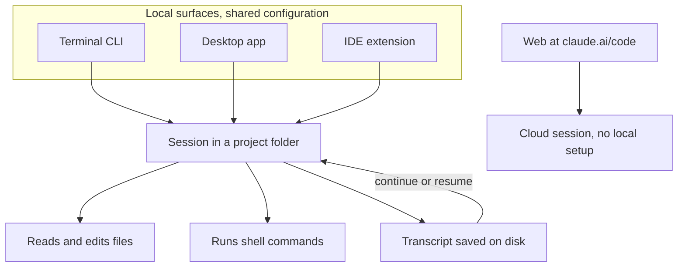
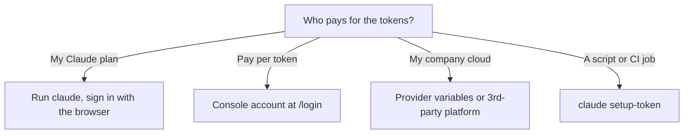
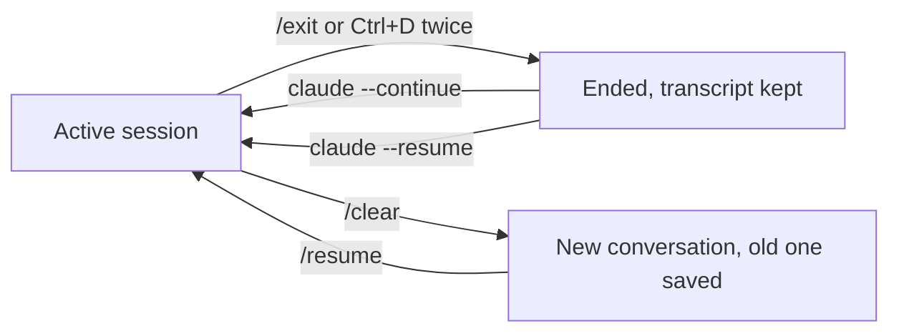

# 06 — Install and first session

After this chapter you have Claude Code installed, signed in and health-checked, and you know which surface to open for which job. You will also have run one complete session on a tiny project: explain the code, fix a failing test, verify the fix, commit it, leave, and come back.

## Mental model

Claude Code is a **harness**: a program that runs a model in a loop and hands it tools to read files, edit files and run commands in your project. [Chapter 03](03-the-agentic-loop-and-tool-use.md) covers the loop; here you need three ideas.

- **One engine, several surfaces.** A *surface* is a place you talk to the agent from: terminal, desktop app, IDE extension, web. The docs say: "Configuration, project memory, and MCP servers are shared across the local surfaces."
- **A session is a conversation tied to a folder.** You start it inside a project directory. It is saved on disk as a *transcript*, so you can close the terminal and pick it up later.
- **A permission mode decides what runs without asking you.** As of Nov 2026 (v2.1.283 or later) a new terminal session starts in `auto` mode. Older tutorials describe a session that asks before every edit; that behaviour is now called Manual mode.



## Check the requirements

Values from the official setup page, as of Nov 2026.

| Requirement | What the docs say |
|---|---|
| Operating system | macOS 13.0+; Windows 10 1809+ or Windows Server 2019+; Ubuntu 20.04+; Debian 10+; Alpine Linux 3.19+ |
| Hardware | 4 GB+ RAM; x64 or ARM64 processor (64-bit only) |
| Network | Internet connection required; Anthropic supported countries only |
| Shell | "Bash, Zsh, PowerShell, or CMD." Windows runs natively or in WSL |
| Node.js | Not in the requirements list. Only the npm install route needs it (22 or later) |
| Git | Optional for Claude Code itself; you need it for the commit step below |
| Account | "Claude Code requires a Pro, Max, Ultra, Team, Enterprise, or Console account. The free claude.ai plan does not include Claude Code access." |

## Install

The native installer is the recommended route. It needs no Node.js and no Administrator rights, and it updates itself in the background.

```bash
# macOS, Linux, WSL
curl -fsSL https://claude.ai/install.sh | bash
```

```powershell
# Windows PowerShell
irm https://claude.ai/install.ps1 | iex
```

Other routes, if your team standardises on a package manager:

| Method | Install | Upgrade | Auto-updates |
|---|---|---|---|
| Native installer | commands above | `claude update` | Yes, in the background |
| Homebrew | `brew install --cask claude-code` | `brew upgrade claude-code` | Not by default |
| WinGet | `winget install Anthropic.ClaudeCode` | `winget upgrade Anthropic.ClaudeCode` | Not by default |
| apt, dnf, apk | add the signed repository, then for example `sudo apt install claude-code` | `sudo apt update && sudo apt upgrade claude-code` | No |
| npm | `npm install -g @anthropic-ai/claude-code@latest` | the same command again, not `npm update -g` | read the `Auto-updates` line in `claude doctor` |

> **Warning:** Never install the npm package with `sudo`. It "installs the same native binary as the standalone installer", so if npm permissions fight you, use the native installer instead.

Verify the install before going further:

```bash
claude --version   # this book cites minimum versions for newer features
claude doctor      # read-only install and settings diagnostics
```

## Sign in: decide who pays

Run `claude` and follow the browser prompts, or run `claude auth login` first. Choosing an authentication method is really choosing a billing route.



| Option | How | Choose it when |
|---|---|---|
| Claude subscription | `claude`, then sign in (Pro, Max, Ultra, Team, Enterprise) | You work interactively and want usage to count against your plan |
| Claude Console | `/login`, then "Sign in with your Console account"; or `claude auth login --console` | You want API usage billing instead of a subscription |
| Cloud provider | Set `CLAUDE_CODE_USE_BEDROCK`, `CLAUDE_CODE_USE_VERTEX` or `CLAUDE_CODE_USE_FOUNDRY` plus the provider's own variables, or pick **3rd-party platform** at the login prompt | Your company buys Claude through Amazon Bedrock, Google Cloud's Agent Platform or Microsoft Foundry |
| Long-lived token | `claude setup-token` prints a one-year OAuth token; export it as `CLAUDE_CODE_OAUTH_TOKEN` | Scripts and CI on a subscription ([chapter 27](27-headless-ci-and-the-agent-sdk.md)) |
| API key variable | `ANTHROPIC_API_KEY` in the environment | Scripts on API billing |

When several credentials exist, the first match wins: (1) cloud provider credentials when a `CLAUDE_CODE_USE_*` variable is set, (2) `ANTHROPIC_AUTH_TOKEN`, (3) `ANTHROPIC_API_KEY`, (4) `apiKeyHelper` script output, (5) `CLAUDE_CODE_OAUTH_TOKEN`, (6) Anthropic profile and federation credentials, (7) subscription credentials from `/login`. A signed-in corporate Claude apps gateway session, if you have one, outranks the whole list.

> **Warning:** An `ANTHROPIC_API_KEY` left in your shell profile ranks above your subscription login. Interactive mode asks once whether to use the key and remembers the answer; `claude -p` always uses it when present. Run `claude auth status --text` to see which method is active.

Credentials go to the macOS Keychain, or to `~/.claude/.credentials.json` (mode `0600`) on Linux, or `%USERPROFILE%\.claude\.credentials.json` on Windows. Inside a session, `/login` switches account and `/logout` signs out.

## Pick a surface

| Surface | What distinguishes it (per the platforms page) | Use it for |
|---|---|---|
| Terminal CLI | "Full feature set"; "scripting and the Agent SDK are CLI-only" | Everything in this book; remote servers; scripts |
| Desktop app | Diff viewer, app preview, parallel sessions; "includes Claude Code, so you don't need to install the CLI separately"; paid subscription required | Visual review, several sessions side by side |
| Web | `claude.ai/code`; cloud, "Anthropic-managed by default; continues after you disconnect" | Long tasks that need little steering |
| VS Code | Extension with inline diffs, file context, @-mentions, plan review; the same extension has an install link for Cursor | Staying in the editor |
| JetBrains | Plugin that "runs the CLI in your IDE's terminal" and "requires the Claude Code CLI, installed separately" | Diff viewer and selection sharing in JetBrains IDEs |
| Mobile app | "a thin client" into cloud sessions, or into a local session via Remote Control | Checking on work away from the desk |

The rest of this book uses the terminal CLI: it has the full feature set, and the other local surfaces share its configuration.

## Health check and updates

Two commands share a name and do different jobs:

| Command | Where | What it does |
|---|---|---|
| `claude doctor` | Your shell | Prints read-only diagnostics "without starting a session": install health, settings-file validation errors, the last update attempt |
| `/doctor` | Inside a session | Setup checkup of installation, settings, extensions and `CLAUDE.md`; it "proposes fixes and asks before applying them". Alias: `/checkup` |

Native installs check for updates "on startup and periodically while running" and apply them on the next start. `claude update` applies one now. To trade freshness for stability, follow the `stable` channel ("typically about one week old, skipping releases with major regressions") in `~/.claude/settings.json`:

```json
{
  "autoUpdatesChannel": "stable"
}
```

## First session: fix one failing test

### Step 0 — create the sample project (two minutes)

```bash
mkdir wordcount && cd wordcount && git init
echo "__pycache__/" > .gitignore   # keep Python's cache files out of the baseline commit

cat > wordcount.py <<'EOF'
"""Count the words on standard input."""
import sys


def count_words(text):
    return len(text.split(" "))


if __name__ == "__main__":
    print(count_words(sys.stdin.read()))
EOF

cat > test_wordcount.py <<'EOF'
import unittest

from wordcount import count_words


class CountWordsTest(unittest.TestCase):
    def test_single_spaces(self):
        self.assertEqual(count_words("one two three"), 3)

    def test_extra_whitespace(self):
        self.assertEqual(count_words("one  two three\n"), 3)


if __name__ == "__main__":
    unittest.main()
EOF

python3 -m unittest          # expect: AssertionError: 4 != 3 ... FAILED (failures=1)
git add . && git commit -m "Add wordcount with a failing test"
```

On native Windows, create the three files in an editor instead of using the `echo` line and the `cat` blocks, and use `python` if `python3` is not found. The first commit matters: it gives you a clean baseline to diff against.

### Step 1 — start a session and read the screen

```bash
claude
```

The first launch walks you through browser sign-in, and a new folder asks you to accept a workspace trust dialog. After that you see a prompt box and a mode indicator. The sketches in this chapter are schematic; exact rendering depends on your version, theme and terminal.

```text
> _                                  <- prompt input; a greyed-out example prompt may sit here
  auto mode on                       <- mode indicator; Shift+Tab changes it
```

Press `?` on an empty prompt to toggle the shortcut help panel. Type `/` to browse commands. If the indicator shows a different mode, auto mode is not available to your session or a setting overrides it; every step below works in any mode.

### Step 2 — ask for an explanation

Start with a read-only question. The first prompt is from the official workflows page; the second uses `@` to mention a file:

```text
give me an overview of this codebase
```

```text
what does count_words in @wordcount.py do when the input has two spaces in a row?
```

```text
  Read wordcount.py                  <- tool calls are listed as they run
  Read test_wordcount.py

  This is a small Python CLI ...     <- then the answer, in prose
```

Reading files inside your working directory needs no approval prompt. Press `Ctrl+O` to open the transcript viewer and see each tool call in detail.

### Step 3 — fix the test, and meet the permission prompt

Write the prompt the way the best-practices page asks: "name the file, describe the symptom, and say what "fixed" looks like up front".

```text
test_extra_whitespace in @test_wordcount.py fails: count_words returns 4 for
"one  two three\n" but 3 is expected. Fix count_words in wordcount.py so any run
of whitespace counts as one separator. Do not change the tests.
Run `python3 -m unittest` and show me the output. Done means both tests pass.
```

What happens next depends on the permission mode:

| Mode | What runs without asking | Indicator |
|---|---|---|
| `auto` | "Everything, with background safety checks": a separate classifier model reviews actions instead of you | `auto mode on` |
| `default` (Manual) | File reads inside your working directories; edits and most shell commands ask first | `manual mode on` |
| `acceptEdits` | "Reads, file edits, and common filesystem commands" | `accept edits on` |
| `plan` | "Reads, plus classifier-approved commands when auto mode is available"; no edits to your source until you approve the plan | `plan mode on` |

In `auto` mode Claude edits `wordcount.py`, runs the tests and reports, usually without stopping. To see a permission prompt at least once, press `Shift+Tab` before sending: from `auto`, the first press switches to Manual. Then each edit and each non-read-only command pauses:

```text
  Edit wordcount.py
  -    return len(text.split(" "))
  +    return len(text.split())

    Yes
    Yes, and don't ask again         <- how long this lasts depends on the tool
    No                               <- Esc does the same; then say what to do instead
```

A permission prompt is the harness asking you, not the model: it shows the exact tool call (the diff, or the command line) and waits. "Don't ask again" has a different lifetime per tool:

| Action | Asks in Manual mode? | "Don't ask again" lasts |
|---|---|---|
| File reads, search | No, inside the working directory | n/a |
| File edits | Yes | "Until session end" |
| Shell commands | Yes, except a built-in set of read-only commands | "Permanently per repository and command", saved to `.claude/settings.local.json` |

The starting mode is resolved in this order: the `--permission-mode` flag, then `permissions.defaultMode` in a settings file, then the built-in default (`auto` for interactive sessions, `default` for `claude -p`). For your first week, `claude --permission-mode default` is a reasonable way to watch every step. [Chapter 09](09-settings-and-permissions.md) covers rules and modes in depth.

### Step 4 — verify it yourself

Do not take "both tests pass" on trust. A line starting with `!` runs in your shell and adds the output to the session:

```text
! python3 -m unittest
..
----------------------------------------------------------------------
Ran 2 tests in 0.000s

OK
```

Then run `/diff` to review every change in the working tree, including Claude's edits.

### Step 5 — commit

```text
commit this fix with a message that says what changed and why
```

Claude stages the file and runs `git commit` (in Manual mode you approve each command). Check the result with `! git log --oneline -2`. Claude Code adds an attribution line to commits it creates; the `attribution` setting customises it.

### Step 6 — generate project instructions with `/init`

`/init` writes a starting `CLAUDE.md`, the file of project instructions loaded into every session. If one exists, `/init` "suggests improvements rather than overwriting it". Trim the result: the docs say the file should hold only what Claude "couldn't work out from the code itself", and recommend staying under 200 lines. For this project, three lines are enough:

```markdown
# wordcount

- Run all tests: `python3 -m unittest`
- Run one test: `python3 -m unittest test_wordcount.CountWordsTest.test_extra_whitespace`
- Never edit a test to make it pass; fix the code.
```

[Chapter 08](08-claude-md-and-memory.md) explains where these files live and how they load.

### Step 7 — end, continue, resume



| You want to | Do this |
|---|---|
| Name the session before leaving | `/rename wordcount-fix` |
| Leave | `/exit` (alias `/quit`), or `Ctrl+D` twice |
| Reopen the most recent session in this directory | `claude --continue` (short form `claude -c`) |
| Pick from a list, or go straight to a name | `claude --resume`, or `claude --resume wordcount-fix` |
| Switch sessions without leaving | `/resume` |
| Start an unrelated task | `/clear`: empty context; the previous conversation stays in the `/resume` picker |
| Undo the last turn | `/rewind`, or `Esc` twice on an empty prompt |

Transcripts are stored as JSONL under `~/.claude/projects/<project>/` and kept for 30 days by default (`cleanupPeriodDays`). Resuming restores the conversation, the model and the permission mode. It does not restore background shell tasks, and startup flags such as `--add-dir` or `--allowedTools` must be passed again.

> **Warning:** `/rewind` restores files that Claude changed with its edit tools. A file that only a shell command changed "isn't tracked and stays as it is". Git is your real undo ([chapter 10](10-plan-mode-checkpoints-and-context-management.md)).

## Five habits for day one

All five come from the official best-practices page, which has been rewritten since most tutorials were made. Its framing: "in most cases, your first plain prompt in a fresh session already does the right thing"; the habits are for when the defaults are not enough.

1. **Tell Claude what it can't see.** Name the file, the symptom and what "fixed" looks like. Hand over evidence with `@file`, a pasted error or a screenshot.
2. **Give it a check to run.** "Give Claude something it can run that comes back pass or fail." Without one, "looks done" is all it has, and you become the test suite.
3. **Watch the first minute.** Then "press `Esc` the moment Claude drifts, and after two failed corrections run `/clear` and write a better prompt instead of a third."
4. **`/clear` between unrelated tasks.** Running out of context is rare now, but "a focused context gets you better answers and costs less". Name sessions with `/rename` so you can return.
5. **Keep `CLAUDE.md` short, and enforce what must never bend.** Write down only what is not in the repo. "If something has to happen every time, make it a hook, a deny rule, or a managed setting" ([chapter 16](16-hooks.md)).

> **Note:** The same page lists advice you can stop following: ALL CAPS emphasis, "think hard" phrases, "don't be lazy" lines, and describing your file layout in `CLAUDE.md`. Use `/effort` for depth and let Claude read the repo.

## From the field

Field numbers come from about four weeks of one developer's Claude Code transcripts. They describe one working style, not a benchmark; frequency counts are rough.

- **Short prompts are normal; the long ones pay.** About 72% of human prompts in that window were under 50 characters, and the median was 27. The prompts that produced the best sessions were the exceptions, and they shared four ingredients: an observable end state, the constraint that rules out the obvious answer, what is already approved, and how success will be shown. One example, paraphrased: "Why is X happening when we already have Y? Understand why it happened and fix it so it won't happen again." It produced a cause analysis, a migration and a guard hook.
- **Name the verification method.** Another paraphrased prompt, "use the browser tools and do real UI testing: look at the web UI and use it", found nine bugs in one pass. A follow-up question, "how did you determine it costs that much a night?", made the agent admit the figure came from a code comment, not a measurement. More templates are in [chapter 34](34-prompt-cookbook-and-anti-patterns.md).
- **Sessions outlive a sitting.** Of 44 interactive sessions, more than half (54.5%) spanned over 24 hours of wall-clock time, with activity on a median of 2 distinct days (small sample). That is why resume is a day-one skill. The author's global instructions add a resume protocol: before writing code in a continued session, run `git log origin/main -5` and list open pull requests, because the conversation may be older than the repository.

## Common problems

| Symptom | Cause | Fix |
|---|---|---|
| `claude: command not found` after installing | Probably `PATH` (our inference, not a quoted diagnosis): the native installer puts the launcher at `~/.local/bin/claude`, and your shell may not search that directory yet | Open a new terminal and check that `~/.local/bin` is on `PATH`; the install troubleshooting page has a `PATH` section |
| npm install fails with `EACCES` | Usually the global npm directory is not writable by your user (our reading; the install troubleshooting page covers `EACCES`) | Do not use `sudo`; use the native installer |
| Sign-in is refused on a free account | "The free claude.ai plan does not include Claude Code access" | Use a paid plan or a Console account |
| Usage is billed to an API key, not your plan | `ANTHROPIC_API_KEY` ranks above subscription login | `claude auth status --text`; unset the variable or switch off "Use custom API key" in `/config` |
| Claude edited files without asking | New interactive sessions start in `auto` mode (v2.1.283 or later) | `Shift+Tab` to Manual, `claude --permission-mode default`, or set `permissions.defaultMode` in user settings |
| `claude --continue` prints `No conversation found to continue` | No interactive session was started in this directory | `claude --resume`, then `Ctrl+A` in the picker to list all projects |
| Homebrew, WinGet or apt install never updates | Package-manager installs do not auto-update by default | Run the upgrade command from the install table |
| `/rewind` did not undo a change | The file was changed only by a shell command | `git restore` or `git checkout` the file |

## Checklist

- [ ] `claude --version` and `claude doctor` run cleanly.
- [ ] You know which credential is active (`claude auth status --text`) and who is billed.
- [ ] You can read the mode indicator and change modes with `Shift+Tab`.
- [ ] You have approved, and declined, at least one permission prompt in Manual mode.
- [ ] You verified a fix yourself with `!` and reviewed it with `/diff` before committing.
- [ ] The project has a short `CLAUDE.md` that states how to run the tests.
- [ ] You ended a session and returned to it with both `claude --continue` and `claude --resume <name>`.

## Try it

1. **Break it again.** Add a test expecting `count_words("")` to return `0`, confirm it fails, then ask Claude to fix it in Manual mode. Decline the first edit with `Esc` and tell it what you want instead.
2. **Port the project.** In a fresh session (`/clear`), ask for a Node version of the same CLI with the same two tests, and state the check: "done means `node --test` passes". Compare how much steering it needed with and without that last sentence.
3. **Leave and return.** `/rename` the session, exit, open a new terminal elsewhere, and get back with `claude --resume <name>`. Ask "what were we doing?" and check the answer against `git log`.

## Sources

- Setup, requirements, install, updates: https://code.claude.com/docs/en/setup
- Authentication and precedence: https://code.claude.com/docs/en/authentication
- Surfaces: https://code.claude.com/docs/en/platforms and https://code.claude.com/docs/en/overview
- Install troubleshooting: https://code.claude.com/docs/en/troubleshoot-install
- `claude doctor` and `/doctor`: https://code.claude.com/docs/en/debug-your-config and https://code.claude.com/docs/en/cli-reference
- Permission modes, starting mode, auto mode: https://code.claude.com/docs/en/permission-modes and https://code.claude.com/docs/en/security
- Permission prompts and rules: https://code.claude.com/docs/en/permissions
- `/init` and `CLAUDE.md`: https://code.claude.com/docs/en/memory
- Sessions, continue and resume: https://code.claude.com/docs/en/sessions
- Checkpoints and `/rewind`: https://code.claude.com/docs/en/checkpointing
- Shell mode, shortcuts, `Esc`: https://code.claude.com/docs/en/interactive-mode
- Best practices: https://code.claude.com/docs/en/best-practices
- Prompt recipes: https://code.claude.com/docs/en/common-workflows
- Field data: the author's own session transcripts and instruction files (about four weeks, to 2026-11-25; not public)

---

[← Previous: Inside the harness: architecture and what happens under the hood](05-inside-the-harness.md) · [Contents](README.md) · [Next: CLI, slash commands and shortcuts →](07-cli-slash-commands-and-shortcuts.md)
