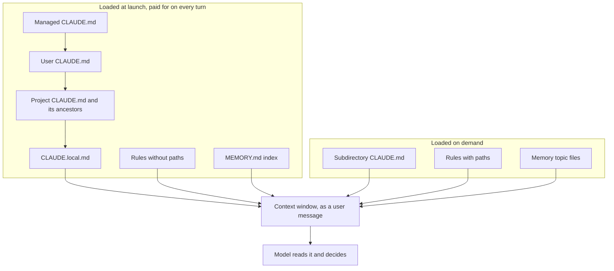
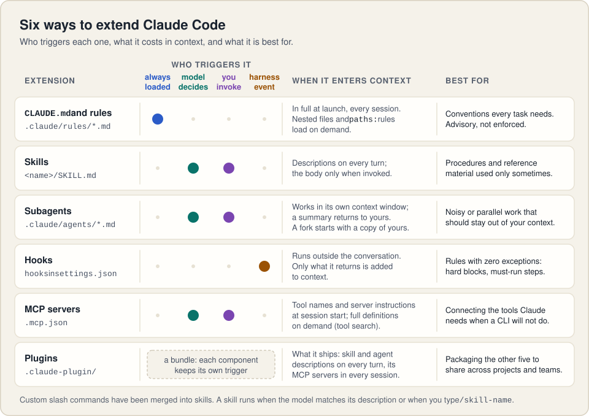
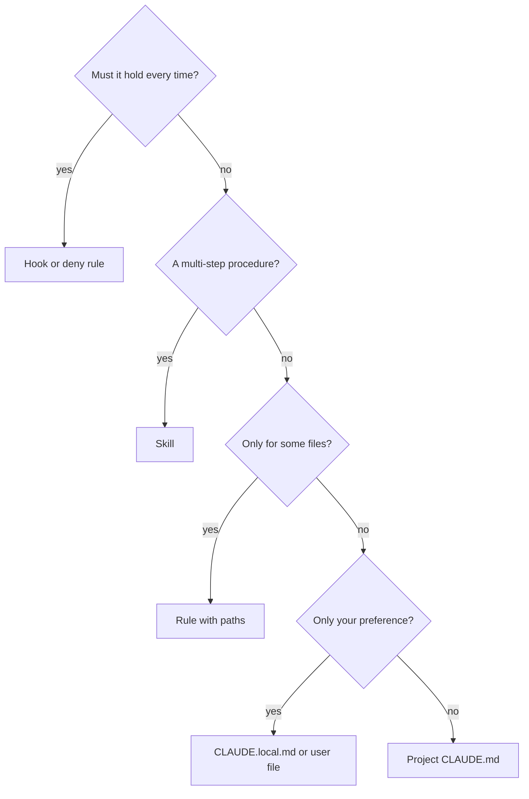

# 07 — CLAUDE.md and memory

After this chapter you can put an instruction in the right file, predict when Claude Code loads it, and check that it reached the model. You can also write a short `CLAUDE.md` that changes behaviour, and recognise the rules that do not belong in it at all.

## Mental model

Claude starts every session knowing nothing about your project. Two mechanisms fill that gap:

- **Instructions you write**: `CLAUDE.md` files and the rule files in `.claude/rules/`. Plain Markdown that Claude Code loads for you.
- **Notes Claude writes**: *auto memory*, a folder of small Markdown files Claude keeps for itself between sessions.

Both are **context, not configuration**. Claude Code pastes the text into the conversation and the model reads it like anything else you say. The memory docs are direct about it: "Claude treats CLAUDE.md files and auto memory as context. They aren't enforced configuration." They also say how it arrives: "CLAUDE.md content is delivered as a user message after the system prompt, not as part of the system prompt itself." Think of a note handed to a capable colleague, not a rule compiled into the tool.



The top box loads when the session starts and costs tokens on every turn. The bottom box loads only when it is needed: when Claude touches a matching file, or opens a memory topic file. Most of this chapter is knowing which is which. `CLAUDE.md` is also only one of six ways to extend Claude Code. The figure puts "CLAUDE.md and rules" in a table beside skills, subagents, hooks, MCP servers and plugins, and shows for each one who triggers it, when it enters context and what it is best for. Its first row is this chapter in one line: in full at launch, nested files and `paths:` rules on demand, advisory and not enforced.



## Where instruction files live

| Scope | Location | Who gets it |
|---|---|---|
| Managed policy | macOS `/Library/Application Support/ClaudeCode/CLAUDE.md`; Linux and WSL `/etc/claude-code/CLAUDE.md`; Windows `C:\Program Files\ClaudeCode\CLAUDE.md` | Everyone in the organisation; users cannot exclude it |
| User | `~/.claude/CLAUDE.md` | Only you, in every project |
| Project | `./CLAUDE.md` or `./.claude/CLAUDE.md` | The team, through source control |
| Local | `./CLAUDE.local.md` (add it to `.gitignore`) | Only you, in this project |
| Subdirectory | a `CLAUDE.md` in a folder below your working directory | Whoever works in that folder |

The table is also the load order, broadest first. The mechanics that follow from it:

- **Ancestors load at launch.** Claude Code loads `CLAUDE.md` and `CLAUDE.local.md` "from your current working directory and every directory above it".
- **Files are added together, never overridden.** "All discovered files are concatenated into context rather than overriding each other", ordered from the filesystem root down to your working directory. Inside one directory, `CLAUDE.local.md` comes after `CLAUDE.md`. If two files disagree there is no winner: "Claude may pick one arbitrarily."
- **Subdirectory files are lazy.** Claude Code loads each one "once Claude reads, writes, or edits another file in that subdirectory". A Bash `cat` or `head` on a single file counts as a read.
- **HTML comments are free.** Block-level comments such as `<!-- maintainer notes -->` are stripped before the text reaches the model.
- **Extra directories are opt-in.** A directory added with `--add-dir` does not contribute its `CLAUDE.md` unless you set `CLAUDE_CODE_ADDITIONAL_DIRECTORIES_CLAUDE_MD=1`.
- **Monorepos can exclude files.** The `claudeMdExcludes` setting takes glob patterns matched against absolute paths (settings are covered in [chapter 08](08-settings-and-permissions.md)).
- **Size limits.** Aim for under 200 lines per file. A launch-loaded file over 4 MiB is skipped entirely. On-demand files are cut at 40,000 characters on a 200K window, and at 150,000 or 200,000 on a 1M window depending on the model (as of Nov 2026).

To see what loaded, run `/context all` and read the **Memory files** list, or run `/memory`.

> **Note:** A subagent starts with a fresh context window (unless it is a *fork*, which inherits your whole conversation) but still loads the same `CLAUDE.md` hierarchy as the main conversation; the built-in Explore, Plan and `web-fetch` agents skip it ([chapter 12](12-subagents.md)). A headless run with `claude -p --bare` skips `CLAUDE.md` and auto memory ([chapter 22](22-headless-ci-and-the-agent-sdk.md)).

## Imports with `@path`

A `CLAUDE.md` can pull in other files:

```markdown
# Project instructions
Branch and commit rules: @docs/git-workflow.md

# Personal notes kept outside the repository
@~/.claude/my-project-instructions.md
```

- Relative paths resolve "relative to the file containing the import, not the working directory".
- Imported files can import others, "with a maximum depth of four hops".
- Imports are **not** lazy. They "don't reduce its context cost, because imported files load together with the CLAUDE.md that imports them." Use them to organise, not to save tokens.
- A path outside the working directory triggers a one-time approval dialog. If you decline, the import stays disabled and the dialog does not come back.
- An `@path` inside a code span or fenced block is not parsed, and a quoted path "isn't imported at all". Put a backslash before each space in a path.

## `.claude/rules/` and path scoping

Rules are extra instruction files, one topic each. Claude Code finds every `.md` file under `.claude/rules/`, recursively.

```text
.claude/
├── CLAUDE.md
└── rules/
    ├── testing.md        # no frontmatter: loads at launch
    └── api-handlers.md   # has paths: loads when a matching file is touched
```

*Frontmatter* is a block of YAML between two `---` lines at the top of a Markdown file. A rule without frontmatter loads at launch "with the same priority as `.claude/CLAUDE.md`". Add frontmatter with a `paths:` list and it becomes *path-scoped*: it stays out of the context until Claude works on a matching file.

```markdown
---
paths:
  - "src/api/**/*.ts"
---

# API handler rules
- Every handler validates its input with a schema from `src/schemas/`.
- Return errors through `AppError`; never send a raw exception to the client.
```

- `paths` is a YAML list or a comma-separated string of globs, for example `"src/**/*.{ts,tsx}"`.
- "`paths` is the only field Claude Code reads from a rule; any other field is ignored without an error." A misspelt key fails silently.
- A scoped rule loads "when Claude uses the Read, Write, or Edit tool on a matching file", or a Bash read such as `cat`.
- Glob trap: `*.md` matches `.md` files anywhere under the base directory; `/*.md` matches only the base directory itself.
- `~/.claude/rules/` holds your personal rules for every project. They load before project rules, and neither set overrides the other.

## How `AGENTS.md` is handled

`AGENTS.md` is the tool-neutral instruction file that other coding agents read ([chapter 23](23-cross-tool-agents-md-cursor-codex-gemini.md)). Older tutorials say Claude Code ignores it. That is no longer true.

- From v2.1.277, Claude Code reads `AGENTS.md` natively, but by default "only when you have no `CLAUDE.md` in your working directory or above it".
- A `CLAUDE.md`, `.claude/CLAUDE.md` or `CLAUDE.local.md` on the path suppresses it. Your `~/.claude/CLAUDE.md`, the managed file and `.claude/rules/` keep loading alongside it.
- The trap: adding a personal `CLAUDE.local.md` to a repo that only has `AGENTS.md` stops Claude from reading `AGENTS.md`.
- Change the behaviour in `/config` under **Project instructions**: `claude-md-or-agents-md` (default), `claude-md-and-agents-md`, `claude-md`, `managed-only`.
- Not read: `AGENTS.local.md`, `AGENTS.override.md`, or anything under a `.agents/` directory.

To share one file between tools, keep policy in `AGENTS.md` and make `CLAUDE.md` a thin adapter:

```markdown
@AGENTS.md

## Claude Code addenda
- Start the app with the `run-service` skill, not by hand.
```

A symlink (`ln -s AGENTS.md CLAUDE.md`) also works, but the Edit and Write tools refuse to write through a symlink, and the docs point Windows users to the import instead. If you once added a `SessionStart` hook that prints `AGENTS.md`, remove it: the file now loads twice.

## `/init`, `/memory` and the audit commands

| Command | What it does |
|---|---|
| `/init` | Generates a starting `CLAUDE.md`. If one exists it "suggests improvements rather than overwriting it". It reads `.cursor/rules/`, `.cursorrules` and `.github/copilot-instructions.md`. `CLAUDE_CODE_NEW_INIT=1` switches to an interactive multi-phase flow. |
| `/memory` | Lists your `CLAUDE.md`, `CLAUDE.local.md` and other memory file locations, toggles auto memory, and opens the auto memory folder. |
| `/context all` | Shows what is in the context window item by item, including the **Memory files** list. |
| `/doctor prompt-audit` | Checks instruction files "for outdated or conflicting content". Requires v2.1.283 or later. |

Treat the `/init` output as a draft, and apply the leave-out test from "Writing instructions that work" to every line of it.

## Auto memory

Auto memory is the part Claude writes. During a session it saves notes it expects to need again, typed `user`, `feedback`, `project` or `reference`, and it "skips anything it can derive from the codebase".

```text
~/.claude/projects/<project>/memory/
├── MEMORY.md                     # the index
├── feedback-no-direct-push.md    # one topic file per memory
└── reference-ci-runner-quirks.md
```

| Aspect | Behaviour (as of Nov 2026) |
|---|---|
| Location | `~/.claude/projects/<project>/memory/`. `<project>` comes from the git repository, so worktrees and subdirectories of one repo share a directory. Override with `autoMemoryDirectory`. |
| What loads | "the first 200 lines or 25KB of `MEMORY.md`, whichever comes first, load at session start." Topic files load on demand only. |
| Sharing | None. "Auto memory is machine-local." It is not in your repo and your teammates do not get it. |
| Lifetime | Files stay until you or Claude edit or delete them; the transcript clean-up does not touch them. |
| Switching it off | Toggle in `/memory` (saves `autoMemoryEnabled`), or set `CLAUDE_CODE_DISABLE_AUTO_MEMORY=1`. |
| Subagents | The main conversation's auto memory is not loaded into subagents; a fork is the exception. |

Say "remember that we never push to main" and Claude writes an auto memory. To put the rule in the shared file instead, say so: "add this to CLAUDE.md", or edit the file through `/memory`. Older tutorials describe a `#` prefix for quick additions; the current docs do not mention it, so check your version with `/help`.

The index is the part with a budget. Keep it one line per memory, such as `- [No direct push](feedback-no-direct-push.md) — always open a PR`, and prune it when it nears 200 lines.

## What survives compaction

*Compaction* replaces a long conversation with a summary ([chapter 04](04-prompt-caching-compaction-and-cost.md)). Instructions differ in how they come through it:

| Where the instruction lives | After compaction |
|---|---|
| Project-root `CLAUDE.md`, rules without `paths:` | "Re-injected from disk" |
| Auto memory | "Re-injected from disk" |
| Rules with `paths:`, subdirectory `CLAUDE.md` | Gone until Claude touches a matching file again |
| Something you typed in the chat | Summarised; "detailed instructions from early in the conversation may be lost" |
| Text a hook added earlier | "Summarized with the rest of the conversation" |

So a rule that must persist through a long session belongs in the project-root file, not in the chat and not behind a `paths:` filter. You can also steer the summary itself with a `# Compact instructions` section in `CLAUDE.md` (shown in the example below) or with `/compact <focus>`.

## Writing instructions that work

The docs give one test for every line. Ask "Could it find this by reading the code?" and "Would it actually go and look?" Then: "If both are yes, leave it out." This is the leave-out test. What survives it:

- How to confirm work: the exact test, typecheck and lint commands, and how to run a single test file.
- Places where the code is misleading.
- Decisions that are not in the repo.
- Anything you have had to correct twice already.

Five habits make the lines land:

1. **Short.** "Every line in it takes a little of Claude's attention on *every* task." Stay under 200 lines; "longer files consume more context and reduce adherence."
2. **Specific.** "Write instructions that are concrete enough to verify."
3. **With the reason.** A rule that carries its reason lets Claude judge the edge cases and lets a teammate judge whether the rule is still needed. The field examples below all date their rules and name the incident.
4. **Plain.** The current best-practices page lists "Add IMPORTANT or ALL CAPS" as old advice: "piling on emphasis mostly makes Claude over-apply the rule."
5. **Consistent.** Group related lines under headings, and delete duplicates. Contradictions are resolved arbitrarily.

| Weak line | Better line |
|---|---|
| Format code properly | Use 2-space indentation |
| Be careful with the database | Never edit an applied migration; add a new file in `migrations/`. Production replays them in order. |
| IMPORTANT: ALWAYS RUN THE TESTS | Run `make check` before every commit. CI runs the same target, so a local pass predicts a green build. |
| The project is organised into controllers, services and models | (delete it: "Claude reads the repo itself. Only write down what isn't in there.") |

Add a line when Claude makes the same mistake a second time, when a code review catches something Claude should have known, or when a new teammate would need the same context. Send everything else to a better home: a multi-step procedure becomes a skill ([chapter 13](13-skills.md)), a rule for one part of the codebase becomes a path-scoped rule, and a personal preference goes in `CLAUDE.local.md`.

## A complete example

A `CLAUDE.md` for a small order-intake service. Every line survives the leave-out test: Claude could not find it by reading the code, or would not go and look.

```markdown
# Orders service

HTTP API for order intake. TypeScript on Node 22, Fastify, Postgres.

## Check your work
- Full gate before any commit: `make check` (lint, typecheck, unit tests). It must exit 0.
- One test file: `npx vitest run src/orders/create.test.ts`
- Integration tests need the database: `make db-up`, then `make test-int`, then `make db-down`.
- A change is done when `make check` passes and its last lines are quoted in your summary.

## Things the code will not tell you
- `src/legacy/` is still called by the nightly export job. Do not delete or tidy files there.
- Money is integer minor units everywhere: `amount: 1050` means 10.50. Never use floats for money.
- `OrderStatus.CLOSED` means refunded, not completed. The name is historical; completed is `FULFILLED`.
- Migrations are forward-only. Add a new file in `migrations/`; never edit an applied one,
  because production replays them in order.

## Conventions
- Use `pnpm`, not `npm` or `yarn`. The lockfile is `pnpm-lock.yaml` and CI rejects any other.
- Validate request bodies with the schemas in `src/schemas/`; no hand-written checks in handlers.
- Raise errors through `AppError` in `src/errors.ts` so the API returns one error shape.

## Git
- Work on a branch named `feat/...`, `fix/...` or `chore/...`. Never commit to `main`: it deploys on push.
- Commit messages follow Conventional Commits; release notes are generated from them.
- Open a pull request when the gate passes. Do not merge it; a person does.

## Compact instructions
When summarising, keep the list of changed files, the names of failing tests and the current plan.

<!-- Maintainers: keep this under 200 lines. Path-specific rules live in .claude/rules/. -->
```

What is missing on purpose: no directory tree, no architecture tour, no "write clean code", and no capital letters for emphasis. The handler rules shown earlier live in `.claude/rules/api-handlers.md`, so they load only when Claude edits a handler.

## The limit of instructions

Everything above is advisory. The best-practices page draws the line between instructions "Claude (the model) reads" and instructions "Claude Code (the harness) *has* to execute", and it is blunt about which is which: "If something has to happen every time, make it a hook, a deny rule, or a managed setting. `CLAUDE.md` is for guidelines, and Claude is allowed to decide a guideline doesn't apply." It also gives the warning sign: "If you keep adding emphasis to a `CLAUDE.md` line and Claude still misses it, that's a sign the line belongs in a hook."



In the example file, "never commit to `main`" and "use `pnpm`" are guidelines. If breaking them would cost you a bad deploy, back them with enforcement: a `deny` permission rule ([chapter 08](08-settings-and-permissions.md)) or a `PreToolUse` hook that exits with code 2 ([chapter 14](14-hooks.md)). Keep the prose line too, because it tells Claude why the call was blocked and what to do instead.

## From the field

The numbers below come from one developer's repos and a window of about four weeks of transcripts. They are observations, not benchmarks; the counts are pattern matches and should be read as rough (the research notes say ±30%).

**A global file built from incidents.** The author's `~/.claude/CLAUDE.md` is 131 lines. Each hard rule states the rule, the reason, the date and the incident behind it; one records a device-restore command that silently upgraded a test phone's operating system, which cannot be undone. The pattern for a hard rule is three copies: prose, a `PreToolUse` hook that blocks the command, and a project memory that names the hook. A comment in one guard script gives the motive: the rule was already in `CLAUDE.md` and "still recurred in the next session, because advisory text does not stop a reflex. This guard does." The same survey found one rule that cites a guard script as its enforcement while neither the user-level settings nor the author's plugin registers that script (project-level settings were not checked). The script exists; within that configuration the rule is still only advice.

**Lean root files, lazy rules.** In a product workspace, sessions were loading about 7k tokens of instructions before the first prompt and "grew past the point where compaction itself failed". The fix was to move detail into `paths:`-scoped rules, cut the root file by roughly 40%, and move facts into skills and reference docs. The decision record adds: "`@import` is eager". The root file now opens with its own budget rule: "**Keep this file lean.** It loads into every session... Before adding a section here, ask whether it is needed on *every* prompt." About 2,900 lines of path-scoped rules across the workspace's repos now load lazily. The root file is still 511 lines, well over the 200-line target, so the rule is a standing pressure rather than a finished job. In 16 of the author's 17 smaller repos, `AGENTS.md` holds the policy and `CLAUDE.md` is `@AGENTS.md` plus a "Claude Code addenda" section of 1 to 29 lines (one outlier has 60); a CI script fails the build when an adapter stops pointing at `AGENTS.md`.

**Where a written rule did not change behaviour.**

| Problem | The instruction | What happened next |
|---|---|---|
| Agent goes silent during long waits; the owner types "status?" | Two project memories | Pokes were 13–17% of prompts in October and 21–22% in November. The likely reason (an inference): a per-project note does not transfer to other projects. |
| Bash idioms that fail in zsh | Memory notes in three projects, then a global rule | Still recurred, including after compaction. A `PreToolUse` hook (early November) and a shell-profile change (late November) followed; errors of that class numbered 19 in the first half of November and 4 in the second. Volume differed, so treat it as weak evidence. |
| Permission prompts keep interrupting | "All approved" typed into the chat, 33 times in 17 of 37 substantive sessions | Prompts continued. They came from the harness (a guard's ask list, a protected path, leftover ask rules), which no sentence can change. The fix was configuration ([chapter 08](08-settings-and-permissions.md)). |

> **Field note:** The same machine holds 413 auto memory files in 32 project directories (by type: 223 `project`, 165 `feedback`, 20 `reference`, 3 `user`). Each memory is one sentence of rule, then why (the dated incident), then how to apply it. One project with 206 memories keeps its index at 79 lines by listing a lead file and folding related ones into it. Lessons get promoted: memory, then `CLAUDE.md`, then a hook, and each move deletes the old copy or leaves a pointer.

## Common problems

| Symptom | Cause | Fix |
|---|---|---|
| A rule is followed early and ignored later in a long session | It lived in the chat or in a path-scoped file and was summarised away | Put it in the project-root `CLAUDE.md`; if it cannot bend, use a hook or deny rule |
| `AGENTS.md` stopped being read | Someone added a `CLAUDE.md` or `CLAUDE.local.md` on the path | Import it with `@AGENTS.md`, or set **Project instructions** to `claude-md-and-agents-md`; confirm in `/memory` |
| A file in `.claude/rules/` never applies | The `paths:` glob does not match, or the key is misspelt and silently ignored | Fix the glob; check with `/context all` after Claude reads a matching file |
| An `@import` does not load | Quoted path, path inside a code span, a declined approval dialog, or more than four hops | Remove the quotes, move it out of the code span, flatten the chain |
| Claude follows one of two conflicting lines at random | Files are concatenated, not overridden | Run `/doctor prompt-audit`; delete the duplicate |
| Claude "forgot" something it saved to memory | The `MEMORY.md` index passed 200 lines or 25KB, or you are on another machine or inside a subagent | Prune the index; move team knowledge into `CLAUDE.md` |
| Adding capitals and "IMPORTANT" does not help | The file is advisory; emphasis makes Claude over-apply | Move the rule to a hook ([chapter 14](14-hooks.md)) |

## Checklist

- [ ] The project `CLAUDE.md` is under 200 lines and every line survives the leave-out test (Claude could not find it in the code, or would not look).
- [ ] It contains the exact commands that prove a change works, including how to run one test file.
- [ ] Each non-obvious rule carries its reason.
- [ ] Rules for one part of the codebase are in `.claude/rules/` with `paths:` frontmatter.
- [ ] Personal preferences are in `CLAUDE.local.md` (gitignored) or `~/.claude/CLAUDE.md`, not the shared file.
- [ ] If the repo has `AGENTS.md`, `CLAUDE.md` imports it rather than restating it.
- [ ] `/context all` shows the files you expect under **Memory files**.
- [ ] Every rule that must never be broken has a hook or a deny rule behind it, and the hook is registered.

## Try it

1. Run `/init` in a repo you know well. Delete every line Claude could have found by reading the code, then count what is left. Add the three things you most often correct.
2. Create `.claude/rules/tests.md` with a `paths:` glob for your test files. Start a new session, run `/context all`, ask Claude to read one test file, then run `/context all` again and find the rule.
3. Ask Claude to "remember" a preference, then open the auto memory folder from `/memory`. Read the topic file and the new `MEMORY.md` line. Decide whether it belongs there, in `CLAUDE.md`, or in a hook.

## Sources

- Claude Code docs, memory: https://code.claude.com/docs/en/memory
- Claude Code docs, best practices: https://code.claude.com/docs/en/best-practices
- Claude Code docs, context window (what survives compaction): https://code.claude.com/docs/en/context-window
- Claude Code docs, how Claude Code works: https://code.claude.com/docs/en/how-claude-code-works
- Claude Code docs, subagents (what loads at startup): https://code.claude.com/docs/en/sub-agents
- Claude Code docs, headless mode (`--bare`): https://code.claude.com/docs/en/headless
- Claude Code docs, commands: https://code.claude.com/docs/en/commands
- AGENTS.md format: https://agents.md/
- Field data: the author's global configuration, a product workspace, 17 smaller repos, and about four weeks of session transcripts (read 2026-11-25).

---

[← Previous: CLI, slash commands and shortcuts](06-cli-slash-commands-and-shortcuts.md) · [Contents](README.md) · [Next: Settings and permissions →](08-settings-and-permissions.md)
