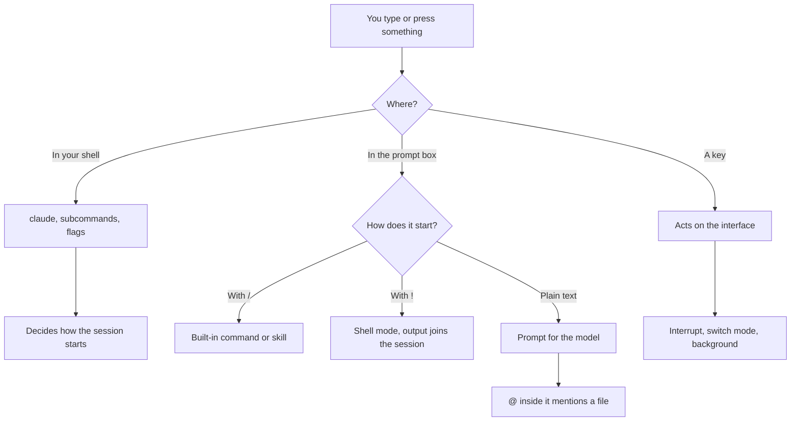
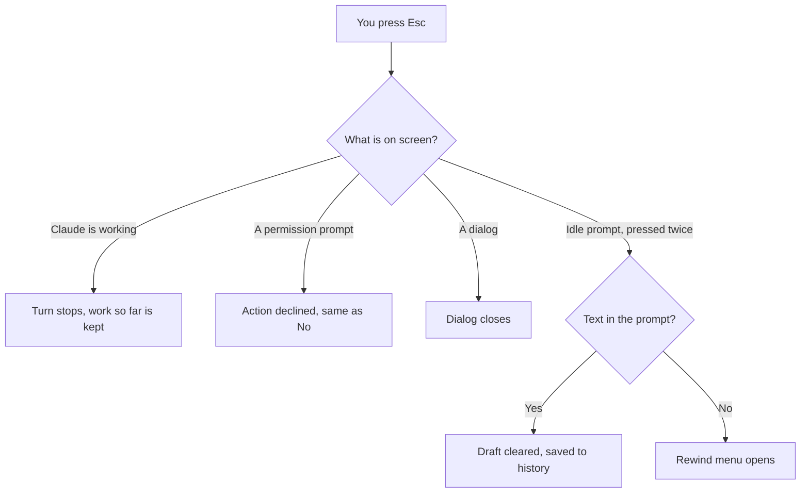

# 07 — CLI, slash commands and shortcuts

After this chapter you can start Claude Code in the right form for the job (interactive, one-shot, piped, resumed), find a built-in command by what it is for, and drive the prompt from the keyboard. Treat it as a reference: skim it once, then return when you need a name.

## Mental model

You give Claude Code instructions in three places, and each one reaches a different part of the system.

1. **In your shell:** `claude`, a subcommand and flags. These decide how a session starts: which model, which permission mode, which tools, interactive or not.
2. **In the prompt box:** the start of the message routes it. `/` runs a command or a skill, `!` runs a shell command yourself, and anything else is a prompt for the model.
3. **On the keyboard:** keys act on the interface (interrupt, switch mode, send work to the background) without adding anything to the conversation.

Two kinds of `/name` exist. Most are built-in commands "[whose behavior is coded into the CLI](https://code.claude.com/docs/en/commands)". The rest are *skills*: "a prompt handed to Claude", the same mechanism as the skills you write yourself in [chapter 15](15-skills.md).



## The `claude` command

Everything below is from [the CLI reference](https://code.claude.com/docs/en/cli-reference) as of Nov 2026 (the docs mention builds up to v2.1.331). The page warns that "`claude --help` does not list every flag", so check the reference when a flag seems to be missing.

### Subcommands

| Command | What it does | Reach for it when |
|---|---|---|
| `claude` | Start an interactive session | Normal work |
| `claude "query"` | Start an interactive session with an initial prompt | You already know the first question |
| `claude -p "query"` | Print mode: query, print the answer, exit | Scripts, pipes, one-off questions |
| `claude -c` | Continue the most recent conversation in the current directory | You are back from a break |
| `claude -r "<session>" "query"` | Resume a session by ID or name | Returning to a named piece of work |
| `claude update` | Update to the latest version | You need a fix today |
| `claude install [version]` | Install or reinstall the native binary; takes a version, `stable` or `latest` | Pinning or repairing an install |
| `claude auth login`, `claude auth logout`, `claude auth status` | Sign in, sign out, show authentication status as JSON (`--text` for readable output) | Checking who you are and who is billed |
| `claude setup-token` | Generate a long-lived OAuth token for CI and scripts | Headless runs on a subscription |
| `claude doctor` | Print read-only installation and settings diagnostics | Claude Code will not start, or behaves oddly |
| `claude mcp` | Configure MCP servers | [Chapter 13](13-mcp-in-practice.md) |
| `claude plugin` | Manage plugins (alias `claude plugins`) | [Chapter 17](17-plugins-and-marketplaces.md) |
| `claude agents` | Open agent view to monitor and dispatch parallel background sessions | Several sessions at once |
| `claude attach <id\|name>`, `claude logs <id\|name>`, `claude stop <id>`, `claude rm <id>` | Attach to a background session, print its recent output, stop it, remove it from the list | Managing sessions started with `--bg` |
| `claude import [source]` | Start a session that runs `/import` to bring configuration from other coding agents | Moving from Codex, Gemini CLI or Cursor |
| `claude purge [path]` | Delete all local Claude Code state for a project (try `--dry-run` first) | Removing transcripts and history |
| `claude remote-control` | Start a Remote Control server (alias `claude rc`) | Steering a machine from claude.ai or the Claude app |
| `claude auto-mode defaults` | Print the built-in auto mode classifier rules as JSON | Seeing what auto mode allows and blocks |
| `claude ultrareview [target]` | Run ultrareview non-interactively; exits 0 on success, 1 on failure | A deep review step in CI |

### The most useful flags

| Flag | Purpose | One-line use case |
|---|---|---|
| `--print`, `-p` | Print the response without interactive mode | A question inside a script |
| `--continue`, `-c` | Load the most recent conversation in the current directory | Pick up where you stopped |
| `--resume`, `-r` | Resume a session by ID or name, or show a picker | `claude -r oauth-migration` |
| `--fork-session` | With `--resume` or `--continue`, create a new session ID | Try another approach without touching the original |
| `--name`, `-n` | Set a display name, shown in `/resume` and the terminal title | `claude -n oauth-migration` so you can find it later |
| `--model` | Model for this session: an alias such as `sonnet`, `opus`, `haiku` or `fable`, or a full model name | A cheaper model for a chore |
| `--effort` | Effort for this session: `low`, `medium`, `high`, `xhigh`, `max` or `ultracode` (the last is "[a Claude Code setting rather than a model effort level](https://code.claude.com/docs/en/model-config)"; available levels depend on the model) | `--effort high` for a hard bug |
| `--permission-mode` | Begin in `default`, `acceptEdits`, `plan`, `auto`, `dontAsk` or `bypassPermissions` (`manual` is an alias for `default`) | `--permission-mode plan` to look before editing |
| `--allowedTools` | Tools that run without prompting, in permission rule syntax | `"Bash(git log *)" "Read"` for a read-only script |
| `--disallowedTools` | Deny rules; a bare tool name removes the tool entirely | Block `Bash(rm *)` for one run |
| `--tools` | Restrict which built-in tools exist at all | `--tools "Bash,Edit,Read"` |
| `--add-dir` | Add working directories Claude can read and edit | A sibling repo you need to consult |
| `--append-system-prompt` | Append text to the default system prompt | One house rule for a scripted run |
| `--output-format` | Print-mode output: `text`, `json` or `stream-json` | `json` when a program reads the result |
| `--json-schema` | Validated JSON output matching a JSON Schema (print mode only) | Structured extraction |
| `--max-turns`, `--max-budget-usd` | Cap agentic turns; stop at an estimated spend (both print mode only) | Limits on an unattended run |
| `--bare` | Minimal mode: skip auto-discovery of hooks, skills, subagents, plugins, MCP servers, auto memory and `CLAUDE.md` | Faster scripted calls |
| `--safe-mode` | Start with all customizations disabled | Find out whether your configuration is the problem |
| `--worktree`, `-w` | Start in an isolated git worktree at `<repo>/.claude/worktrees/<name>` | Parallel work ([chapter 25](25-parallel-work-worktrees-and-background-tasks.md)) |
| `--bg`, `--background` | Start the session as a background agent and return immediately | Start it now, check it later |
| `--from-pr` | Open the session picker filtered to sessions linked to a pull request | `claude --from-pr 1234` |
| `--mcp-config`, `--strict-mcp-config` | Load MCP servers from JSON; skip servers configured elsewhere | Reproducible CI runs |
| `--plugin-dir` | Load a plugin from a directory for this session only | Testing a plugin you are writing |
| `--settings` | A settings JSON file or inline JSON for this session | One-off overrides |
| `--verbose`, `--debug` | Full turn-by-turn output; debug mode with a category filter | `--debug='mcp,startup'` |
| `--dangerously-skip-permissions` | "[Equivalent to](https://code.claude.com/docs/en/cli-reference) `--permission-mode bypassPermissions`" | Disposable sandboxes only ([chapter 29](29-security-and-guardrails.md)) |

> **Warning:** `--system-prompt` replaces the whole default prompt, "[including tool guidance and safety instructions](https://code.claude.com/docs/en/cli-reference)". Prefer `--append-system-prompt` unless you are building a different product on top of the CLI.

### Piping and one-shot use

*Print mode* (`-p`) runs one query and exits, so it composes with other commands like any Unix tool.

```bash
# One question, one answer (run inside the wordcount project from chapter 05)
claude -p "what does count_words in wordcount.py do with repeated spaces?"

# Pipe content in (both examples are from the official docs)
cat error.log | claude -p "what's going on here"
git log --oneline -20 | claude -p "summarize these recent commits"

# A bounded, read-only run whose output a program will parse
claude -p "list the three riskiest files in this repo and say why" \
  --permission-mode dontAsk \
  --allowedTools "Bash(git log *)" "Bash(git diff *)" "Read" \
  --max-turns 20 \
  --output-format json > risk.json
```

Print mode differs from an interactive session in four ways that surprise people:

- **[It starts in](https://code.claude.com/docs/en/permission-modes) `default` permission mode, not `auto`.** Nobody is there to answer a prompt, so anything that would ask is denied. Pass `--permission-mode` and `--allowedTools` explicitly.
- **It always uses `ANTHROPIC_API_KEY` when the variable is present**, even if you are signed in with a subscription.
- **Its sessions are hidden from `claude -c`**, [which skips sessions created with](https://code.claude.com/docs/en/cli-reference) `claude -p`. Use `claude -p --continue` to include them.
- **Some flags only exist here** (`--max-turns`, `--max-budget-usd`, `--json-schema`), and `--bg` cannot be combined with `-p`.

[Chapter 27](27-headless-ci-and-the-agent-sdk.md) builds real automation on these flags.

## Slash commands by purpose

[The docs' command table](https://code.claude.com/docs/en/commands) lists 126 distinct names as of Nov 2026; 25 are marked **Skill** and one **Workflow**. Three rules apply to all of them:

- "[A command is only recognized at the start of your message.](https://code.claude.com/docs/en/commands)"
- A command sent while Claude is responding is queued, [except a few that run immediately](https://code.claude.com/docs/en/commands) "such as `/status`, `/tasks`, and `/usage`".
- "[Not every command appears for every user. Availability depends on your platform, plan, and environment.](https://code.claude.com/docs/en/commands)" `/help` shows what your build has.

**Session: start, stop, move around**

| Command | What it does |
|---|---|
| `/clear [name]` | Start a new conversation with empty context; the name labels the previous one in the `/resume` picker. Aliases `/reset`, `/new` |
| `/resume [session]` | Resume a conversation by ID or name, or open the session picker. Alias `/continue` |
| `/rename [name]` | Rename the session; without a name, one is generated |
| `/branch [name]` | Branch the conversation at this point and switch into the branch; the original stays reachable with `/resume` |
| `/rewind` | Rewind the conversation and/or code to a previous point. Aliases `/checkpoint`, `/undo` |
| `/plan [description]` | Enter plan mode, optionally starting on the described task |
| `/goal [condition]` | Set a goal: Claude keeps working across turns until the condition is met; `/goal clear` removes it |
| `/btw [question]` | Ask a side question about the current session without adding to the conversation |
| `/tasks` | View and manage background work in this session. Also `/bashes` |
| `/background [prompt]` | Detach the session as a background agent. Alias `/bg` |
| `/export [filename]` | Export the conversation as plain text |
| `/exit` | Exit the CLI. Alias `/quit` |

**Context: what the model is carrying**

| Command | What it does |
|---|---|
| `/context [all]` | Visualize current context usage as a colored grid, with optimization suggestions |
| `/compact [instructions]` | Free up context by summarizing the conversation so far; optional focus instructions |
| `/autocompact` | Set how full the window gets before automatic compaction, for example `/autocompact 500k` |
| `/memory` | Edit `CLAUDE.md` files, switch auto memory on or off, view auto memory entries |
| `/init` | Initialize the project with a `CLAUDE.md` guide |
| `/add-dir <path>` | Add a working directory for file access |
| `/usage` | Show session cost, plan usage limits and activity stats. Aliases `/cost`, `/stats` |

**Config: how the session behaves**

| Command | What it does |
|---|---|
| `/config` | Open the Settings interface; `/config theme=dark` sets a key directly. Alias `/settings` |
| `/model [model]` | Switch the model "[and save it as your default for new sessions](https://code.claude.com/docs/en/commands)" |
| `/effort` | Set the effort level: `low` to `xhigh`, `max` (session-only) or `auto`; `/effort status` prints it |
| `/fast` | Toggle fast mode; also `/fast on` and `/fast off` |
| `/permissions` | Manage allow, ask and deny rules for tool permissions. Alias `/allowed-tools` |
| `/sandbox` | Toggle sandbox mode, on supported platforms only |
| `/output-style [style]` | List output styles or switch to one |
| `/statusline`, `/theme` | Configure the status line; change the color theme |
| `/keybindings`, `/terminal-setup` | Open your keyboard shortcuts file; install a Shift+Enter newline binding for some terminals |
| `/login`, `/logout` | Sign in to, or out from, your Anthropic account |

`/model` with no argument opens a picker: `Enter` switches and saves the model as your default, `s` switches for this session only, and the left and right arrows adjust effort. Aliases include `sonnet`, `opus`, `haiku`, `fable` and `opusplan` ([Opus during plan mode, Sonnet for execution](https://code.claude.com/docs/en/model-config)). As of Nov 2026, Fable 5.2, Opus 5.5, Sonnet 5.5 and Haiku 5.5 default to `medium` effort. For one hard turn, put `ultrathink` in the prompt; phrases like "think hard" are [ordinary text, not keywords](https://code.claude.com/docs/en/best-practices). `/fast` buys speed, "[up to 2.5x faster at a higher cost per token](https://code.claude.com/docs/en/fast-mode)".

**Extension: what is plugged in**

| Command | What it does |
|---|---|
| `/mcp` | Manage MCP server connections and OAuth authentication |
| `/plugin [subcommand]` | Manage plugins; no argument opens the plugin menu |
| `/reload-plugins`, `/reload-skills` | Reload active plugins without restarting; re-scan skill and command directories |
| `/skills` | List available skills; `t` sorts by token count |
| `/agents` | Print a reminder to ask Claude to create or manage subagents, or to edit `.claude/agents/` directly |
| `/hooks` | View hook configurations |
| `/ide` | Manage IDE integrations and show status |
| `/install-github-app` | Install the Claude GitHub App for a repository |

**Review: check the work**

| Command | What it does |
|---|---|
| `/diff` | Review the changes in your working tree, including Claude's edits |
| `/code-review` | Skill. Review the current diff, or a PR number, branch or path, for correctness bugs; `--fix` applies the findings. Alias `/review` |
| `/security-review` | Analyze the changes on your current branch for security vulnerabilities; needs an `origin` remote |
| `/simplify [target]` | Skill. Review changed code for cleanup opportunities and apply the fixes; "[The review doesn't look for correctness bugs](https://code.claude.com/docs/en/commands)" |
| `/verify` | Skill. Build, run and observe a change |

**Diagnostics: when something is off**

| Command | What it does |
|---|---|
| `/doctor` | Skill. Setup checkup of installation, settings, extensions and `CLAUDE.md`; applies fixes after you confirm. Alias `/checkup` |
| `/status` | Settings interface on the Status tab: version, model, account, connectivity |
| `/help` | Show help and available commands |
| `/debug [description]` | Skill. Enable debug logging and troubleshoot from the session debug log |
| `/release-notes` | Changelog in an interactive version picker |
| `/insights` | HTML report analyzing your recent sessions |
| `/feedback [report]` | Send product feedback; `/bug` opens the same dialog |

## Interactive mode

"[Keyboard shortcuts may vary by platform and terminal.](https://code.claude.com/docs/en/interactive-mode)" Press `?` on an empty prompt to see the panel for yours.

### Input prefixes

| You type | What happens |
|---|---|
| `/` at the start | "[Command or skill](https://code.claude.com/docs/en/interactive-mode)" |
| `!` at the start | Shell mode: "[Run a command directly, add its output to the session, and have Claude respond to it](https://code.claude.com/docs/en/interactive-mode)" |
| `@` | "[File path mention](https://code.claude.com/docs/en/interactive-mode)" with path autocomplete, for example `@src/utils/auth.js` or a directory such as `@src/components` |
| `#` | Not documented today. Older guides describe it as a memory shortcut; ask Claude to "add this to CLAUDE.md" or use `/memory` instead |

Shell mode does not need Claude to interpret or approve the command: it is you typing, with the output shared. [Claude answers the output automatically](https://code.claude.com/docs/en/interactive-mode), at the cost of a normal prompt, unless `respondToBashCommands` is `false` in `settings.json`. Leave shell mode with `Escape`, `Backspace` or `Ctrl+U` on an empty prompt.

An `@` file is included "[when it fits the Read tool's token limit, 25,000 tokens by default](https://code.claude.com/docs/en/common-workflows)"; a text file over 256KB is not included at all. For larger files, name the path and let Claude read the part it needs.

### Multiline input

| Keys | Works where |
|---|---|
| `\` then `Enter` | "[Works in all terminals](https://code.claude.com/docs/en/interactive-mode)" |
| `Ctrl+J` | "[Works in any terminal without configuration](https://code.claude.com/docs/en/terminal-config)" |
| `Shift+Enter` | [Native in iTerm2, WezTerm, Ghostty, Kitty, Warp and Windows Terminal 1.25 or later](https://code.claude.com/docs/en/terminal-config). Run `/terminal-setup` once in VS Code, Cursor, Devin Desktop, Alacritty before 0.16 and Zed |
| `Option+Enter` | macOS, after enabling Option as Meta |
| Paste | Any terminal; [a paste over 800 characters or three lines](https://code.claude.com/docs/en/terminal-config) collapses to a placeholder such as `[Pasted text #1 +120 lines]` |
| `Ctrl+G` | Opens the prompt in your default text editor |

[To rebind keys](https://code.claude.com/docs/en/keybindings), `/keybindings` opens `~/.claude/keybindings.json` (the newline and submit actions are `chat:newline` and `chat:submit`). [Chapter 18](18-output-styles-statusline-keybindings.md) covers the file format, tmux settings and Vim mode.

### Keyboard shortcuts

| Key | Action |
|---|---|
| `Esc` | Interrupt Claude; see the next section for every case |
| `Shift+Tab` | [Cycle permission modes](https://code.claude.com/docs/en/permission-modes). From `auto`, the first press goes to `default`, then `acceptEdits`, then `plan` |
| `Ctrl+C` | Interrupt a running operation. With nothing running, the first press clears the prompt and a second press exits |
| `Ctrl+D` | Exit; press twice |
| `Ctrl+B` | Send running Bash commands and agents to the background (tmux users press twice) |
| `Ctrl+O` | Toggle the transcript viewer: detailed tool usage, and thinking shown as gray italic text |
| `Ctrl+T` | Toggle Claude's task checklist |
| `Ctrl+R` | Search your prompt history; `Up` and `Down` step through it |
| `Ctrl+S` | Stash the prompt text; press again on an empty prompt to restore it |
| `Ctrl+V` | Paste an image from the clipboard (`Cmd+V` in iTerm2, `Alt+V` on Windows and WSL) |
| `Ctrl+L` | Redraw the screen |
| `Option+P` or `Alt+P` | Switch model without clearing your prompt |
| `Option+O` or `Alt+O` | Toggle fast mode |
| `Tab` or `Right arrow` | Accept the greyed-out prompt suggestion |
| `Ctrl+A`, `Ctrl+E`, `Ctrl+K`, `Ctrl+U`, `Ctrl+W` | Line editing: start, end, delete to end, delete to start, delete previous word |

**Queueing.** While Claude is working, plain `Enter` queues your message instead of interrupting the turn. `Ctrl+Enter` [sends queued messages now](https://code.claude.com/docs/en/interactive-mode) (v2.1.275 or later).

**Background tasks.** There are two ways to background a shell command: ask Claude to run it in the background, or press `Ctrl+B` while it runs. The command returns a task ID at once and its output goes to a file Claude can read later. A command that hits its timeout [is moved to the background automatically](https://code.claude.com/docs/en/interactive-mode) "unless the command starts with `sleep`". `/tasks` lists and manages them; they are cleaned up when Claude Code exits. `Ctrl+X Ctrl+K`, pressed twice within 3 seconds, stops all running background subagents.

### What `Esc` does



The docs describe a single `Esc` like this: "[Stop the current response or tool call mid-turn so you can redirect. Claude keeps the work done so far](https://code.claude.com/docs/en/interactive-mode)". Queued messages are sent next. One trap: at a plan approval prompt, press `Esc` to back out, because `Shift+Tab` there approves the plan.

## Removed and renamed: for readers of older tutorials

| Older material says | Status in the docs (Nov 2026) | Use instead |
|---|---|---|
| `/vim` | "[Removed in v2.1.92](https://code.claude.com/docs/en/commands)" | `/config`, then Editor mode; or `editorMode` set to `"vim"` |
| `/pr-comments [PR]` | "[Removed in v2.1.91](https://code.claude.com/docs/en/commands)" | No replacement is named in the command table |
| `/ultraplan <prompt>` | "[Removed. Use plan mode instead](https://code.claude.com/docs/en/commands)" | `/plan` or `Shift+Tab` |
| `/extra-usage` | Renamed | `/usage-credits` |
| `/agents` opens a wizard | Only on v2.1.197 and earlier; it now prints a reminder | Ask Claude to create the subagent, or edit `.claude/agents/` |
| `/cost`, `/stats`, `/review` | Still work, as aliases | `/usage`, `/code-review` |
| "routines" | Now "cloud scheduled tasks" | `/schedule` (alias `/routines`) |
| `--enable-auto-mode` | [Listed as removed in v2.1.111](https://code.claude.com/docs/en/cli-reference) | `--permission-mode auto` |
| `--remote` | "[Deprecated alias for](https://code.claude.com/docs/en/cli-reference) `--cloud`" | `--cloud` |
| The `Task` tool | Renamed to `Agent` in v2.1.63 | `Agent` in permission rules and hooks |
| Custom commands in `.claude/commands/` | [Merged into skills](https://code.claude.com/docs/en/skills); existing files keep working, and a skill wins a name clash | A skill ([chapter 15](15-skills.md)) |

## Ten commands to learn first

| # | Command | Why it is worth learning first |
|---|---|---|
| 1 | `/clear` | The cheapest quality lever: "[a focused context gets you better answers and costs less](https://code.claude.com/docs/en/best-practices)" |
| 2 | `claude --continue` and `/resume` | Real work spans days; getting back should take one command |
| 3 | `/rewind` | An undo for edits and conversation. It does not restore changes made only by Bash commands |
| 4 | `/plan` | Makes Claude read and propose before it edits |
| 5 | `/context` | Shows what fills the window, so you stop guessing |
| 6 | `/compact` | With focus instructions, keeps a long session usable: `/compact focus on the auth bug fix` |
| 7 | `/usage` | The docs' first step when a task cost too much: run it "[to see where it went](https://code.claude.com/docs/en/best-practices)" |
| 8 | `/model` and `/effort` | "[Effort is the main control for how long Claude thinks](https://code.claude.com/docs/en/best-practices)" |
| 9 | `/diff` | Read what changed before you commit it |
| 10 | `/doctor` | The first stop when anything looks wrong; `claude doctor` if the CLI will not start |

Add three keys to that list: `Esc` (stop), `Shift+Tab` (change mode) and `Ctrl+B` (background). Then `!` for quick shell checks and `/btw` for questions that should not clutter the conversation.

## From the field

Numbers are from about four weeks of one developer's transcripts. Slash-command counts are a floor (only commands that leave a log event), and none of this is a general benchmark.

- **Slash commands are rare, and your list will reflect what you build.** The window holds 200 slash commands against 1,195 human prompts, across 27 distinct names. The top built-ins were `/reload-plugins` (46) and `/plugin` (27), because this developer maintains a plugin, then `/goal` (14), `/remote-control` (8), `/login` (7) and `/model` (6). Most of the rest were the plugin's own skills typed as commands. `/compact` and `/resume` never appear, which means unused or not logged; the data cannot say which.
- **The quiet input features carry real load.** Of 1,130 prompt events, 682 were typed, 240 were accepted prompt suggestions and 182 were queued while Claude was busy; another 54 inputs were `!` shell lines. The same developer interrupted only 12 to 19 main-thread turns (two analyses, two counts) while typing "status?" roughly 200 times (rough counts), which is a good argument for learning `Esc` and `/btw` early.
- **Bash is the agent's main tool, and it chains.** Bash made up 82% of 111,557 tool calls. The most common leading commands were `grep` (15,208), `sed` (15,002), Python fed from a heredoc (9,381) and `cat` (7,399); an average call chained 6.25 segments and 71% began with `cd`. About 2.4% of Bash calls were flagged as errors, and roughly one in ten of those was a zsh quoting problem. The harness also refused 137 "sleep, then poll" commands (main and subagent transcripts together): use a background task, not a sleep loop.

## Common problems

| Symptom | Cause | Fix |
|---|---|---|
| `Shift+Enter` submits instead of adding a line | The terminal does not send a distinct key | `Ctrl+J` or `\` then `Enter`; run `/terminal-setup` once in VS Code, Cursor, Alacritty before 0.16 or Zed |
| A command from a tutorial is "not found" | Removed or renamed, or not available on your platform or plan | Check the table above, then `/help` |
| `/command` in the middle of a sentence is sent as text | "A command is only recognized at the start of your message" | Put it first, or send it alone |
| Tool calls are denied in `claude -p` | Print mode starts in `default` mode with nobody to approve | Pass `--permission-mode` and `--allowedTools` |
| `claude -c` cannot find the last run | It skips sessions created with `claude -p` | `claude -p --continue`, or `claude --resume` |
| Typing during a turn did not stop Claude | `Enter` queues the message | Press `Esc` to interrupt; `Ctrl+Enter` sends the queue now |
| `Ctrl+B` does nothing inside tmux | tmux uses it as its prefix key | Press it twice |
| A resumed session lost its extra directory or tool rules | `--add-dir`, `--allowedTools`, `--mcp-config` and [similar flags are not restored](https://code.claude.com/docs/en/sessions) | Pass them again on `--resume` |

## Checklist

- [ ] You can start a session four ways: `claude`, `claude "query"`, `claude -p "query"` and `claude -c`.
- [ ] You can pipe a file or command output into `claude -p` and read the answer on stdout.
- [ ] You know that print mode starts in `default` mode and needs explicit permissions.
- [ ] You can name one command from each of the six groups without looking.
- [ ] You can enter a multiline prompt in your own terminal.
- [ ] You know what one `Esc` and two `Esc` presses do.
- [ ] You can background a long command and find it again with `/tasks`.

## Try it

1. **Pipe something real.** In any repository, run `git log --oneline -20 | claude -p "summarize these recent commits"`. Then add `--output-format json` and look at what a program would receive.
2. **Drive a session from the keyboard.** In the sample project from [chapter 06](06-install-and-first-session.md), ask for something slow, press `Esc` mid-turn, redirect, then use `Esc` twice to open the rewind menu and go back one step.
3. **Find your ten.** After a day of work, run `/insights` and `/usage`, then write down the commands you actually used. Compare them with the table above.

## Sources

- CLI reference (subcommands, flags, system prompt flags): https://code.claude.com/docs/en/cli-reference
- All commands, aliases, removed entries: https://code.claude.com/docs/en/commands
- Interactive mode (shortcuts, prefixes, `Esc`, background commands, queueing): https://code.claude.com/docs/en/interactive-mode
- Multiline input and terminal setup: https://code.claude.com/docs/en/terminal-config
- Keybindings file: https://code.claude.com/docs/en/keybindings
- Models, effort, `ultrathink`: https://code.claude.com/docs/en/model-config and https://code.claude.com/docs/en/fast-mode
- Permission modes and the `Shift+Tab` cycle: https://code.claude.com/docs/en/permission-modes
- Sessions and what resume restores: https://code.claude.com/docs/en/sessions
- Custom commands merged into skills: https://code.claude.com/docs/en/skills
- Best practices and piping examples: https://code.claude.com/docs/en/best-practices and https://code.claude.com/docs/en/common-workflows
- Troubleshooting: https://code.claude.com/docs/en/troubleshooting
- Field data: the author's own session transcripts (about four weeks, to 2026-11-25; not public)

---

[← Previous: Install and first session](06-install-and-first-session.md) · [Contents](README.md) · [Next: CLAUDE.md and memory →](08-claude-md-and-memory.md)
