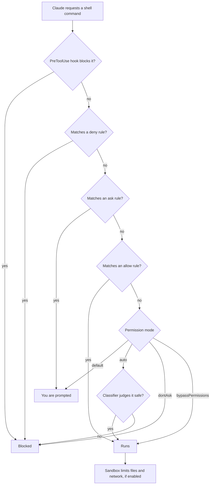
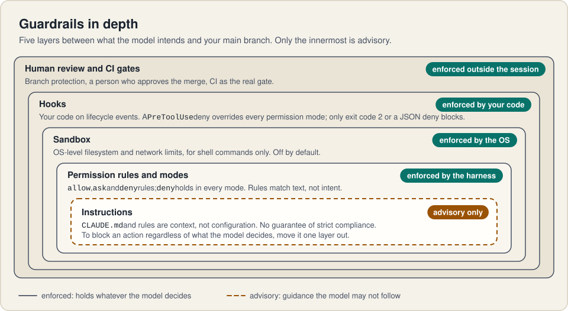
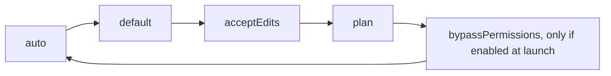

# 08 — Settings and permissions

After this chapter you can find the settings file that controls a behaviour, write permission rules that match what you mean, and pick a permission mode knowing exactly what it removes. You also get a baseline `settings.json` to adapt for a team repo and a safe way to cut permission prompts.

## Mental model

[Chapter 07](07-claude-md-and-memory.md) covered text the model reads and may decide not to follow. This chapter covers configuration that Claude Code, the program around the model (the *harness*), executes whatever the model thinks. There are three layers:

1. **Settings**: JSON files that configure the harness. Model, hooks, environment variables, plugins and the permission rules all live here.
2. **Permissions**: a decision for every tool call: run it, ask you, or block it. Rules (`deny`, `ask`, `allow`) decide first. The *permission mode* decides everything the rules do not mention.
3. **Sandbox**: an operating-system boundary around shell commands. Rules decide whether a command starts; the sandbox limits what it can touch while it runs.

The diagram follows one shell command that is not in Claude Code's built-in read-only set. The first check is a `PreToolUse` hook: a command of your own that the harness runs before each tool call ([chapter 14](14-hooks.md)).



No single layer is complete, which is why they are stacked. The figure widens the view to five nested layers. Only the innermost, instructions, is advisory: the model may not follow it. The other four hold whatever the model decides: permission rules and modes (enforced by the harness), the sandbox (enforced by the operating system), hooks (enforced by your code), and human review with CI gates (enforced outside the session). To block an action for certain, move it one layer out.



## Settings files: scopes and precedence

| Precedence | Scope | Location | Who it affects |
|---|---|---|---|
| 1 (highest) | Managed | `managed-settings.json` in `/Library/Application Support/ClaudeCode/` (macOS), `/etc/claude-code/` (Linux and WSL) or `C:\Program Files\ClaudeCode\` (Windows); also pushed from the admin console or device management | Everyone your organisation deploys it to |
| 2 | Command line | `--settings <file-or-json>` | This run only |
| 3 | Project local | `.claude/settings.local.json` | You, in this project. Claude Code adds it to your global git excludes on first write |
| 4 | Shared project | `.claude/settings.json` | Everyone who works in the repo; commit it |
| 5 | User | `~/.claude/settings.json` | You, in every project |

How the files combine:

- **Scalars override.** "A key set at a higher level overrides the same key set lower down."
- **Lists merge.** "When you set the same list key, such as `permissions.allow`, in more than one file, Claude Code combines the lists instead of picking one".
- **Deny is sticky.** "If a tool is denied at any level, no other level can allow it."
- **No parent lookup.** `.claude/settings.json` is read from the session's primary working directory "with no parent-directory fallback". This is unlike `CLAUDE.md`, which loads from every directory above you.
- **Edits apply live.** Claude Code watches the files and applies most changes, including `permissions` and `hooks`, to the running session. `model`, `effortLevel` and `modelSettings` are read only at session start.
- **Strict JSON.** "A `//` comment or a trailing comma is a syntax error". Add the `$schema` line shown in the baseline below so your editor catches mistakes.
- **Environment variables are not a level** in this stack. Set them in your shell or under the `env` key.

One more file, `~/.claude.json`, is not a settings scope: Claude Code writes it for itself (account details, MCP server configurations, per-project trust decisions). You do not need to edit it.

To debug, run `claude doctor` in your shell (it prints settings-file validation errors), `/status` in a session (it shows whether managed settings apply), and `/permissions` for the rules in force, listed by scope.

> **Warning:** A repo's `.claude/settings.json` is code you run. Project `allow` rules apply only after you accept the workspace trust dialog, but a `claude -p` run in a folder you never trusted shows no dialog and still uses the project's hooks and `env` block. Read the file before you run an agent in a repo you cloned ([chapter 24](24-security-and-guardrails.md)).

## Keys worth knowing

| Key | What it does |
|---|---|
| `permissions.allow`, `permissions.ask`, `permissions.deny` | Approve, prompt for, or block listed tool uses |
| `permissions.defaultMode` | The permission mode new sessions start in |
| `permissions.additionalDirectories` | File access to directories outside the current one (access only; their configuration does not load) |
| `permissions.disableBypassPermissionsMode` | Set to the string `"disable"` to stop anyone entering `bypassPermissions`; works from any scope |
| `env` | Environment variables for every session and its subprocesses |
| `hooks`, `disableAllHooks` | Your commands at lifecycle points ([chapter 14](14-hooks.md)); the switch that turns them all off |
| `sandbox` | Isolates shell commands from your filesystem and network |
| `model`, `effortLevel` | Starting model and default effort level |
| `enabledMcpjsonServers`, `enableAllProjectMcpServers` | Approve specific MCP servers ([chapter 11](11-mcp-in-practice.md)) from a project `.mcp.json`, or every one without a prompt |
| `enabledPlugins`, `extraKnownMarketplaces` | Plugins on or off per scope; marketplaces for a repo or organisation |
| `autoMemoryEnabled`, `claudeMdExcludes` | Auto memory on or off; `CLAUDE.md` files to skip |
| `cleanupPeriodDays` | Days transcripts are kept (default `30`, minimum `1`) |
| `attribution` | The attribution added to commits and pull requests (replaces the deprecated `includeCoAuthoredBy`) |
| `statusLine` | An object with `type` set to `"command"` and a `command` string, not a bare string |

## Permission rules

A rule is `Tool` or `Tool(specifier)`.

| Kind | Example | Matches |
|---|---|---|
| Whole tool | `Bash` | Every Bash command. In `deny`, a bare tool name removes the tool from Claude's context |
| Bash, exact | `Bash(npm run build)` | That exact command and nothing else |
| Bash, prefix | `Bash(npm test *)` | `npm test` alone or with anything after it. `Bash(npm test:*)` is an equivalent spelling |
| File read | `Read(./.env)`, `Read(~/Documents/*.pdf)` | Paths in gitignore syntax. Deny rules are also applied, best-effort, to Grep and Glob |
| File edit | `Edit(/src/**/*.ts)` | Every built-in tool that edits files |
| Web | `WebFetch(domain:example.com)` | That hostname only. `domain:*.example.com` matches subdomains but not `example.com` itself |
| MCP | `mcp__puppeteer`, `mcp__puppeteer__puppeteer_navigate` | Every tool from one server, or one tool. A catch-all allow such as `mcp__*` is skipped |
| Subagents, skills | `Agent(Explore)`, `Skill(name)` | Used in `deny` to switch one off |

**Bash rules match text.** Five behaviours explain most surprises:

- **The space matters.** `Bash(ls *)` needs a space after `ls`, so it does not match `lsof`. `Bash(ls*)` does.
- **Compound commands are split.** `Bash(safe-cmd *)` does not allow `safe-cmd && other-cmd`. Claude Code splits on `&&`, `||`, `;`, `|`, `|&`, `&` and newlines, and "every subcommand must be allowed". A deny or ask rule fires when any subcommand matches.
- **Some wrappers are stripped, others are not.** `timeout`, `time`, `nice`, `nohup` and bare `xargs` are removed before matching, so `Bash(npm test *)` also covers `timeout 30 npm test`. Runners such as `npx`, `docker exec`, `devbox run` and `mise exec` are not, so `Bash(npx *)` allows whatever `npx` can launch.
- **Redirects are checked as file access.** The target of `> file` is checked against `Edit` rules and `< file` against `Read` rules.
- **A Bash rule is not a security boundary.** A deny on `Bash(rm *)` stops `rm -rf build/` but not `/bin/rm -rf build/` or `bash -c 'rm -rf build/'`. Patterns that try to constrain arguments, such as `Bash(curl http://github.com/ *)`, are fragile.

**Path rules have four anchors:**

| Pattern | Anchored at | Example |
|---|---|---|
| `//path` | Filesystem root | `Read(//Users/alice/secrets/**)` |
| `~/path` | Home directory | `Read(~/Documents/*.pdf)` |
| `/path` | The settings file's own root (the project for project settings, `~/.claude` for user settings) | `Edit(/src/**/*.ts)` |
| `path` or `./path` | Current directory | `Read(*.env)` |

`/Users/alice/file` is therefore *not* an absolute path; write `//Users/alice/file`. `*` stays inside one path segment and `**` crosses directories. A bare filename matches at any depth, so `Read(.env)` equals `Read(**/.env)`. Use `Read` and `Edit` only: rules written as `Write(path)`, `Grep(path)` or `Glob(path)` do not match, and a `.claudeignore` file "has no effect".

`Read` deny rules cover Claude's file tools and shell commands Claude Code recognises (`cat`, `head`, `tail`, `sed`, `tee`). They do not cover "a command that reads files without naming them, such as `grep -r pattern .`". The sandbox closes that gap.

## Evaluation order: deny, ask, allow

"Rules are evaluated in order: deny, then ask, then allow. The first match in that order determines the outcome, and rule specificity doesn't change the order." A narrow allow cannot rescue something a broad deny blocks:

```json
{
  "permissions": {
    "allow": ["Bash(git push origin feature/*)"],
    "deny": ["Bash(git push *)"]
  }
}
```

Every push is blocked here, including the one the allow rule names. A broad `ask` rule behaves the same way: it prompts even for commands a narrower allow rule names. Write deny rules narrowly, naming only what is forbidden, or use a hook that inspects the command.

| Layer | How it behaves across modes |
|---|---|
| `deny` | "Deny rules block in every mode, including `bypassPermissions`." |
| `ask` | Prompts even in modes that would approve, such as `acceptEdits` or `bypassPermissions`. In `dontAsk` the call is denied instead |
| `allow` | "Allow rules have no effect in `bypassPermissions`", because everything already runs |
| `PreToolUse` hook | Exit code 2 stops the call before any rule is evaluated. A hook that answers "allow" cannot override a deny or ask rule |

> **Warning:** With `claude -p --bare`, settings and permission rules are still read but hooks never run. A rule enforced only by a hook is not enforced there ([chapter 22](22-headless-ci-and-the-agent-sdk.md)).

## The six permission modes

| Mode | Runs without asking | Fits |
|---|---|---|
| `default` (shown as Manual; the CLI accepts `manual`) | File reads in your working directories | Sensitive work; first weeks with the tool |
| `acceptEdits` | Reads, file edits and common filesystem commands (`mkdir`, `touch`, `mv`, `cp`) inside the working directory | Iterating while you review the diff |
| `plan` | Reads and exploration; no edits to your source until you approve the plan | Exploring before changing ([chapter 09](09-plan-mode-checkpoints-and-context-management.md)) |
| `auto` | "Everything, with background safety checks" | Everyday interactive work |
| `dontAsk` | Reads and pre-approved tools; "anything that would prompt is denied" | CI and scripts |
| `bypassPermissions` | "Everything", apart from a short list no mode auto-approves | Isolated containers and VMs only |

**Which mode a session starts in** is the first of these that is set: the `--permission-mode` flag (or `--dangerously-skip-permissions`), then `permissions.defaultMode`, then the built-in default. As of Nov 2026 the built-in default is `auto` for interactive terminal and VS Code sessions (v2.1.283 or later) and `default` for `claude -p` and the Agent SDK. Older tutorials that say every session starts by asking are out of date.

Two traps. Setting `auto` or `bypassPermissions` as `defaultMode` in a project's `.claude/settings.json` or `.claude/settings.local.json` has no effect; set it in user or managed settings. And if a project file does set `auto`, the session falls back to the built-in default and ignores your user-level `defaultMode` as well.

`Shift+Tab` cycles modes inside a session:



`dontAsk` never appears in the cycle; start with `--permission-mode dontAsk`. You cannot enter `bypassPermissions` in a session that was started without it.

### Auto mode: what the classifier does and misses

In `auto`, "a separate classifier model reviews actions before they run and blocks the ones it judges risky": actions that go beyond your request, target infrastructure it does not recognise, or follow hostile content Claude read. Blocked by default: download-and-execute (piping `curl` into `bash`), production deploys and migrations, force pushes, and `git reset --hard`. Your `ask` and `deny` rules still apply.

After 3 blocks in a row or 20 in a session, auto mode pauses and prompting returns; approving the prompted action resumes it. The thresholds are not configurable. In a `claude -p` run without `--permission-prompt-tool`, an action blocked at the threshold is skipped and Claude keeps working. An organisation can switch auto mode off with `permissions.disableAutoMode` set to `"disable"`.

What it misses, in Anthropic's own published figures: 0.4% false positives on real traffic, but 17% of real over-eager actions and 5.7% of synthetic exfiltration attempts got through. Anthropic's own summary: "Auto mode reduces permission prompts but does not guarantee safety." Treat it as a filter that removes most bad calls, and keep `deny` rules and the sandbox for what must never happen.

Tune it in `~/.claude/settings.json` with `autoMode.allow` and `autoMode.environment`, keeping the `"$defaults"` entry. `/auto-mode-setup` drafts `autoMode.environment` entries, `claude auto-mode defaults` prints the built-in rules as JSON, and `claude auto-mode config` shows them with your settings applied.

### What `bypassPermissions` removes

`bypassPermissions` (the flag `--dangerously-skip-permissions` is equivalent) "disables permission prompts and safety checks so tool calls execute immediately, including writes to protected paths". The classifier is gone and allow rules are irrelevant. The docs' position: it "offers no protection against prompt injection or unintended actions", and "Only use this mode in isolated environments like containers, VMs, or dev containers without internet access".

What still holds: `deny` rules, explicit `ask` rules, hooks, prompts for recognised critical-path `rm` and `rmdir` removals, and a refusal to start as root or under `sudo`. Do not rely on plan mode's blocks in a session where bypass is available.

## The sandbox

The sandbox is "a boundary that the operating system enforces around the shell commands Claude runs". It is off by default; turn it on with `/sandbox` or `sandbox.enabled`. It is not a permission mode; it works alongside whichever mode you are in.

| It covers | It does not cover |
|---|---|
| Bash, PowerShell and Monitor commands, and every process they start | Claude's own file tools, WebFetch and WebSearch |
| Writes: only the working directory, a per-user temp directory and directories you added | Reads: most of the machine stays readable by default, "including credential files such as `~/.ssh` and `~/.aws/credentials`" |
| Network: no direct route out; a proxy whose allowed-domain list starts empty | Command hooks, local MCP servers, the status line command, and commands you type at the `!` prompt |
| macOS (Seatbelt), Linux and WSL2 (bubblewrap, plus `socat`) | Native Windows, where commands run unsandboxed |

- **Two modes.** Auto-allow runs a sandboxed command with no prompt; regular mode still sends every command through permissions. `sandbox.autoAllowBashIfSandboxed` defaults to `false` (before v2.1.324 it was `true`).
- **The escape hatch.** When a command fails inside the sandbox, Claude may retry it with `dangerouslyDisableSandbox`. Set `"allowUnsandboxedCommands": false` to forbid that. Set `sandbox.failIfUnavailable` to `true` as well, because by default commands run unsandboxed when the sandbox cannot start.
- **Permission rules feed it.** `Read` and `Edit` deny rules block the same paths for sandboxed commands, and `WebFetch(domain:...)` rules join the domain list. The reverse is not true: "A `denyRead` entry doesn't stop the Read tool, and `allowedDomains` doesn't limit WebFetch". So list secrets as `Read(...)` deny rules, which cover both.
- **Limits.** The proxy does not inspect TLS, so allowing a broad domain such as `github.com` still leaves a route for data to leave. Tools that are not proxy-aware (plain `ssh`, most database drivers) get no network at all. Commands in `sandbox.excludedCommands` run with your full access.

## A baseline `settings.json` for a team repo

Commit this as `.claude/settings.json` and adapt the command names.

```json
{
  "$schema": "https://json.schemastore.org/claude-code-settings.json",
  "permissions": {
    "allow": [
      "Bash(npm run lint)",
      "Bash(npm run typecheck)",
      "Bash(npm test *)",
      "Bash(gh pr view *)",
      "Bash(gh pr checks *)",
      "WebFetch(domain:docs.example.com)"
    ],
    "ask": [
      "Bash(git push *)",
      "Bash(gh pr merge *)",
      "Bash(npm install *)"
    ],
    "deny": [
      "Read(.env)",
      "Read(.env.*)",
      "Read(./secrets/**)",
      "Read(~/.ssh/**)",
      "Read(~/.aws/**)",
      "Bash(yarn *)",
      "Bash(pnpm *)"
    ],
    "disableBypassPermissionsMode": "disable"
  },
  "sandbox": {
    "enabled": true,
    "allowUnsandboxedCommands": false,
    "network": {
      "allowedDomains": ["registry.npmjs.org"]
    }
  }
}
```

| Part | Why it is there |
|---|---|
| `allow`: the gate commands | Claude can check its own work without waiting for you. They are exact commands or narrow prefixes. Claude Code already runs a built-in set of read-only commands unprompted, so those are not repeated |
| `allow`: no runners | No `npx *`, `bash *` or `docker exec *`. Each one allows anything that runner can start |
| `ask`: push, merge, new dependencies | Outward-facing or hard to undo. Ask rules prompt in every mode, and in `dontAsk` (CI) they become denials |
| `deny`: secrets | Blocks the file tools, recognised shell reads and sandboxed commands at once |
| `deny`: other package managers | Turns a `CLAUDE.md` convention into enforcement. It matches text, so it stops mistakes, not a determined bypass |
| `disableBypassPermissionsMode` | The repo refuses `--dangerously-skip-permissions`. Remove it only if your CI runs bypass inside a disposable container |
| `sandbox` | Shell commands cannot write outside the repo or reach unlisted domains. Add the registries your build needs, and the hosts your allowed commands call: `gh`, and `git push` over HTTPS, reach your Git host only if it is on the list. Leave `failIfUnavailable` at its default until everyone is on a supported platform |
| No `defaultMode` | `auto` and `bypassPermissions` are ignored from a project file, and `auto` there would also cancel each developer's own choice |
| No `enableAllProjectMcpServers` | It would approve every server in `.mcp.json` without a prompt |

Personal additions go in `.claude/settings.local.json`. Rules that need logic, such as "no push to `main`", need a hook ([chapter 14](14-hooks.md)).

## Cutting permission prompts safely

Prompts stop protecting you once you stop reading them. Anthropic reports that "in practice users accept 93% of them anyway". Reduce the volume so the remaining prompts mean something:

1. Run `/permissions` and look at what is already allowed and which calls auto mode recently denied.
2. Run `/fewer-permission-prompts`. This bundled skill builds an allowlist for the project's `.claude/settings.json` from the read-only calls in your transcripts. Review the diff before you commit it.
3. Allow exact check commands and narrow prefixes. Never allow a runner or a shell (`npx *`, `bash *`).
4. Turn on the sandbox with auto-allow, so commands that cannot leave the repo stop prompting. Anthropic reports 84% fewer prompts in its internal usage (no method is given).
5. Use `auto` mode for the rest, and keep `ask` rules on the few actions you always want to see.
6. Prune `.claude/settings.local.json` now and then. Each permanent "don't ask again" answer adds a rule to it.
7. Keep `bypassPermissions` for containers and VMs.

## From the field

These numbers come from one developer's machine and about four weeks of transcripts. They are floors (the permission decision is missing on roughly 8,000 tool results), not benchmarks.

**Bypass mode with hooks as the only gate: one real trade-off, not a recommendation.** The author's user settings set `defaultMode` to `bypassPermissions` on a working laptop, not in a container. There is no `deny` list, the `ask` list is empty, and 50 `allow` rules remain that do nothing in this mode. What stands between the agent and the machine is a handful of `PreToolUse` guard hooks, most of them written after a specific incident. One replaced a prose rule for the auto-mode classifier that "went inert" at the switch; its header notes: "Hooks run in every permission mode, so this survives bypass."

| Measure (about four weeks) | Value |
|---|---|
| Sessions run mainly in `bypassPermissions` | 62 of 76 |
| Tool results accepted by configuration or mode | 98.7% of 103,311 |
| Tool calls blocked by a hook | 486 (0.44% of calls; two thirds inside subagents) |
| Prompts the user approved / tool calls the user denied | 853 / 22 |

What it buys: long unattended runs, and no fatigue from prompts that were approved about 97% of the time anyway. What it costs: the documented loss of any protection against prompt injection; guards that only stop what someone already thought of, and that match text rather than intent (the largest block reason was a guard that could not work out a write target); no deny rule on credentials; and, in a product workspace protected by the same kind of guard, a subagent that once set the guard's override variable itself. The lesson recorded there: "A guard an agent can switch off is not a guard." None of this changes the documented guidance, which the baseline above follows: bypass belongs in an isolated container or VM.

> **Field note:** Bypass did not end the prompts. In one session the owner asked "then why are you asking for permission every minute". Reading which calls had prompted found three causes: a plugin guard's own ask list, session worktrees under `~/.claude/` (a path that prompts in every mode), and leftover ask rules. They were found by reading the transcript, not by guessing.

**Settings files drift like code.** In the product workspace, one repo's `.claude/settings.json` allows `yarn *` and denies `npm install*` and `pnpm *`, so the "Yarn only" convention is enforced, and the frontend repo is the mirror image. The same workspace also shows the failure modes. An allow list of 26 mostly narrow prefixes includes `npx *` and `uvx *`. A `settings.local.json` holds about 49 one-off entries (literal `curl` and `sed` commands, scratch paths). And the hooks the repo's policy depends on are installed on the owner's machine, not in the repo, so a fresh clone gets the policy text without its enforcement.

## Common problems

| Symptom | Cause | Fix |
|---|---|---|
| A setting has no effect | A higher scope sets the same key, or the file has a comment or trailing comma | `claude doctor`; check `/status` for managed settings |
| `"defaultMode": "auto"` is ignored | It is in project or local settings, where `auto` and `bypassPermissions` do not apply | Move it to `~/.claude/settings.json` or pass `--permission-mode` |
| An allowed command still prompts | It is a compound command with one part not allowed, or it redirects to a file | Allow each subcommand; add an `Edit` rule for the target |
| An allow rule never works | A deny or ask rule also matches and is evaluated first | Narrow the deny, or accept the prompt |
| A `Read(.env)` deny is in place but the secret appeared | A shell command read it without naming it, such as a recursive `grep` | Turn on the sandbox; the deny rule then applies to shell commands too |
| Auto mode starts prompting | 3 blocks in a row or 20 in the session | Approve the prompted action to resume; review denials in `/permissions` |
| `npm install` fails with the sandbox on | The allowed-domain list starts empty | Add the registry to `sandbox.network.allowedDomains` |
| Bypass mode still prompts | Ask rules, hooks and critical-path removals survive bypass | Read which call prompted, then fix that rule or hook |

## Checklist

- [ ] `.claude/settings.json` is committed, valid strict JSON, and carries the `$schema` line.
- [ ] The repo's gate commands are in `allow` as exact commands or narrow prefixes.
- [ ] No `allow` rule names a runner or shell (`npx *`, `bash *`, `docker exec *`).
- [ ] Secrets and credential directories are `Read(...)` deny rules.
- [ ] Push, merge and dependency installs are `ask` rules.
- [ ] You know which mode your sessions start in and why.
- [ ] `bypassPermissions` is used only inside a container or VM, or the repo disables it.
- [ ] `.claude/settings.local.json` has been reviewed in the last month.

## Try it

1. Run `/permissions` in a repo you use. Find one allow rule you did not write on purpose, work out which file it lives in, and delete it.
2. Add `"deny": ["Read(.env)"]` to a test repo with a dummy `.env`. Ask Claude to print the file with the Read tool, then with `cat`, then with a recursive `grep`. Note which attempts are blocked, turn on `/sandbox`, and repeat.
3. In a scratch repo, start a session with `claude --permission-mode default`, press `Shift+Tab` and watch the status bar change. Then switch to `auto`, ask for a force push to a throwaway remote, and read the classifier's denial.

## Sources

- Claude Code docs, settings: https://code.claude.com/docs/en/settings
- Claude Code docs, settings reference: https://code.claude.com/docs/en/settings-reference
- Claude Code docs, permissions: https://code.claude.com/docs/en/permissions
- Claude Code docs, permission modes: https://code.claude.com/docs/en/permission-modes
- Claude Code docs, sandboxing: https://code.claude.com/docs/en/sandboxing
- Claude Code docs, managed settings: https://code.claude.com/docs/en/managed-settings
- Claude Code docs, security: https://code.claude.com/docs/en/security
- Claude Code docs, best practices: https://code.claude.com/docs/en/best-practices
- Claude Code docs, headless mode: https://code.claude.com/docs/en/headless
- Anthropic, auto mode (acceptance and miss rates): https://www.anthropic.com/research/claude-code-auto-mode
- Anthropic, sandboxing (prompt reduction): https://www.anthropic.com/research/claude-code-sandboxing
- Field data: the author's user settings and hook scripts, a product workspace's `.claude/` directories, and about four weeks of session transcripts (read 2026-11-25).

---

[← Previous: CLAUDE.md and memory](07-claude-md-and-memory.md) · [Contents](README.md) · [Next: Plan mode, checkpoints and context management →](09-plan-mode-checkpoints-and-context-management.md)
