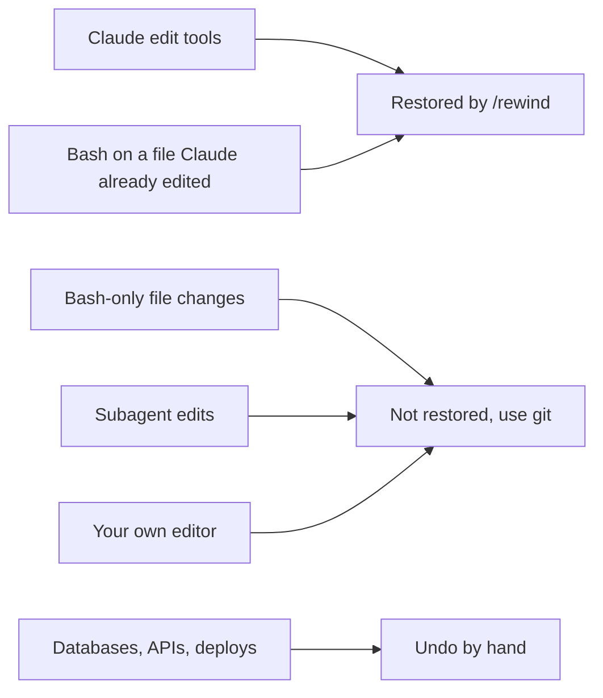

# 10 — Plan mode, checkpoints and context management

After this chapter you can steer a long session instead of only starting one: make Claude plan before it edits, choose how hard it thinks, read what is filling the context window, and pick between compacting, clearing and starting over. You will also know exactly what `/rewind` can and cannot undo, and how to write a handoff note that lets a fresh session continue the work.

## Mental model

A session is a transcript that grows. Every prompt, file read, command output and reply is appended to the **context window**: the text the model can see on each request ([chapter 02](02-llms-tokens-and-the-context-window.md)). You have four kinds of control over that transcript.

| Control | Question it answers | Tools |
|---|---|---|
| Think first | Should Claude edit yet? | plan mode |
| Think harder | How much reasoning is this task worth? | `/model`, `/effort`, `ultrathink` |
| Keep or drop | What should stay in the window? | `/context`, `/compact`, `/clear`, a new session |
| Go back | Can I undo that? | checkpoints, `/rewind`, git |

The figure shows what one request carries. The system prompt, tool definitions, CLAUDE.md with rules and auto memory, and skill descriptions load at session start and count on every request. Conversation messages and tool results grow with every turn. What is left is headroom: free space, plus a reserve for the reply being generated.

```mermaid
flowchart TD
  P["You send a prompt"] --> C["Checkpoint saved"]
  C --> W["Claude reads, edits, runs"]
  W --> G["Transcript grows"]
  G --> Q{"What next?"}
  Q -->|"same task, context clean"| P
  Q -->|"same task, context noisy"| K["/compact with a focus"]
  Q -->|"different task"| X["/clear"]
  Q -->|"wrong turn"| R["/rewind"]
  K --> P
  X --> P
  R --> P
```




Two facts shape the rest of the chapter. First, current models have a 1M-token window by default (as of Nov 2026) and Claude Code compacts on its own, so the official best-practices page now files "The context window is your main constraint, manage it aggressively" under old advice: "running out is rare". Second, a big window is not a clean one. Anthropic's API docs call the quality drop on long inputs *context rot*: "As token count grows, accuracy and recall degrade". You manage context for focus and cost, not to avoid a crash.

## Plan mode

**Plan mode** is a permission mode ([chapter 09](09-settings-and-permissions.md)) in which "Claude reads files, runs shell commands to explore, and writes a plan, but does not edit your source."

### Enter and leave

| How | Detail |
|---|---|
| `Shift+Tab` | Cycles modes. New interactive sessions start in `auto` (v2.1.283+); the first press goes to `default`, then `acceptEdits`, then `plan`. Stop when the status bar shows `plan mode on`. |
| `/plan` | Enters plan mode from the prompt. `/plan fix the auth bug` enters it and starts on that task. |
| `claude --permission-mode plan` | Starts the session in plan mode. |
| `defaultMode` | Set it to `plan` in `.claude/settings.json` to make planning the project default (see below). |
| Claude itself | The `EnterPlanMode` tool lets Claude switch to plan mode on its own; it needs no permission. |

```json
{ "permissions": { "defaultMode": "plan" } }
```

To leave without approving anything: "With no approval prompt open, press `Shift+Tab` again to leave plan mode."

### What is restricted

File edits stay blocked until you approve the plan (the warning below gives the one exception). Shell commands are handled by the first case that matches your session:

| Your session | Shell commands while planning |
|---|---|
| Interactive terminal started with bypass permissions available | Run with neither a classifier check nor a prompt |
| Auto mode available (`useAutoModeDuringPlan` is on by default) | A classifier reviews shell commands instead of prompting you; approved ones run, rejected ones are blocked |
| Anything else | Commands outside the built-in read-only set prompt you for approval |

Subagents ([chapter 14](14-subagents.md)) follow the main conversation: "When the main conversation is in `plan` mode, the subagent stays in plan mode whichever `permissionMode` you set". The built-in Plan subagent gathers context with read-only tools; Write and Edit are denied to it.

> **Warning:** The docs say it plainly: "In interactive terminal sessions with bypass permissions available, don't rely on plan mode's blocks." If you launch with bypass permissions, plan mode is a working convention, not a guard.

### Approve the plan

"When the plan is ready, Claude presents it and asks how to proceed."

| Option | Effect |
|---|---|
| **Yes, and use auto mode** | Approves and continues in auto mode. Reads **Yes, auto-accept edits** when auto mode is not available to your session. |
| **Yes, manually approve edits** | Approves; you "approve and review each edit individually". |
| **No, keep planning** | "stay in plan mode and tell Claude what to change". |

- `Ctrl+G` opens the proposed plan in your default text editor, so you can edit it before Claude proceeds.
- To back out of the prompt, press `Esc` first: "pressing `Shift+Tab` there approves the plan."
- `showClearContextOnPlanAccept` (default `false`) adds an option that "approves the plan, clears the conversation context, and starts implementing from the plan alone". Use it when the exploration was long and noisy.
- Plans are saved under `~/.claude/plans` unless you set `plansDirectory` to a path inside the project. The approved plan is re-injected from disk after a compaction, so it does not get summarised away.

### When planning pays off

The costs page credits plan mode with "preventing expensive re-work when the initial direction is wrong". The best-practices page also says that "in most cases, your first plain prompt in a fresh session already does the right thing". Both are true, so choose per task. The table is this book's rule of thumb, not a quote from the docs.

| Plan first | Skip the plan |
|---|---|
| The change spans several files, or code you do not know | The change is small and you can already picture the diff |
| More than one design is reasonable and the choice matters | There is one obvious way to do it |
| A wrong start is expensive: migrations, public APIs, anything hard to undo | A wrong start costs one `/rewind` |
| The work will run unattended or be split across agents | You are watching and can press `Esc` |

For bigger work the docs go one step further than plan mode: "Ask Claude to interview you instead", save the answers as `SPEC.md`, then "start a fresh session to build from it". [Chapter 22](22-explore-plan-implement-verify.md) builds a full workflow on that idea.

## Model, effort and thinking

These controls decide how much reasoning each turn gets. All defaults below are as of Nov 2026.

| Control | How to set it | What to know |
|---|---|---|
| Model | `/model`, `claude --model <alias>` | Aliases: `opus` (also `best`), `sonnet`, `haiku`, `fable`, `opusplan`, `default`. `/model` switches and saves your choice as the default for new sessions; in the picker, `s` switches for this session only. |
| Effort | `/effort <level>`, `claude --effort <level>`, left/right arrows in the `/model` picker | Levels: `low`, `medium`, `high`, `xhigh`, `max`. Fable 5.2, Opus 5.5, Sonnet 5.5 and Haiku 5.5 default to `medium`. `max` applies to the current session only. `/effort status` prints the level; `/effort auto` clears a saved one. |
| One deep turn | Put `ultrathink` anywhere in the prompt | Requests deeper reasoning on that turn without changing the session effort. "think", "think hard" and "think more" are ordinary prompt text, not keywords. |
| Thinking display | `Ctrl+O` | Thinking is collapsed by default; `Ctrl+O` shows it. You cannot turn thinking off on Opus 5.5, Sonnet 5.5, Haiku 5.5 or the Fable models. |
| Fast mode | `/fast` | "up to 2.5x faster at a higher cost per token" on supported models. Turned on mid-conversation, "you pay the full fast mode uncached input token price for the entire conversation context". |

- **Default model.** On Pro, Max, Ultra, Team, Enterprise and the Anthropic API, `default` resolves to Opus 5.5. "No Fable model is the account-type default on any plan or provider", so reach it with `/model fable`.
- **Plan with one model, build with another.** `opusplan` "uses `opus` during plan mode, then switches to `sonnet` for execution".
- **How to choose effort.** The docs: "Effort is the main control for how long Claude thinks" and "Save `max` for a hard problem you want Claude to work through without you". A workable habit: leave the default alone, raise to `high` or `xhigh` for hard debugging and design, drop to `low` for mechanical edits, and use `ultrathink` for a single hard question.
- **If a setting will not stick.** Effort resolves in this order: `CLAUDE_CODE_EFFORT_LEVEL`, then a level picked in the session, then `--effort`, then settings, then the model default. An exported environment variable silently beats `/effort`.

> **Note:** You pay for reasoning you do not see: "You are charged for all thinking tokens generated, even when collapsed or redacted." The API docs also warn that changing effort between requests "can invalidate all or part of the prompt cache" ([chapter 04](04-prompt-caching-compaction-and-cost.md)). Pick a level for the task; do not flip it every turn.

## Read `/context`

```text
/context        coloured grid of what is using the window
/context all    expand the per-item breakdown
```

Per the docs it also "Shows optimization suggestions for context-heavy tools, memory bloat, and capacity warnings." Row names change between versions, so read the labels in your build and ask three questions:

1. **How much is used before I type anything?** The system prompt, tool definitions, memory files such as CLAUDE.md, and the skill listing are fixed overhead. You pay for them on every request.
2. **What is the biggest item in the conversation?** It is often one tool result or one large file, not the chat itself.
3. **How far am I from the auto-compact threshold?** If you are close and still mid-task, compact now with your own focus instead of waiting for the automatic summary.

To watch the number all the time, put `context_window.used_percentage` in your status line ([chapter 18](18-output-styles-statusline-keybindings.md)).

## Compact, clear or new session

| Tool | What it does | Cost |
|---|---|---|
| `/compact [instructions]` | "Free up context by summarizing the conversation so far." The optional instructions steer the summary: `/compact focus on the auth bug fix`. | It is itself a large request |
| `/clear [name]` | "Start a new conversation with empty context." The old conversation is saved, not deleted; a name labels it in the `/resume` picker. Aliases: `/reset`, `/new`. | "`/clear` costs nothing" |
| New session | Another `claude` process: "Each new session starts with a fresh context window, without the conversation history from previous sessions." | Normal startup overhead |

Choose with this table:

| Situation | Use | Why |
|---|---|---|
| Same task, long exploration behind you, direction settled | `/compact <what to keep>` | Keeps the thread and drops the noise, with a focus you chose |
| Next task is unrelated | `/clear` | The docs still advise "`/clear` between unrelated tasks": "a focused context gets you better answers and costs less" |
| Two corrections on the same problem both failed | `/clear`, then a better prompt | "after two failed corrections run `/clear` and write a better prompt instead of a third" |
| A quick side question | `/btw <question>` | Answered from the current context "without adding to the conversation" |
| You want to try an alternative and keep this thread | `/branch [name]` | Copies the conversation into a new session; the original stays reachable with `/resume` |
| Only the last stretch went wrong | `/rewind` | Restore, or summarise from a chosen message (see below) |
| Different directory or worktree, or work in parallel | New session | Separate window, separate transcript ([chapter 25](25-parallel-work-worktrees-and-background-tasks.md)) |
| Stopping for the day, or handing over | Handoff note, then exit | A file on disk outlives the summary, the cache and the transcript |

> **Note:** Coming back after a break is a natural decision point. The prompt cache "lasts about an hour on a subscription and five minutes on an API key, cloud provider, or usage credits", and the costs page lists cache misses after a break among the reasons a session keeps spending. If you no longer need the old context, `/clear` before your next prompt, not after it.

## Auto-compaction and what survives

"Claude Code compacts automatically as you approach the limit, so a full context window doesn't end your session." With no auto-compact window set, compaction happens at the model's context limit; models with a native 1M window "compact before the window fills, at about 967K tokens by default" (as of Nov 2026). To compact earlier, for focus or cost:

```text
/autocompact 500k
```

That command needs v2.1.221 or later. The same control exists as the `autoCompactWindow` setting and the `CLAUDE_CODE_AUTO_COMPACT_WINDOW` environment variable. `DISABLE_AUTO_COMPACT=1` turns the automatic trigger off while manual `/compact` still works.

A compaction is a lossy summary: "The summary keeps your requests and key code snippets, but detailed instructions from early in the conversation may be lost. Put persistent rules in CLAUDE.md." What comes back afterwards:

| Item | After compaction |
|---|---|
| System prompt and output style | Both still apply |
| Project-root CLAUDE.md, unscoped rules, auto memory | Re-injected from disk |
| The plan written in plan mode | Re-injected from disk |
| Skill descriptions | Rebuilt from your current skills and re-injected (v2.1.304+) |
| Bodies of skills you invoked | Re-injected, capped at 5,000 tokens per skill and 25,000 in total; oldest dropped first |
| Files Claude read or edited | Up to five are re-read, most recently modified first; a file over 5,000 tokens comes back as a path only |
| Rules with `paths:` frontmatter, nested CLAUDE.md files | Reloaded on demand, so gone until a matching file is touched again |
| Context that hooks added earlier | Summarised with the rest of the conversation |
| Background commands and background subagents | Keep running; Claude is reminded which ones are still running |
| Your early prompts and corrections | Summarised; details may be lost |

Three ways to protect what matters:

1. **Tell the summariser what to keep.** Add a section to CLAUDE.md ([chapter 08](08-claude-md-and-memory.md)):

```markdown
# Compact instructions

When compacting, always keep:
- the current goal and the exact command that proves it is done
- the files changed so far, and why
- decisions made and options already rejected
- any instruction from me that says "always" or "never"
```

2. **Move must-survive rules to a place that is re-injected.** That means the project-root CLAUDE.md or an unscoped rule. For a path-scoped rule that must persist, the docs say to "drop the `paths:` frontmatter".
3. **Re-inject with a hook.** Claude Code runs `SessionStart` hooks that match the `compact` source and adds their output to the compacted context ([chapter 16](16-hooks.md)).

If one huge file or tool result refills the window right after every summary, "Claude Code stops auto-compacting after a few attempts and shows an error instead of looping." The documented recovery: read the big file in chunks, run `/compact keep only the plan and the diff`, move the work to a subagent, or `/clear`.

## Resume and session storage

Transcripts are stored "as JSONL at `~/.claude/projects/<project>/<session-id>.jsonl`", where `<project>` is your working directory path with non-alphanumeric characters replaced by `-`. They are kept for 30 days by default (`cleanupPeriodDays`). The entry format is internal and "changes between versions", so do not build tools that depend on it staying stable.

```bash
claude --continue                 # most recent session in this directory
claude --resume                   # pick from a list
claude --resume oauth-migration   # by name; set one with /rename oauth-migration
claude --from-pr 1234             # the session linked to that pull request
```

Inside a session, `/resume` opens the same picker: `Ctrl+A` shows all projects, `Ctrl+B` the current branch, `Space` previews, `/` searches.

| Resume restores | Resume does not restore |
|---|---|
| The conversation; after a compaction, the summary plus later messages only | Background Bash and monitor tasks |
| Model, permission mode (terminal resume), active goal | Launch flags such as `--mcp-config`, `--plugin-dir`, `--add-dir`, `--settings`, `--allowedTools`, `--disallowedTools`: pass them again |
| Checkpoints, which survive a resume | Interrupted tool calls: they are not rerun |

Opening one session in two terminals makes "both write to one transcript". Add `--fork-session` to keep the two conversations separate.

## Checkpoints and `/rewind`

"Every prompt you send that starts a turn creates a new checkpoint". Claude Code keeps snapshots for the 100 most recent checkpoints in a session and sweeps them about 30 days after the session last saved one. Open the menu with `/rewind` (aliases `/checkpoint`, `/undo`) or press `Esc` twice on an empty prompt.

| Menu action | Effect |
|---|---|
| **Restore code and conversation** | Files and chat both go back to that prompt |
| **Restore conversation** | Rewinds the chat and leaves files as they are |
| **Restore code** | Reverts files and keeps the chat |
| **Summarize from here** | Compresses the conversation from that point forward into a summary, which frees context |
| **Summarize up to here** | Compresses what came before that point and keeps the later messages intact |
| **Never mind** | Returns to the message list without changing anything |

Summarizing "doesn't change files on disk, and the original messages stay in the session transcript". The two code options appear only when that checkpoint has tracked file changes to revert.



| Change made by | Does `/rewind` restore it? |
|---|---|
| Claude's file editing tools | Yes |
| Bash, on a file Claude had already edited | Yes: it "undoes changes that Bash commands make to that file afterward" |
| Bash only, for example `sed -i`, a formatter, a code generator, `mv` or `rm` | No: "A file that only Bash commands changed isn't tracked and stays as it is. To revert it, use version control, such as Git." |
| A subagent | Usually no: "Claude Code usually doesn't capture those edits in your session's checkpoints." |
| You, outside Claude Code | Normally not captured |
| Symlinked or hard-linked files, including files pnpm hard-links into place | No |
| Remote systems: databases, APIs, deployments | No: they "can't be checkpointed" |
| A message you typed while Claude was working | It has no checkpoint of its own; the menu marks it **No code restore** |

The docs sum it up: "Checkpoints are designed for quick, session-level recovery." They sit beside git; they do not replace it.

### Safe undo: rewind plus git

1. **Make a baseline before the risky prompt**, so git knows what "before" looked like.

```bash
git switch -c try/auth-refactor
git add -A && git commit -m "wip: baseline before auth refactor"
```

2. **Run the task.**
3. **If it went wrong, rewind.** Press `Esc` twice, pick the prompt, choose **Restore code and conversation**.
4. **Ask git what the rewind missed.** After a full restore, anything git still lists was changed by Bash, a subagent or you.

```bash
git status --short
git diff --stat
```

5. **Revert the leftovers with git.**

```bash
git restore path/to/file        # tracked file changed outside the edit tools
git clean -n                    # preview untracked files first
git clean -f path/to/new-file   # then delete only the ones you do not want
```

6. **Undo remote effects by hand.** Roll back the migration, redeploy the previous build, revert the pushed commit. Neither rewind nor a local `git restore` reaches them.

> **Warning:** `git clean -f` deletes untracked files permanently. Run the `-n` preview every time. [Chapter 24](24-git-prs-and-code-review.md) covers the wider git workflow.

## Write a handoff note

A new session starts empty, and a resumed one may hold only a summary. A **handoff note** is a short file that states the goal, the current state and the next step, so that any fresh session, another person or another tool can continue. Ask for it before you stop:

```text
Write HANDOFF.md for a fresh session that will see none of this conversation.
Sections: goal and done-check; state (branch, last commit, uncommitted files);
done, with evidence; tried and rejected; next steps with exact commands; open questions.
Check every claim against git and the test output first. Mark anything you could not verify.
```

A good result looks like this:

```markdown
# Handoff: cookie sessions

## Goal and done-check
Move session tokens to httpOnly cookies. Done when `npm test -- auth` passes and login works in the browser.

## State
- Branch `feat/cookie-sessions`, last commit `a1b2c3d`, 2 uncommitted files
- Failing: `refresh rotates token` (expected 200, got 401)

## Done, with evidence
- Cookie writer added; `npm test -- cookie` is green

## Tried and rejected
- Refresh token in localStorage: fails the security requirement

## Next steps
1. Fix rotation in `src/auth/refresh.ts`, then rerun `npm test -- auth`
2. Check login by hand in the browser

## Open questions
- Keep header auth for one more release?
```

Start the next session from the file, and make it verify before it trusts:

```bash
claude "Read HANDOFF.md, check the State section against git, then continue from Next steps."
```

## From the field

The first two items come from a rolling window of about four weeks of one developer's transcripts: 76 sessions with a response, 44 of them interactive. The third comes from a product workspace's decision log, with numbers as recorded there. They describe one working style and are not benchmarks.

- **Compaction was common, and nobody typed it.** 20 sessions (45% of the interactive ones) hit main-thread compaction, 84 times in total: a median of 3 per compacting session, 11 at most. The main-thread context at compaction had a median of 423k tokens and fell to a median of 33k. Every compaction was triggered automatically, and no `/compact` or `/resume` command appears in the logs (unused or not logged; the data cannot say which). As far as the logs show, every summary was written without a `/compact` focus from the user.
- **Plan mode was rare; planning was not.** Plan mode appears in 2 of the 44 interactive sessions (4.5%). In the same window a planning skill was activated 22 times and the built-in Plan subagent was launched 17 times. The author's planning runs through a skill that turns a request into a written plan and issues, which outlive any one session. That is the spec-first pattern, built with a skill instead of the mode ([chapter 15](15-skills.md)).
- **Context economics: measure before you blame.** In a product workspace one session grew to a 221 MB transcript with 214 compactions. When it was measured, re-injected attachments made up 46% of it and all tool results about 9%. A task list holding 100 completed tasks had been re-injected 1,263 times, and hooks had fired 33,295 times, including a hook plugin with no rules configured. The fix was to prune completed tasks and disable unused plugins. The lesson recorded in the repo: "Measure before diagnosing." The same repo notes that "auto-compact cannot defend against one giant tool result".

> **Field note:** Compaction also loses state. After one compaction, an empty pull-request list was read as "the agents died" and the agents were dispatched again, duplicating work. In another session, an approval given earlier survived only as reported speech in the summary. The adopted fixes put state on disk: a `PreCompact` hook writes a snapshot (branch and uncommitted state) to a file, and a resume rule says to check `git log` and the open pull requests before writing any code.

## Common problems

| Symptom | Cause | Fix |
|---|---|---|
| A rule was followed early and ignored later | It lived only in the conversation or in a path-scoped rule and was summarised away | Move it to the project-root CLAUDE.md; use a hook if it can never bend |
| `Autocompact is thrashing: the context refilled to the limit...` | One oversized file or tool result refills the window after each summary | Read in chunks, `/compact keep only the plan and the diff`, use a subagent, or `/clear` |
| `/rewind` left some files changed | Bash-only changes, subagent edits or linked files are not tracked | Follow the safe-undo steps: `git status --short`, then `git restore` |
| Claude started editing when you meant to leave the plan prompt | `Shift+Tab` approves the plan at the approval prompt | Press `Esc` first, then `Shift+Tab` |
| Edits happened during plan mode | The session was started with bypass permissions available | Do not rely on plan mode's blocks there; start without bypass |
| After `--resume`, an MCP server or extra directory is missing | Launch flags are not restored | Pass `--mcp-config`, `--add-dir` and similar flags again |
| After compaction, finished work is redone | The summary dropped state, and absence was read as "not done" | Keep state in files; check git and open pull requests first |
| Much of the window is used before the first prompt | Tool definitions and long memory files load up front | Run `/context all`; disable unused MCP servers; shorten CLAUDE.md |

## Checklist

- [ ] I can enter plan mode three ways and I know that `Shift+Tab` approves at the approval prompt.
- [ ] I plan when a wrong start is expensive and skip the plan when the diff is obvious.
- [ ] I set effort with `/effort`, not with phrases like "think hard"; I keep `ultrathink` for single hard turns.
- [ ] I run `/context` when a session feels slow or vague, before guessing at the cause.
- [ ] I `/clear` between unrelated tasks and give `/compact` a focus.
- [ ] Rules that must survive compaction live in the project-root CLAUDE.md or in a hook.
- [ ] I commit a baseline before risky work and pair `/rewind` with `git status`.
- [ ] I write a handoff note before I stop a task that is not finished.

## Try it

1. **Plan, edit, approve.** In a scratch repo run `/plan add a --json flag to the CLI`. When the plan appears, press `Ctrl+G`, change one step in your editor, save, then choose **Yes, manually approve edits**. Note which shell commands ran during planning and whether any asked for approval.
2. **Find the rewind gap.** Commit a baseline. Ask Claude to edit one file with its edit tool and to change a second file only with `sed -i` through Bash. Rewind with **Restore code and conversation**, then run `git status --short`. Which file is still modified? Restore it with git.
3. **Handoff round trip.** In the middle of a task, ask for `HANDOFF.md` with the prompt above. Run `/clear`, then start from the file. List what the new session had to rediscover and add those points to your handoff prompt.

## Sources

- Permission modes and plan mode: https://code.claude.com/docs/en/permission-modes
- Model, effort and thinking: https://code.claude.com/docs/en/model-config and https://code.claude.com/docs/en/fast-mode
- Context window and what survives compaction: https://code.claude.com/docs/en/context-window
- How Claude Code works: https://code.claude.com/docs/en/how-claude-code-works
- Checkpointing: https://code.claude.com/docs/en/checkpointing
- Sessions and resume: https://code.claude.com/docs/en/sessions
- Commands, interactive mode and settings reference: https://code.claude.com/docs/en/commands , https://code.claude.com/docs/en/interactive-mode , https://code.claude.com/docs/en/settings-reference
- Best practices: https://code.claude.com/docs/en/best-practices
- Costs: https://code.claude.com/docs/en/costs
- Troubleshooting: https://code.claude.com/docs/en/troubleshooting
- Context windows and context rot, Claude API docs: https://platform.claude.com/docs/en/build-with-claude/context-windows
- Effort, Claude API docs: https://platform.claude.com/docs/en/build-with-claude/effort
- Field data: the author's Claude Code transcripts (a window of about four weeks, snapshot 2026-11-25), plugin repository and product workspace

---

[← Previous: Settings and permissions](09-settings-and-permissions.md) · [Contents](README.md) · [Next: The extension model: what each piece is and how to choose →](11-the-extension-model.md)
