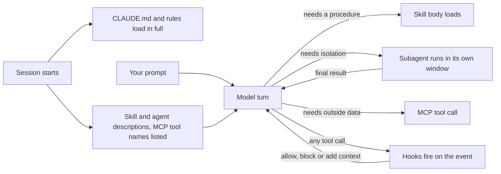
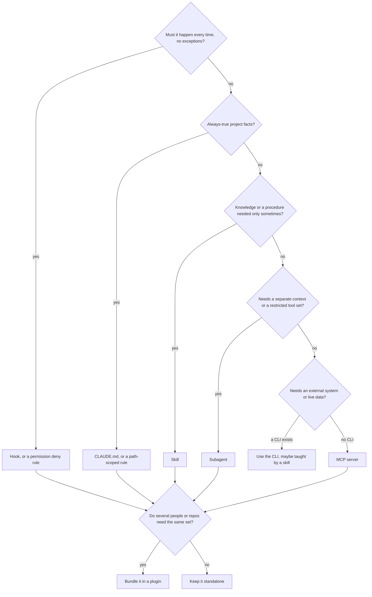

# 11 — The extension model: what each piece is and how to choose

Claude Code has a handful of extension points: instruction files, skills, subagents, hooks, MCP servers, plugins and output styles. After this chapter you can say what each one is, recognise its files on disk, and pick the right one for a job before you read the detailed chapters 12–18.

## Mental model

Every extension answers two questions differently: **who triggers it**, and **when it costs context** (the tokens it puts into the model's working memory, see [chapter 02](02-llms-tokens-and-the-context-window.md)). Get those two right and the choice usually makes itself.


- **Always loaded.** `CLAUDE.md` and unscoped rules enter context in full at launch, every session. They are advisory: the model reads them, nothing enforces them.
- **Model decides, or you invoke.** Skills, subagents and MCP tools put a short listing (names, descriptions) in context; the full content arrives only when Claude, or you, call one.
- **Harness event.** Hooks run outside the conversation when the harness reaches an event, such as "before a tool call". Only what a hook returns is added to context. Of the extensions, it is the only one that can enforce a rule; permission rules ([chapter 09](09-settings-and-permissions.md)) are the other enforcement tool.
- **External process.** An MCP server is a separate program that the harness starts or connects to; Claude decides when to call its tools.
- **A bundle.** A plugin is packaging. Each skill, agent, hook or server inside it keeps its own trigger.



The harness itself, and how it assembles each request, is covered in [chapter 05](05-inside-the-harness.md).

## CLAUDE.md and rules

**What it is.** Plain Markdown instructions that the harness concatenates into context. Use it for facts that are true in every session: build commands, conventions, things the code will not tell you. Details are in [chapter 08](08-claude-md-and-memory.md).

```text
~/.claude/CLAUDE.md              # you, every project
~/.claude/rules/*.md             # your personal rules, every project
<repo>/CLAUDE.md                 # the team, committed (or <repo>/.claude/CLAUDE.md)
<repo>/CLAUDE.local.md           # you, this project; add it to .gitignore
<repo>/.claude/rules/*.md        # one topic per file, found recursively
<repo>/src/api/CLAUDE.md         # loads once Claude touches files in src/api/
```

A path-scoped rule. `paths` is the only field a rule reads; any other key is ignored without an error:

```markdown
---
paths:
  - "src/api/**/*.ts"     # loads when Claude reads or edits a matching file
---
- Every handler validates input with a schema from `src/schemas/`.
```

- **Enters context:** ancestors and unscoped rules at launch, in full; subdirectory files and scoped rules when Claude works on a matching file. Files add up, they never override each other. A managed policy file also exists for organisations.
- **Can:** shape every answer. **Cannot:** enforce anything. The official guidance says to keep it under 200 lines and move procedures to skills.
- `@path` imports are eager: they organise the file but do not save tokens.

## Skills

**What it is.** A folder with a `SKILL.md`: instructions, reference material or a workflow that loads only when needed. Custom slash commands were merged into skills, so `/deploy` is a skill. Details in [chapter 15](15-skills.md); step-by-step in [chapter 20](20-guide-write-a-skill.md).

```text
~/.claude/skills/<name>/SKILL.md          # personal, all projects
<repo>/.claude/skills/<name>/SKILL.md     # project, commit to share
<plugin>/skills/<name>/SKILL.md           # invoked as /plugin-name:skill-name
release-notes/
├── SKILL.md
├── reference.md                          # read only when SKILL.md points to it
└── scripts/commits-since-tag.sh          # run, never loaded into context
```

```markdown
---
name: release-notes                  # becomes /release-notes
description: Use when the user asks for release notes or a changelog entry. Not for commit messages.
disable-model-invocation: false      # true = only you can run it
allowed-tools: Read Grep             # tools it may use without asking
context: fork                        # optional: run in a subagent
---
Collect the commits since the last tag, group them by type, ...
```

- **Enters context:** the `description` (plus `when_to_use`, together cut at 1,536 characters) on every turn; the body only when the skill is invoked.
- **Can:** be triggered by the model from its description, or by you as `/name`; restrict tools; run in a subagent. **Cannot:** guarantee it will be triggered, or enforce its own rules.
- All frontmatter fields are optional. When names collide, managed beats user, and user beats project.

## Subagents

**What it is.** A worker with its own context window, system prompt, tool set and model. Claude delegates a task to it and gets a summary back, so noisy work stays out of your conversation. Details in [chapter 14](14-subagents.md); step-by-step in [chapter 19](19-guide-write-a-subagent.md).

```text
~/.claude/agents/<name>.md       # all your projects
<repo>/.claude/agents/<name>.md  # this project, commit to share
<plugin>/agents/<name>.md        # namespaced my-plugin:name
claude --agents '{...}'          # JSON, this session only
```

```markdown
---
name: code-improver                 # required
description: Scans files and suggests improvements. Use after writing or modifying code.  # required
tools: Read, Grep, Glob             # allowlist; omit to inherit
model: sonnet                       # sonnet, opus, haiku, fable, full ID or inherit
---
You are a code improvement specialist. For each issue, explain it,
show the current code, and provide an improved version.
```

- **Enters context:** the description stays in your context so Claude knows when to delegate. The subagent starts with a fresh window, but still loads `CLAUDE.md`, a git status snapshot and any skills listed in `skills` (the built-in Explore and Plan agents skip `CLAUDE.md` and git status, and `omitClaudeMd: true` drops `CLAUDE.md` for yours). A *fork* starts with a copy of your whole conversation instead. Only its final result returns to you.
- **Can:** isolate context, run in parallel, use a cheaper model, run read-only. **Cannot:** share its working state with you mid-task. Plugin subagents ignore `hooks`, `mcpServers` and `permissionMode`.
- Precedence: managed > CLI flag > project > user > plugin. The `/agents` wizard was removed after v2.1.197 (it now prints a reminder); ask Claude to write the file, or write it yourself.

## Hooks

**What it is.** A handler (a shell `command`, an `http` endpoint, an `mcp_tool`, a `prompt` or an `agent`) that the harness runs on one of 34 events, such as `PreToolUse`, `PostToolUse`, `UserPromptSubmit` or `Stop`. Details in [chapter 16](16-hooks.md).

```text
~/.claude/settings.json          # "hooks" key: all your projects
<repo>/.claude/settings.json     # committed, the team
<repo>/.claude/settings.local.json
<plugin>/hooks/hooks.json        # the only standalone hooks file
skill or subagent frontmatter    # scoped to that skill or agent
```

```json
{
  "hooks": {
    "PostToolUse": [
      {
        "matcher": "Edit|Write",
        "hooks": [{ "type": "command", "command": "f=$(jq -r '.tool_input.file_path') && npx prettier --write --ignore-unknown \"$f\"" }]
      }
    ]
  }
}
```

Three levels: the **event**, a **matcher** (one string, here a tool-name pattern), and the **handlers**. The handler gets the event as JSON on stdin.

- **Enters context:** nothing, unless the hook returns text for the model (`hookSpecificOutput.additionalContext`). A `systemMessage` goes to the user, not the model.
- **Can:** block an action (`exit 2`, or a `deny` decision), run a step every time, inject context. `exit 1` does **not** block. **Cannot:** understand intent: a command guard matches text, so test it for false positives.
- `/hooks` is a read-only browser. Settings edits are picked up live.

## MCP servers

**What it is.** A program that speaks the Model Context Protocol and exposes tools (and other primitives) from an outside system: an issue tracker, a database, a browser. How the protocol works is in [chapter 12](12-mcp-how-it-works.md); adding and building servers is in [chapter 13](13-mcp-in-practice.md).

```text
~/.claude.json                   # local scope (default, per project path) and user scope
<repo>/.mcp.json                 # project scope, committed; asks before first use
<plugin>/.mcp.json               # shipped by a plugin
```

```json
{
  "mcpServers": {
    "tracker": { "type": "http", "url": "https://mcp.example.com/mcp",
                 "headers": { "Authorization": "Bearer ${TRACKER_TOKEN}" } },
    "notes":   { "type": "stdio", "command": "uv", "args": ["run", "notes_server.py"] }
  }
}
```

- **Enters context:** with tool search (on by default), tool names and server instructions at session start, full definitions on demand. Each result enters context when a tool is called.
- **Can:** give Claude live data and actions it cannot reach with files or Bash. **Cannot:** be cheaper than an existing CLI: the cost docs say to prefer `gh`, `aws` or `gcloud` when one exists.
- Add one with `claude mcp add`; check it with `/mcp`. `mcpServers` inside `settings.json` is not read.

## Plugins

**What it is.** The packaging layer: one installable, versioned unit holding any mix of skills, agents, hooks, MCP servers and more, distributed through a *marketplace* (a catalogue file). Details in [chapter 17](17-plugins-and-marketplaces.md); step-by-step in [chapter 21](21-guide-build-and-ship-a-plugin.md).

```text
team-kit/
├── .claude-plugin/
│   └── plugin.json          # the manifest, and nothing else goes here
├── skills/<name>/SKILL.md
├── agents/<name>.md
├── hooks/hooks.json         # same shape as "hooks" in settings
├── .mcp.json
└── output-styles/
```

```json
{
  "name": "team-kit",
  "version": "0.1.0",
  "description": "A changelog skill, a read-only reviewer and a push guard",
  "author": { "name": "Your Name" }
}
```

- `name` is the only required key; it becomes the namespace (`/team-kit:changelog`).
- **Enters context:** whatever its components put there. "An enabled plugin is part of every session, not only the sessions where you use it": skill and agent descriptions every turn, its MCP servers every session. `claude plugin details <name>` shows the projected token cost.
- **Can:** share one setup across repositories and people, with versions and updates. **Cannot:** load a root `CLAUDE.md` as context. Scaffold one with `claude plugin init <name>`; check it with `claude plugin validate`.

## Output styles, briefly

An output style is one Markdown file (`~/.claude/output-styles/` or `.claude/output-styles/`) that sets Claude's voice and format for the whole session. Frontmatter keys: `name`, `description`, `keep-coding-instructions`, `force-for-plugin`. Without `keep-coding-instructions: true` it replaces the built-in coding instructions. Switch with `/output-style <style>`; see [chapter 18](18-output-styles-statusline-keybindings.md).

## How to choose

### What the official docs say

The "Extend Claude Code" page (https://code.claude.com/docs/en/features-overview) gives a trigger for each addition, quoted here:

| Trigger | Add |
|---|---|
| Claude gets a convention or command wrong twice | Add it to CLAUDE.md |
| You keep asking Claude to be shorter, explain more, or answer in the same format | Set an output style |
| You keep typing the same prompt to start a task | Save it as a user-invocable skill |
| You paste the same playbook or multi-step procedure into chat for the third time | Capture it as a skill |
| You keep copying data from a browser tab Claude can't see | Connect that system as an MCP server |
| A side task floods your conversation with output you won't reference again | Route it through a subagent |
| You want something to happen every time without asking | Write a hook |
| A second repository needs the same setup | Package it as a plugin |

Three lines from its comparison tabs carry most of the weight: "**Put guardrails in hooks.** An instruction like 'never edit `.env`' in CLAUDE.md or a skill is a request, not a guarantee." / "MCP connects Claude to external services. Skills extend what Claude knows, including how to use those services effectively." / "**Rule of thumb:** Keep CLAUDE.md under 200 lines." Its context-cost row: CLAUDE.md "Every request"; skills "Low (descriptions every request)"; MCP "Low until a tool is used"; subagents "Isolated from main session"; hooks "Zero, unless hook returns additional context".

### A decision flowchart



Permission rules (`permissions.deny` and friends) are not an extension, but they sit beside hooks as the other enforcement tool; see [chapter 09](09-settings-and-permissions.md).

### Use cases

| Job | Mechanism | Why | Common wrong choice |
|---|---|---|---|
| Never let Claude push to main | `PreToolUse` hook on `Bash`, plus server-side branch protection | A hook can match spellings such as `git -C . push` that a `Bash(git push *)` rule misses; the server holds for everyone | A line in CLAUDE.md, which is only a request |
| Keep secrets out of reads | Deny rules such as `Read(./.env)`, plus the sandbox with `filesystem.denyRead` | The rule stops file tools and `cat`; only the sandbox stops a script that opens the file itself | "Never read .env" as an instruction |
| Format code after every edit | `PostToolUse` hook on `Edit\|Write` | Runs every time, costs no context | Asking Claude to run the formatter |
| Run tests before Claude stops | `Stop` hook that checks a predicate | Blocking `Stop` keeps the turn going until it passes, up to 8 continuations in a row | A reminder in CLAUDE.md, which Claude can forget |
| Our build and test commands | CLAUDE.md | Needed in nearly every session | A skill nobody triggers |
| Rules for one directory or language | Path-scoped rule | Loads only for matching files | A longer root CLAUDE.md |
| Our release checklist | Skill with `disable-model-invocation: true` | A procedure you run on purpose | Pasting it into chat each time |
| Consistent commit messages | Skill (model-invoked) | Loads when Claude writes a commit | A wall of rules in CLAUDE.md |
| Explain the codebase to newcomers | Skill with reference files | Large material, loaded on demand | All of it in CLAUDE.md |
| Review a diff without editing | Subagent with `tools: Read, Grep, Glob` | Read-only tool set, separate context | A skill, which runs in your context with your tools unless you list `disallowed-tools` |
| Search a large repo for one answer | Built-in Explore subagent | The file dumps stay out of your window | Reading the files yourself |
| A two-line lookup | Just ask in the main conversation | Delegation overhead outweighs it | A custom subagent |
| Query our issue tracker | MCP server, or its CLI if it has one | Live data Claude cannot see otherwise | Copying tickets into chat |
| Work with GitHub | The `gh` CLI, taught by a skill if needed | A CLI costs no listing tokens | An MCP server by default |
| Shorter answers in every reply | Output style | Sets the voice for the whole session | Repeating "be brief" |
| Share our team's setup | Plugin in a team marketplace | One install, versioned updates | Copying files between repos |
| One personal helper skill | `~/.claude/skills/` | No packaging needed | A plugin |
| Keep critical context after compaction | `SessionStart` hook with matcher `compact` returning `additionalContext` | Re-injected after every compaction | Hoping the summary keeps it |

### Combinations that work

- **A skill that runs in a subagent:** `context: fork` plus `agent: Explore` gives a read-only investigation that leaves only its result in your window. The inverse is a subagent with `skills:` to preload knowledge.
- **A hook that enforces what CLAUDE.md asks:** the instruction says why, the hook makes it true. The docs: "Use CLAUDE.md for 'we do it this way here.' Use permissions or hooks for security boundaries."
- **A skill that teaches an MCP server or CLI:** the server gives access; the skill says how your team uses it.
- **A plugin bundling skill + hook + agent + MCP server:** a changelog skill, a read-only reviewer agent, a push guard and the tracker server, installed in one step.

### Anti-patterns

- **A must-never-break rule written only as an instruction.** It will be followed most of the time, which is not the same as always. Add a hook or deny rule.
- **A giant always-loaded CLAUDE.md.** Every line costs tokens in every request. Move procedures to skills and directory rules to path-scoped rules.
- **A subagent for a two-line lookup.** It pays for a new window and a summary to save nothing.
- **An MCP server where a CLI exists.** You pay for tool listings and a server process for what `gh` already does.
- **A plugin for one personal skill.** The docs: "Keep that standalone setup while it serves one project or only you."
- **A hook that answers `ask` by default.** Hooks run before the permission mode is consulted, so a hook `ask` prompts even in bypass mode; let a hook deny or stay out of the way.

## From the field

All numbers come from one developer's repos and roughly four weeks of transcripts, surveyed Nov 2026. They show what happened in that setup, not general benchmarks.

- **Descriptions are the bill.** In the author's plugin repo, an ablation attributed about 82% of the plugin's token overhead to skill and agent `description` plus `when_to_use`, and about 9% to all its hooks. Trimming those fields by 28% *raised* should-trigger coverage from 84% to 94%. The repo now holds a CI budget for always-on text.
- **The wrong output channel.** 15 of 25 skills in the same plugin were never invoked across 953 sessions. The hook that suggested them used `systemMessage`, which only the user sees, and fired on `Stop`. Moving it to `additionalContext` on `UserPromptSubmit` put the suggestion where the model reads it.
- **A feature removed.** The plugin once shipped four permission levels built on hooks. They were removed in a major release because a hook `ask` is honoured in every mode, so the maintainer was prompted constantly.
- **Rule, hook, memory.** The author's global setup stores each hard rule three times: prose with its reason in `CLAUDE.md`, a hook that enforces it, and a memory entry naming the hook. One hook's header gives the motive: the rule was already in `CLAUDE.md` and "still recurred in the next session, because advisory text does not stop a reflex."
- **The instruction diet.** A product workspace loaded about 7k tokens of instructions before the first prompt. The fix was `paths:`-scoped rules, an instruction file cut by about 40%, and facts moved into skills and reference docs.

> **Field note:** Lessons there move along a promotion path: memory, then `CLAUDE.md`, then a hook, and hook scripts that prove themselves move from `~/.claude/hooks` into a plugin.

## Common problems

| Symptom | Cause | Fix |
|---|---|---|
| Claude still breaks a rule in CLAUDE.md | Instructions are advisory | Enforce it with a hook or a permission deny rule |
| A skill never triggers | Vague description, or it is hidden from the model | Put the user's words in `description`; check `disable-model-invocation`; test with `/name` |
| Context fills before you type | Long CLAUDE.md, many skills, plugins or MCP servers | Check `/context`, `/skills` (`t` sorts by tokens) and `/doctor`; disable what you do not use |
| A hook's message has no effect on Claude | It used `systemMessage` or stderr | Return `hookSpecificOutput.additionalContext` |
| A hook "blocks" nothing | It exits 1 | Exit 2, or return a deny decision |
| Files in a plugin are ignored | They sit inside `.claude-plugin/` | Keep only `plugin.json` there; components go at the plugin root |
| A subagent definition does not load | Missing `name` or `description`, or bad YAML | Run `claude --debug` and read `~/.claude/debug/<session-id>.txt`; `claude plugin validate .claude/agents` catches other errors but not a missing `name` |

## Checklist

- [ ] Every rule that must never break has a hook or deny rule, not only an instruction.
- [ ] `CLAUDE.md` holds facts true in every session and stays under about 200 lines.
- [ ] Directory- or language-specific guidance lives in path-scoped rules.
- [ ] Procedures and reference material are skills with short, specific descriptions.
- [ ] Noisy or read-only work goes to a subagent with a restricted tool set.
- [ ] You use a CLI before adding an MCP server for the same system.
- [ ] Only setups shared across people or repositories are packaged as plugins.
- [ ] You have looked at `/context` to see what your extensions cost.

## Try it

1. Run `/context` in a project you use. List every extension that loads, sort them into the four trigger columns of the figure, and note the one that costs the most tokens.
2. Pick three rules from your `CLAUDE.md`. For each, decide with the flowchart whether it should stay, become a path-scoped rule or skill, or get a hook.
3. Take one job you repeat each week and write its row for the use-case table: mechanism, why, and the wrong choice you might have made.

## Sources

- Extend Claude Code (feature comparison, triggers, context costs): https://code.claude.com/docs/en/features-overview
- Memory and rules: https://code.claude.com/docs/en/memory
- Skills: https://code.claude.com/docs/en/skills
- Subagents: https://code.claude.com/docs/en/sub-agents
- Hooks reference and guide: https://code.claude.com/docs/en/hooks · https://code.claude.com/docs/en/hooks-guide
- MCP: https://code.claude.com/docs/en/mcp ; costs (prefer a CLI): https://code.claude.com/docs/en/costs
- Plugins: https://code.claude.com/docs/en/plugins/overview · https://code.claude.com/docs/en/plugins/create
- Output styles: https://code.claude.com/docs/en/output-styles
- Debug your config (where hooks live, what loaded): https://code.claude.com/docs/en/debug-your-config
- Commands (`/agents`, `/hooks`, `/skills`, `/doctor`): https://code.claude.com/docs/en/commands
- Blog, "Steering Claude Code: when to use CLAUDE.md, skills, hooks, and subagents": https://claude.com/resources/articles/steering-claude-code-skills-hooks-rules-subagents-and-more
- Field data: the author's plugin repo, global configuration and a product workspace, surveyed 2026-11-25.

---

[← Previous: Plan mode, checkpoints and context management](10-plan-mode-checkpoints-and-context-management.md) · [Contents](README.md) · [Next: MCP: how the protocol works →](12-mcp-how-it-works.md)
