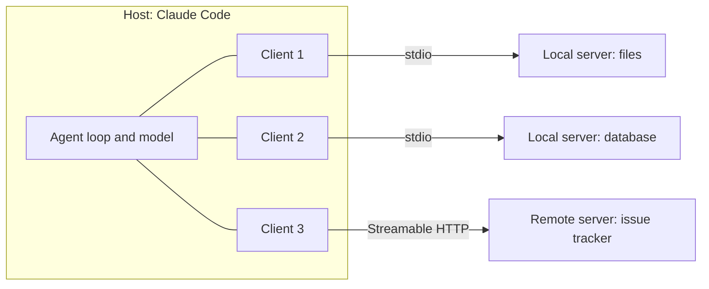
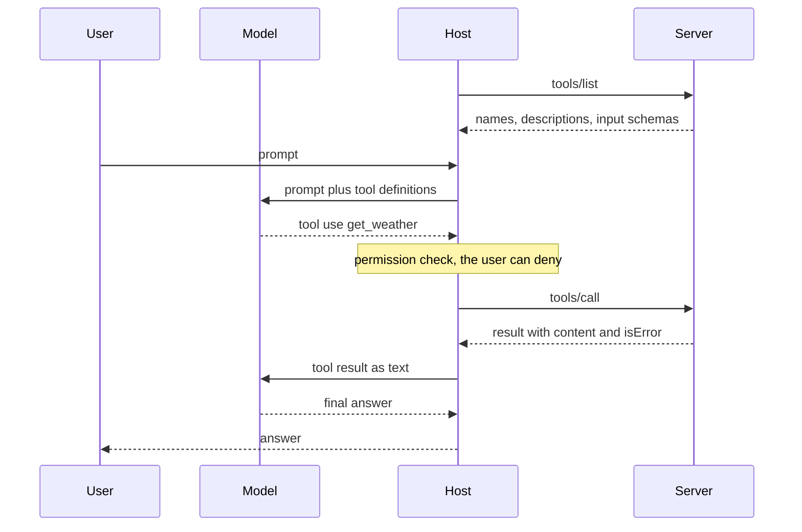
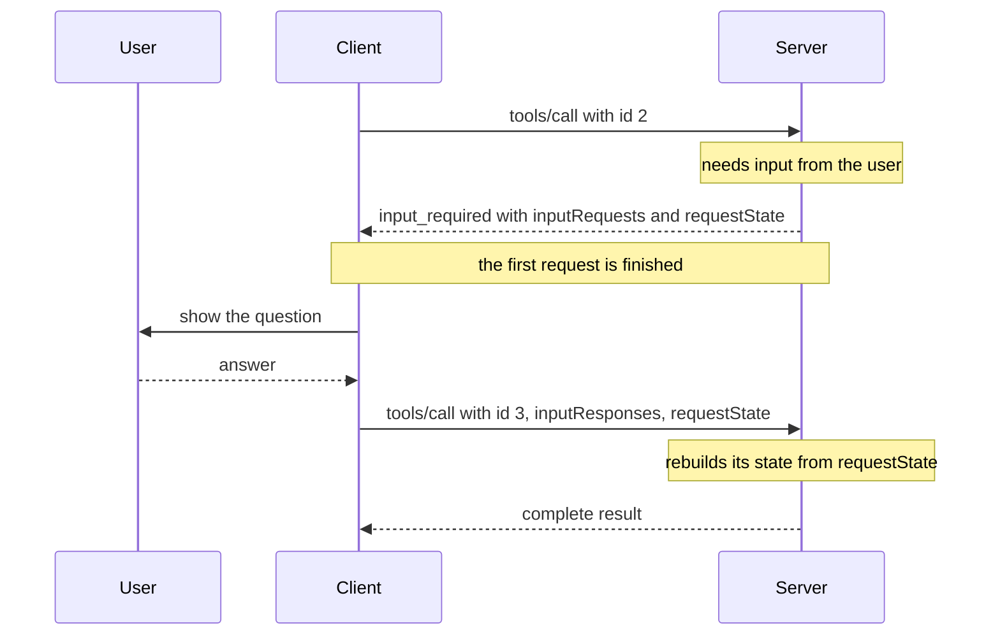

# 12 — MCP: how the protocol works

After this chapter you can read a Model Context Protocol exchange on the wire and say what each side is doing: who discovers what, who decides to call a tool, and what comes back when a call fails. You will also know what the 2026-07-28 revision changed, so you can tell whether a server, an SDK or a tutorial describes the current protocol or the older one.

## Mental model

**The problem.** A coding agent is only as useful as the systems it can reach: the issue tracker, the database, the browser, your internal API. Without a shared protocol, every AI application needs its own adapter for every system, and each adapter is written again for the next application. The **Model Context Protocol (MCP)** replaces that with one contract. You wrap a system once as an *MCP server*, and every application that speaks MCP can use it. MCP has three roles:

| Role | What it is | Example |
|---|---|---|
| **Host** | The AI application (the figure labels it *Application*). It coordinates and manages one or more MCP clients | Claude Code, Claude Desktop, an IDE |
| **Client** | A component inside the host that holds the connection to one server. The host creates one client per server | Created by the host; you never write it |
| **Server** | A program that provides context to clients. It runs on your machine or remotely | A browser-automation server, an issue-tracker server, your own |

The figure shows the same roles. The application, for example Claude Code, holds one MCP client per connection: one reaches a local server over stdio (the server process's standard input and output), the other a remote server over Streamable HTTP. The strip along its lower edge is the exchange this chapter walks through: `tools/list` to discover, then `tools/call` for the tool the model chose.




Three ideas carry the rest of the chapter:

1. **The model never talks to a server.** The model asks for a tool call, the host decides whether to allow it, the client sends the message, and the result returns to the model as text in its context window (see [chapter 3](03-the-agentic-loop-and-tool-use.md)).
2. **Messages and transport are separate layers.** The *data layer* defines the messages: discovery, tools, resources, prompts, notifications. The *transport layer* defines how the bytes move. The spec says "Protocol semantics are identical on every transport".
3. **Each request stands alone.** Since revision 2026-07-28 there is no handshake and no session. Every request carries what the server needs to process it.

## Three primitives, three owners

A server can offer three kinds of thing, called *primitives*. They differ in who decides when one is used.

| Primitive | Who decides | What it is | Methods | In Claude Code ([chapter 13](13-mcp-in-practice.md)) |
|---|---|---|---|---|
| **Tools** | The model ("model-controlled") | Functions the model calls to act or fetch data | `tools/list`, `tools/call` | `mcp__<server>__<tool>` |
| **Resources** | The application ("application-driven") | Data with a URI that the client attaches as context | `resources/list`, `resources/read`, `resources/templates/list` | `@server:protocol://resource/path` |
| **Prompts** | The user ("user-controlled") | Templates the user picks explicitly, typically as slash commands | `prompts/list`, `prompts/get` | `/servername:promptname` |

The control column is design intent: the spec adds that the protocol "does not mandate any specific user interaction model", so each host decides how to surface each primitive. Clients offer one feature back to servers: **elicitation**, where a server asks the user for more input. Two older client features, *roots* and *sampling*, are deprecated as of 2026-07-28. They still work during the deprecation window, but do not build new servers on them.

## Messages are JSON-RPC

Every MCP message is a JSON-RPC 2.0 object encoded as UTF-8. JSON-RPC is a small standard for calling a named method on another program with JSON messages. There are three shapes:

| Shape | `id` | `method` | Who sends it |
|---|---|---|---|
| Request | yes | yes | The client only |
| Response (`result` or `error`) | same as the request | no | The server only |
| Notification | no | yes | Either side; no reply is expected |

The one-way rule is new in 2026-07-28: "servers do not initiate JSON-RPC requests and clients do not send JSON-RPC responses". A complete request looks like this (from the spec):

```json
{
  "jsonrpc": "2.0", "id": 1,
  "method": "tools/call",
  "params": {
    "name": "get_weather",
    "arguments": { "location": "Seattle, WA" },
    "_meta": {
      "io.modelcontextprotocol/protocolVersion": "2026-07-28",
      "io.modelcontextprotocol/clientInfo": { "name": "ExampleClient", "version": "1.0.0" },
      "io.modelcontextprotocol/clientCapabilities": {}
    }
  }
}
```

The `_meta` block is what makes the request stand alone. Protocol version and client capabilities are required on every request; client identity is recommended. The spec's own examples leave `_meta` out for brevity, and so do the shorter examples below. Real requests always include it.

## Two transports: stdio and Streamable HTTP

| | stdio | Streamable HTTP |
|---|---|---|
| Who starts the server | The client launches it as a subprocess | It already runs on its own and serves many clients |
| Framing | One JSON-RPC message per line on `stdin`/`stdout`, no embedded newlines | Each client message is its own HTTP POST to a single MCP endpoint |
| Reply | A line on `stdout` | `application/json` (one object) or `text/event-stream` (a stream scoped to that request: progress notifications, then the response) |
| Request metadata | In the body only | In the body, mirrored into headers `MCP-Protocol-Version`, `Mcp-Method`, `Mcp-Name` |
| Cancelling | The client sends `notifications/cancelled` | The client closes the response stream |
| Credentials | Read from the environment | Optional OAuth 2.1; when used, a bearer token on every request |
| Use it for | Local tools that need your files, your shell or one user's credentials | Shared or hosted services used by many people |

The same call over HTTP adds headers that let load balancers route without parsing the body:

```http
POST /mcp HTTP/1.1
Host: example.com
Content-Type: application/json
Accept: application/json, text/event-stream
MCP-Protocol-Version: 2026-07-28
Mcp-Method: tools/call
Mcp-Name: get_weather
```

- **stdio:** "The server MUST NOT write anything to its `stdout` that is not a valid MCP message." Logs go to `stderr`. One stray `print` corrupts the stream.
- **HTTP:** the body is the source of truth. If a header disagrees with it, the server rejects the request with `400` and JSON-RPC error `-32020` (`HeaderMismatch`). Servers MUST validate the `Origin` header and SHOULD bind to localhost when they run locally, to block DNS-rebinding attacks.
- **"SSE" means two things.** The old *HTTP+SSE transport* (two endpoints, from 2024-11-05) is deprecated. Server-Sent Events as a *response format* inside Streamable HTTP is current.

## What revision 2026-07-28 changed

MCP versions are dates. `2026-07-28` is current as of Nov 2026 and is a breaking change from `2025-11-25`: the protocol became stateless. The spec calls the two generations *modern* and *legacy*.

| Topic | Legacy (2025-11-25 and earlier) | Modern (2026-07-28) |
|---|---|---|
| Opening | `initialize` request, then `notifications/initialized` | No handshake. Version and capabilities ride in `_meta` on every request |
| Sessions | `Mcp-Session-Id` header on HTTP | None. Cross-call state is an explicit handle the server returns and the model passes back as a tool argument |
| What a server supports | In the `initialize` response | `server/discover`: servers MUST implement it, clients MAY call it |
| Server needs something from the client | The server sends its own request (`elicitation/create`, `sampling/createMessage`, `roots/list`) | Multi Round-Trip Requests: the server replies `input_required` and the client retries |
| Results | No type marker | Every result has `resultType`: `complete` or `input_required` |
| Change notifications | A GET stream, `resources/subscribe` | One opt-in `subscriptions/listen` stream |
| Broken stream | Resume with `Last-Event-ID` | No resume. The client re-issues the request with a new `id` |
| Deprecated | | Roots, Sampling, protocol Logging, the HTTP+SSE transport, Dynamic Client Registration |

`server/discover` replaces the handshake as the way to ask a server what it speaks (response from the spec):

```json
{
  "jsonrpc": "2.0", "id": "discover-1",
  "result": {
    "resultType": "complete",
    "supportedVersions": ["2026-07-28"],
    "capabilities": { "tools": {}, "resources": {} },
    "_meta": { "io.modelcontextprotocol/serverInfo": { "name": "ExampleServer", "version": "1.0.0" } },
    "instructions": "This server provides weather and resource utilities.",
    "ttlMs": 3600000, "cacheScope": "public"
  }
}
```

**What this means for older servers.** An implementation is *modern*, *legacy* or *dual-era* (both).

| Client | Server | Outcome |
|---|---|---|
| Modern only | Legacy only | Fails |
| Legacy only | Modern only | Fails. A legacy client has no way to fall forward |
| Dual-era | Legacy or modern | Works. On stdio the client probes with `server/discover` and falls back to `initialize` on an unrecognised error or a timeout. On HTTP it tries a modern request and inspects the `400` body before falling back |
| Any | Dual-era | Works. The server picks its behaviour from how the client opens |

- A server built on a 2025 SDK keeps working with dual-era clients. Upgrade its SDK to reach modern-only clients. Clients MUST treat a result with no `resultType` (from an older server) as `complete`.
- Claude Code before v2.1.302 showed `tools fetch failed` in `/mcp` for a server on revision 2026-07-28. Update the client. How Claude Code probes older servers is not described in the docs read for this book, so check behaviour in your version.
- Most tutorials and videos from before mid-2026 describe the legacy model.

## Discovery and invocation

The client learns a server's tools with `tools/list`. The response (from the spec, icons removed):

```json
{
  "jsonrpc": "2.0", "id": 1,
  "result": {
    "resultType": "complete",
    "tools": [
      {
        "name": "get_weather",
        "title": "Weather Information Provider",
        "description": "Get current weather information for a location",
        "inputSchema": {
          "type": "object",
          "properties": { "location": { "type": "string", "description": "City name or zip code" } },
          "required": ["location"]
        }
      }
    ],
    "nextCursor": "next-page-cursor", "ttlMs": 300000, "cacheScope": "public"
  }
}
```

`name`, `description` and `inputSchema` (a JSON Schema) are what the model sees when it chooses a tool. List rules worth knowing:

- **Pagination.** If `nextCursor` is present, send it back as `params.cursor` for the next page. The cursor is opaque: do not parse it, and do not assume a page size. A missing `nextCursor` means the end.
- **Caching.** `ttlMs` says how long the list stays fresh and `cacheScope` says who may reuse it.
- **Stability.** The list MUST NOT vary per connection, but it MAY vary by the authorization on the request. Servers SHOULD return tools in the same order every time, which also helps prompt-cache hit rates ([chapter 4](04-prompt-caching-compaction-and-cost.md)).

To run a tool the client sends `tools/call` with the tool's `name` and an `arguments` object (the request shown earlier). The response:

```json
{
  "jsonrpc": "2.0", "id": 2,
  "result": {
    "resultType": "complete",
    "content": [{ "type": "text", "text": "Current weather in New York:\nTemperature: 72°F\nConditions: Partly cloudy" }],
    "isError": false
  }
}
```

`content` is a list of blocks: `text`, `image`, `audio`, `resource_link` or an embedded `resource`. A tool can also return `structuredContent`, a JSON value that matches its `outputSchema`. End to end:



## Two kinds of error

A failed call comes back in one of two forms, and the difference decides whether the model can recover.

| | Protocol error | Tool execution error |
|---|---|---|
| Wire form | JSON-RPC `error` object | Normal `result` with `isError: true` |
| Used for | Unknown tool, malformed request, server fault | API failure, invalid input value, business-rule failure |
| Reaches the model? | Clients MAY pass it on; recovery is unlikely | Clients SHOULD pass it on so the model can correct itself |

```json
{ "jsonrpc": "2.0", "id": 3, "error": { "code": -32602, "message": "Unknown tool: invalid_tool_name" } }
```

```json
{
  "jsonrpc": "2.0", "id": 4,
  "result": {
    "resultType": "complete",
    "content": [{ "type": "text", "text": "Invalid departure date: must be in the future. Current date is 08/08/2025." }],
    "isError": true
  }
}
```

The second form is a message *to the model*. It says what was wrong and what a valid value looks like, so the next call can succeed. Input validation moved from protocol errors to `isError` results in revision 2025-11-25 for that reason. If you write a server, return validation failures as `isError`.

## Multi Round-Trip Requests

Sometimes a server cannot finish without asking something, such as a confirmation or a missing value. A modern server may not send its own request, so it answers the call with an *interim result* and the client tries again. This is **Multi Round-Trip Requests (MRTR)**. It is allowed on `tools/call`, `prompts/get` and `resources/read` only.



The interim result, then the `params` of the retry (both from the spec):

```json
{
  "jsonrpc": "2.0", "id": 2,
  "result": {
    "resultType": "input_required",
    "inputRequests": {
      "github_login": {
        "method": "elicitation/create",
        "params": {
          "mode": "form",
          "message": "Please provide your GitHub username",
          "requestedSchema": { "type": "object", "properties": { "name": { "type": "string" } }, "required": ["name"] }
        }
      }
    },
    "requestState": "eyJsb2NhdGlvbiI6Ik5ldyBZb3JrIn0..."
  }
}
```

```json
{
  "name": "get_weather",
  "arguments": { "location": "New York" },
  "inputResponses": { "github_login": { "action": "accept", "content": { "name": "octocat" } } },
  "requestState": "eyJsb2NhdGlvbiI6Ik5ldyBZb3JrIn0..."
}
```

- The retry is a new request with a new `id`. The server keeps no memory of the first one.
- `requestState` is opaque to the client, which MUST echo it back unchanged. The server MUST treat it as attacker-controlled input and protect its integrity (for example with an HMAC) if it affects authorization or business logic.
- A server MUST NOT send an input request for a capability the client did not declare in `_meta`.

## Authorization for remote servers

Authorization is optional and defined for HTTP transports only. A stdio server SHOULD NOT use it and takes credentials from its environment instead. For a protected remote server the roles map onto OAuth 2.1: the MCP server is the *resource server*, the MCP client is the *OAuth client*, and a separate *authorization server* signs the user in and issues tokens.

1. The client sends a request with no token. The server answers `401` with a `WWW-Authenticate` header that points at its metadata document (shown below).
2. The client reads that document (OAuth Protected Resource Metadata, RFC 9728), finds the authorization server and reads its metadata.
3. The client gets a client ID: a Client ID Metadata Document (preferred), pre-registration, or Dynamic Client Registration (deprecated, kept for older authorization servers).
4. The client opens a browser with PKCE (a one-time proof that binds the authorization code to this client) and a `resource` parameter naming the MCP server (RFC 8707). The user approves, and the client exchanges the code for an access token.
5. The client retries with `Authorization: Bearer <access-token>`, on every request and never in the query string.

```http
HTTP/1.1 401 Unauthorized
WWW-Authenticate: Bearer resource_metadata="https://mcp.example.com/.well-known/oauth-protected-resource",
                         scope="files:read"
```

Two rules prevent token misuse. The server MUST check that a token was issued for it and MUST NOT accept or forward any other token. The client MUST NOT send the server a token from a different authorization server. If a token lacks a scope mid-session, the server answers `403` with `error="insufficient_scope"` and the client re-authorizes with a larger scope set.

## The human in the loop

Tools are model-controlled, so the spec puts the brake in the host: "there SHOULD always be a human in the loop with the ability to deny tool invocations". Applications SHOULD show which tools are exposed, show when a tool runs, and ask for confirmation. The protocol requires no particular UI; Claude Code implements this with its permission system ([chapter 9](09-settings-and-permissions.md)). Each side has duties. Servers MUST validate all tool inputs, enforce access controls, rate-limit calls and sanitize outputs. Clients SHOULD confirm sensitive operations, show tool inputs before sending them, set timeouts and log tool use. Clients MUST treat tool annotations (a server's hints about a tool's behaviour) as untrusted unless the server is trusted.

> **Warning:** A tool description is text that the model reads and you usually do not. A malicious server can hide instructions in it (*tool poisoning*), change a description after you approved the server (*rug pull*), or use its descriptions to interfere with another server's tools (*cross-server shadowing*). Anthropic "does not security-audit or manage any MCP server". Treat servers like dependencies: trusted source, pinned version. Defences are in [chapter 29](29-security-and-guardrails.md).

## From the field

> **Field note:** Two of the five MCP servers the author built show the two eras. A memory service uses the TypeScript SDK v2 and answers both the 2025-era handshake and revision 2026-07-28. A device-lab gateway is hand-written JSON-RPC over Streamable HTTP, pinned at protocol `2025-03-26` with `Mcp-Session-Id` sessions; it accepts POST only and answers GET with 405. The hand-written server owns every protocol change itself, which is the practical argument for an SDK.

> **Field note:** The same gateway computes its tool list per caller: API surface, intersected with the caller's role, intersected with the device contract the caller holds. Its design note reads "an agent must never be told a tool is callable when the caller's contract forbids it". The modern spec permits this: the list may vary by the authorization on the request, never by connection.

> **Field note:** In about four weeks of one developer's transcripts, MCP tools were 1,822 of 111,557 tool calls (1.63%), and 5.71% of them were flagged as errors against 2.43% for all tools. This is one person's rolling window and the harness's own error flag, not a benchmark. It still shows why the text of an error result matters: MCP calls failed more than twice as often as the average tool.

## Common problems

| Symptom | Cause | Fix |
|---|---|---|
| A server works in one client but shows no tools, or `tools fetch failed`, in another | Era mismatch between a modern-only and a legacy-only side | Update the client (Claude Code v2.1.302 or later for 2026-07-28 servers); build servers on a dual-era SDK |
| A stdio server connects, then returns garbage or zero tools | Something other than MCP messages was written to `stdout` | Send all logs to `stderr` |
| HTTP request rejected with `400` and code `-32020` | A header disagrees with the body, or a required header is missing | Let the SDK build the headers; check proxies that rewrite them |
| The model gives up after one failed call | The server sent a protocol error for a fixable input problem | Return `isError: true` with text that says what to change |
| A tutorial's `initialize` example fails against a new server | The tutorial describes the legacy handshake | Send per-request `_meta`; call `server/discover` for capabilities |
| A call is lost after a network drop | Modern streams cannot be resumed | Re-issue with a new `id`. The tool may already have run, so check before repeating a write |
| A server "asks a question" and nothing happens | It returned `input_required` and the client never retried | Use a client that supports elicitation; servers must only request inputs the client declared |

## Checklist

- [ ] I can name the host, client and server for one tool I use.
- [ ] I know which primitive is model-controlled, which is application-driven and which is user-controlled.
- [ ] Given a JSON message, I can say whether it is a request, a response or a notification.
- [ ] I can explain why a local tool uses stdio and a shared service uses Streamable HTTP.
- [ ] I can list four things revision 2026-07-28 removed or replaced.
- [ ] I know which failures arrive as `isError: true` and why the model handles those better.
- [ ] I know a remote server must reject tokens that were not issued for it.
- [ ] I treat tool descriptions and tool output as untrusted text.

## Try it

1. **Read the wire.** Pipe one request into any stdio server you have (replace the command after the pipe) and read the reply. A modern server returns `supportedVersions` and `capabilities`, or an unsupported-version error that lists the versions it accepts. Any other error, or silence, means legacy.

   ```bash
   printf '%s\n' '{"jsonrpc":"2.0","id":1,"method":"server/discover","params":{"_meta":{"io.modelcontextprotocol/protocolVersion":"2026-07-28","io.modelcontextprotocol/clientCapabilities":{}}}}' | node build/index.js
   ```

2. **Classify errors.** Pick a tool you use. List three ways it can fail, decide for each whether it is a protocol error or an `isError` result, and write the message the model should read.
3. **Spot the era.** Open any MCP tutorial or server README and look for `initialize`, `Mcp-Session-Id`, an SSE endpoint or server-initiated sampling. Each one marks legacy material.

## Sources

- https://modelcontextprotocol.io/docs/learn/architecture
- https://modelcontextprotocol.io/specification/2026-07-28/changelog
- https://modelcontextprotocol.io/specification/2026-07-28/basic/versioning
- https://modelcontextprotocol.io/specification/latest/basic/transports (with the `stdio` and `streamable-http` binding pages)
- https://modelcontextprotocol.io/specification/2026-07-28/server/discover
- https://modelcontextprotocol.io/specification/latest/server/tools
- https://modelcontextprotocol.io/specification/2026-07-28/server/resources and `/server/prompts`
- https://modelcontextprotocol.io/specification/2026-07-28/server/utilities/pagination
- https://modelcontextprotocol.io/specification/2026-07-28/basic/patterns/mrtr
- https://modelcontextprotocol.io/specification/latest/basic/authorization
- https://code.claude.com/docs/en/mcp, https://code.claude.com/docs/en/mcp-quickstart and https://code.claude.com/docs/en/security
- https://invariantlabs.ai/blog/mcp-security-notification-tool-poisoning-attacks

---

[← Previous: The extension model: what each piece is and how to choose](11-the-extension-model.md) · [Contents](README.md) · [Next: MCP in practice: using and building servers →](13-mcp-in-practice.md)
