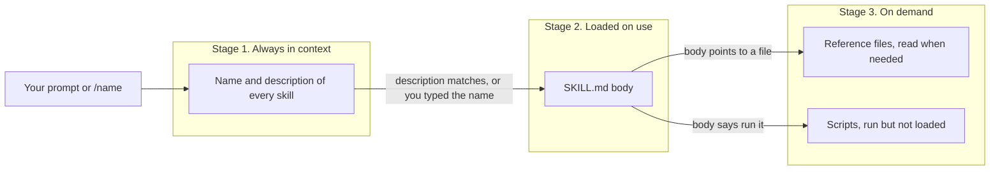

# 13 — Skills

After this chapter you can package a procedure as a skill that costs one sentence of context until
it is used, control who may run it and with which tools, and measure whether it triggers and
whether it helps. You will also know which parts of a skill travel to other coding agents.

## Mental model

A **skill** is a folder with a `SKILL.md` file in it. The file has two parts: YAML frontmatter that
tells Claude when to use the skill, and a Markdown body with the instructions Claude follows when
the skill runs. Claude loads a skill on its own when your request matches its description, or you
run it yourself by typing `/skill-name`.

**Progressive disclosure** means a skill is loaded in stages, and you pay for a stage only when it
is reached:

1. **Listing.** The name and description of every skill sit in context on every turn.
2. **Body.** The rest of `SKILL.md` loads only when the skill is invoked.
3. **Supporting files.** Reference files are read and scripts are run only when the body says so.



This is the difference from `CLAUDE.md` ([chapter 7](07-claude-md-and-memory.md)), which loads in
full every session. The docs: "Unlike CLAUDE.md content, a skill's body loads only when it's used,
so long reference material costs almost nothing until you need it." Stage 1 is not free, though:
"Every skill in the skill listing adds to your context on every turn."

The docs say when to make one: "Create a skill when you keep pasting the same instructions,
checklist, or multi-step procedure into chat, or when a section of CLAUDE.md has grown into a
procedure rather than a fact." A short fact needed in most tasks stays in `CLAUDE.md`. A rule with
zero exceptions belongs in a hook ([chapter 14](14-hooks.md)): a skill is text the model reads, so
nothing guarantees it is followed.

## Where skills live and which one wins

| Scope | Path | Loads in |
|---|---|---|
| Enterprise | `.claude/skills/<name>/SKILL.md` in the managed settings directory | Every machine the organization deploys it to |
| Personal | `~/.claude/skills/<name>/SKILL.md` | All your projects on this machine |
| Project | `.claude/skills/<name>/SKILL.md` | This repository. Commit it to share it |
| Nested | `<subdir>/.claude/skills/<name>/SKILL.md` | Sessions started in or below `<subdir>`; from above, once Claude works on files there |
| Added directory | `.claude/skills/` inside a directory passed with `--add-dir` | That session |
| Plugin | `<plugin>/skills/<name>/SKILL.md` | Wherever the plugin is enabled, as `/plugin-name:skill-name` |
| claude.ai account | Skills enabled for your account | Sessions signed in with that account |

When two skills share a name: enterprise beats personal, and personal beats project. Plugin skills
never collide because they are namespaced. A root skill and a nested skill with the same name both
load. Claude Code watches the skill directories, so an edit to `SKILL.md` takes effect in the
running session. If a new skill does not appear, run `/reload-skills`. `/skills` lists what is loaded.

## Custom slash commands are now skills

Older tutorials treat "custom slash commands" and "skills" as two features. They are one. The docs:
"Custom commands have been merged into skills. Your existing `.claude/commands/` files keep working."

| You have | You type | Notes |
|---|---|---|
| `.claude/commands/deploy.md` | `/deploy` | Older format. Same frontmatter, except `name` and `paths` |
| `.claude/skills/deploy/SKILL.md` | `/deploy` | Wins if both exist. Can carry supporting files |
| `<plugin>/skills/deploy/SKILL.md` | `/plugin-name:deploy` | Namespaced by the plugin |

- Claude can now invoke a command file on its own. Add `disable-model-invocation: true` to stop that.
- Many built-in commands are skills too. As of Nov 2026, 25 entries in the commands reference are
  marked "a bundled skill. It works like skills you write yourself: a prompt handed to Claude",
  among them `/code-review`, `/simplify`, `/doctor`, `/batch`, `/loop` and `/verify`.
- "A command is only recognized at the start of your message". Up to six skills can be chained there.

## Frontmatter fields

In Claude Code every field is optional and only `description` is recommended. Names are lowercase
with hyphens, except `when_to_use`. An unknown field is ignored without an error.

| Field | What it controls |
|---|---|
| `name` | The command name. Defaults to the directory name |
| `description` | What the skill does and when to use it. Claude matches your request against this text |
| `when_to_use` | Extra trigger phrases, appended to `description` in the listing |
| `argument-hint`, `arguments` | The hint shown in autocomplete; names for positional arguments |
| `disable-model-invocation`, `user-invocable` | Who may run it: you, Claude, or both (table below) |
| `allowed-tools`, `disallowed-tools` | Tools pre-approved, or removed, while the skill is active |
| `model`, `effort` | Model for the turn when you type `/name`; effort for the rest of the turn |
| `context`, `agent`, `background` | `context: fork` runs the skill in a subagent of type `agent`; `background: false` waits for it |
| `paths` | Glob patterns for the files that activate the skill |
| `hooks`, `shell` | Hooks registered when the skill is invoked; the shell for injected commands |
| `metadata`, `license`, `compatibility` | Your own data and standard fields. Claude Code does not act on them |

### Who can invoke it

| Frontmatter | You | Claude | Description in context |
|---|---|---|---|
| (default) | Yes | Yes | Yes |
| `disable-model-invocation: true` | Yes | Not on its own | No |
| `user-invocable: false` | No | Yes | Yes |

Use the first switch for anything with side effects: "You don't want Claude deciding to deploy
because your code looks ready." It also stops the skill from being preloaded into a subagent. Use
the second switch for background knowledge that makes no sense as a command.

### Tool allowances and arguments

`allowed-tools` "grants permission for the listed tools during the turn that invokes the skill".
It uses permission-rule syntax, for example `Bash(git add *)`. Two limits matter. The grant "clears
when you send your next message", and it is not a sandbox: "It does not restrict which tools are
available". To take tools away while a skill runs, use `disallowed-tools`.

> **Warning:** A project skill's `allowed-tools` applies even in a `-p` run in a folder you never
> trusted. Read it before you run Claude Code in a cloned repository, and never write a bare `Bash`.

**Arguments.** Whatever follows the skill name replaces `$ARGUMENTS` in the body. `$0` and `$1`
pick single arguments, and names listed in `arguments` become `$name`. If the body says
`Fix GitHub issue $ARGUMENTS`, typing `/fix-issue 123` sends Claude "Fix GitHub issue 123".

### Running in a subagent

`context: fork` starts a new subagent of the type named in `agent` (default `general-purpose`) and
gives it the skill content as its prompt. The name misleads: the docs warn that such a skill
"doesn't run in a fork of the current conversation". The subagent does not see your conversation,
"so the skill's instructions have to stand on their own." It runs in the background unless you set
`background: false`. With `agent: Explore` it also starts without your `CLAUDE.md` files. A
read-only debugging skill in the author's plugin combines `context: fork`, `agent: Explore`,
`model: sonnet` and `allowed-tools: [Read, Grep, Glob]`. The inverse also exists: an agent
definition can preload skills with its `skills` field, and then the full body is injected at
startup ([chapter 12](12-subagents.md)).

## Write a description that triggers reliably and cheaply

The description is the only thing Claude sees before it decides to load the skill, and it is in
context on every turn. It has to be both precise and short.

```yaml
# Weak: no trigger words, no boundary
description: Helps with releases.

# Strong: situation, the words people type, and what it is not for
description: "Use when the user asks for release notes, a changelog entry or 'what changed since the last release'. Drafts notes from the commits since the last git tag. Not for a single PR description or a commit message."
```

1. **Say what it does and when to use it.** Lead with the main use case: the combined
   `description` and `when_to_use` text is cut off at 1,536 characters in the listing.
2. **Use the words people type.** The author's plugin gives every skill the same shape: `Use when
   <situation>`, quoted trigger phrases, then a `Not for …` boundary that names the sibling skill.
3. **Keep it short.** When the listing overflows its budget, descriptions are dropped, least-used skills first.
4. **Test near-misses.** The plugin's guide asks for 20 trigger queries before tuning a description:
   8 to 10 that should trigger and 8 to 10 that should not, and they must be "genuine near-misses".

To see the cost, `/skills` lists every skill (`t` sorts by token count) and `/skill-doctor` reports
per-skill context cost and usage. To cut it without editing a file, set the skill to `"name-only"`
or `"off"` under `skillOverrides` in your settings. Plugin skills are managed through `/plugin`.

## Structure the body, references and scripts

- **Keep `SKILL.md` under 500 lines.** Once loaded, the body "stays in context across turns, so
  every line is a recurring token cost."
- **Put the most important rules first.** After compaction, invoked skill bodies are re-attached
  "capped at 5,000 tokens per skill and 25,000 tokens total; oldest dropped first".
- **Write standing instructions.** Claude Code "does not re-read the skill file on later turns".
  "Run the tests after every edit" keeps working; "Run the tests" is done once.
- **Move depth into files.** Long material goes in `references/`, deterministic steps in
  `scripts/`. Link each file from the body with one line saying what it holds and when to read it.
- **Use `${CLAUDE_SKILL_DIR}` for paths.** It expands to the skill's own directory in the body and
  in `allowed-tools`, so a bundled script runs from any working directory without a prompt.

A body order that works in the author's plugin: why the skill exists, a numbered workflow, hard
rules, an error table, then references.

## Worked example: a release-notes skill

```text
.claude/skills/release-notes/
├── SKILL.md                    # frontmatter + workflow (stage 1 and 2)
├── references/
│   └── style.md                # tone rules and one example, read on demand
├── scripts/
│   └── commits-since-tag.sh    # run, never loaded into context
└── evals/
    └── trigger-evals.json      # prompts that should and should not trigger
```

`SKILL.md`:

```markdown
---
name: release-notes
description: "Use when the user asks for release notes, a changelog entry or 'what changed since the last release'. Drafts notes from the commits since the last git tag, grouped by type. Not for a single PR description or a commit message."
argument-hint: "[from-ref] [to-ref]"
allowed-tools:
  - Bash(${CLAUDE_SKILL_DIR}/scripts/commits-since-tag.sh)
  - Bash(${CLAUDE_SKILL_DIR}/scripts/commits-since-tag.sh *)
  - Read
---

# Release notes

Draft release notes for a commit range. Requested range: `$ARGUMENTS` (empty means last tag to HEAD).

## Hard rules
- Every line must trace to a commit in the script output. Never add a change from memory.
- Do not edit `CHANGELOG.md`, create a tag or push. Print the notes and stop.

## Workflow
1. Run `${CLAUDE_SKILL_DIR}/scripts/commits-since-tag.sh $ARGUMENTS`. It prints the range, then one
   `hash subject` line per commit. If it fails, show the error and stop.
2. Group the commits: Breaking changes, Features (`feat`), Fixes (`fix`), Other. Drop `chore`, `ci`
   and `test` commits unless they change behaviour.
3. Read [references/style.md](references/style.md), then rewrite each line for a user of the
   product: what changed for them, not how it was done.
4. Output Markdown: a heading with the end of the range, then each non-empty group. Keep the short
   hash at the end of every line. If the range has no commits, say so in one line.
```

`scripts/commits-since-tag.sh` (make it executable with `chmod +x`):

```bash
#!/usr/bin/env bash
# Usage: commits-since-tag.sh [from-ref] [to-ref]   (default: last tag..HEAD)
# Prints the range, then "<short-hash> <subject>" for each non-merge commit.
set -euo pipefail
from="${1:-$(git describe --tags --abbrev=0 2>/dev/null || true)}"
to="${2:-HEAD}"
range="${from:+$from..}$to"
echo "# range: $range"
git log --no-merges --pretty='%h %s' "$range"
```

`evals/trigger-evals.json`, in the shape the author's plugin uses (add more rows of each kind):

```json
[
  {"query": "what changed since the last release?", "should_trigger": true},
  {"query": "write a commit message for my staged changes", "should_trigger": false}
]
```

Run it with `/release-notes`, with `/release-notes v1.2.0 HEAD`, or by asking the first query above.

## Test and evaluate a skill

The docs separate two questions: "Seeing a skill trigger tells you Claude found it, not that it did
what you intended." Check triggering and output quality separately, and compare against a baseline.

1. Confirm the skill is loaded with `/skills`.
2. Open a **fresh** session and ask in natural words. A fresh session matters "because leftover
   context from authoring the skill will mask gaps in the written instructions."
3. Run it directly with `/name` and arguments.
4. Try the near-misses. The skill should stay quiet.
5. Turn the skill off and repeat the same prompts. For a personal or project skill, set
   `"skillOverrides": { "release-notes": "off" }` in `.claude/settings.local.json`.

Write the test prompts first. Anthropic's skill-authoring guide says "Create evaluations BEFORE
writing extensive documentation" and suggests three scenarios that show the gap without the skill.
Its evals guide adds that "20-50 simple tasks drawn from real failures is a great start."

For a skill that ships in a plugin ([chapter 15](15-plugins-and-marketplaces.md)), `claude plugin
eval` automates the comparison. What the docs confirm, as of Nov 2026:

| Point | Detail |
|---|---|
| Requires | Claude Code v2.1.269 or later |
| Suite | An `evals/` directory inside the plugin. Each case is a prompt plus graders (regex, tool-use, LLM rubric, baseline and others) |
| Runs | "each case runs three times by default" |
| Baseline | Each case is rerun without the plugin, because "Claude might do as well without it." The difference is the plugin's contribution |
| Gate | `--threshold` (default 1.0), exit code 1 on failure, a self-contained `report.html` |

```bash
claude plugin eval init    # draft cases and graders under evals/
claude plugin eval . --ablation with-without --runs 3 --judge-model sonnet --threshold 0.8
```

The second line is the shape of the command in the author's plugin repo. `--ablation with-without`
asks for the baseline run from the table. The flags match `claude plugin eval --help` in v2.1.332,
where `--judge-model` defaults to `haiku`. Every run is a real model call, so set `--max-cost-usd`
before it goes into CI. The `skill-creator` plugin compares a single skill with its own
`evals/evals.json` format; neither reads the other's files.

## The cross-tool Agent Skills standard

`SKILL.md` is not only a Claude Code format. The Agent Skills specification says it "was originally
developed by Anthropic, released as an open standard", and other agents read the same folders
(as seen on 2026-11-25):

| Tool | Skill directories it reads |
|---|---|
| Claude Code | `.claude/skills/`, `~/.claude/skills/`, plugins |
| Cursor | `.cursor/skills/`, `.agents/skills/`, and also `.claude/skills/` and `.codex/skills/` |
| Codex CLI | `.agents/skills` (working directory, parents, repo root), `~/.agents/skills` |
| Gemini CLI | `.gemini/skills/` or `.agents/skills/` |
| OpenCode | `.opencode/skills`, plus `.claude/skills` and `.agents/skills` |
| GitHub Copilot | `.github/skills`, `.claude/skills`, `.agents/skills` |

Three rules keep a skill portable:

- **Always set `name` and `description`.** Claude Code treats them as optional; the standard requires both.
- **Stay inside the standard's fields when you upload.** They are `name`, `description`, `license`,
  `compatibility`, `metadata` and `allowed-tools`. A claude.ai upload with a Claude Code field such
  as `argument-hint` fails with `Unexpected key(s) in SKILL.md frontmatter`.
- **Do not count on automatic triggering elsewhere.** The author's capability registry measures it as
  native on Claude Code, partial on Cursor and unknown on the rest. Expect to type the name there.

`.agents/skills/` is emerging as the neutral directory. Repos in the field data mirror `.claude/skills/`
into it and check that the copies stay identical ([chapter 23](23-cross-tool-agents-md-cursor-codex-gemini.md)).

## From the field

**1. Descriptions were the bill, and trimming them helped.** In the author's plugin repo, an
ablation (switching parts off and measuring the difference) attributed about 82% of the plugin's
token overhead to `description` and `when_to_use` text, and about 9% to all hooks together. Cutting
that text by 28% (26,686 to 19,092 characters) raised should-trigger coverage from 84% to 94%. CI
now enforces a budget: the always-on text of every skill and agent measured 7,298 tokens against a
ceiling of 8,000. Hiding skills with `disable-model-invocation: true` was rejected because it also
blocks subagent orchestration.

**2. Most skills were never used, because the reminder went to the wrong reader.** 15 of 25 skills
were never invoked across 953 sessions. A hook was meant to nudge Claude toward them, but it wrote
to `systemMessage`, which is shown to the user and never to the model, and it fired on `Stop`,
after the work was done. The fix was `additionalContext` on `UserPromptSubmit`, once per skill per
session ([chapter 14](14-hooks.md)).

**3. Evals are reported as uplift, including the bad news.** The plugin's suite runs each case with
and without the plugin, so "the headline number is **Δ** (uplift), not raw pass rate". The mean Δ
across twelve cases was +0.13. One case scored −0.25 with the plugin, and the skill was fixed at
the source. Evals run nightly, not on pull requests: "a PR gate that costs $12 per push and flakes
would be disabled within a week".

> **Field note:** About four weeks of the author's transcripts hold 243 skill activations and 184
> calls to the `Skill` tool (the tool Claude uses to load a skill), 100 of them from subagents. The
> counts are a floor for one developer, not a benchmark.

## Common problems

| Symptom | Cause | Fix |
|---|---|---|
| The skill never triggers | The description lacks the words people type, or the YAML did not parse | Add trigger phrases; run with `--debug` to see the parse error |
| It triggers on the wrong requests | The description is too broad | Add a `Not for …` boundary, or set `disable-model-invocation: true` |
| Claude follows it at first, then stops | The file is not re-read; compaction kept only the start | Word rules as standing instructions, put them first, invoke the skill again |
| Descriptions are cut short | Too many skills for the listing budget | Run `/skill-doctor`; set rarely used skills to `"name-only"` or `"off"` |
| A frontmatter field has no effect | Misspelled name; unknown fields are ignored silently | Compare with the field table; hyphens, not camelCase |
| A `context: fork` skill returns nothing useful | The body holds guidelines but no task | Write an explicit task, or drop `context: fork` |
| Upload fails with `Unexpected key(s)` | Claude Code-only fields in the frontmatter | Keep to the six standard fields for uploads |

## Checklist

- [ ] The description says what the skill does, when to use it, and what it is not for.
- [ ] `name` and `description` are both set, so the skill is portable.
- [ ] Skills with side effects have `disable-model-invocation: true`.
- [ ] `allowed-tools` lists scoped rules only, never a bare `Bash`.
- [ ] `SKILL.md` is under 500 lines, hard rules first; references and scripts live in linked files.
- [ ] I tested should-trigger and should-not-trigger prompts in a fresh session.
- [ ] I compared results with the skill turned off before trusting that it helps.

## Try it

1. Build the `release-notes` skill in a repository with at least one tag. Run it three ways: by
   natural request, with `/release-notes`, and with two refs as arguments.
2. Write six trigger prompts for it, three near-misses among them. Run them in fresh sessions, then
   edit only the description until all six behave.
3. Run `/skills`, press `t`, and find your most expensive skill. Shorten its description by a third
   and check that it still triggers.

## Sources

- Skills (locations, frontmatter, invocation control, arguments, subagent execution, evaluation, troubleshooting): https://code.claude.com/docs/en/skills
- Commands reference (bundled skills, `/skills`, `/skill-doctor`, `/reload-skills`): https://code.claude.com/docs/en/commands
- Plugin evals (`claude plugin eval`): https://code.claude.com/docs/en/plugin-evals
- Preloading skills into subagents: https://code.claude.com/docs/en/sub-agents#preload-skills-into-subagents ; what survives compaction: https://code.claude.com/docs/en/context-window#what-survives-compaction
- Skill authoring best practices: https://platform.claude.com/docs/en/agents-and-tools/agent-skills/best-practices
- Agent Skills standard: https://agentskills.io/ and https://agentskills.io/specification
- Anthropic, "Demystifying evals for AI agents": https://www.anthropic.com/research/demystifying-evals-for-ai-agents
- Other tools' skill docs: https://cursor.com/docs/context/skills · https://learn.chatgpt.com/docs/build-skills · https://geminicli.com/docs/cli/skills/ · https://opencode.ai/docs/skills/ · https://docs.github.com/en/copilot/concepts/agents/about-agent-skills
- Field data: the author's plugin repo, a product workspace, and about four weeks of Claude Code transcripts, surveyed 2026-11-25.

---

[← Previous: Subagents](12-subagents.md) · [Contents](README.md) · [Next: Hooks →](14-hooks.md)
