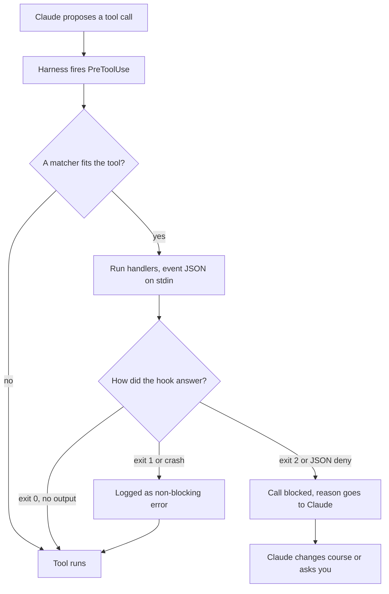
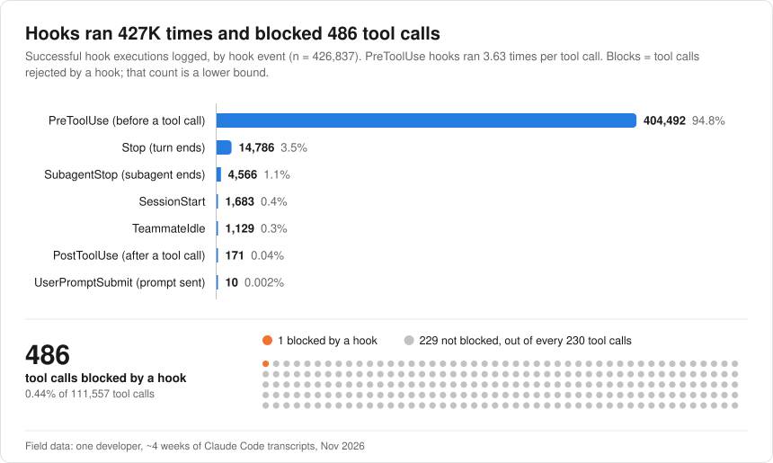

# 16 — Hooks

After this chapter you can write a hook that blocks a dangerous command, one that injects context when a session starts or a prompt arrives, and one that keeps a turn from ending until a check passes. You will know which exit code and which output field produce each effect, how to test a hook without opening a session, and how to diagnose a guard that does not block.

## Mental model

`CLAUDE.md`, skills and subagent prompts are text that the model reads. The model usually follows that text, but nothing guarantees it. A **hook** is code that the harness (the Claude Code program, not the model) runs when a named **lifecycle event** fires: before a tool call, when you submit a prompt, when a turn ends. The model cannot skip a hook, forget it, or decide that it does not apply this time.

The official best-practices page draws the line like this: "If something has to happen every time, make it a hook, a deny rule, or a managed setting. `CLAUDE.md` is for guidelines, and Claude is allowed to decide a guideline doesn't apply."

Every hook works in the same three steps. An event fires and the harness finds the hooks registered for it. Each matching hook receives one JSON object on standard input (stdin) that describes the event. The hook answers with an exit code and, optionally, JSON on standard output (stdout), and the harness acts on that answer.



Look at the third branch. A script that fails with exit code 1 does **not** block anything. That single fact causes most "my guard doesn't work" reports, and the section on exit codes covers it in full. A command hook also runs with your full user permissions, which makes hooks a security topic: see [chapter 29](29-security-and-guardrails.md).

## The configuration shape

Hooks are defined in JSON settings files (see [chapter 9](09-settings-and-permissions.md)) with three levels of nesting: the **event**, then a **matcher group** that filters when the hooks apply, then one or more **handlers** that do the work. This file registers the four hooks built later in the chapter:

```json
{
  "hooks": {
    "PreToolUse": [
      { "matcher": "Bash",
        "hooks": [ { "type": "command",
                     "command": "python3 \"$HOME/.claude/hooks/force-push-guard.py\"",
                     "timeout": 10,
                     "statusMessage": "Checking the push...",
                     "onFailure": "block" } ] }
    ],
    "SessionStart": [
      { "hooks": [ { "type": "command", "command": "bash \"$HOME/.claude/hooks/session-context.sh\"", "timeout": 10 } ] }
    ],
    "UserPromptSubmit": [
      { "hooks": [ { "type": "command", "command": "bash \"$HOME/.claude/hooks/scope-reminder.sh\"", "timeout": 5 } ] }
    ],
    "Stop": [
      { "hooks": [ { "type": "command", "command": "bash \"$HOME/.claude/hooks/require-tests.sh\"", "timeout": 300 } ] }
    ]
  }
}
```

- **Event** (`PreToolUse`, `Stop`, ...): when to run. The next section lists the events.
- **Matcher** (`"Bash"`): a single string, never an array. For tool events it names tools: `Bash`, `Edit|Write`, or `*` for every tool, MCP tools included. Names are case-sensitive, and a misspelled name matches nothing without any error. Some events match on something other than a tool, and a group can leave `matcher` out, as three of the four do here.
- **Handler**: `type` plus its settings. `timeout` is in seconds. `statusMessage` is the text shown while the hook runs. `onFailure: "block"` (v2.1.295+) makes a crash, a timeout or an exit 1 block the action instead of letting it through; it has no effect on `Stop`, `SubagentStop`, `TaskCompleted` and `TeammateIdle` hooks or on async hooks. `"async": true` suits side effects such as notifications, with the documented limit that "Async hooks can't block or control Claude's behavior".

### The five handler types

| `type` | What it runs | Use it for |
|---|---|---|
| `command` | A shell command. Event JSON arrives on stdin | Almost everything. Every example in this chapter |
| `http` | An HTTP endpoint that receives the event | A policy service shared by a team |
| `mcp_tool` | A tool on an MCP server | Reusing a server you already run (`onFailure` from v2.1.328+) |
| `prompt` | A prompt that a model evaluates | A judgement call that a regular expression cannot make |
| `agent` | A subagent | Checks that need tools. Marked experimental |

For enforcement the docs recommend the first three: "use a `command`, `http`, or `mcp_tool` hook, and add `onFailure: "block"`". A `prompt` or `agent` hook is a model call, so it gives you judgement, not determinism. Field names for each type are in the hooks reference; this chapter stays with `command`.

### The seven places a hook can live

| Location | Scope | Shared with others? |
|---|---|---|
| `~/.claude/settings.json` | All your projects | No |
| `.claude/settings.json` | One project | Yes, when committed |
| `.claude/settings.local.json` | One project | No. Claude Code adds it to your global git excludes when it first saves a setting to it |
| Managed policy settings | The organisation | Set by administrators |
| A plugin's `hooks/hooks.json` | Wherever the plugin is enabled | Through the plugin ([chapter 17](17-plugins-and-marketplaces.md)) |
| Skill frontmatter | Defined with the skill | With the skill ([chapter 15](15-skills.md)) |
| Subagent frontmatter | Defined with the subagent | With the subagent. Plugin subagents ignore `hooks` |

Type `/hooks` in a session to view the hooks registered under each event. Hooks placed in `~/.claude.json` are ignored: that file is not a settings file. Two settings govern hooks as a whole: `disableAllHooks` turns them off (together with a custom status line), and the managed-only `allowManagedHooksOnly` restricts a machine to the organisation's hooks.

## The event catalogue

The hooks reference lists 34 events as of Nov 2026, and the list keeps growing. You will use five or six of them. The table groups all 34 and says what `exit 2` does on each, taken from the reference's "Exit code 2 behavior per event" table. Check that table again in your version before you rely on a block.

| Group | Events | Blocking behaviour |
|---|---|---|
| Session | `SessionStart`, `Setup`, `SessionEnd` | None can block. On `SessionStart` and `SessionEnd`, exit 2 shows the hook's stderr to you only; `Setup` ignores it |
| Prompt | `UserPromptSubmit`, `UserPromptExpansion` | Both can block: the prompt is rejected, or the expansion is stopped |
| Tool calls | `PreToolUse`, `PostToolUse`, `PostToolUseFailure`, `PostToolBatch`, `PreSkillShellCommand` | `PreToolUse` blocks the call, `PreSkillShellCommand` blocks the command, `PostToolBatch` stops the loop before the next model call. `PostToolUse` and `PostToolUseFailure` cannot undo anything: exit 2 only shows stderr to Claude |
| Permissions | `PermissionRequest`, `PermissionDenied` | Neither reads exit 2 as a decision. `PermissionRequest` denies through its JSON `decision` object; on `PermissionDenied` the denial has already happened |
| Turn end | `Stop`, `StopFailure` | `Stop` can block the stop and send Claude back to work. `StopFailure` ignores output and exit code |
| Subagents and teams | `SubagentStart`, `SubagentStop`, `TaskCreated`, `TaskCompleted`, `TeammateIdle` | `SubagentStart`: notice only. The other four can block: the subagent keeps working, the task creation is rolled back, the task is not marked completed, the teammate keeps working |
| Context and model | `PreCompact`, `PostCompact`, `PreModelSwitch`, `PostModelSwitch` | `PreCompact` and `PreModelSwitch` can block. `PostCompact` and `PostModelSwitch`: notice only |
| Instructions and config | `InstructionsLoaded`, `ConfigChange` | `ConfigChange` can block a settings change (except one from policy settings). `InstructionsLoaded` ignores the exit code |
| Workspace | `FileChanged`, `CwdChanged`, `DirectoryAdded`, `WorktreeCreate`, `WorktreeRemove` | `WorktreeCreate`: any non-zero exit fails the creation. `WorktreeRemove`: any non-zero exit fails the removal if the directory still exists. The other three cannot block |
| Interface and MCP | `Notification`, `MessageDisplay`, `Elicitation`, `ElicitationResult` | `Elicitation` (the request is declined) and `ElicitationResult` (the response is blocked) can block. `Notification` and `MessageDisplay` cannot |

## What a hook receives, and how it answers

### Input: one JSON object on stdin

```json
{
  "session_id": "0f9e8d7c-5b6a-4c3d-9e2f-1a0b9c8d7e6f",
  "transcript_path": "/Users/you/.claude/projects/-Users-you-my-app/0f9e8d7c.jsonl",
  "cwd": "/Users/you/my-app",
  "permission_mode": "auto",
  "hook_event_name": "PreToolUse",
  "tool_name": "Bash",
  "tool_input": { "command": "git push --force origin main" }
}
```

The fields depend on the event. These are the ones that real hook scripts in the field data read:

| Fields | Seen on |
|---|---|
| `session_id`, `cwd`, `transcript_path`, `permission_mode`, `hook_event_name` | General context |
| `tool_name`, `tool_input.command`, `tool_input.file_path` | Tool events |
| `prompt` | `UserPromptSubmit` |
| `source` | `SessionStart` (tells a resume from a fresh start) |
| `stop_hook_active`, `last_assistant_message` | `Stop` |

### Output: the exit code comes first

| Exit code | Meaning | What happens |
|---|---|---|
| `0` | Success | Claude Code applies any valid JSON the hook printed. Claude never sees stderr from a hook that exits 0 |
| `2` | Blocking error | On an event that can block, the action stops. The hook's stderr (or a JSON decision's reason) becomes the block message |
| Anything else, including `1` | Non-blocking error | The action goes ahead |

The docs say it plainly: "Exit code 1 without valid JSON output is a non-blocking error ... even though 1 is the conventional Unix failure code. If your hook is meant to enforce a policy, use `exit 2`." That simple rule has four documented exceptions:

1. **Valid JSON overrides the exit code.** If the hook prints valid JSON that passes the schema and exits with a code other than 0 or 2, the run counts as a success and the JSON fields decide the outcome. Exit 1 plus a JSON deny can still block. (With `onFailure: "block"` set, such an exit code counts as a failure instead, so exit 0 when you print JSON.)
2. **`onFailure: "block"` changes the default.** With it, exit 1, crashes and timeouts all block (v2.1.295+, and v2.1.328+ for `mcp_tool` hooks).
3. **Some events have their own rules.** Any non-zero `WorktreeCreate` exit fails the creation. `PostToolUse` exit 2 only shows stderr to Claude. `SessionStart`, `SubagentStart` and `PostModelSwitch` exit 2 only renders a notice. On `Stop`, `SubagentStop`, `TaskCompleted` and a plugin's `UserPromptSubmit` hook, an exit 2 with nothing on stdout whose stderr says a file is missing (such as `No such file or directory`) counts as a non-blocking error.
4. **Broken JSON is not applied.** On exit 0, output that does not parse or fails the schema becomes a non-blocking error.

> **Warning:** A hook that times out does not block either. The docs state that a timed-out `PreToolUse` hook "doesn't block the tool call ... so don't count on a stalled hook to act as a gate". Add `onFailure: "block"` to any guard that must fail closed (block when it is broken) rather than fail open (allow when it is broken).

### Output: JSON on stdout, and who reads it

There are two ways to block: `exit 2` with the reason on stderr, or exit 0 with a JSON decision. The docs say "Choose one approach per hook". Beyond blocking, the field you print decides **who sees your message**. Pick the channel by its reader.

| You want to | Print | Who gets it |
|---|---|---|
| Deny a tool call | `hookSpecificOutput.permissionDecision: "deny"` with `permissionDecisionReason` | Claude, as the reason the call failed |
| Give the model information | `hookSpecificOutput.additionalContext` | Claude. It enters the context |
| Tell the human something | `systemMessage` | You, in the interface. The model never sees it |
| Keep Claude working at a stop | `{"decision": "block", "reason": "..."}` or exit 2 with stderr | Claude, as the reason to continue |
| Leave a trace for debugging | stderr with exit 0 | Not Claude. Treat it as diagnostics only |

Two rules keep JSON output from being ignored without notice. `permissionDecision` must sit inside `hookSpecificOutput`, with `hookEventName` set to the event. And stdout must start with `{`: if your shell profile prints a banner, that text arrives ahead of the JSON.

## Four hooks to copy

Save the scripts in `~/.claude/hooks/` and register them with the configuration shown at the start of this chapter, in `~/.claude/settings.json`. Each script was run with test payloads piped in, as the testing section shows. The shell scripts need `jq`.

> **Note:** [Chapter 21](21-guide-build-and-ship-a-plugin.md) ships a force-push guard like hook 1 inside a plugin, using `${CLAUDE_PLUGIN_ROOT}` and payload tests; [chapter 11](11-the-extension-model.md) shows when a hook, and not an instruction, is the right tool.

### 1. A `PreToolUse` guard with a named override

```python
#!/usr/bin/env python3
"""PreToolUse guard: block `git push --force`. Override: ALLOW_FORCE_PUSH=1 (env or prefix)."""
import json, os, re, sys
SEPARATORS = re.compile(r"&&|\|\||;|\||\n")          # split a compound command into segments
FORCE = re.compile(r"\bgit\b.*\bpush\b.*\s(--force(?!-with-lease|-if-includes)|-f)\b")
OVERRIDE = re.compile(r"\bALLOW_FORCE_PUSH=1\b")

def main():
    try:
        payload = json.load(sys.stdin)                # the event arrives as JSON on stdin
    except Exception:
        sys.exit(0)                                   # unreadable payload: allow (fails open)
    if payload.get("tool_name") != "Bash":
        sys.exit(0)
    command = (payload.get("tool_input") or {}).get("command") or ""
    # Check the override in two places: an inline `VAR=1 cmd` prefix is part of the command
    # text and never reaches this process's environment.
    if os.environ.get("ALLOW_FORCE_PUSH") == "1" or OVERRIDE.search(command):
        sys.exit(0)
    hit = next((s.strip() for s in SEPARATORS.split(command) if FORCE.search(s)), None)
    if not hit:
        sys.exit(0)                                   # exit 0 with no output = no decision
    reason = (f"BLOCKED by force-push-guard: `{hit}` rewrites remote history. "
              "Do NOT retry or rephrase. Stop and ask the user; only after an explicit yes, "
              "re-run the command prefixed with ALLOW_FORCE_PUSH=1.")
    print(json.dumps({"hookSpecificOutput": {         # the decision is in the JSON, so exit 0
        "hookEventName": "PreToolUse",
        "permissionDecision": "deny",
        "permissionDecisionReason": reason}}))
    sys.exit(0)

main()
```

The override variable is a consent channel, not a lock. The deny message tells the model to stop, ask you, and re-run with the prefix only after you agree. A model could type the prefix on its own, so for a rule with zero exceptions, ship no override at all. Note the two failure modes: the script itself allows an unreadable payload, while `onFailure: "block"` in the configuration blocks when the script crashes or hangs.

### 2. A `SessionStart` context injector

```bash
#!/usr/bin/env bash
# SessionStart hook: give each session a scratch directory and tell Claude where it is.
set -euo pipefail
input=$(cat)                                          # the event JSON
session_id=$(echo "$input" | jq -r '.session_id')
cwd=$(echo "$input" | jq -r '.cwd')
src=$(echo "$input" | jq -r '.source // "unknown"')   # tells a resume from a fresh start
out="$HOME/.claude/outputs/$(date +%Y-%m-%d)_$(basename "$cwd")_${session_id:0:8}"
mkdir -p "$out"
# Claude Code runs the contents of $CLAUDE_ENV_FILE before each Bash command,
# so this export is visible to every command Claude runs in the session.
if [ -n "${CLAUDE_ENV_FILE:-}" ]; then
  echo "export SESSION_OUTPUT_DIR=\"$out\"" >> "$CLAUDE_ENV_FILE"
fi
# additionalContext goes into Claude's context. jq builds the JSON, so quoting is safe.
jq -n --arg dir "$out" --arg src "$src" '{
  hookSpecificOutput: {
    hookEventName: "SessionStart",
    additionalContext: "Session output directory: \($dir) (also $SESSION_OUTPUT_DIR in Bash). Put files that do not belong in the repo there. Session source: \($src)."
  }
}'
```

### 3. A `UserPromptSubmit` hook

```bash
#!/usr/bin/env bash
# UserPromptSubmit hook: when a prompt asks for "everything", remind Claude to decompose.
set -euo pipefail
prompt=$(jq -r '.prompt // empty')                    # jq reads the event JSON from stdin
if echo "$prompt" | grep -qiE 'do everything|entire (repo|codebase)|all open (prs|pull requests)|merge all'; then
  cat <<'JSON'
{
  "hookSpecificOutput": {
    "hookEventName": "UserPromptSubmit",
    "additionalContext": "Large-scope request detected. Split it into bounded sub-tasks, write long outputs to separate files in sections, and delegate heavy reads to scoped subagents instead of reading whole repos in the main thread."
  }
}
JSON
fi
# No match: exit 0 with no output, and the prompt goes through untouched.
```

This hook is advisory: it adds context and never blocks. To reject a prompt instead, write the reason to stderr and `exit 2`.

### 4. A `Stop` hook that enforces a check without looping

```bash
#!/usr/bin/env bash
# Stop hook: do not let a turn end on failing tests, but push back only once.
set -uo pipefail
input=$(cat)
# Loop guard: stop_hook_active is true when Claude is already continuing because a
# Stop hook blocked it. Without this check, a suite that stays red blocks every stop.
if [ "$(echo "$input" | jq -r '.stop_hook_active // false')" = "true" ]; then
  exit 0
fi
# Stop fires every time Claude finishes responding, not only when a task is done.
# Skip the check when no code file changed, so answering a question costs nothing.
root=$(git rev-parse --show-toplevel 2>/dev/null) || exit 0
git -C "$root" status --porcelain | grep -qE '\.(ts|tsx|js|py|go|rs|sh)$' || exit 0
if ! output=$(cd "$root" && npm test 2>&1); then      # swap in your project's check
  # exit 2 blocks the stop; stderr goes back to Claude as the reason to keep working.
  echo "Tests fail. Fix them before finishing, or state plainly what is still broken:" >&2
  echo "$output" | tail -n 20 >&2
  exit 2
fi
exit 0
```

With the guard, this hook buys one more attempt and then lets the turn end. Without it, the only brake is the harness, which overrides a `Stop` hook after eight blocks in a row (`CLAUDE_CODE_STOP_HOOK_BLOCK_CAP`). Treat that cap as a backstop, not a design. One trap follows from the third exit-code exception: if the test output you relay on stderr contains `No such file or directory`, the exit 2 can be read as a non-blocking error and the turn ends. If your check prints such messages, exit 0 and print `{"decision": "block", "reason": "..."}` on stdout instead; that rule covers only an exit 2 with empty stdout. [Chapter 23](23-testing-and-verification-loops.md) shows where a `Stop` hook sits among the other ways to make Claude verify its work.

## Pair every hard rule with an enforcing hook

A rule that lives only in `CLAUDE.md` is a request. The reliable pattern from the field data stores each hard rule three times:

1. **The rule, in prose, with its reason.** Write it in `CLAUDE.md` ([chapter 8](08-claude-md-and-memory.md)) with the date and the incident behind it. The reason helps the model handle cases your pattern misses.
2. **The hook that enforces it.** Its deny message says what to do next: stop, ask, and how to override.
3. **A pointer between them.** The rule names the hook, and a memory note names the hook too, so a later session knows the rule is enforced and by what.

One guard's header in the author's configuration records why step 2 exists: the rule was already in `CLAUDE.md` and "still recurred in the next session, because advisory text does not stop a reflex. This guard does."

> **Field note:** That configuration moved from `allow` and `ask` permission lists to `bypassPermissions` with hooks as the only gate. The author's note on the move: "Hooks run in every permission mode, so this survives bypass." In bypass mode one of those guards deliberately blocks only what cannot be undone.

Three design rules came out of that setup:

- **A hook denies or stays out of the way.** It never answers "ask" and never approves. "From the field" explains why.
- **Guard the path being written, not the tool.** A protected-file guard that matched `Edit|Write` missed `cat > file`, `sed -i` and `tee` run through Bash. Match the effect in every tool that can cause it.
- **Verify the wiring.** An audit of that configuration found a rule that cited a guard script as its enforcement. The script and its tests existed, but neither the user settings nor the plugin registered it, so at that level the rule was advisory. Run `/hooks` after you write a rule.

## Performance cost

Hooks sit on the hot path: a `PreToolUse` hook runs before every matching tool call.



In the field data (one developer, a rolling window of about four weeks) the transcripts log 426,837 successful hook executions. Of those, 404,492 were `PreToolUse`: 3.63 hook executions per tool call. Blocks were rare at 486 tool calls, 0.44% of all calls, and that count is a floor because some results carry no decision record. So almost all hook time is spent saying "fine". Keep that path cheap:

- **Use a narrow matcher.** `Bash` instead of `*` when the rule is about shell commands.
- **Exit early.** Check `tool_name` and the cheap conditions first. Never run a test suite in `PreToolUse`.
- **Set a `timeout`.** Defaults are 600 seconds for `command`, `http` and `mcp_tool` (lowered to 30 on `UserPromptSubmit`, `PreModelSwitch` and `PostModelSwitch`), 30 for `prompt` and 60 for `agent`. Matching hooks run in parallel, so the slowest one sets the delay.
- **Make side effects async.** A notification or a log line does not need to hold up the tool call.
- **Count the tokens.** Every `additionalContext` stays in the context window. In the author's plugin an ablation attributed about 9% of the plugin's token overhead to all its hooks together, against about 82% for skill descriptions.

Failure has a cost too. The same window logged 660 non-blocking hook errors, 579 of them exit code 127 (command not found), and 43 blocks whose reason was a guard that timed out with `onFailure: "block"` set. Failing closed is the right default for a core guard, but then a slow guard stops all work.

## Test a hook without a session

A command hook is a program that reads stdin, so you can test it by piping JSON into it.

```bash
echo '{"tool_name":"Bash","tool_input":{"command":"git add . && git push -f origin main"}}' \
  | python3 ~/.claude/hooks/force-push-guard.py; echo "exit=$?"
```

```text
{"hookSpecificOutput": {"hookEventName": "PreToolUse", "permissionDecision": "deny", "permissionDecisionReason": "BLOCKED by force-push-guard: `git push -f origin main` rewrites remote history. ..."}}
exit=0
```

Write one payload for each branch, and keep them as a test file next to the script:

| Payload | Expected |
|---|---|
| `git push origin feature && rm -f tmp.txt` | No output, exit 0 (the `-f` belongs to `rm`) |
| `git push --force-with-lease origin feature` | No output, exit 0 |
| `git push --force-with-lease --force-if-includes origin feature` | No output, exit 0 |
| `ALLOW_FORCE_PUSH=1 git push --force origin main` | No output, exit 0 (override) |
| `{"hook_event_name":"Stop","stop_hook_active":true}` into the `Stop` hook | Exit 0 at once |

Then check the wiring in a real session: `/hooks` confirms the registration, and `claude --debug` writes a log file that you can read for hook errors. One of the author's guards ships with unit tests and a dated comment for each false-positive fix. A guard matches text, not intent, so its patterns need maintenance like any other code.

## From the field

These three come from the author's plugin repository. The counts are that project's own measurements, not benchmarks.

**The nudge only the user could see.** The plugin had a hook that suggested a skill when one fitted the task. The hook's header comment records that 15 of 25 skills were never invoked across 953 sessions. The cause was the channel: the hook printed `systemMessage`, which reaches the user's screen and never the model. It also fired on `Stop`, after the moment had passed. The fix was `additionalContext` on `UserPromptSubmit`, once per skill per session per repo.

**The advisory note that looped.** A `SubagentStop` hook added an `additionalContext` reminder about writing a handoff. The reminder re-woke the subagent that had just stopped, which stopped again and was reminded again: 15 to 23 wake-ups and about 200k tokens for each read-only helper. The fix has three parts: honour `stop_hook_active`, skip read-only roles, and speak once per agent. A hook does not have to block to cause a loop.

**The feature that was removed.** The plugin once added four permission levels, with a resolver and hooks to apply them. A later major release removed all of it. Claude Code honours a hook's `ask` in every permission mode, `bypassPermissions` included, so the maintainer was prompted constantly. The decision record that removed it left one rule behind: a hook denies or stays out of the way.

## Common problems

| Symptom | Cause | Fix |
|---|---|---|
| The guard runs, but the action goes ahead | The script ends with `exit 1`. Only exit 2 blocks by default | `exit 2` with the reason on stderr, or a JSON deny. Add `onFailure: "block"` |
| The guard never runs | Mistyped script path, matcher typo or wrong case, matcher written as an array, or hooks placed in `~/.claude.json` | `/hooks`, exact tool names, an absolute path or `${CLAUDE_PROJECT_DIR}`, and `chmod +x` |
| JSON output is ignored | The shell profile prints text first (debug log: `Hook output does not start with {`), or `permissionDecision` sits outside `hookSpecificOutput` | Wrap profile output in `if [[ $- == *i* ]]`. Fix the nesting |
| Claude never stops, or keeps repeating one failure | A `Stop` hook blocks every turn end | Exit early when `stop_hook_active` is true |
| Every Bash call is blocked with a timeout reason | A slow or hung guard that has `onFailure: "block"` | Make the guard fast, bound its stdin read, lower `timeout` |
| The model ignores your reminder | It was sent as `systemMessage`, or as stderr with exit 0 | Use `additionalContext` |
| The rule is bypassed through another tool | The matcher covers `Edit` and `Write` but not shell redirects | Guard the path in Bash commands too. More cases: [chapter 32](32-troubleshooting-common-problems.md) |

## Checklist

- [ ] Every hard rule in `CLAUDE.md` names the hook that enforces it, and `/hooks` shows that hook registered.
- [ ] Guards block with `exit 2` or a JSON deny, never with `exit 1`.
- [ ] Core guards set `onFailure: "block"` and a short `timeout`.
- [ ] Every `Stop` or `SubagentStop` hook checks `stop_hook_active` before it blocks or adds context.
- [ ] Messages for the model use `additionalContext` or a block reason. Messages for you use `systemMessage`.
- [ ] Each deny message says what to do next, and each hook has piped-JSON tests for its allow, block and override branches.
- [ ] You have read every hook a repository or plugin brings before you trusted it.

## Try it

1. Install the force-push guard. Pipe the test payloads from the testing section through it, then open a session in a scratch repository that has no remote, ask Claude to force-push, and read the deny reason it gets back.
2. Break the guard on purpose. Remove `onFailure` from its configuration, then replace the JSON deny with a message on stderr and `sys.exit(1)`. Ask for the force-push again and watch the call go through. Change the code to 2 and try once more. Last, put `onFailure: "block"` back with exit 1 and see the difference.
3. Write a `UserPromptSubmit` hook that adds the current git branch as `additionalContext`. Then add `systemMessage` with the same text and note which of the two Claude can quote back to you.

## Sources

- Hooks reference: https://code.claude.com/docs/en/hooks
- Hooks guide: https://code.claude.com/docs/en/hooks-guide
- Best practices, "Enforce the rules that can't have exceptions": https://code.claude.com/docs/en/best-practices
- Debug your configuration: https://code.claude.com/docs/en/debug-your-config
- Settings reference (`disableAllHooks`) and managed settings (`allowManagedHooksOnly`): https://code.claude.com/docs/en/settings-reference · https://code.claude.com/docs/en/managed-settings
- Field data: the author's plugin repository, machine-level configuration and session transcripts (a rolling window of about four weeks)

---

[← Previous: Skills](15-skills.md) · [Contents](README.md) · [Next: Plugins and marketplaces →](17-plugins-and-marketplaces.md)
