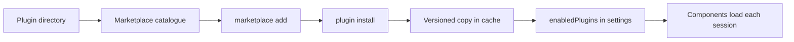
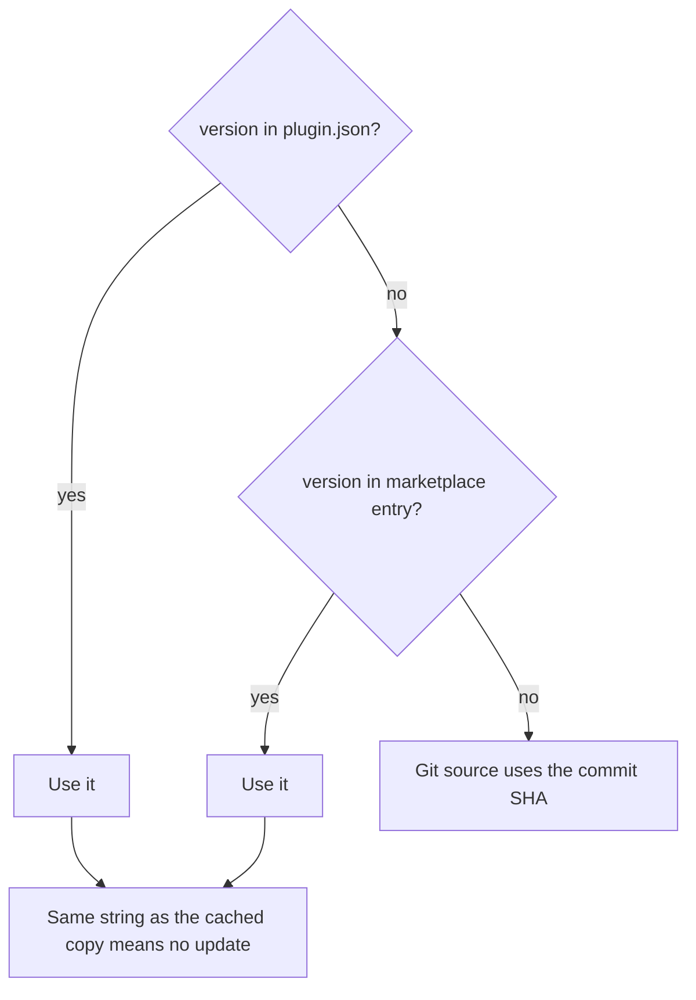

# 17 — Plugins and marketplaces

After this chapter you can read a plugin's directory and say what it will add to your sessions, build a small plugin with one skill, one hook and one subagent, test and validate it locally, and publish it through a marketplace that your team installs from. You will also know why an update can fail to reach your users, and what to read before you install someone else's plugin.

## Mental model

The last five chapters covered four kinds of extension: MCP servers, subagents, skills and hooks, each configured in its own place. A **plugin** is the unit that packages them for sharing. The docs define it as "a directory of components, usually with a manifest": one folder that holds skills, agents, hooks, MCP server configuration and more, plus a small JSON file (the manifest) that names and versions it.

A **marketplace** is how a plugin reaches other people. It is "a repository or directory with a `.claude-plugin/marketplace.json` file", and the docs add: "It's a catalog, not a hosted store". The catalogue lists plugins and says where to fetch each one. Installing a plugin copies it from that source into a cache on your machine.



Three consequences follow from this design:

- **Names are namespaced.** A skill `review` in a plugin named `my-plugin` is invoked as `/my-plugin:review`, and an agent is addressed as `deploy-tools:reviewer`. Two plugins cannot collide.
- **An enabled plugin has a footprint.** The name and description of each skill, agent and command that the model can invoke are "in Claude's context on every turn". The plugin's MCP servers run alongside every session.
- **A plugin is code.** In the docs' words, "what the plugin runs, it runs as you". The trust section near the end of this chapter is not optional reading.

## Anatomy of a plugin

Every component has a default location. Claude Code scans these folders, so a plugin can work with no manifest at all (the name then comes from the marketplace entry or the directory name).

```text
my-plugin/
├── .claude-plugin/
│   └── plugin.json          # the manifest, and nothing else
├── skills/<name>/SKILL.md   # skills, which are also the slash commands
├── commands/                # flat .md files; the docs say "Prefer skills/ for new plugins"
├── agents/                  # subagent definitions
├── hooks/hooks.json         # hook wiring, next to the scripts it calls
├── .mcp.json                # MCP servers
├── .lsp.json                # language servers
├── output-styles/           # output styles
├── workflows/               # workflow scripts (.js)
├── themes/                  # themes
├── monitors/monitors.json   # background commands whose output reaches Claude
└── bin/                     # executables, put on the Bash tool's PATH
```

Four rules catch most first-time mistakes:

- "Only `plugin.json` goes inside `.claude-plugin/`. Components saved there don't load." A `skills/` folder inside `.claude-plugin/` is ignored without an error.
- "A `CLAUDE.md` at the plugin root isn't loaded as context". Put standing guidance in a skill.
- Plugin subagents ignore the `permissionMode`, `mcpServers` and `hooks` frontmatter fields ([chapter 14](14-subagents.md)).
- Monitors are not started in `claude -p` runs.

A plugin can also ship a hooks module (a "mod": JavaScript or TypeScript handlers that draw panes and add commands) and channels. This chapter stays with the four components you already know.

## The manifest

`name` is the only required key. This is the manifest of the plugin you will build below:

```json
{
  "name": "team-kit",
  "version": "0.1.0",
  "description": "A changelog skill, a read-only diff reviewer and a force-push guard",
  "author": { "name": "Your Name" },
  "license": "MIT",
  "keywords": ["changelog", "review", "guard"]
}
```

| Group | Keys | Notes |
|---|---|---|
| Required | `name` | Kebab-case (lowercase words joined by hyphens). It becomes the namespace |
| Identity | `displayName`, `version`, `description`, `author`, `homepage`, `repository`, `license`, `keywords` | `version` controls updates, see below |
| Behaviour | `defaultEnabled` (default `true`), `engines`, `dependencies`, `network`, `userConfig` | Example: `"engines": { "claude-code": ">=2.1.400" }` (v2.1.323+) |
| Component paths | `skills`, `commands`, `agents`, `outputStyles`, `workflows`, `hooks`, `mcpServers`, `lspServers` | Only needed when you leave the default layout |

The component keys behave in three different ways. `skills` adds to the default scan. `commands`, `agents`, `outputStyles` and `workflows` each replace their default scan. `hooks`, `mcpServers` and `lspServers` merge with the default file. Paths must be relative to the plugin root and start with `./`; a path that escapes the root or does not exist does not load. Unknown top-level keys are stripped with a warning, while an unknown key inside a `userConfig` entry is an error.

`userConfig` declares options the user fills in at install time. Each option needs `type` (`string`, `number`, `boolean`, `directory` or `file`), `title` and `description`, and can add `required`, `default`, `options`, `multiple`, `sensitive`, `min` and `max`. Non-sensitive values are stored under `pluginConfigs` in `settings.json`. Values marked `sensitive` go to the operating system's credential store, which is where a plugin's API token belongs.

### Path variables

| Variable | Resolves to | Use it for |
|---|---|---|
| `${CLAUDE_PLUGIN_ROOT}` | The installed version's directory. It changes on every update | Calling the plugin's own scripts from hooks and MCP config |
| `${CLAUDE_PLUGIN_DATA}` | `~/.claude/plugins/data/<id>/`. It survives updates | State, caches, installed dependencies |
| `${CLAUDE_PROJECT_DIR}` | The project directory | Reaching project files |
| `${user_config.KEY}` | The value of a `userConfig` option | Configuration files such as `.mcp.json` |
| `CLAUDE_PLUGIN_OPTION_<KEY>` | The same value, as an environment variable | Hook scripts |

> **Warning:** These variables are not in the environment of commands that Claude runs through the Bash tool, so a shell command cannot count on `$CLAUDE_PLUGIN_ROOT` being set. To give Claude an executable, put it in `bin/`, which is on the Bash tool's `PATH`.

## Marketplaces

A marketplace is one JSON file. Required top-level keys are `name`, `owner` (with a `name`) and `plugins`. Each entry needs `name` and `source`, and can add `description`, `version`, `category`, `tags` and more. Unknown keys are ignored without a warning, so check spelling.

```json
{
  "name": "team-plugins",
  "description": "Plugins for my team",
  "owner": { "name": "Your Name" },
  "plugins": [
    {
      "name": "team-kit",
      "source": "./plugins/team-kit",
      "description": "A changelog skill, a read-only diff reviewer and a force-push guard"
    },
    {
      "name": "deploy-tools",
      "source": { "source": "github", "repo": "your-org/deploy-tools", "ref": "main" },
      "description": "Deployment helpers kept in their own repository"
    }
  ]
}
```

`source` is either a relative path inside the marketplace repository (`./...`) or an object. The object's `source` field picks the kind: `github` (with `repo`, `ref`, `sha`), `url`, `git-subdir`, `npm`, `archive` or `command`. Some names are reserved, among them `claude-plugins-official`, `anthropic-marketplace`, `inline`, `builtin` and `skills-dir`. `claude plugin validate` also rejects plugin names that start with `claude-`, `anthropic-`, `anthropics-` or `cc-plugin-`.

### Add, install, enable

```bash
claude plugin marketplace add your-org/team-plugins   # a GitHub repo, a URL or a local path
claude plugin install team-kit@team-plugins           # the install id is name@marketplace
claude plugin list
claude plugin disable team-kit@team-plugins           # keep it installed, switch it off
```

Inside a session, `/plugin` opens a panel with Discover, Installed, Marketplaces and Errors tabs, and `/plugin marketplace add [source]` and `/plugin install <plugin>` do the same jobs as the shell commands. `/reload-plugins` applies changes without a restart.

Where do plugins come from? Anthropic's official marketplace, `claude-plugins-official`, is added on your first interactive start. Anthropic also publishes a community marketplace, `claude-community`, as a read-only mirror, and reference skills in the `anthropics/skills` repository. The older `claude-code-plugins` marketplace is deprecated. Community indexes such as `awesome-claude-code` have no Anthropic affiliation and are not security-audited.

Installing writes an entry to `enabledPlugins` in a settings file. The scope (`-s, --scope`) picks which one:

| Scope | Written to | Effect |
|---|---|---|
| `user` (default) | `~/.claude/settings.json` | You, in every project |
| `project` | `.claude/settings.json` | Committing it enables the plugin for collaborators "but doesn't download it" |
| `local` | `.claude/settings.local.json` | You, in this project only |

Local overrides project, and project overrides user. In managed settings, `true` force-enables a plugin and `false` blocks it.

## Versions and updates

Claude Code resolves a plugin's version in a fixed order, and an installed copy is replaced only when that version changes.



> **Warning:** This is the pinned-version trap. The docs: "a manifest that pins `"version": "1.0.0"` keeps every user on the cached copy until its author changes the string, however many commits they push." Either bump `version` with every release, or leave it out of both files so that a git-sourced plugin is versioned by its commit SHA (12 characters).

Three more facts about updates, as of Nov 2026:

- **Auto-update is on only for Anthropic's official marketplaces.** The docs: "Off by default: every other marketplace". When it runs, it starts after your first message plus a random delay of up to ten minutes and prints `Plugin updated: <name> · Run /reload-plugins to apply`.
- **Manual updates are per plugin.** "There's no command that updates every plugin at once." Run `claude plugin marketplace update` to refresh the catalogues, then `claude plugin update <plugin>` for each plugin.
- **Versions live side by side on disk.** The cache is `~/.claude/plugins/cache/<marketplace>/<plugin>/<version>/`, and a previous version is removed 14 days after an update. This is why `${CLAUDE_PLUGIN_ROOT}` changes on every update and why a hard-coded cache path breaks.

## Build a small plugin, step by step

You will package the force-push guard from [chapter 16](16-hooks.md) with one skill and one subagent, inside a repository that is also a marketplace.

> **Note:** [Chapter 21](21-guide-build-and-ship-a-plugin.md) is the full workshop version: it starts from `claude plugin init`, adds an eval suite with `claude plugin eval` and tags a release. [Chapter 11](11-the-extension-model.md) covers when a plugin is worth it at all.

**1. Create the layout and the manifest.** Save the `plugin.json` shown above into `.claude-plugin/`.

```bash
mkdir -p team-plugins/.claude-plugin
mkdir -p team-plugins/plugins/team-kit/{.claude-plugin,skills/changelog-entry,agents,hooks}
cd team-plugins
```

**2. Add the skill** as `plugins/team-kit/skills/changelog-entry/SKILL.md` ([chapter 15](15-skills.md)):

```markdown
---
name: changelog-entry
description: Writes a CHANGELOG.md entry for the current branch. Use when the user asks for a changelog entry, release note, or "what changed" summary of their diff.
---

1. Run `git diff main...HEAD --stat` and read the changed files that matter.
2. Group changes under **Added**, **Changed**, **Fixed** or **Removed**.
3. Write one line per change in user-facing wording.
4. Insert the entry under `## Unreleased` in `CHANGELOG.md`. Do not bump the version.
```

**3. Add the subagent** as `plugins/team-kit/agents/diff-reviewer.md`:

```markdown
---
name: diff-reviewer
description: Reviews the current branch diff for bugs and missing tests. Read-only. Use before opening a pull request.
tools: Read, Grep, Glob, Bash
model: sonnet
---

You review a diff; you never edit files.

1. Run `git diff main...HEAD` and read each changed file where context matters.
2. Report findings as a list: severity, file and line, evidence, suggested fix.
3. An empty list is a valid result. Do not invent findings to look thorough.
```

`Bash` is there so the agent can run `git diff`. As [chapter 14](14-subagents.md) warns, that makes it read-only by instruction, not by tool list: drop `Bash` and name the files in the brief if you need a hard guarantee.

**4. Add the hook.** Copy `force-push-guard.py` into `plugins/team-kit/hooks/` and wire it in `plugins/team-kit/hooks/hooks.json`. The file has the same shape as the `hooks` key in settings, and it reaches the script through `${CLAUDE_PLUGIN_ROOT}`:

```json
{
  "hooks": {
    "PreToolUse": [
      { "matcher": "Bash",
        "hooks": [ { "type": "command",
                     "command": "python3 \"${CLAUDE_PLUGIN_ROOT}\"/hooks/force-push-guard.py",
                     "timeout": 10,
                     "onFailure": "block" } ] }
    ]
  }
}
```

**5. Validate.** The `Provides:` list is the fastest check that every component was found. This output is from v2.1.332, trimmed:

```bash
claude plugin validate ./plugins/team-kit
```

```text
Provides:
  ❯ hooks: PreToolUse Bash command "python3 \"${CLAUDE_PLUGIN_ROOT}\"/hooks/force-push-guard.py"
  ❯ skills: team-kit:changelog-entry
  ❯ agents: team-kit:diff-reviewer
✔ Validation passed
```

The same run also lists "plugin directory checks", here a missing `README.md` and a missing icon. They do not change the result, even under `--strict`, unless you add `--profile directory`; add a README anyway. In CI use `claude plugin validate --strict`, which fails on warnings such as unrecognised fields.

**6. Test it in place.** No marketplace is needed for development:

```bash
claude --plugin-dir ./plugins/team-kit    # loads as team-kit@inline; the flag is repeatable
```

In the session, run `/team-kit:changelog-entry`, check that `/hooks` lists the guard, and ask Claude to use the `team-kit:diff-reviewer` agent. After each edit, `/reload-plugins` picks up the change. If something is missing, debug in the documented order: `claude plugin validate`, `/reload-plugins`, the Errors tab of `/plugin`, `claude plugin list`, then `/mcp` for servers.

**7. Publish.** Save the marketplace file from the previous section as `.claude-plugin/marketplace.json` at the repository root (keep only the `team-kit` entry). Then:

```bash
claude plugin validate .                                # validates the marketplace manifest
git init && git add . && git commit -m "team-kit 0.1.0" # then push to your git host
claude plugin marketplace add your-org/team-plugins
claude plugin install team-kit@team-plugins
```

For every later release, change `version` in `plugin.json` first. `claude plugin tag` creates a `{name}--v{version}` git tag and checks that the manifest and the marketplace entry agree (run it with `--dry-run` to see what it would do).

**8. Measure it (optional).** `claude plugin eval` (v2.1.269+) runs a suite from the plugin's `evals/` folder: each case is a prompt plus graders. Each case runs three times by default and again without the plugin, because "A high score on its own doesn't tell you the plugin helped". `claude plugin eval init` drafts a suite, `--threshold` (default 1.0) turns it into a gate with exit code 1 on failure, and the run writes a self-contained `report.html`. [Chapter 23](23-testing-and-verification-loops.md) places evals among the other verification loops.

## Team distribution

For a team, commit the marketplace and the plugin choice to the repository's `.claude/settings.json`:

```json
{
  "extraKnownMarketplaces": {
    "team-plugins": {
      "source": { "source": "git", "url": "https://git.example.com/your-org/team-plugins.git", "ref": "main" }
    }
  },
  "enabledPlugins": { "team-kit@team-plugins": true }
}
```

Enabling does not download. Each collaborator still runs `claude plugin install team-kit@team-plugins --scope project` once. An organisation can go further in managed settings: `strictKnownMarketplaces` and `blockedMarketplaces` control which marketplaces may be added, and a managed `enabledPlugins` entry forces a plugin on or off. [Chapter 31](31-repo-standards-and-team-adoption.md) covers rollout.

Keep the shared set small. Every enabled plugin adds descriptions to every turn, so a plugin that only one person needs belongs in that person's user scope. `claude plugin details <name>` shows a plugin's component inventory and projected token cost.

## Trust: what to review before installing

The plugin security page is blunt: "A Claude Code plugin you install can execute arbitrary code on your machine with your user privileges." A marketplace does not change that. The validator's own output says that it does not run the safety scan and policy review that the plugin directory applies to submissions, and the help text of `claude plugin eval` says that a passing suite is not a security vetting. Read these before you install:

| Read | Because |
|---|---|
| `hooks/hooks.json` and every script it calls | They run as you on every matching event, without asking |
| `.mcp.json` | Its servers start with every session. Anthropic "does not security-audit or manage any MCP server" |
| `bin/` | These executables are on the Bash tool's `PATH` |
| `skills/` and `agents/` | The model follows these instructions. Look for steps that fetch or run remote content |
| The marketplace entry's `source` | A branch `ref` means the content can change after your review |

The risk is measured. A Snyk scan of 3,984 agent skills reported that "36.82% (1,467 skills) have at least one security flaw". Pinning has had bugs too: CVE-2026-86063 let a branch named like a commit SHA bypass a plugin's pinned SHA until v2.1.179, which is one more reason to keep Claude Code updated. For a quick scan of skills, the Snyk write-up gives `uvx mcp-scan@latest --skills`. Community collections are useful to learn from, but nobody audits them for you. [Chapter 29](29-security-and-guardrails.md) covers the wider supply-chain picture.

## From the field

**The version string is the delivery mechanism.** The author's plugin holds 30 skills, 10 subagents and 31 hook wirings over 15 events, and describes itself as Markdown, JSON and Bash with no build step. It is installed on several tools, so its version appears in six manifests and a README badge. One file is the single source of that version and lists every consumer, a `--sync` script rewrites them, and a "version truth" check in the validation gate fails when they disagree. The contributor rule reads: "Pushing commits **without** bumping `version` does **not** deliver changes to installed users." A related lesson from the same repository: tag after the squash merge, not before.

**One source, generated adapters.** The same repository targets Cursor, Codex, Gemini CLI and OpenCode from one canonical set of skills, agents and hooks. Each per-tool file is produced by a generator and committed with a `GENERATED FILE — DO NOT EDIT` header. Every generator has a `--check` mode that regenerates into a temporary directory and diffs, plus a test that plants drift to prove the check fires. The marketplace repository works the same way: one catalogue is edited by hand, the others are generated, and validation ends with `git diff --exit-code`. [Chapter 28](28-cross-tool-agents-md-cursor-codex-gemini.md) expands on this pattern.

**Promotion leaves copies behind.** The author's hooks began as scripts in `~/.claude/hooks` and later moved into the plugin. A survey of the machine found two hooks registered twice, once in user settings and once by the plugin (whether both copies run was not tested). It also found 18 older scripts that the user settings no longer register, 13 of them with same-named copies in the plugin. Elsewhere that configuration follows a clear pattern, where each move deletes the old copy or leaves a pointer; these were the leftovers. The same survey found 18 of 21 installed plugins switched off: installing is cheap, and enabling is what costs context.

> **Field note:** That repository runs its eval suite nightly and not on pull requests, with this reasoning: "a PR gate that costs $12 per push and flakes would be disabled within a week". Its reported mean uplift (score with the plugin minus score without it) across twelve cases was +0.13, and one case scored −0.25 with the plugin, which led to a fix in the skill.

## Common problems

| Symptom | Cause | Fix |
|---|---|---|
| Users never receive your fix | The manifest pins `version` and you did not change it | Bump `version` every release, or remove it and let the commit SHA be the version |
| The plugin loads but a skill or agent is missing | The component sits inside `.claude-plugin/`, or a manifest path does not start with `./` | Move it to the plugin root. Check `Provides:` in `claude plugin validate` and the Errors tab of `/plugin` |
| `--plugin-dir` loads nothing, with no error | It points at the marketplace root | Point it at the plugin directory |
| A script is not found after an update | A hard-coded cache path, while the version directory changed | `${CLAUDE_PLUGIN_ROOT}` for code, `${CLAUDE_PLUGIN_DATA}` for state |
| A teammate has the plugin enabled but nothing loads | Project scope enables but does not download | `claude plugin install <name>@<marketplace> --scope project` |
| The plugin never asks for its options | The `userConfig` dialog appears only when installing through `/plugin` | `/plugin configure <plugin-name>` |
| The same guard is registered in two places | A script was moved into a plugin and the old registration stayed in settings | Compare `/hooks` with your settings file. Delete the old entry and the old script |
| Context use grew after installing plugins | Every enabled plugin's descriptions are in context on every turn | Disable what you do not use; check `claude plugin details` |

## Checklist

- [ ] Only `plugin.json` sits in `.claude-plugin/`; every component is at the plugin root.
- [ ] Hook and MCP commands use `${CLAUDE_PLUGIN_ROOT}`; state goes to `${CLAUDE_PLUGIN_DATA}`.
- [ ] `claude plugin validate --strict` passes for the plugin and for the marketplace, and runs in CI.
- [ ] You tested with `claude --plugin-dir` before publishing.
- [ ] You have a version policy: bump on every release, or no `version` at all.
- [ ] Secrets are `userConfig` options marked `sensitive`, never files in the repository.
- [ ] When a script moves into a plugin, the old copy and its settings entry are deleted.
- [ ] Before installing a plugin you read its hooks, `.mcp.json`, `bin/` and skills.

## Try it

1. Build `team-kit` from this chapter, validate it, and load it with `--plugin-dir`. Confirm all three components with `/team-kit:changelog-entry`, `/hooks` and a request for the `team-kit:diff-reviewer` agent.
2. Reproduce the pinned-version trap. Install `team-kit` from a local marketplace, change the skill's text without touching `version`, and update. Then bump `version` and update again.
3. Pick one plugin you already have installed. Open its directory under `~/.claude/plugins/cache/` and list every command its hooks and MCP servers can run.

## Sources

- Plugins overview: https://code.claude.com/docs/en/plugins/overview
- Create a plugin, test and debug: https://code.claude.com/docs/en/plugins/create
- Manifest reference: https://code.claude.com/docs/en/plugins/manifest-reference
- Components: https://code.claude.com/docs/en/plugins/components
- Install, scopes and updates: https://code.claude.com/docs/en/plugins/install
- Create a marketplace and marketplace reference: https://code.claude.com/docs/en/plugins/create-marketplace · https://code.claude.com/docs/en/plugins/marketplace-reference
- Versions and the cache: https://code.claude.com/docs/en/plugins/loading
- CLI reference: https://code.claude.com/docs/en/plugins/cli-reference
- Organisations and security: https://code.claude.com/docs/en/plugins/org · https://code.claude.com/docs/en/plugins/security · https://code.claude.com/docs/en/security
- Plugin evals: https://code.claude.com/docs/en/plugin-evals
- Official and community marketplaces: https://github.com/anthropics/claude-plugins-official · https://github.com/anthropics/claude-plugins-community
- Snyk skills scan: https://snyk.io/blog/toxicskills-malicious-ai-agent-skills-clawhub/
- Pinned-SHA advisory: https://github.com/anthropics/claude-code/security/advisories/GHSA-pq7j-f95f-qfcv

> **Note:** Older tutorials link to `/plugins`, `/plugins-reference`, `/discover-plugins` and `/plugin-marketplaces`. Those URLs now redirect to `/plugins/overview`, `/plugins/manifest-reference`, `/plugins/install` and `/plugins/create-marketplace`.

---

[← Previous: Hooks](16-hooks.md) · [Contents](README.md) · [Next: Output styles, status line and keybindings →](18-output-styles-statusline-keybindings.md)
