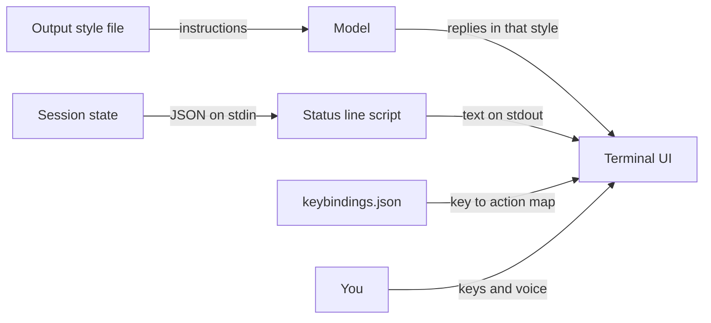

# 18 — Output styles, status line and keybindings

After this chapter you can change how Claude Code answers you, what it shows under the prompt and what your keys do. None of this gives the agent a new capability. It makes the interface fit the way you work, which matters once you spend hours a day in it.

## Mental model

There are three small surfaces, and each one is read by a different party.

| Surface | What it changes | Who reads it | Where it lives |
|---|---|---|---|
| Output style | The standing instructions for how Claude responds | The model | A Markdown file in `~/.claude/output-styles` or `.claude/output-styles`, or inside a plugin |
| Status line | The text shown under the prompt | You | A script named by `statusLine` in settings |
| Keybindings | Which key runs which action | The terminal UI | `~/.claude/keybindings.json` |



Only the output style reaches the model. The status line and the keybindings are local: the status line script ["does not consume API tokens"](https://code.claude.com/docs/en/statusline), and a keybinding never appears in the conversation.

## Output styles

### What a style changes

An **output style** is a named set of instructions about how Claude should respond: tone, format, how much it explains. Four documented properties decide when a style is the right tool:

- It applies for the whole session and [still applies after a compaction](https://code.claude.com/docs/en/context-window) ([chapter 10](10-plan-mode-checkpoints-and-context-management.md)).
- A custom style drops [Claude Code's built-in software-engineering instructions](https://code.claude.com/docs/en/output-styles) unless you set `keep-coding-instructions: true`.
- It reaches the main conversation and forks only. The docs: other subagents ["run their own system prompt, so styles don't change how they respond"](https://code.claude.com/docs/en/output-styles).
- It is guidance, not enforcement: ["It doesn't guarantee that something always happens"](https://code.claude.com/docs/en/output-styles). For a guarantee, use a hook ([chapter 16](16-hooks.md)).

### Built-in styles

| Style | What the docs say (as of Nov 2026) |
|---|---|
| `default` | The standard behaviour |
| `Proactive` | [Starts work right away](https://code.claude.com/docs/en/output-styles) and makes reasonable assumptions instead of asking about routine decisions. It does not change your permission mode |
| `Concise` | Leads with the result and leaves out preamble, narration and recaps ([v2.1.237 or later](https://code.claude.com/docs/en/output-styles)) |
| `Explanatory` | Adds `★ Insight` blocks to its replies |
| `Learning` | Leaves `TODO(human)` markers for you to fill in |

### Switch styles

```text
/output-style                list the available styles
/output-style Explanatory    switch to one
```

The command [needs v2.1.269 or later](https://code.claude.com/docs/en/output-styles); `/config` offers the same choice. The selection is saved as `outputStyle` in `.claude/settings.local.json`:

```json
{ "outputStyle": "Explanatory" }
```

> **Warning:** The setting value [is case-sensitive](https://code.claude.com/docs/en/output-styles) (the `/output-style` command is not), and a name that does not match silently gives you Default. If a style seems to do nothing, check the spelling before anything else.

### Write a custom style

A custom style is one Markdown file. Put it in `~/.claude/output-styles/` to use it in every project, or in `.claude/output-styles/` to keep it with one repository.

```markdown
---
name: Receipts
description: Every "done" names the check that proves it and quotes what the check printed
keep-coding-instructions: true
---

# Receipts

When you report that something works, is fixed or is finished:

1. Name the command, test or URL you used to check it.
2. Quote the output lines that prove it.
3. If you could not run a check, write "not verified" and say why.

Lead with the result, then the evidence, then the next step. No preamble.
```

Save it as `~/.claude/output-styles/receipts.md`, start a new session (the terminal reads style files only when Claude Code starts), then run `/output-style Receipts`.

The [frontmatter keys are all optional](https://code.claude.com/docs/en/output-styles): `name`, `description`, `keep-coding-instructions` (default `false`) and `force-for-plugin` (plugin styles only: `true` applies the style whenever the plugin is enabled and overrides the user's `outputStyle`). A plugin [ships its styles](https://code.claude.com/docs/en/plugins/manifest-reference) in an `output-styles/` folder ([chapter 17](17-plugins-and-marketplaces.md)).

> **Warning:** Without `keep-coding-instructions: true`, your style replaces the built-in coding instructions. That suits a style for writing or research work. For a coding style it is almost never what you want.

### Style, CLAUDE.md, skill or hook?

| You want | Use | Why |
|---|---|---|
| A different voice or format in every reply | Output style | Applies all session and survives compaction |
| Project facts and conventions | CLAUDE.md | Loaded for every task in that project ([chapter 08](08-claude-md-and-memory.md)) |
| A procedure that is needed only sometimes | Skill | Its body loads only when it is used ([chapter 15](15-skills.md)) |
| Something that must happen every time | Hook | A style ["doesn't guarantee that something always happens"](https://code.claude.com/docs/en/output-styles) |
| The same behaviour inside subagents | The subagent's own definition | Styles do not reach non-fork subagents ([chapter 14](14-subagents.md)) |

## Status line

The **status line** is the text under the prompt. Claude Code produces it by running a command of yours and printing whatever that command writes.

### Configure it

The quick way is to describe what you want: `/statusline` ["accepts natural language instructions"](https://code.claude.com/docs/en/statusline) and generates a script file in `~/.claude/`. The manual way is a `statusLine` object in a settings file:

```json
{
  "statusLine": {
    "type": "command",
    "command": "~/.claude/statusline.sh",
    "padding": 2
  }
}
```

`statusLine` takes the object form shown above. Its [optional keys](https://code.claude.com/docs/en/statusline) are `padding` (default `0`), `refreshInterval` (seconds, minimum `1`) and `hideVimModeIndicator`. How the command runs:

- It gets one JSON object on stdin and prints text on stdout. Several lines, ANSI colours and [OSC 8 links are supported](https://code.claude.com/docs/en/statusline). The terminal size is in `COLUMNS` and `LINES`.
- It runs locally and ["does not consume API tokens"](https://code.claude.com/docs/en/statusline).
- Updates are [debounced at 300ms](https://code.claude.com/docs/en/statusline), and a run that is still in flight is cancelled by a newer one. Keep the script fast.
- It runs outside the sandbox. Sandboxing covers Bash, PowerShell and Monitor commands, and [the docs list the status line command](https://code.claude.com/docs/en/sandboxing) among the things it does not cover. Treat a status line script from someone else like any other script that runs with your rights ([chapter 29](29-security-and-guardrails.md)).

### What the script receives

A trimmed example. The [field names are from the docs](https://code.claude.com/docs/en/statusline); the values are illustrative.

```json
{
  "session_id": "abc123",
  "cwd": "/home/dev/shop-api",
  "model": { "id": "claude-opus-5-5", "display_name": "Opus 5.5" },
  "workspace": { "current_dir": "/home/dev/shop-api", "project_dir": "/home/dev/shop-api" },
  "output_style": { "name": "default" },
  "cost": { "total_cost_usd": 1.42, "total_duration_ms": 1860000 },
  "context_window": { "context_window_size": 1000000, "used_percentage": 42, "remaining_percentage": 58 },
  "effort": { "level": "medium" }
}
```

| Group | Documented fields |
|---|---|
| Session | `session_id`, `session_name`, `cwd`, `transcript_path`, `version` |
| Model | `model.id`, `model.display_name`, `effort.level`, `thinking.enabled`, `fast_mode` |
| Workspace | `workspace.current_dir`, `workspace.project_dir`, `workspace.added_dirs`, `workspace.git_worktree`, `worktree.name`, `worktree.branch` |
| Context | `context_window.used_percentage`, `context_window.remaining_percentage`, `context_window.context_window_size`, `exceeds_200k_tokens`, `prompt_cache` |
| Cost and limits | `cost.total_cost_usd`, `cost.total_duration_ms`, `cost.total_lines_added`, `cost.total_lines_removed`, `rate_limits.five_hour`, `rate_limits.seven_day`, `rate_limits.spend_limit` |
| Other | `output_style.name`, `vim.mode`, `agent.name`, `pr.number`, `pr.url`, `pr.review_state` |

> **Note:** Several fields are absent or `null` at times: `vim`, `agent`, `pr`, `worktree`, `rate_limits`, and `used_percentage` early in a session. Give every field a fallback. In the documented list the branch appears only under `worktree`, so outside a worktree the script has to ask git.

### A working script

This script prints the model, the folder, the git branch and the context use. It needs `jq`.

```bash
#!/usr/bin/env bash
# ~/.claude/statusline.sh: model, folder, git branch, context use
input=$(cat)

model=$(jq -r '.model.display_name // "?"' <<<"$input")
dir=$(jq -r '.workspace.current_dir // .cwd // "."' <<<"$input")
pct=$(jq -r '.context_window.used_percentage // empty' <<<"$input")
branch=$(git -C "$dir" branch --show-current 2>/dev/null)

line="[$model] ${dir##*/}"
[ -n "$branch" ] && line="$line | $branch"

if [ -n "$pct" ]; then                     # null early in a session
  pct=${pct%.*}                            # drop decimals if present
  color=$'\033[32m'                        # green
  [ "$pct" -ge 50 ] && color=$'\033[33m'   # yellow
  [ "$pct" -ge 80 ] && color=$'\033[31m'   # red
  line="$line | ctx ${color}${pct}%"$'\033[0m'
fi

printf '%s\n' "$line"
```

Test it without Claude Code by piping sample JSON into it:

```bash
chmod +x ~/.claude/statusline.sh
echo '{"model":{"display_name":"Opus 5.5"},"workspace":{"current_dir":"'"$PWD"'"},"context_window":{"used_percentage":42}}' \
  | ~/.claude/statusline.sh
```

In a repository named `shop-api` on branch `main` this prints the line below, with `42%` in green. Feed it `{}` and it still prints a line (`[?] .`, plus the branch when you are inside a repository) instead of failing.

```text
[Opus 5.5] shop-api | main | ctx 42%
```

Three rules keep a status line healthy. Keep it fast, because it runs again and again: no network calls, only cheap git commands. Keep it tolerant, with a `jq` fallback such as `// "?"` or `// empty` for every field. And test it by hand with sample JSON before you wire it into settings.

## Keybindings

`/keybindings` opens `~/.claude/keybindings.json`, creating it if needed. [Changes apply without a restart](https://code.claude.com/docs/en/keybindings).

```json
{
  "$schema": "https://www.schemastore.org/claude-code-keybindings.json",
  "$docs": "https://code.claude.com/docs/en/keybindings",
  "bindings": [
    { "context": "Chat", "bindings": { "ctrl+e": "chat:externalEditor", "ctrl+s": null, "ctrl+k ctrl+n": "chat:newline" } },
    { "context": "Global", "bindings": { "ctrl+k ctrl+t": "app:toggleTranscript" } }
  ]
}
```

| Entry | Effect |
|---|---|
| `"ctrl+e": "chat:externalEditor"` | Opens the prompt in your editor. This is [the docs' own example](https://code.claude.com/docs/en/keybindings); the default keys are `Ctrl+G` and `Ctrl+X Ctrl+E`. |
| `"ctrl+s": null` | `null` unbinds a key. By default `Ctrl+S` [stashes the prompt text](https://code.claude.com/docs/en/interactive-mode). |
| `"ctrl+k ctrl+n": "chat:newline"` | A chord: two key presses separated by a space, [pressed within 3 seconds](https://code.claude.com/docs/en/keybindings). Handy where `Shift+Enter` is not available. A chord reserves its first key, and `Ctrl+K` alone deletes to the end of the line by default, so pick another prefix if you use that. |
| `"ctrl+k ctrl+t": "app:toggleTranscript"` | A chord for the transcript viewer, which is `Ctrl+O` by default. |

> **Note:** This book checked four action names against [the keybindings page](https://code.claude.com/docs/en/keybindings) (as of Nov 2026): `chat:externalEditor`, `chat:newline` and `chat:submit` belong to the `Chat` context, and `app:toggleTranscript` to `Global`. The page lists every other action with its context; look an action up there before you bind it. Validation problems are written to the debug log, so start with `claude --debug` when a binding does nothing.

Rules to know before you edit:

- **Contexts** [scope a binding to one part of the UI](https://code.claude.com/docs/en/keybindings). They include `Global`, `Chat`, `Autocomplete`, `Settings`, `Confirmation`, `Transcript`, `HistorySearch`, `Task`, `Select`, `Plugin`, `Agents` and `Scroll`.
- **Reserved keys** [cannot be rebound](https://code.claude.com/docs/en/keybindings): `Ctrl+C`, `Ctrl+D`, `Ctrl+M`, `Ctrl+[`, `Ctrl+I`, `Ctrl+H` and Caps Lock.
- **Not remappable here:** vim keys, and the word-editing shortcuts such as `Ctrl+W`, for which the file ["has no actions"](https://code.claude.com/docs/en/interactive-mode).

Know the defaults before you change them: press `?` on an empty prompt to [toggle the shortcut help panel](https://code.claude.com/docs/en/interactive-mode). The ones you will meet most are `Ctrl+R` (search command history), `Ctrl+B` (move running commands and agents to the background; tmux users press it twice), `Shift+Tab` (cycle permission modes) and `Esc` twice on an empty prompt (the rewind menu). [Chapter 07](07-cli-slash-commands-and-shortcuts.md) has the full list.

## Terminal setup, vim mode and voice

**Multiline prompts.** `Ctrl+J`, or `\` followed by `Enter`, [works in every terminal](https://code.claude.com/docs/en/terminal-config). `Shift+Enter` works natively in Ghostty, Kitty, iTerm2, WezTerm, Warp and Windows Terminal 1.25 or later. Run `/terminal-setup` once in VS Code, Cursor, Devin Desktop, Alacritty before 0.16 and Zed. Inside tmux, add these lines to `~/.tmux.conf`:

```text
set -g allow-passthrough on
set -g focus-events on
set -s extended-keys on
set -as terminal-features 'xterm*:extkeys'
```

The last two lines enable `Shift+Enter`; passthrough lets notifications out of tmux. For [an audible signal when Claude needs you](https://code.claude.com/docs/en/terminal-config), set `{"preferredNotifChannel": "terminal_bell"}` in settings.

**Vim mode.** [Turn it on](https://code.claude.com/docs/en/interactive-mode) in `/config` under Editor mode, or in `~/.claude/settings.json`:

```json
{ "editorMode": "vim", "vimInsertModeRemaps": { "jj": "<Esc>" } }
```

- It supports ["a subset of NORMAL- and VISUAL-mode motions and operators"](https://code.claude.com/docs/en/interactive-mode). "Block-wise visual mode with `Ctrl+V` is not supported".
- `Enter` still submits in INSERT mode. For a newline use `o` or `O` in NORMAL mode, or `Ctrl+J`.
- The `/vim` command was [removed in v2.1.92](https://code.claude.com/docs/en/commands). Vim keys are not remappable through the keybindings file. `vimInsertModeRemaps` is read only from user settings, `--settings` and managed settings.

**Voice.** `/voice hold`, `/voice tap` and `/voice off` control dictation; hold `Space` to record. The setting is `{"voice": {"enabled": true, "mode": "tap"}}`. Voice requires a Claude.ai account (not an API key, Bedrock, Agent Platform or Foundry) and does not work in SSH or cloud sessions. Dictation ["does not consume Claude messages or tokens"](https://code.claude.com/docs/en/voice-dictation).

> **Note:** Voice audio is [streamed to Anthropic for transcription](https://code.claude.com/docs/en/voice-dictation). Check your employer's policy before you dictate at work.

## From the field

These examples describe one developer's machine, surveyed on 2026-11-25. They show one working setup, not a recommendation for everyone.

- **The status line as a dashboard.** The author's status line is a 372-line script shipped by the author's plugin. It prints two lines: model, directory, branch, effort, context percentage, the 5-hour, 7-day and spend limits, prompt-cache warmth, duration, cost and CLI version. Its header states the design rule in capitals: "NEVER BLOCKS ON STDIN … a statusline that never returns is a session that never paints." For that reason it reads stdin with `read -r -t "$timeout"`, not `cat`.
- **Version-proof wiring.** A plugin's install path contains its version number, so a fixed path breaks on every update. The author's settings resolve the newest installed copy at run time (names replaced with placeholders):

```json
{
  "statusLine": {
    "type": "command",
    "command": "f=$(ls $HOME/.claude/plugins/cache/<marketplace>/<plugin>/*/scripts/statusline.sh 2>/dev/null | sort -rV | head -1) && [ -n \"$f\" ] && bash \"$f\""
  }
}
```

- **An output style aimed at one failure.** The author keeps no user-level styles. The plugin ships one, named `Evidence`, with `keep-coding-instructions: true` and this description: "Every completion claim names the check that proves it, and reports what the check actually said". It targets the most common trust problem in the author's sessions, a "done" with no proof: about 60 agent self-corrections across 20 of 37 substantive sessions (regex counts over roughly four weeks of transcripts; read them as ±30%).

> **Field note:** The style is not the only defence. Because a style cannot guarantee anything, the same setup also runs a turn-end hook that reminds the agent of its definition of done. There is also no `keybindings.json` on that machine: after months of heavy use, the defaults are still in use. Customise what hurts, not everything you can.

## Common problems

| Symptom | Cause | Fix |
|---|---|---|
| `outputStyle` is set but replies look like the default | The value is case-sensitive; a non-matching name silently gives Default | Copy the exact name from `/output-style` |
| A custom style made Claude worse at coding | Custom styles drop the built-in software-engineering instructions | Add `keep-coding-instructions: true` |
| A style rule is followed most of the time, not always | A style ["doesn't guarantee that something always happens"](https://code.claude.com/docs/en/output-styles) | Move must-happen rules to a hook |
| A subagent ignores the style | Styles do not affect subagents, except forks | Put the instruction in the subagent's definition |
| The status line is blank or shows `null` | The script failed, or a field is absent or `null` at that moment | Run the script by hand with sample JSON; add `jq` fallbacks; check `chmod +x` |
| The status line lags behind the session | The script is slow, and a newer update cancels a run still in flight | Remove slow commands such as network calls; cache anything expensive in a file |
| A keybinding does nothing | A reserved key, the wrong context or an invalid entry | Start with `claude --debug` and read the validation messages; choose another key |
| `Shift+Enter` submits the prompt | The terminal does not send it natively, or tmux swallows it | `/terminal-setup`, the tmux lines above, or `Ctrl+J` |

## Checklist

- [ ] I know which of the three surfaces reaches the model (only the output style).
- [ ] My custom style sets `keep-coding-instructions: true` unless I mean to drop the coding instructions.
- [ ] I use a hook, not a style, for anything that must happen every time.
- [ ] My `statusLine` is an object with `type` and `command`, and the script has a fallback for every field.
- [ ] I tested the status line script by piping sample JSON into it.
- [ ] I looked up the action name and context in the docs before adding a keybinding.
- [ ] Multiline input works in my terminal, with `Ctrl+J` as the fallback.

## Try it

1. **Write a style.** Create `~/.claude/output-styles/receipts.md` from the example, start a new session, run `/output-style Receipts`, and ask for a small bug fix. Does the reply name its check and quote the output? Remove `keep-coding-instructions`, restart, repeat the task and compare the two replies.
2. **Build the status line.** Install the script above, run the sample-JSON test, then add `statusLine` to `~/.claude/settings.json`. Extend the script with one more field, for example `effort.level` or `cost.total_cost_usd`, and give it a fallback.
3. **Rebind one key.** Run `/keybindings`, add the `ctrl+e` entry, and confirm that it works without a restart. Then add an entry for a reserved key such as `ctrl+c`, start `claude --debug`, and read what the debug log says about it.

## Sources

- Output styles: https://code.claude.com/docs/en/output-styles
- Status line: https://code.claude.com/docs/en/statusline
- Keybindings: https://code.claude.com/docs/en/keybindings
- Interactive mode, including shortcuts and vim mode: https://code.claude.com/docs/en/interactive-mode
- Terminal configuration: https://code.claude.com/docs/en/terminal-config
- Voice dictation: https://code.claude.com/docs/en/voice-dictation
- Commands: https://code.claude.com/docs/en/commands
- What survives compaction, sandbox scope and plugin layout: https://code.claude.com/docs/en/context-window , https://code.claude.com/docs/en/sandboxing , https://code.claude.com/docs/en/plugins/manifest-reference
- Field data: the author's `~/.claude` configuration, plugin repository and Claude Code transcripts (surveyed 2026-11-25)

---

[← Previous: Plugins and marketplaces](17-plugins-and-marketplaces.md) · [Contents](README.md) · [Next: Guide: write a subagent →](19-guide-write-a-subagent.md)
