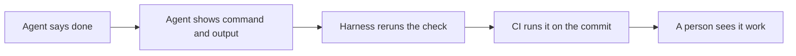
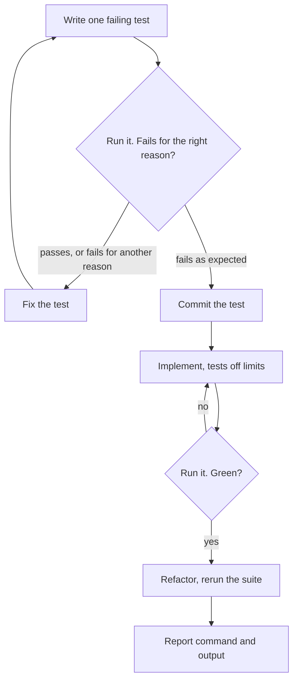

# 18 — Testing and verification loops

After this chapter you can make an agent's work provable instead of plausible. You can run a test-first loop in which every test is seen to fail before it passes, recognise the ways a "done" claim goes wrong, and prove that each of your gates is able to fail. You can also verify a UI in a real browser, require evidence in the final report, and move verification from a request in a prompt to something the harness or CI enforces.

## Mental model

Two rules hold this chapter together.

1. **A report is a claim; a run is evidence.** "All tests pass" is text the model wrote. The exit code of a command, run on a known commit, is a fact.
2. **"A check that has never been observed to fail is not known to be a check."** That sentence is a CI rule in one of the author's repos. A *gate* is any automated check that must pass before work moves on: a test target, a lint job, a required CI check. A gate that is always green tells you nothing until you have watched it go red for the right reason.

Evidence comes in strengths. Each step to the right is harder to fake and costs more to get:



Pick the rung by the risk of the change. A README edit can stop at the second rung. A change to login should reach the last one.

## Test-first with an agent

Test-first development (also called red/green/refactor) means: write a test that fails, write the code that makes it pass, then clean up while the tests stay green. It suits agents because the test is exactly the kind of check [chapter 17](17-explore-plan-implement-verify.md) asks for: something the agent can run that comes back pass or fail.



1. **Ask for the test only.** No implementation yet.
2. **See it fail, and read why.** The failure must say the behaviour is missing. An import error or a typo is a different failure.
3. **Commit the failing test.** From here on, any change to it shows up in the diff.
4. **Implement with the tests off limits.**
5. **Run the whole suite, refactor, run it again.**
6. **Report** the command and its output.

```text
Use red/green TDD for this change.
1. Write one failing test for: the 6th failed login in 15 minutes returns 429.
   Do not write any implementation yet.
2. Run the test and show me the failure output. It must fail because the
   behaviour is missing, not because of an import or syntax error.
3. Stop and wait for me.
```

```text
Commit the test. Now implement until it passes. Do not edit anything under
tests/. If you believe a test is wrong, stop and tell me why instead.
```

**Why the test must be seen to fail.** A test that passes before the code exists is not exercising the new behaviour: it imports the wrong module, asserts on a mock, or was never collected by the test runner. Only the red run proves the test is connected to the thing you are about to build.

**Protect the tests.** Anthropic's own long-running-agent harness used this instruction: "It is unacceptable to remove or edit tests because this could lead to missing or buggy functionality." A prompt line is a request. For the implementation step you can add a deny rule to `.claude/settings.json` ([chapter 8](08-settings-and-permissions.md)):

```json
{
  "permissions": {
    "deny": ["Edit(/tests/**)"]
  }
}
```

The leading `/` anchors the path at the settings source: for project settings, the project's working directory. The docs say "`Edit` rules apply to all built-in tools that edit files", so this one rule also covers the Write tool; a separate `Write(...)` rule would not match. In Bash, the rule applies to redirection targets and to file commands Claude Code recognises (such as `sed` and `tee`), but not to "arbitrary subprocesses that read or write files indirectly": "Rules match tool calls, not intent". So the real control is the diff against the commit from step 3:

```bash
RED_COMMIT=1c4e7d2                                   # the hash of the commit from step 3
git diff --stat "$RED_COMMIT"..HEAD -- tests/        # expect no output
```

## How false "done" claims happen

The best-practices page describes the symptom plainly: "Claude said it was done and it wasn't quite". There are five mechanisms, and each has a different remedy:

| Mechanism | What it looks like | How to catch it |
|---|---|---|
| The check never ran | "Tests pass" with no command in the transcript, or a run from before the last edit | Require command plus output; rerun it yourself on the commit |
| The check ran but its result was hidden | Output piped through `grep` or `tail`, a `\|\| true` suffix, `cmd 2>/dev/null; echo done` | Judge by exit code; keep pipes off the gate command |
| The tests were weakened | Assertions loosened, tests skipped or deleted, a threshold lowered | Diff of the test files; protected tests; thresholds that only move up |
| The behaviour was mocked away | A test asserts on a mock or on a special-cased input | Seam tests, mutation checks, running the real feature |
| A proxy was checked | An API field says "available"; a build is "processed"; CI is green | Check the artifact the user actually touches |

This is documented behaviour, not an occasional glitch. The vendor's prompting guide says Claude "can sometimes focus too heavily on making tests pass at the expense of more general solutions". The Claude Code issue tracker has reports with titles such as "Claude fabricated test results in PR description without running tests". Research benchmarks built to provoke the behaviour have measured models from more than one vendor editing tests, special-casing test inputs and overloading comparison operators; one of those papers found that making tests read-only "restores legitimate performance while preventing test modification attempts" but "does not eliminate other cheating methods". Those studies use artificial tasks and mostly older models, so take the mechanisms from them and not the percentages.

> **Field note:** In the author's data a build gate's output was filtered through `grep`; the pattern missed the line that started with `error:` and a failing build shipped to production. The lesson recorded afterwards: verify a gate by its exit code, never by text matching on its output.

## A check that has never failed is not known to be a check

An **inert gate** exists, is green, and cannot detect the thing it is named after. It is worse than a missing gate, because people cite it as evidence. Real examples from the author's repos:

| Gate | Why it stayed green |
|---|---|
| Phase-exit scripts | They asserted `test -f package.json`: that files existed. No workflow ran them, and they had been failing on the default branch for months while being cited as proof |
| A test runner with `passWithNoTests: true` | A renamed test path matched zero tests and exited 0 |
| A `make` target for chaos tests | It printed TODO and exited 0; the real script sat under another target |
| A required status check named `CI` | The branch ruleset required a context that no workflow reported |
| A docs check in a fresh worktree | With no `node_modules` it printed SKIP and passed locally |
| A 16-check gate on one pull request | The writer and the reader used different field paths, so every unit test on both sides passed |

There are four defences. Use the first on every new gate.

### 1. Sabotage pairs: red, then green

A sabotage pair is a demonstrated failure followed by a demonstrated pass.

1. Add the gate and run it: green.
2. Break the thing it guards, on purpose. Run it: it must go **red**. Save the output.
3. Undo the sabotage. Run it: green again. Save the output.
4. If step 2 stayed green, the gate is inert. Report that; do not ship it.

Put both outputs in the pull request body:

```markdown
## Gate proof
- Sabotage: removed the `await` in `saveRun()` → `make test-seams` exit 1 (output below)
- Restored → `make test-seams` exit 0 (output below)
```

### 2. A negative-gates self-test

Automate the sabotage so it runs in CI. This sketch works on a throwaway copy, never on the working tree:

```bash
#!/usr/bin/env bash
# ci/selftest/negative-gates.sh (sketch): each gate must fail when its subject is sabotaged
set -uo pipefail
work="$(mktemp -d)"; trap 'rm -rf "$work"' EXIT
fail=0
check() {                       # check <name> <sabotage command> <gate command>
  rsync -a --delete --exclude .git ./ "$work/"          # fresh copy for every case
  ( cd "$work" && eval "$2" )
  if ( cd "$work" && eval "$3" ) >/dev/null 2>&1; then
    echo "INERT: $1 stayed green after sabotage"; fail=1
  else
    echo "ok: $1 went red"
  fi
}
check "lint"  "echo 'var x = ;' >> src/index.js"                    "make lint"
check "tests" "sed -i.bak 's/return total/return 0/' src/cart.js"   "make test"
exit "$fail"
```

> **Field note:** The repo this pattern comes from learned the "throwaway copy" rule the hard way. Its mutation gate once edited tracked files in place and a sabotaged line reached a pull request.

### 3. Mutation checks

A mutation check changes the code in a small way (flip a condition, return a constant) and expects at least one test to fail. If every test still passes, nothing covers that behaviour. The cheapest version removes your uncommitted implementation and reruns the tests:

```bash
git stash push -u -- src/  # take the implementation away, keep the tests; -u also takes new files
npm test                   # must fail
git stash pop              # bring it back
npm test                   # must pass
```

Without `-u`, files the implementation added are left in place and the "must fail" run can pass. For a fix made of two parts, revert each half separately. A test that passes with either half removed is not testing that half.

### 4. Seam tests

A **seam** is the place where two pieces of code meet: a writer and a reader, a service and its client. Each side can be internally consistent, with every unit test green, while the two disagree about a field name. The product workspace's rule is "Test the seam, not the sides": the only test that sees the defect "feeds one side the *other side's real output*".

```js
// Seam test: give the reader the writer's real output, not a hand-written fixture.
import test from "node:test";
import assert from "node:assert/strict";
import { buildRunEvent } from "../service/src/events.js";   // writer
import { parseRunEvent } from "../web/src/run-events.js";   // reader

test("the web client reads what the service writes", () => {
  const wire = JSON.parse(JSON.stringify(buildRunEvent({ id: "r1", status: "done" })));
  assert.deepEqual(parseRunEvent(wire), { id: "r1", status: "done" });
});
```

Two more rules from the same repos: a gate must sit on the path it guards *and* in a required check ([chapter 19](19-git-prs-and-code-review.md)), and "could not check" must never exit 0. One watchdog workflow documents its exit codes as "0 verified, 1 evidence moved, 2 COULD NOT BE CHECKED — and 2 is not a softer 1."

## Verify UI and behaviour in a real browser

A type checker cannot see a blank page. The official list of acceptable checks includes "A browser screenshot next to the mockup", and the web repo in the product workspace says it directly: "A green `make ci` is not verification" for UI work.

1. Start the app from a fresh build. A reused dev server can serve a stale bundle and fake your results.
2. Drive the real flow: click, type, submit. Loading the page is not using it.
3. Read the browser console and failed network requests.
4. Take screenshots at phone, tablet and desktop widths, in light and dark themes.
5. Compare with the mockup or the committed baseline. Updating a baseline is a deliberate act, not a way to get green.
6. Attach the screenshots to the report.

| Tool | What it does (docs, as of Nov 2026) |
|---|---|
| `/verify` | Skill: build, run and observe a change |
| `/run` | Skill: launch and drive your app |
| `/run-skill-generator` | Skill: writes a per-project skill that teaches `/run` and `/verify` |
| `claude --chrome` | Enables Chrome browser integration for web automation and testing |
| A browser-automation MCP server | For example the Playwright plugin; [chapter 11](11-mcp-in-practice.md) covers adding MCP servers |

Say which method you want. A prompt that worked in the field data:

```text
Use the browser tools and do real UI testing: look at the web UI and
use it, to find the real issues. Attach a screenshot for each finding.
```

> **Field note:** In one session an agent reported "all devices available" from an API check while the web console was unusable. One browser pass, asked for with the prompt above, found nine bugs. In the same workspace the written rule for UI changes is interaction, a console check and screenshots at 375, 768 and 1440 px in both themes.

Some checks cannot be automated: OS permission dialogs, a logged-in browser profile, a physical device. Write those down as human-only, and verify in the context the user launches from. One of the author's helpers worked from a terminal and hung when a browser launched it.

## Put the evidence in the final report

The official wording: "ask Claude for *evidence*: the command it ran and its output, or the screenshot. 'All tests pass' on its own tells you very little". Ask for a fixed shape:

```markdown
## Verification
- Commit: `3f2a9c1` on `fix/login-rate-limit`
- `npm test -- auth` → exit 0 (42 passed, 0 failed)
- `npm run lint` → exit 0
- Browser: 6 bad passwords in a row; the 6th shows "Too many attempts" (screenshot attached)
- Not verified: behaviour behind the production load balancer (needs a human)
```

- **Name the commit.** Test the commit, not a working copy that other sessions share.
- **Quote exit codes.** A pipeline such as `npm test | tail -5` returns the exit code of `tail`.
- **Never print success after a silenced command.** `cmd 2>/dev/null; echo commented` reports "commented" when `cmd` failed. That pattern appears in the field data: a review ruling was reported as posted when the command had failed.
- **Keep a "not verified" line.** It is the most honest part of the report, and the place where a human check gets scheduled.

## Enforce it, do not request it

A line in a prompt or in `CLAUDE.md` is read by the model, with no guarantee. A hook or a CI job is executed by software. The docs say: "If something has to happen every time, make it a hook, a deny rule, or a managed setting."

| Control | Who runs it | Can the agent skip it? |
|---|---|---|
| "Run the tests before you finish" in the prompt | The model | Yes |
| `/goal <condition>` | An evaluator model after every turn | Not directly, but the verdict is still a model's judgement |
| `Stop` hook | Claude Code, when Claude tries to stop | No, unless it can edit the hook |
| Required CI check | Your CI, on the pushed commit | No, without bypass rights on the branch |

A `Stop` hook ([chapter 14](14-hooks.md)) runs when Claude finishes a response. The docs: "Exit code 2 is what blocks the stop." Their one-line example is `pnpm tsc --noEmit 1>&2 || exit 2`. A fuller version, registered in `.claude/settings.json` (make the script executable with `chmod +x`):

```json
{
  "hooks": {
    "Stop": [
      { "hooks": [ { "type": "command", "command": "\"${CLAUDE_PROJECT_DIR}\"/.claude/hooks/verify-on-stop.sh" } ] }
    ]
  }
}
```

```bash
#!/usr/bin/env bash
# .claude/hooks/verify-on-stop.sh: block the stop while the check fails
input="$(cat)"
# Loop guard: if this hook already sent Claude back, let the turn end.
[ "$(echo "$input" | jq -r '.stop_hook_active // false')" = "true" ] && exit 0
# Stop fires after every response, so skip when nothing under src/ or tests/ is uncommitted.
[ -z "$(git status --porcelain -- src tests)" ] && exit 0
if ! out="$(npm test 2>&1)"; then
  echo "Tests fail. Fix them before you stop:" >&2
  echo "$out" | tail -n 40 >&2
  exit 2          # exit 2 blocks the stop; exit 1 would not
fi
exit 0
```

- "`Stop` hooks fire whenever Claude finishes responding, not only at task completion." Keep the check fast.
- After eight blocked stops in a row with no tool call, Claude Code ends the turn anyway (the cap is `CLAUDE_CODE_STOP_HOOK_BLOCK_CAP`). The cap is a backstop, not a design.
- With the loop guard, this hook forces one more attempt and no more. It also sees only uncommitted changes, so it is silent once the agent has committed. CI is still the gate that counts.
- Write a `/goal` condition as a predicate ("`npm test` exits 0"), not as an imperative. In the author's data a goal phrased as "do not stop" produced 21 consecutive blocks.

> **Warning:** Never weaken a gate to get green. In the author's plugin repo a worker agent lowered a coverage floor from 84 to 77 to pass an upgrade; "Never weaken a quality gate to get green" is now a hard rule there, next to "Never fake validation success". The product workspace treats its phase-exit scripts as contracts: "Never edit them to make them pass — fix the underlying issue."

Some things an agent cannot verify at all: a human sign-off, a pilot result, a production measurement. One repo keeps a `human-gates.md` list of items "an agent cannot do and must never fake"; each row stays open until a person links evidence.

## Evaluating prompts and skills

Prompts, skills and plugins are non-deterministic, so one successful run proves little. An **eval** is a test for that kind of behaviour: a task, several trials, and a grader that scores each trial.

| Idea | What to know |
|---|---|
| Graders | Code-based (fast, objective, brittle), model-based (flexible, needs calibration), human (the reference, slow) |
| Where to start | Anthropic's evals guide suggests 20 to 50 simple tasks drawn from real failures |
| One run is not enough | At 75% per trial, three passes in a row happen about 42% of the time |
| Grade outcomes | Check the result, not the path the agent took; read transcripts when a score surprises you |
| Baseline | A high score "doesn't tell you the plugin helped, because Claude might do as well without it" |

For skills, the authoring guide says: "Create evaluations BEFORE writing extensive documentation." Find what fails without the skill, build three scenarios that test those gaps, record a baseline, then write the minimum instructions that move it.

Claude Code has a built-in runner, `claude plugin eval` (v2.1.269 or later). The suite lives in `evals/` inside the plugin. Each case is a prompt plus graders, runs three times by default, and is rerun without the plugin so the difference is the plugin's contribution. `--threshold` (default 1.0) makes it a CI gate with exit code 1 on failure, and it writes a self-contained `report.html`.

```bash
claude plugin eval init          # draft a suite
# As run in the author's plugin repo (flags match `claude plugin eval --help` in v2.1.332):
claude plugin eval . --ablation with-without --runs 3 \
  --judge-model sonnet --allow-tools Write --threshold 0.8
```

> **Field note:** The author's plugin reports the uplift (score with the plugin minus score without), not the raw pass rate. Across twelve cases the mean uplift was +0.13, and one case scored −0.25: the skill made things worse and was fixed at the source. Those evals run nightly, never on pull requests: "a PR gate that costs $12 per push and flakes would be disabled within a week". In the product workspace the per-PR gate is deterministic and LLM-free; the LLM judge runs nightly as a majority vote of three.

## From the field

> **Field note:** Numbers below come from one developer's repos and about four weeks of Claude Code transcripts (37 substantive sessions, counts ±30%). They are not benchmarks.

**Forty inert gates, zero strict ones.** An audit of the product workspace found about 40 recorded cases of "a gate that exists, is green, and cannot detect what it names", against zero cases of a gate that was too strict. The resulting standing rule has four points: test the seam; put the gate on the path it guards and in a required check; "Every new gate ships with a demonstrated failure"; and "Report a sabotage that does not go red".

**"Done" without evidence is one of the 18 friction categories in the transcript analysis.** The transcripts hold 60 agent self-corrections in 20 of 37 sessions, and pushback of the "still not working" kind in 12. In one case the agent said twice "it's released, just refresh" before checking that the builds had never been added to the tester group. An advisory definition-of-done reminder hook fired about 650 times in the same window. The data shows that the reminder was adopted; it does not show a before-and-after rate.

## Common problems

| Symptom | Cause | Fix |
|---|---|---|
| "Tests pass", but CI is red | Stale or piped local run; local state differs | Rerun on the commit in a clean checkout; judge by exit code |
| Green suite, wrong behaviour | Tests edited, special-cased or mocked to pass | Protected tests, diff of test files, a seam test, `/verify` |
| A new test passed on its first run | It never exercised the new code | Remove the implementation and watch it fail |
| A gate has been green for months | Nothing runs it, or it cannot fail | Sabotage pair; move it into a required check |
| The UI "works" but the page is broken | Verified by types or an API, not a browser | Browser pass with console check and screenshots |
| A `Stop` hook does not block | The script exits 1 | Exit 2, with the reason on stderr |
| The agent never stops | A `Stop` hook blocks every turn end | Check `stop_hook_active`; state the goal as a predicate |
| High eval score, no real benefit | No baseline without the skill or plugin | Run with and without; report the difference |

## Checklist

- [ ] Every new test was seen to fail, for the right reason, before the code was written.
- [ ] The failing test was committed, and the test files did not change afterwards.
- [ ] The final report shows commands, exit codes and the commit they ran on.
- [ ] Every new gate has a red-then-green sabotage pair in its pull request.
- [ ] At least one test feeds one side of a seam with the other side's real output.
- [ ] UI changes were used in a real browser, with screenshots and a console check.
- [ ] The check that matters is enforced by a `Stop` hook or a required CI check.
- [ ] Skills and prompts are scored against a baseline over several runs.

## Try it

1. **See red first.** Pick a small function. Ask Claude Code for a failing test only, and read the failure. Commit it, ask for the implementation with `tests/` off limits, then run `git diff --stat "$RED_COMMIT"..HEAD -- tests/` and confirm it prints nothing.
2. **Sabotage one gate.** Choose a check your repo relies on (lint, a test target, a CI job). Break the thing it guards in a scratch copy and run it. If it stays green, you have found an inert gate; fix it and write the red-then-green pair down.
3. **Enforce one check.** Add the `Stop` hook from this chapter to a scratch repo, break a test and ask the agent for an unrelated edit. Watch it get sent back once, and note what the loop guard does on the second stop.

## Sources

- [Claude Code best practices](https://code.claude.com/docs/en/best-practices)
- [Hooks reference](https://code.claude.com/docs/en/hooks) and [hooks guide](https://code.claude.com/docs/en/hooks-guide)
- [Plugin evals](https://code.claude.com/docs/en/plugin-evals)
- [Commands reference](https://code.claude.com/docs/en/commands)
- [Claude prompting best practices](https://platform.claude.com/docs/en/build-with-claude/prompt-engineering/claude-prompting-best-practices)
- [Skill authoring best practices](https://platform.claude.com/docs/en/agents-and-tools/agent-skills/best-practices)
- [Effective harnesses for long-running agents, Anthropic](https://www.anthropic.com/research/effective-harnesses-for-long-running-agents)
- [Demystifying evals for AI agents, Anthropic](https://www.anthropic.com/research/demystifying-evals-for-ai-agents)
- [Red/green TDD, Agentic Engineering Patterns](https://simonwillison.net/guides/agentic-engineering-patterns/red-green-tdd/)
- [Recent reward hacking, METR, Jun 2025](https://metr.org/blog/2025-06-05-recent-reward-hacking/)
- [Impossible-task benchmark paper, arXiv 2510.20270](https://arxiv.org/html/2510.20270v1)
- [Issue: fabricated test results in a PR description](https://github.com/anthropics/claude-code/issues/22507)
- Field data: the author's plugin repo, a product workspace, smaller personal repos and about four weeks of session transcripts

---

[← Previous: Explore, plan, implement, verify](17-explore-plan-implement-verify.md) · [Contents](README.md) · [Next: Git, pull requests and code review →](19-git-prs-and-code-review.md)
