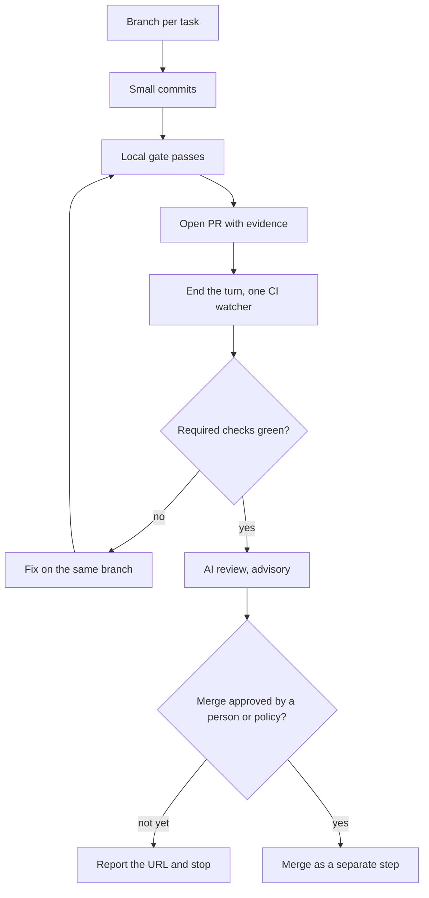

# 19 — Git, pull requests and code review

After this chapter you can run source control with an agent without losing track of what changed or who approved it: one branch per task, small commits that say why, and a pull request whose body states what was verified and how. You can use the built-in review commands, decide which automated reviewers gate and which only advise, review AI-written code efficiently, and keep "open a pull request" and "merge it" as two separate authorities.

## Mental model

An agent with a shell has the same Git and GitHub rights as the account it runs under. The pull request (PR) is where its work stops being a claim and becomes a change that software has checked and a person can read. Four kinds of action have rising cost. Hand over the cheap ones and keep the expensive ones:

| Action | Easy to undo? | Reach | Sensible default for an agent |
|---|---|---|---|
| Commit on a task branch | Yes | Local | Allowed |
| Push the branch, open a PR | Yes, close it | Visible to the team; starts CI | Allowed, with a body that states the verification |
| Merge | Hard; needs a revert | Default branch; may deploy | Explicit instruction, or a narrow written policy |
| Force-push, delete branches, change protection | Often not | Other people's work | Ask every time |



The official best-practices page puts the last decision outside the model. Under "Who has the last word" it lists "Claude's summary of what it did" on the non-deterministic side and "Branch protection, a person who approves the merge" on the deterministic side.

## Branch per task, small commits

One task gets one branch, and nothing is committed on the default branch. Commit after each passing step ([chapter 17](17-explore-plan-implement-verify.md)), so the history reads as a sequence of small, checked changes. Tell the agent once, in the brief or in `CLAUDE.md`:

```text
Work on a new branch fix/login-rate-limit. Never commit to main.
Commit after each passing step, using Conventional Commits. The subject
says what changed; the body says why and how you checked it.
```

```bash
git switch -c fix/login-rate-limit
git add -A
git commit -m "fix(auth): limit failed logins to 5 per 15 minutes" \
           -m "Support reported credential stuffing. Verified: npm test -- auth (exit 0)."
```

A real commit message carries what the diff cannot show: the reason. Agents left alone tend to narrate the diff ("update auth.js"), so ask for the why.

The author's repos share one convention set that you can copy: type-prefixed branches (`feat/`, `fix/`, `docs/`, `chore/`, `ci/`), commit subjects in the form `<type>(<scope>): <description>`, and squash merges whose subject ends in the PR number.

When you resume work or start a second session, look before you write. This three-line check prevents duplicate PRs:

```bash
git fetch origin
git log origin/main -5 --oneline     # was it already merged?
gh pr list --state open              # is there already a PR for it?
```

Two sessions that need different branches at the same time need separate working directories. That is [chapter 20](20-parallel-work-worktrees-and-background-tasks.md).

## Open a pull request with gh

When Claude needs an outside tool, the docs call a CLI such as `gh` "usually the easiest way in". The prompt can be as short as `create a pr`. A session is linked to a PR "when Claude creates it with `gh pr create` or `glab mr create`", and `claude --from-pr 1234` reopens the linked session later.

```bash
gh pr create --base main \
  --title "fix(auth): limit failed logins to 5 per 15 minutes" \
  --body-file pr-body.md
```

The body is the part that matters. It should let a reviewer rerun your proof:

```markdown
## What and why
Limit failed logins to 5 per account per 15 minutes. Closes #212.

## How it was verified
- `npm test -- auth` → exit 0 (42 passed) on commit 3f2a9c1
- `make ci` → exit 0
- Browser: the 6th bad password shows the lockout message (screenshot below)

## Risk and where to look
Medium: touches the auth path. Written with an agent. Please check the
window arithmetic in `src/auth/limiter.js`.

## Not verified
Behaviour behind the production load balancer.
```

That shape matches a "PR contract" proposed in a January 2026 practitioner post on AI code review: what and why in one or two sentences, proof that it works, the risk tier and which parts were AI-generated, and one or two places where human review is wanted. The author's repos state the same rule in their instruction files: the PR body says what changed, why, and "how it was verified (the exact commands and their result)".

Read your own diff before you ask anyone else to. `/diff` shows the changes in your working tree, including Claude's edits.

## The built-in review commands

```text
/code-review [low|medium|high|xhigh|max|ultra] [--fix] [--comment] [--max-findings n|all|default] [pr#|branch|path]
```

| You type | It reviews |
|---|---|
| `/code-review` | The current diff |
| `/code-review 1234` | PR 1234 |
| `/code-review src/auth` | A path |
| `/code-review main...my-feature` | A branch range |
| `/code-review high --comment 1234` | PR 1234 at higher effort, posting the findings on the PR |

| Command | What the docs say (as of Nov 2026) |
|---|---|
| `/code-review` | A skill that reviews the current diff, or a PR number, branch or path, "for correctness bugs". Alias `/review`. Runs locally as a background subagent on any subscription plan. It follows `CLAUDE.md` and "doesn't read `REVIEW.md`" |
| `--fix`, `--comment` | `--fix` applies the findings; `--comment` posts them on the GitHub PR or GitLab merge request |
| `/code-review ultra` | A deep multi-agent review in a cloud sandbox (research preview). Needs a claude.ai sign-in. Three one-time free runs on Pro, Max and Ultra, then "typically $5 to $25" per review as usage credits |
| `/security-review` | "Analyze the changes on your current branch for security vulnerabilities". It reviews the diff between your branch and origin's default branch and needs an `origin` remote. No flags are documented |
| `/simplify [target]` | Reviews changed code for cleanup and applies the fixes. "The review doesn't look for correctness bugs" |

`/code-review` is useful because of where it runs: "in a fresh subagent that never saw your conversation". The docs explain why that matters: "A fresh reviewer does help, because it hasn't seen your reasoning".

> **Warning:** Do not fix everything a reviewer finds. The docs: "A reviewer that's asked to find problems will always find *something*. If you fix every finding, you end up with extra abstraction layers and tests for cases that can't happen." Fix what affects correctness and decide the rest yourself.

## Automated reviewers in CI: advise or gate?

| Reviewer | Where it runs | What it does to the merge |
|---|---|---|
| Claude Code Review (managed; Team and Enterprise plans; GitHub only) | Anthropic infrastructure, in four stages: find, verify, rank, post | Posts inline comments and a check run named **Claude Code Review** that "doesn't conclude as a failure". "By itself, a review doesn't approve or block the pull request." |
| `anthropics/claude-code-action@v1` with the code-review plugin | A GitHub Actions job in your repo | Comments on the PR; gating is whatever you build around the job |
| GitHub Copilot code review | GitHub | "By default, Copilot's reviews do not count toward required approvals for the pull request." |

The managed review is tuned with a `REVIEW.md` file that is read from the base branch, never from the PR's own changes, so a PR cannot rewrite its own review instructions. A comment `@claude review` starts a review on demand.

The self-hosted version, as the GitHub Actions page gives it:

```yaml
name: Code Review
on:
  pull_request:
    types: [opened, synchronize, ready_for_review, reopened]
jobs:
  review:
    runs-on: ubuntu-latest
    permissions:
      contents: read
      pull-requests: read
      issues: read
      id-token: write
    steps:
      - uses: actions/checkout@d23441a48e516b6c34aea4fa41551a30e30af803 # v6.1.0
        with:
          fetch-depth: 1
      - uses: anthropics/claude-code-action@9c5ddab2e6d17b83ea679153b31f1d5f023cf636 # v1.0.217
        with:
          anthropic_api_key: ${{ secrets.ANTHROPIC_API_KEY }}
          plugin_marketplaces: "https://github.com/anthropics/claude-plugins-official.git"
          plugins: "code-review@claude-plugins-official"
          prompt: "/code-review:code-review --comment ${{ github.repository }}/pull/${{ github.event.pull_request.number }}"
          claude_args: '--allowedTools "mcp__github_inline_comment__create_inline_comment"'
```

`--comment` makes Claude post the review; without it the findings stay in the run log. The `claude_args` line is required, because the action starts the inline-comment server only when `--allowedTools` names it. On public repos, PRs from forks get no secrets, so the review does not run for them. Setup and cost controls are in [chapter 22](22-headless-ci-and-the-agent-sdk.md).

**Deterministic checks gate; model reviews advise.** A model reviewer is non-deterministic and always finds something, so a gating one turns into a flaky gate that people learn to bypass. One of the author's repos writes it as an invariant: "No release gate depends on a non-deterministic agent decision." The docs add the other half: "A review with no findings doesn't mean your code is error-free or secure."

> **Field note:** A product workspace runs its own AI reviewer as a workflow, deliberately non-gating. It reviews when a PR opens, and again on new commits only when the PR carries a `re-review` label. Its design note is "NON-GATING, BUT NOT SILENT": a run that produced no review posts a comment and a `neutral` check, because otherwise a green check was indistinguishable from "did not review".

## Reviewing AI-written code as a human

Read in this order. The first three steps take minutes and catch most bad PRs:

1. **Proof first.** Does the body show commands and output? Can you rerun one?
2. **Tests next.** Did existing tests change? Look for loosened assertions, `skip`, lowered thresholds and deleted files ([chapter 18](18-testing-and-verification-loops.md)).
3. **Scope.** Is there anything nobody asked for? Unrequested functionality is a warning sign.
4. **Seams.** Check where the change meets code it did not touch: field names, API contracts, config keys.
5. **Wiring.** Is the new code actually called? A lesson from the field data: tested code with no caller enforces nothing.
6. **Sensitive areas.** Authentication, payments, secrets and untrusted input get a human threat-model read ([chapter 24](24-security-and-guardrails.md)).
7. **Dependencies.** Does each new package exist, and is it needed?

Agents make writing cheap. The published data suggests that the cost moves to review:

| Finding | Source | Caveat |
|---|---|---|
| High-AI-adoption teams: PRs merged +98%, PR review time +91%, PR size +154%, bugs per developer +9%; no significant link to company-level throughput or quality | Faros AI report, Jul 2025 | Vendor telemetry (10,000+ developers); correlations; data to June 2025 |
| AI-co-authored PRs: 10.83 issues per PR against 6.45 for human-only | CodeRabbit report, Dec 2025 | The vendor sells AI review; 470 open-source PRs; authorship was inferred |
| AI adoption relates positively to throughput, and still negatively to delivery stability | DORA 2025 report | Survey of about 5,000 people; self-reported; correlational |
| Experienced open-source developers took 19% longer with AI, and still believed they had been about 20% faster | METR trial, Jul 2025 | 16 developers, early-2025 tools; METR now marks it out of date. Its value is the perception gap |
| "100 lines is usually a reasonable size for a CL, and 1000 lines is usually too large." | Google engineering practices | Written before agents; the baseline the other rows are measured against |

None of these is a controlled 2026 measurement. Read them together as a direction: individual output rises, and review time and stability are where the cost lands. The response is the oldest advice in code review: keep each PR small enough to be read properly, and split work that is not.

> **Field note:** Small PRs have a price too. In the author's sessions each PR paid about 18 minutes of local gate plus about 18 minutes of CI, and bot reviewers ran five or six rounds per PR, each restarting CI. The fixes adopted were one PR per objective, pushed once after the local gates pass, and at most two review rounds, with later findings filed as issues.

## Who may merge

Opening a PR is cheap and reversible. Merging changes the default branch and may deploy. The author's instruction files separate the two in so many words: "PR open ≠ PR merge". The product workspace version reads:

> "**Never merge a PR without explicit instruction** — open, share the URL, stop"

It has one narrow exception: docs-only, test-only, dependency-bump and behaviour-free CI changes may merge once every required check is green on the current head commit. Everything else waits: "Anything that changes behaviour, auth or permissions, infrastructure, schema or money is NOT low-risk", and "When unsure, it is not low-risk."

Three incidents from the field data show what happens when the two authorities blur:

| What happened | Why | Durable fix |
|---|---|---|
| One shell command printed `BLOCKED 1` for an unresolved review thread and then merged anyway. A real defect reached the default branch | Check and merge were chained in one command, and the account's admin bypass let the merge through | The readiness check and the merge are separate tool calls |
| On "merge all", a session merged another session's green PR that was being held for a coordinated database change. The merge auto-deployed, and login returned errors until the database was recreated (before launch, no customers) | The hold lived in a conversation, not on the PR | Ask the owning session before merging a PR you did not open; check whether a merge auto-deploys |
| A second session reopened "-rebased" copies of conflicted PRs and merged one from a head that predated the original's last fix | No check of remote state; no ownership rule between sessions | The three-line resume check from earlier in this chapter |

The first row in commands:

```bash
# Anti-pattern: the verdict is printed, not obeyed.
./scripts/pr-ready.sh 482; gh pr merge 482 --squash

# Call 1: read the state. Do not chain the merge onto it.
gh pr checks 482 --required          # exit 8 means checks are still pending
gh pr view 482 --json reviewDecision,mergeStateStatus,headRefOid

# Call 2: only after reading call 1, pinned to the commit you checked.
HEAD_SHA="<headRefOid from call 1>"  # paste the value; do not re-query it here
gh pr merge 482 --squash --match-head-commit "$HEAD_SHA"
```

Replace "merge all" with a scoped instruction:

```text
Merge the PRs this session opened once green with no open threads.
For anyone else's PR, ask the owning session first and tell me which
ones you skipped and why.
```

Put holds where every session can see them. One of the author's repos states that a pre-merge condition "is a blocking review thread on the PR, not a chat message". A draft PR or a blocking thread survives a context reset; a sentence in a chat does not.

## Branch protection and required checks

Written rules depend on the agent reading them. Branch protection does not. Remember that the agent uses your credential: the product workspace's own design notes say the only thing keeping agent writes inside the organisation is "a written instruction, not a boundary the credential itself enforces". If your account can bypass protection, so can the agent.

- **Require status checks on the default branch.** A solo developer cannot require an approving review from themselves, so in the product workspace the private repos require one aggregate check and no review; the public repos add a secret scan and one review.
- **Use one fan-in job per workflow file as the required check.** A fan-in job `needs:` every other job and reports one status, so the protection rule names a single check (`needs:` cannot cross workflow files). A ruleset (GitHub's newer form of branch protection) that requires a context, meaning a status-check name, that no workflow reports is a silent failure. One of the author's repos recorded exactly that: a required context named `CI` "that no workflow reported".
- **Count `skipped` as failure** in the fan-in job, and put path filters on steps, not on jobs.
- **Require conversation resolution** ("Require conversation resolution before merging" in the branch protection settings), so an unresolved thread blocks the merge without any script. It binds an admin account only if bypassing is also switched off.
- **Read the rules; never guess them.**

```yaml
  ci:
    name: CI                      # the single required status check
    if: always()
    needs: [lint, test, build]
    runs-on: ubuntu-latest
    steps:
      - name: Fail unless every needed job succeeded
        run: |
          for r in ${{ join(needs.*.result, ' ') }}; do
            [ "$r" = "success" ] || { echo "a job ended as: $r"; exit 1; }
          done
```

```bash
gh api repos/OWNER/REPO/branches/main/protection    # classic branch protection
gh api repos/OWNER/REPO/rulesets                    # rulesets, if the repo uses them
```

## Waiting on CI without burning tokens

A turn that sleeps and polls pays to re-read the conversation on every wake-up and reports nothing in between. The product workspace measured about 10 hours of sleep loops in three weeks and wrote this rule: after opening the PR, "**end the turn**: start ONE background watcher (`gh pr checks <n> --watch` with `run_in_background`) and let its completion notify you. **Never sleep-poll CI, and never keep a turn open waiting for it**".

1. Run the local gate, push once, open the PR.
2. Start one background watcher and end the turn.
3. When the watcher exits, the session is notified. Read the result, and report on every terminal state: pass, fail or timeout.
4. On failure, read only the failed logs, fix, and push once.

```bash
gh pr checks 482 --watch --fail-fast     # run as a background command
gh run view "$RUN_ID" --log-failed       # after a failure; RUN_ID comes from `gh run list`
```

Claude Code also ships skills for this loop (check `/help` in your version): `/ship [level] [pr] [+bot]` commits, pushes, opens a PR, reviews it and then watches it; `/steward [pr] [+bot]` watches your open PR and pushes fixes; `/autofix-pr [prompt]` starts a cloud session that does the same for the branch's PR.

- A subagent should finish its work and return after opening the PR. The main session watches CI. Subagents that wait on long gates tend to end mid-task ([chapter 21](21-multi-agent-orchestration.md)).
- Background commands are not restored when you resume a session. Start the watcher again.
- Cancel superseded runs per PR, so bursts of agent pushes do not queue stale runs.
- When every job fails at `Set up job` within a minute, the cause is the CI host or a throttle, not your commit. Do not keep re-running.
- Commits pushed with the default `GITHUB_TOKEN` of a workflow do not trigger CI.

## From the field

> **Field note:** These numbers come from about four weeks of one developer's Claude Code transcripts, including subagents. They describe one heavy user, not a benchmark.

- **Volume.** 948 distinct PRs in 26 repos were linked to sessions in the window (what triggers a link was not verified). A pattern count over Bash command text found `gh pr view` 3,512 times, `gh pr checks` 2,048, `gh pr create` 1,033 and `gh pr merge` 971; the count includes text inside heredocs, so read it as an order of magnitude.
- **Polling.** `sleep` was the 19th most common leading command (855 calls), and the harness refused a "sleep, then poll" chain 137 times. The harness already resists the habit; the rule above removes it.
- **Merges.** Both merge incidents in this chapter were detected by another session after the fact, not by a gate. The fixes that stayed were procedural (separate calls, ask the owner) and structural (required checks, holds recorded on the PR).

## Common problems

| Symptom | Cause | Fix |
|---|---|---|
| Two PRs for the same change | A resumed or second session did not check remote state | `git log origin/main -5` and `gh pr list --state open` before writing code |
| A PR merged while a check said blocked | Verify and merge chained in one command; admin bypass | Separate calls; `--match-head-commit`; protection that also binds admins |
| The agent merged a PR someone was holding | "Merge all"; the hold lived in chat | Scope merges to PRs this session opened; record holds on the PR |
| Review rounds never end | A reviewer asked for problems always finds some | Cap the rounds; later findings become issues |
| The AI review check is green, but nothing was reviewed | A non-gating job that exits 0 reports success | Post a comment and a neutral check when no review was produced |
| Hours of turns spent waiting for CI | Sleep-and-poll loops | One background `gh pr checks --watch`; end the turn |
| A required check waits forever | The rule names a context that no workflow reports | One fan-in job with exactly the required name |
| A 2,000-line PR that nobody reads properly | One prompt, one giant diff | Split by task; one objective per PR; state where to look |

## Checklist

- [ ] Every task has its own branch, and nothing is committed on the default branch.
- [ ] Commits are small, and each message says why.
- [ ] The PR body lists the commands run, their results, and what was not verified.
- [ ] I read the diff, and a fresh-context `/code-review` ran before I asked for human review.
- [ ] AI reviewers advise; deterministic checks gate.
- [ ] The agent may open PRs; merging needs my instruction or a written low-risk policy.
- [ ] The default branch has required checks, and I have read its protection rules.
- [ ] CI is watched by one background command, not by a sleep loop.

## Try it

1. **Write the PR body first.** For your next change, write the "How it was verified" section before you open the PR, run each command in it, then let the agent open the PR with `gh pr create --body-file`.
2. **Get a fresh review.** Run `/code-review` on a branch you consider finished. Sort the findings into "affects correctness" and "style or speculative", and fix only the first group.
3. **Read your protection.** Run `gh api repos/OWNER/REPO/branches/main/protection` on a repo you own. List what is required today, and whether your own account can bypass it.

## Sources

- [Claude Code common workflows](https://code.claude.com/docs/en/common-workflows)
- [Commands reference](https://code.claude.com/docs/en/commands)
- [Code Review](https://code.claude.com/docs/en/code-review) and [local code review](https://code.claude.com/docs/en/code-review-local)
- [Ultrareview pricing](https://code.claude.com/docs/en/ultrareview#pricing-and-free-runs)
- [Claude Code GitHub Actions](https://code.claude.com/docs/en/github-actions)
- [Claude Code best practices](https://code.claude.com/docs/en/best-practices)
- [GitHub Copilot code review](https://docs.github.com/en/copilot/concepts/agent-capabilities/agent-powered-workflows-and-operations/code-review)
- [Small CLs, Google engineering practices](https://google.github.io/eng-practices/review/developer/small-cls.html)
- [The AI Productivity Paradox Report 2025, Faros AI](https://www.faros.ai/blog/ai-software-engineering)
- [State of AI vs human code generation, CodeRabbit](https://www.coderabbit.ai/blog/state-of-ai-vs-human-code-generation-report)
- [DORA 2025 report](https://dora.dev/research/2025/dora-report/)
- [METR study of experienced open-source developers, Jul 2025](https://metr.org/blog/2025-07-10-early-2025-ai-experienced-os-dev-study/)
- [Practitioner post on AI code review and the PR contract, Jan 2026](https://addyosmani.com/blog/code-review-ai/)
- Field data: the author's global `CLAUDE.md`, a product workspace, and about four weeks of session transcripts

---

[← Previous: Testing and verification loops](18-testing-and-verification-loops.md) · [Contents](README.md) · [Next: Parallel work: worktrees and background tasks →](20-parallel-work-worktrees-and-background-tasks.md)
