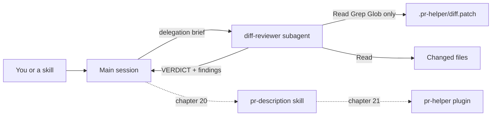

# 19 — Guide: write a subagent

You will build `diff-reviewer`, a read-only subagent that reviews a saved git diff against its goal
and returns a short, fixed-format verdict. It is the first piece of a small "PR helper" kit:
[chapter 20](20-guide-write-a-skill.md) adds a `pr-description` skill that calls it, and
[chapter 21](21-guide-build-and-ship-a-plugin.md) packages both with a guard hook into a plugin.

- **Time:** about 45 minutes. **Needs:** Claude Code signed in ([chapter 6](06-install-and-first-session.md)),
  `git`, `python3`. Commands match v2.1.332 (Nov 2026); check yours with `claude --version`.
- **Concepts:** what a subagent starts with and returns is in [chapter 14](14-subagents.md).

## What you will build



The subagent never edits or runs anything: the main session (later, the skill) saves the diff to a
file, and the subagent reads it with fresh eyes and reports back.

## Step 1 — Create the sample repo

Make a tiny repo in a scratch directory. The second commit, on a feature branch, carries a planted
bug that its own tests miss: the docstring promises a discount for "10 or more items", but the code
tests `qty > 10`.

```bash
mkdir -p ~/scratch/pr-helper-demo && cd ~/scratch/pr-helper-demo
git init -b main
cat > pricing.py <<'EOF'
"""Tiny pricing module for the PR helper workshop."""


def apply_discount(total, percent):
    """Return total reduced by percent (0-100), rounded to cents."""
    if not 0 <= percent <= 100:
        raise ValueError("percent must be between 0 and 100")
    return round(total * (100 - percent) / 100, 2)
EOF
cat > test_pricing.py <<'EOF'
import unittest

from pricing import apply_discount


class TestPricing(unittest.TestCase):
    def test_apply_discount(self):
        self.assertEqual(apply_discount(200.0, 25), 150.0)
EOF
git add . && git commit -m "feat: add apply_discount"

git switch -c feature/bulk-discount
cat >> pricing.py <<'EOF'


def bulk_price(qty, unit_price):
    """Orders of 10 or more items get 10% off."""
    total = qty * unit_price
    if qty > 10:
        return apply_discount(total, 10)
    return total
EOF
cat > test_bulk.py <<'EOF'
import unittest

from pricing import bulk_price


class TestBulkPrice(unittest.TestCase):
    def test_big_order_gets_discount(self):
        self.assertEqual(bulk_price(20, 5.0), 90.0)

    def test_small_order_pays_full_price(self):
        self.assertEqual(bulk_price(2, 5.0), 10.0)
EOF
git add . && git commit -m "feat: add bulk_price with a 10% bulk discount"
```

Now save the branch diff where a read-only agent can read it, and keep that folder (and Python's
cache) out of git:

```bash
mkdir -p .pr-helper && printf '.pr-helper/\n__pycache__/\n' >> .git/info/exclude
git diff main...HEAD > .pr-helper/diff.patch
python3 -m unittest && python3 -c "from pricing import bulk_price; print(bulk_price(10, 5.0))"
```

You should see the tests pass (`OK`) and then `50.0`. Ten items at 5.0 should cost 45.0 after the
promised discount, so the tests are green and the code is wrong. That is what the reviewer must find.

**Check:** `git log --oneline` shows two commits, and `.pr-helper/diff.patch` is not empty.

## Step 2 — Decide that a subagent is the right tool

Run the idea through the decision guide in [chapter 11](11-the-extension-model.md) before writing a
file. The official trigger for a subagent is "A side task floods your conversation with output you
won't reference again", and the docs describe one as an "Isolated execution context that returns
summarized results". A diff review fits for three reasons:

| Need | Why a subagent gives it |
|---|---|
| Fresh eyes | A fresh-context subagent does not see the conversation that wrote the code ([chapter 14](14-subagents.md)) |
| A hard read-only limit | Its `tools` list can leave out every tool that writes |
| A short result | Only its final report comes back to the main session |

A PR checklist alone would be a skill ([chapter 15](15-skills.md)); a must-hold rule, a hook ([chapter 16](16-hooks.md)).

**Check:** you can say in one sentence what it returns: a verdict and `path:line` findings.

## Step 3 — Try the idea as a session-only agent

Before you save anything, test the prompt with the `--agents` flag. Agents defined this way "exist
only for that session and aren't saved to disk, making them useful for quick testing".

```bash
cd ~/scratch/pr-helper-demo
claude --agents '{
  "diff-reviewer": {
    "description": "Reviews a saved diff against its goal. Read-only.",
    "prompt": "You review a diff someone else wrote. Read the diff file and the changed files. Report defects with path:line evidence and a failing input. Do not invent findings.",
    "tools": ["Read", "Grep", "Glob"],
    "model": "sonnet"
  }
}'
```

In that session, ask:
```text
Use the diff-reviewer agent on .pr-helper/diff.patch. Goal: orders of 10 or more items get 10% off.
```

You should see a tool-call row naming the agent, in the form the docs show as
`code-improver(Suggest code improvements)`, then its report. An interactive session accepts only
inline JSON here; the file form (`--agents ./agents.json`) works with `-p` from v2.1.281.

**Check:** the report mentions the `qty > 10` line; if not, fix the prompt now, before you share
it. (This guide started no interactive session; the row format is quoted from the docs.)

## Step 4 — Write the agent file

Save this as `.claude/agents/diff-reviewer.md`. The frontmatter is YAML, and the body is the
agent's system prompt. Only `name` and `description` are required.

```markdown
---
name: diff-reviewer
description: Reviews a saved diff against its stated goal and reports defects with file:line evidence. Use proactively before a PR description is written or a branch is pushed. Read-only; give it the diff file path and the goal.
tools: Read, Grep, Glob
model: sonnet
---

You review a change someone else wrote. You have not seen the conversation that produced it.

## Input you expect
- GOAL: one or two sentences on what the change should do.
- DIFF: a path to a unified diff file, for example `.pr-helper/diff.patch`.
If either is missing, reply `blocked: need GOAL and DIFF` and stop.

## Procedure
1. Read the diff file in full. Then Read each changed file for surrounding context.
2. Compare the code with the goal, docstrings, comments and tests in the diff.
3. Look for, in order: wrong behaviour (boundaries, off-by-one, wrong operator),
   missing error handling, tests that miss the changed branch, security problems.
4. For every finding, quote the line and show an input that fails. No failing input, no finding.

## Rules
- You cannot edit files or run commands. Describe fixes; never ask for more tools.
- `approve` with zero findings is a valid answer. Do not invent findings.
- Ignore style unless it hides a bug.

## Return
Summarize what you found.
```

What each field does here:

- **`description`** is written for delegation: what it does, when to use it ("Use proactively
  before…"; the docs suggest phrases like "use proactively"), and what input it needs. It sits in
  context on every turn, so keep it to two or three sentences.
- **`tools: Read, Grep, Glob`** makes it read-only. Without a `tools` line it "Inherits every tool
  available to subagents". The docs' own reviewer example adds `Bash` and warns that it "can still
  change files through Bash". You may want `Bash` so the agent can run `git diff` itself; then add
  `permissions.deny` rules for the commands you fear ([chapter 9](09-settings-and-permissions.md)).
  This guide keeps `Bash` out and hands the agent a saved diff instead.
- **`model: sonnet`** runs the review on Sonnet whatever the main session uses. Other values are
  `opus`, `haiku`, `fable`, a full model ID or `inherit` (as of Nov 2026). Leave it out and the
  agent runs on the parent's model.

> **Note:** With no `permissionMode`, a subagent inherits the main session's mode (new interactive
> sessions start in `auto`). The short `tools` list is what keeps this agent read-only.

**Check:** `head -1 .claude/agents/diff-reviewer.md` prints `---`. A file whose `---` is not on line
1 is skipped.

## Step 5 — Or have Claude draft it

There is no creation wizard any more. On v2.1.197 and earlier, `/agents` opened an interactive
interface; today it prints "a reminder to ask Claude to create or manage subagents, or to edit
`.claude/agents/` or `~/.claude/agents/` directly". The docs' advice is: "ask Claude to write it for
you, or write the file yourself". A prompt in the shape of the docs' example:

```text
Create a project subagent in .claude/agents/diff-reviewer.md that reviews a saved diff file
against a stated goal. It needs GOAL and DIFF as input, reports defects with path:line evidence
and a failing input, and never invents findings. Make it read-only (Read, Grep, Glob) and have
it use Sonnet.
```

Read the draft, `tools` line first. `claude agents` ("Manage background agents") creates
nothing. For a guided draft, the optional official `plugin-dev` plugin ships an `agent-creator`
agent (`/plugin install plugin-dev@claude-plugins-official`).

**Check:** the drafted file has the four frontmatter lines from Step 4 and no `Bash`.

## Step 6 — Lint the file

```bash
claude plugin validate .claude/agents
```

On v2.1.332 this guide's run printed `Validating components in: …/.claude/agents` and
`✔ Validation passed`. The validator lists only files with problems; a file without a `description` gets a warning, and
`--strict` turns warnings into exit code 1. In this guide's runs it did **not** flag a misspelled
field (`tool:` for `tools:`), a name with spaces, or YAML that a strict parser rejects. Add a parse
check (needs PyYAML, `python3 -m pip install pyyaml`):

```bash
python3 -c "import sys,yaml; print(sorted(yaml.safe_load(open(sys.argv[1]).read().split('---')[1])))" \
  .claude/agents/diff-reviewer.md
```

It printed `['description', 'model', 'name', 'tools']`. Claude Code watches `.claude/agents/`, so the
next delegation uses the file with no restart.

**Check:** both commands succeed and the field list has no typos.

## Step 7 — Invoke it, explicitly and implicitly

Start `claude` in the repo and try the three explicit forms:

| Form | What to type |
|---|---|
| @-mention | `@agent-diff-reviewer GOAL: orders of 10 or more get 10% off. DIFF: .pr-helper/diff.patch` |
| Name it in a prompt | `Use the diff-reviewer agent on .pr-helper/diff.patch …` |
| Whole session | `claude --agent diff-reviewer` (the header shows `@diff-reviewer`) |

Even with an @-mention, "Your full message still goes to Claude, which writes the subagent's task
prompt". So the implicit route depends on Claude knowing enough to brief it. Give it the four parts
of a delegation brief from [chapter 14](14-subagents.md), without naming the agent:

```text
Before I open a PR, get an independent review of this branch.
Goal: orders of 10 or more items get 10% off; smaller orders pay full price.
Known: the diff is saved at .pr-helper/diff.patch; the tests pass.
Scope: read-only, only the files in the diff.
Return: verdict and findings with path:line and a failing input, under 200 words.
```

Claude should pick `diff-reviewer` from its description; if it reviews inline, see "Make it better".

**Check:** the transcript shows a `diff-reviewer(…)` row for each form.

## Step 8 — Confirm it ran and what it cost

| Command | What it tells you |
|---|---|
| `/context` | Lists "custom subagents with the source each loaded from": `diff-reviewer` from `.claude/agents/` |
| `/tasks` | Background work "including subagents that have finished"; it names the model on the subagent's row (v2.1.242+), and finished ones sit under "Earlier in this session" (v2.1.319+) |
| `claude --debug` | Writes `~/.claude/debug/<session-id>.txt`; search it for `does not recognize or apply` to find a misspelled field (v2.1.296+) |

Cost has two parts: the subagent "spends tokens of its own while it runs", and its report lands in
your main context. Step 9 shrinks the second ([chapter 30](30-cost-usage-and-observability.md) covers totals).

**Check:** `/tasks` shows the run with model Sonnet.

## Step 9 — Tighten the return format and test on the planted bug

"Summarize what you found" changes shape every run, and the chapter 20 skill needs one fixed
shape. Replace the last two lines of the file (`## Return` and `Summarize what you found.`) with
this section. The result is the final `diff-reviewer.md` that chapter 21 puts in the plugin:

```markdown
## Return format (nothing else, under 200 words)
VERDICT: approve | request-changes
FINDINGS:
- [blocking|major|minor] path:line - what fails - failing input - suggested fix
TESTS_MISSING: one line per untested case, or "none"
READ: the files you read
```

Run the review again with the brief from Step 7. A good result looks like this (illustrative; the
model's wording varies):

```text
VERDICT: request-changes
FINDINGS:
- [blocking] pricing.py:14 - `qty > 10` excludes exactly 10 items, but the docstring says
  "10 or more" - bulk_price(10, 5.0) returns 50.0, expected 45.0 - use `qty >= 10`
TESTS_MISSING: bulk_price at the boundary qty == 10
READ: .pr-helper/diff.patch, pricing.py, test_bulk.py
```

The failing input is real (Step 1 printed `50.0`). Now test a correct change:

```bash
sed -i.bak 's/qty > 10/qty >= 10/' pricing.py && rm pricing.py.bak
git diff main > .pr-helper/diff.patch
```

The reviewer should return `VERDICT: approve` and no blocking finding. Then undo the fix
(`git checkout pricing.py`) so chapter 20 still has a bug to report.

**Check:** the buggy diff gets `request-changes` with `pricing.py:14`; the fixed one gets `approve`.

## Make it better

Change one thing at a time and keep evidence: a list of prompts that should delegate ("review my
branch before I open a PR") and near-misses that should not ("fix the bulk discount bug"), each run
twice in a fresh session, with the result written down before and after each edit.

- **It is not chosen automatically.** Put the trigger words people type ("review", "before a PR",
  "diff") early in `description`. The docs warn when all agent descriptions together pass 15,000
  tokens, so add words, not paragraphs.
- **It is chosen for the wrong tasks.** Add a boundary such as "Not for fixing code".
- **Findings without evidence.** Keep the "No failing input, no finding" rule; run the clean diff
  from Step 9 again after every prompt change to catch invented findings.
- **Measuring it properly.** Nothing built in measures delegation for a standalone
  `.claude/agents/` file. For an agent inside a plugin, `claude plugin eval` "runs each prompt with
  and without the plugin and scores the results" ([chapter 21](21-guide-build-and-ship-a-plugin.md)).

## Ship it or share it

| Scope | Where the file lives | Who gets it |
|---|---|---|
| One session | `--agents '<json>'` | Only that session; nothing on disk |
| This project | `.claude/agents/diff-reviewer.md` | Everyone who clones the repo, once committed |
| All your projects | `~/.claude/agents/diff-reviewer.md` | Only you |
| A plugin | `<plugin>/agents/diff-reviewer.md` | Everyone with the plugin enabled; invoked as `@agent-<plugin>:diff-reviewer` |

When names clash, "managed > CLI flag > project > user > plugin". A plugin agent ignores `hooks`,
`mcpServers` and `permissionMode` "For security reasons". To share it with your team, commit it.
In this demo, commit it on `main` and rebase the feature branch onto it, so the branch diff stays
about pricing (chapter 20's script prints that diff):

```bash
git switch main
git add .claude/agents/diff-reviewer.md
git commit -m "chore: add read-only diff-reviewer subagent"
git switch feature/bulk-discount
git rebase main
```

**Check:** `git show --stat main` lists only the agent file, not `.pr-helper/`, and
`git diff --stat main...HEAD` still lists only `pricing.py` and `test_bulk.py`.

## Troubleshooting

| Symptom | Cause | Fix |
|---|---|---|
| The agent never appears in `/context` | `---` not on line 1, no `name`, `name` without `description`, or YAML that does not parse | Fix the frontmatter; run with `--debug` and read the log |
| A setting seems ignored | Misspelled field; unknown fields are "ignored without reporting an error" | Search the debug log for `does not recognize or apply` |
| The "read-only" agent changed a file | `tools` includes `Bash`, or `tools` was left out | List tools explicitly; add `permissions.deny` rules if it needs `Bash` |
| It says it cannot see the diff | It has no `Bash`, so it cannot run `git diff` | Save the diff to a file and name the path in the brief |
| Claude reviews inline instead of delegating | Weak description, or the brief lacked a goal | Add trigger words; name the agent or use `@agent-diff-reviewer` |
| `claude --agents ./agents.json` is refused | Interactive sessions refuse a file path | Pass inline JSON, or use the file form with `-p` |

## Checklist

- [ ] The sample repo has two commits and a planted bug that its tests miss.
- [ ] `.claude/agents/diff-reviewer.md` starts with `---` and has `name`, `description`, `tools`, `model`.
- [ ] `tools` is `Read, Grep, Glob`; you chose on purpose not to give it `Bash`.
- [ ] `claude plugin validate .claude/agents` passes and the YAML parses.
- [ ] Explicit (`@agent-diff-reviewer`, `--agent`) and implicit delegation both work.
- [ ] With the fixed return format, it reports `pricing.py:14` on the buggy diff and approves the fixed one.
- [ ] The agent file is committed; `.pr-helper/` is not.

## Sources

- Subagents (creating, `--agents`, frontmatter, invoking, `/tasks`, debugging): https://code.claude.com/docs/en/sub-agents
- Commands reference (`/agents`, `/tasks`, `/context`): https://code.claude.com/docs/en/commands
- CLI reference (`--agent`, `--agents`, `claude agents`): https://code.claude.com/docs/en/cli-reference
- Debug your configuration (`/context`, debug log): https://code.claude.com/docs/en/debug-your-config
- Extend Claude Code (choosing a feature, precedence): https://code.claude.com/docs/en/features-overview
- Plugins reference (`claude plugin validate`): https://code.claude.com/docs/en/plugins/cli-reference
- Official plugin-dev plugin: https://github.com/anthropics/claude-plugins-official/tree/main/plugins/plugin-dev
- Local runs for this guide: Claude Code 2.1.332, `claude plugin validate` and the sample repo, 2026-11-26.

---

[← Previous: Output styles, status line and keybindings](18-output-styles-statusline-keybindings.md) · [Contents](README.md) · [Next: Guide: write a skill →](20-guide-write-a-skill.md)
