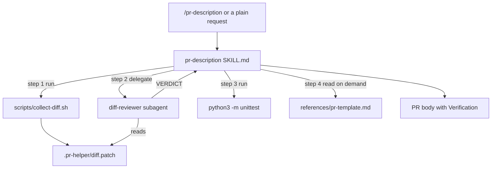

# 20 — Guide: write a skill

You will build `pr-description`, a skill that writes a pull request body from the branch diff,
hands the review step to the `diff-reviewer` subagent from [chapter 19](19-guide-write-a-subagent.md),
and ends with a Verification section that lists only commands it really ran.
[Chapter 21](21-guide-build-and-ship-a-plugin.md) then packages both into a plugin.

- **Time:** about 60 minutes. **Needs:** the chapter 19 repo with `.claude/agents/diff-reviewer.md`
  and the planted bug still in place. Commands match Claude Code v2.1.332 (Nov 2026).
- **Concepts:** frontmatter, invocation and progressive loading are in [chapter 15](15-skills.md).

## What you will build



Until the skill runs, only its `description` is in context. The body loads on invocation, the
template only when workflow step 4 reads it, and the script's code never loads; only its output does.

## Step 1 — Start from the chapter 19 repo

```bash
cd ~/scratch/pr-helper-demo
git switch feature/bulk-discount
git status --short && ls .claude/agents
```

Expect no modified tracked files and `diff-reviewer.md` (if you left the bug fixed, `git checkout pricing.py`).

**Check:** `grep -n 'qty > 10' pricing.py` prints line 14.

## Step 2 — Decide: skill, CLAUDE.md or subagent

The official guide ties each feature to a trigger. "You paste the same playbook or multi-step
procedure into chat for the third time" means "Capture it as a skill". The other candidates:

| Option | Loads | Fit for "write a PR body" |
|---|---|---|
| `CLAUDE.md` | Every session | Poor: a multi-step procedure costs tokens in every session. The docs say to move such entries "to a skill or a path-scoped rule instead" |
| Skill | "On demand, when invoked or relevant" | Good: a repeatable workflow with a script and a template |
| Subagent | Its own context window | Right for one step only: the review, where fresh eyes matter |

"They can combine", says the guide, which is the plan here. A must-hold rule is a hook (chapter 21
adds one). The full decision guide is [chapter 11](11-the-extension-model.md).

**Check:** you can name which part is the skill (the procedure) and which is the subagent (the review).

## Step 3 — Create the skill folder by hand

Claude Code has no bundled skill creator and no `claude skill` command. The docs' own first skill
is a `mkdir` and a `SKILL.md`:

```bash
mkdir -p .claude/skills/pr-description/references .claude/skills/pr-description/scripts
```

`/skills` lists skills but does not create them; `/reload-skills` re-scans if a new one does not
show up. `claude plugin init <name>` scaffolds a skills-directory plugin, but only at
`~/.claude/skills/<name>/` (your user folder), so this guide stays in the project.

The optional official **skill-creator** plugin drafts and evaluates skills
(`/plugin install skill-creator@claude-plugins-official`). Its `evals/evals.json` format and
`claude plugin eval`'s format are "not interchangeable", so pick one per skill.

**Check:** `ls .claude/skills/pr-description` shows `references` and `scripts`.

## Step 4 — Write a description that triggers and costs little

The description is the only part Claude sees before it decides to load the skill, and it is in
context on every turn. Compare:

```yaml
# Weak: no trigger words, no boundary
description: Helps with pull requests.

# Strong: the words people type, what it does, and what it is not for
description: "Use when the user asks for a PR description, a pull request body or to 'write up this branch'. Drafts the body from the branch diff, has the diff-reviewer subagent review it, and adds a Verification section. Not for commit messages or release notes."
```

- Lead with the main use case (`description` plus `when_to_use` is cut at 1,536 characters), quote
  the phrases people type, and add a `Not for …` line against near-misses.
- No `disable-model-invocation`: the skill only prints, so Claude may trigger it. Set it to `true`
  for side effects such as a deploy ([chapter 15](15-skills.md)).

**Check:** the strong description is under three sentences and names a sibling task it should not take.

## Step 5 — Write SKILL.md

Save as `.claude/skills/pr-description/SKILL.md`:

```markdown
---
name: pr-description
description: "Use when the user asks for a PR description, a pull request body or to 'write up this branch'. Drafts the body from the branch diff, has the diff-reviewer subagent review it, and adds a Verification section. Not for commit messages or release notes."
argument-hint: "[base-branch]"
allowed-tools:
  - Bash(${CLAUDE_SKILL_DIR}/scripts/collect-diff.sh)
  - Bash(${CLAUDE_SKILL_DIR}/scripts/collect-diff.sh *)
  - Bash(python3 -m unittest)
  - Read
---

# PR description

Write a pull request body for the current branch. Base branch: `$ARGUMENTS` (empty means `main`).

## Hard rules
- Every statement in the body traces to the script output, the diff or a command run in this turn.
- The Verification section lists only commands you ran in this turn, with their real result.
- Do not create the PR, push, commit or edit files. Print the body and stop.

## Workflow
1. Run `${CLAUDE_SKILL_DIR}/scripts/collect-diff.sh $ARGUMENTS`. If it exits non-zero,
   show its message and stop.
2. Delegate the review to the diff-reviewer subagent with this brief, then wait for its VERDICT:
   - GOAL: one sentence built from the commit subjects in step 1.
   - DIFF: `.pr-helper/diff.patch`
   - Scope: read-only; only the files in the diff. Return in your standard format.
3. Run the project's tests once: `python3 -m unittest`. Keep the command and its last line.
4. Read [references/pr-template.md](references/pr-template.md) and fill in every section.
5. If the VERDICT is `request-changes`, start the reply with "Not ready to merge" and fill in
   Known issues from the findings.
```

Why it is written this way:

- **Hard rules first:** after compaction, skill bodies are re-attached with a per-skill cap.
- **`$ARGUMENTS`** is whatever follows the command: `/pr-description develop` compares with `develop`.
- **`allowed-tools`** pre-approves these calls "during the turn that invokes the skill"; it is not
  a sandbox, so no bare `Bash`. `${CLAUDE_SKILL_DIR}` is the skill's folder, from any directory.
- **Step 2 is a delegation brief** (goal, input, scope, return; [chapter 14](14-subagents.md)).
  The subagent reads that brief, not this file.

**Check:** `head -1 .claude/skills/pr-description/SKILL.md` prints `---`.

## Step 6 — Add the reference file

Save as `.claude/skills/pr-description/references/pr-template.md` (free until workflow step 4 reads it).

```markdown
# PR body template
Fill every section. Delete a section only when its note says you may.
## Summary
One or two sentences: what changes for a user or caller, and why.
## Changes
- One bullet per logical change, in the reader's terms, ending with the file it touches.
## Review
The diff-reviewer VERDICT line, then each finding as `severity path:line - problem`.
## Verification
- `<command you ran>` -> `<last line of its output>`. Never list a command you did not run.
## Known issues
Only after `request-changes`: one bullet per open finding. Otherwise delete this section.
```

**Check:** the file has a `## Verification` heading; the skill's hard rule depends on it.

## Step 7 — Add the helper script and run it yourself

Save as `.claude/skills/pr-description/scripts/collect-diff.sh`:

```bash
#!/usr/bin/env bash
# Usage: collect-diff.sh [base]   (default base: main)
# Prints the commits and diffstat of base...HEAD and saves the full diff to
# .pr-helper/diff.patch at the repo root, for the diff-reviewer subagent to Read.
set -euo pipefail
base="${1:-main}"
root="$(git rev-parse --show-toplevel)"
out="$root/.pr-helper/diff.patch"
mkdir -p "$root/.pr-helper"
git diff "$base...HEAD" > "$out"
if [ ! -s "$out" ]; then
  echo "collect-diff: no changes between $base and HEAD" >&2
  exit 1
fi
echo "# branch: $(git branch --show-current)  base: $base"
echo "# commits"
git log --no-merges --pretty='%h %s' "$base..HEAD"
echo "# diffstat"
git diff --stat "$base...HEAD"
echo "# full diff: .pr-helper/diff.patch ($(wc -l < "$out" | tr -d ' ') lines)"
```

```bash
chmod +x .claude/skills/pr-description/scripts/collect-diff.sh
.claude/skills/pr-description/scripts/collect-diff.sh
```

Output from this guide's run (your hash will differ):

```text
# branch: feature/bulk-discount  base: main
# commits
fece5f9 feat: add bulk_price with a 10% bulk discount
# diffstat
 pricing.py   |  8 ++++++++
 test_bulk.py | 11 +++++++++++
 2 files changed, 19 insertions(+)
# full diff: .pr-helper/diff.patch (33 lines)
```

With the branch itself as base it printed `collect-diff: no changes between …` and exited 1: the stop signal for workflow step 1.

**Check:** the script runs from the repo root and from a subfolder, and exits 1 when there is nothing to describe.

## Step 8 — Wire in the subagent

There are three documented ways to combine a skill with a subagent. This guide uses the first.

| Way | How | Why or why not here |
|---|---|---|
| Delegate from the body | Workflow step 2 asks Claude to use `diff-reviewer` | Chosen: the skill runs in your session, so it can run the script and the tests; only the review is isolated |
| `context: fork` with `agent` | The whole skill runs as a new subagent of the type named in `agent` (default `general-purpose`) | Not here: `diff-reviewer` has no `Bash`, so it could not run the script. The docs warn it "doesn't run in a fork of the current conversation" |
| Preload with `skills:` | An agent definition lists skills whose full body it gets at startup | The reverse direction; useful when the agent is the entry point |

> **Note:** `agent:` takes a built-in agent (`Explore`, `Plan`, `general-purpose`) "or any custom
> subagent from `.claude/agents/`", so `agent: diff-reviewer` is valid; it is the missing `Bash`
> that rules it out here.

**Check:** `.claude/agents/diff-reviewer.md` exists, and SKILL.md names it exactly `diff-reviewer`.

## Step 9 — Lint and audit

```bash
claude plugin validate .claude/skills
python3 -c "import sys,yaml; print(sorted(yaml.safe_load(open(sys.argv[1]).read().split('---')[1])))" \
  .claude/skills/pr-description/SKILL.md
```

This guide's run printed `✔ Validation passed`, then `['allowed-tools', 'argument-hint',
'description', 'name']` (directory validation needs v2.1.233+; the parse check is there because,
as chapter 19 found, the validator misses some YAML mistakes).

In a session, `/doctor prompt-audit .claude/skills/pr-description` (v2.1.283+) checks it with your
`CLAUDE.md`, rules and subagents for outdated or conflicting instructions (not run for this guide).

**Check:** validation passes and the YAML field list has no typos.

## Step 10 — Invoke it by name and by request

Open a **fresh** session in the repo; leftover context from authoring "will mask gaps in the
written instructions".

1. Ask `What skills are available?` and confirm `pr-description` is listed. Then type `/pr-description main`.
2. In another fresh session ask `Write the PR description for this branch.`, then the near-miss
   `Write a commit message for my staged changes.`, which the skill should stay out of.

The shape to expect (illustrative; this guide did not start a session):

```markdown
Not ready to merge.
## Summary
Adds bulk_price, which gives orders of 10 or more items 10% off.
## Review
VERDICT: request-changes
- blocking pricing.py:14 - `qty > 10` gives no discount for exactly 10 items
## Verification
- `python3 -m unittest` -> `OK`
## Known issues
- bulk_price(10, 5.0) returns 50.0; expected 45.0 (pricing.py:14).
```

**Check:** the transcript shows the script run, a `diff-reviewer(…)` row and one test run, and the
Verification section lists only that test command.

## Step 11 — Check its cost and usage

| Command | What it shows |
|---|---|
| `/skills` | Every skill; press `t` to sort by token count |
| `/context` | The skills section, including bundled skills that `/skills` does not list |
| `/skill-doctor` | "what each of your skills costs in context and how often it gets used"; needs v2.1.252+ and opens in the `/plugin` manager's **Stats** tab |

`/skill-doctor` neither lints content nor tests triggering. **Check:** `pr-description` appears in
`/skills` with its token count.

## Step 12 — Prepare it for evaluation

`claude plugin eval` needs "a plugin directory with a `plugin.json` or `.claude-plugin/plugin.json`
manifest, or a skills-directory plugin"; a bare skill folder is neither. Chapter 21 adds it. Until then:

- **Baseline by hand:** run your prompts with the skill on, then off, via
  `"skillOverrides": { "pr-description": "off" }` in `.claude/settings.local.json`.
- **Write cases now in `claude plugin eval` format**; save `evals/writes-pr-body/prompt.md`:

```markdown
---
max_turns: 20
allowed_tools: [Read, Glob, Grep, Bash, Skill, Agent]
---

Write the PR description for this branch against main.
```

Then `graders/criteria.md` and `graders/skill-fired.md` beside it:

```markdown
---
type: llm
---

PASS if the body has a Verification section that lists only commands that were run, and reports the qty == 10 boundary bug.
FAIL if it claims tests or checks that were not run, or misses the boundary bug.
```

```markdown
---
type: tool_used
tool: Skill
input_match: '"skill"\s*:\s*"(?:[\w-]+:)?pr-description"'
---
```

**Check:** `ls evals/writes-pr-body/graders` shows both files. Chapter 21 runs this case, adds a
second one (`triggers-on-pr-request`) and a script that rebuilds this repo, since each run starts in an empty folder.

## Make it better

Change one thing per round, in a fresh session, and write down the result before and after.

- **Triggering.** Keep 8 to 10 prompts that should trigger and 8 to 10 genuine near-misses ("write
  release notes"). Add a missed phrase people really type; add a `Not for` line for a false hit.
- **Cost.** Past three sentences, move detail into the body; re-check `/skills` with `t`.
- **Output.** Compare with the skill off; if the body is as good without it, the skill is not
  earning its cost. If Verification names a command the transcript lacks, make that rule sharper.

## Ship it or share it

| Scope | Where it lives | Invoked as |
|---|---|---|
| Personal | `~/.claude/skills/pr-description/SKILL.md` | `/pr-description`, in all your projects |
| Project | `.claude/skills/pr-description/SKILL.md` | `/pr-description`, for everyone who clones the repo |
| Plugin | `<plugin>/skills/pr-description/SKILL.md` | `/<plugin>:pr-description` ([chapter 21](21-guide-build-and-ship-a-plugin.md)) |

Precedence is "managed > user > project for skills". Commit the folder with the script's
executable bit, on `main` as in chapter 19, so the feature branch diff stays about pricing:

```bash
git switch main
git add .claude/skills/pr-description evals
git commit -m "feat: add pr-description skill"
git ls-files -s .claude/skills/pr-description/scripts/collect-diff.sh   # mode 100755
git switch feature/bulk-discount
git rebase main
```

> **Warning:** A project skill's `allowed-tools` applies even in a `-p` run in a folder nobody
> trusted. Anyone who clones the repo should read it, and you should keep every entry scoped.

## Troubleshooting

| Symptom | Cause | Fix |
|---|---|---|
| `/pr-description` is not found | Malformed YAML, wrong folder, or the list was not re-scanned | Run `/reload-skills`; run with `--debug` to see the parse error |
| Plain requests never trigger it | The description lacks the words people type | Add quoted trigger phrases; test in a fresh session |
| It runs for commit messages | No boundary in the description | Add `Not for commit messages` |
| A permission prompt for the script | `allowed-tools` path does not match, or no `chmod +x` | Use the `${CLAUDE_SKILL_DIR}/scripts/…` form exactly; make the script executable |
| `collect-diff: no changes` | You are on `main`, or passed the wrong base | Switch to the feature branch, or pass the base: `/pr-description develop` |
| Claude reviews inline instead of delegating | The agent file is missing or the name differs | Check `/context` for `diff-reviewer`; match the name in step 2 |
| Verification lists tests that never ran | The rule is vague or buried | Keep it in Hard rules at the top; say "in this turn" |

## Checklist

- [ ] The skill folder has `SKILL.md`, `references/pr-template.md` and an executable `scripts/collect-diff.sh`.
- [ ] The description names the trigger phrases and a `Not for` boundary, in under three sentences.
- [ ] `allowed-tools` holds only scoped entries; there is no bare `Bash`.
- [ ] The script runs by hand and exits 1 when there is nothing to describe.
- [ ] `claude plugin validate .claude/skills` passes and the YAML parses.
- [ ] `/pr-description` and a plain request both produce a body that delegates to `diff-reviewer`.
- [ ] The Verification section lists only commands that ran.
- [ ] Eval cases are drafted under `evals/` for chapter 21.

## Sources

- Skills (create, frontmatter, `${CLAUDE_SKILL_DIR}`, `context: fork`, testing, `/skill-doctor`, skill-creator evals): https://code.claude.com/docs/en/skills
- Commands reference (`/skills`, `/reload-skills`, `/skill-doctor`, `/doctor`): https://code.claude.com/docs/en/commands
- Extend Claude Code (choosing a feature, precedence, context cost): https://code.claude.com/docs/en/features-overview
- Memory (`/doctor prompt-audit`, what belongs in CLAUDE.md): https://code.claude.com/docs/en/memory
- Create plugins (`claude plugin init`, skills-directory plugins): https://code.claude.com/docs/en/plugins/create
- Plugin evals (requirements, case and grader format): https://code.claude.com/docs/en/plugin-evals
- Official skill-creator plugin: https://github.com/anthropics/claude-plugins-official/tree/main/plugins/skill-creator
- Local runs for this guide: Claude Code 2.1.332, `claude plugin validate`, the helper script and the sample repo, 2026-11-26.

---

[← Previous: Guide: write a subagent](19-guide-write-a-subagent.md) · [Contents](README.md) · [Next: Guide: build and ship a plugin →](21-guide-build-and-ship-a-plugin.md)
