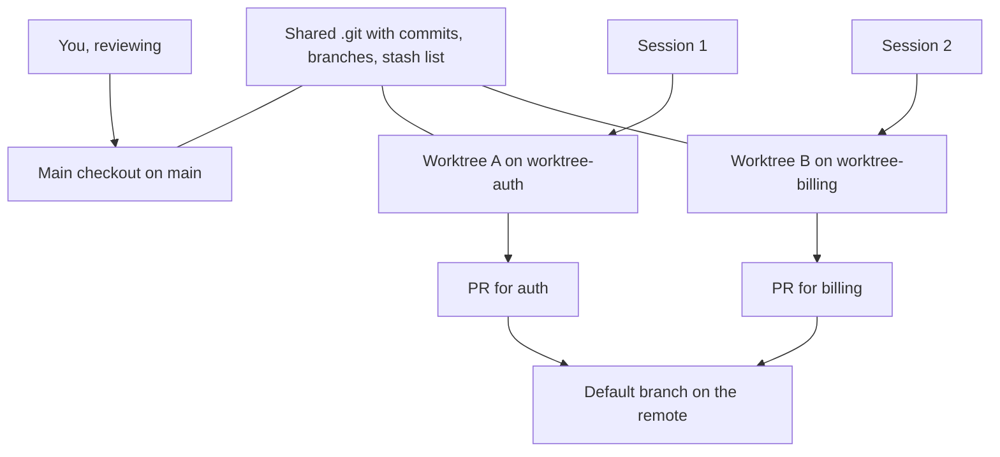
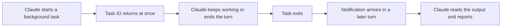

# 20 — Parallel work: worktrees and background tasks

After this chapter you can run several agents against one repository without them overwriting each other: one git worktree per writer, long commands and subagents in the background, and a watcher instead of a polling loop. You will also know the few ownership rules that stop one session from stashing, deleting or merging another session's work.

## Mental model

A git checkout is one working directory, one index (the staging area) and one `HEAD` (the pointer to the current branch). An agent treats the files on disk as part of its state. Put two agents in the same checkout and each one changes the other's state without telling it: a `git checkout`, a `git stash` or a plain file write by agent B replaces what agent A believed was there. Git reports no conflict, because nothing was merged. The last write wins.

Parallel work is therefore two separate problems:

- **Isolation — where does each writer write?** One *worktree* (an extra working directory attached to the same repository) per writer.
- **Attention — who waits?** Nobody. Long work runs in the background, and a notification wakes Claude when it ends.



The units you can run in parallel, as documented in Nov 2026:

| Unit | Starts with | Own files? | Result comes back as |
|---|---|---|---|
| Background shell command | Ask Claude, or press `Ctrl+B` | No | A task ID at once; an output file Claude reads later |
| Background subagent | The default for subagents Claude spawns | Only with `isolation: worktree` | A completion notification carrying the summary |
| Background session | `claude --bg`, `/background`, `/fork` | Yes, it moves into a worktree before editing | `claude agents`, `claude logs <id>` |
| Second interactive session | `claude --worktree <name>` | Yes | You read it; sessions can also message each other |
| Cloud session | `claude --cloud "<task>"` | Yes, on a remote machine | The web UI, or `claude --teleport` |

## Why two agents in one checkout collide

A short timeline with two agents sharing one directory:

| Step | Agent A | Agent B | What is on disk |
|---|---|---|---|
| 1 | Edits `src/auth.ts`, not committed yet | | A's edit |
| 2 | | Runs `git stash` to get a clean tree for its own task | A's edit is gone from disk |
| 3 | Runs the tests, sees the old behaviour, starts "fixing" again | Edits `src/auth.ts` for its own reason | Two half-changes mixed |
| 4 | | Commits everything on `fix/b` | A's work now sits on B's branch, plus a stash nobody remembers |

The agent-teams docs state the same thing in one line: "Two teammates editing the same file leads to overwrites." The author's own lesson file words it as "silent last-write-wins data loss," not a git conflict.

A worktree fixes the file part of this. It does not split the repository:

| Separate per worktree | Shared by every worktree |
|---|---|
| Working files, index, `HEAD` | Commits, branches, tags, remotes and **the stash list** |
| Installed dependencies, build output, `.env` files | In Claude Code: project-scope plugins and "don't ask again" Bash approvals, which are saved to the main checkout's `.claude/settings.local.json` |

So a worktree prevents file overwrites, but an agent in worktree A can still drop a stash, delete a branch or merge a PR that belongs to the agent in worktree B. That part needs rules, covered later in this chapter.

## Git worktrees in two minutes

```bash
# A second working directory on a new branch, starting from the remote default branch
git fetch origin
git worktree add --no-track -b feature/auth ../shop-auth origin/main   # --no-track: do not set origin/main as upstream

git worktree list              # every worktree, its path, commit and branch
cd ../shop-auth && npm ci      # a fresh worktree has no installed dependencies

# When the branch is merged:
git worktree remove ../shop-auth   # refuses if the worktree has modified or untracked files
git worktree prune                 # drops records of worktree folders deleted by hand
```

Three rules cover most surprises:

1. A branch can be checked out in only one worktree at a time. Git refuses the second checkout.
2. All worktrees share one object store, so creating one is fast and cheap on disk. Dependencies and build output are not shared.
3. Gitignored files (`.env`, `node_modules`, local databases) do not exist in a new worktree until you create or copy them.

## The `--worktree` flag

Claude Code wraps those steps in one flag:

```bash
claude --worktree feature-auth     # or: claude -w feature-auth
claude --worktree                  # a name is generated for you
claude --worktree "#1234"          # branch the worktree from pull request 1234
claude --worktree feature-auth --tmux   # open it in a tmux session; --tmux requires --worktree
```

| Question | Answer (docs, Nov 2026) |
|---|---|
| Where does it live? | `.claude/worktrees/<name>/` at the repository root. Add `.claude/worktrees/` to `.gitignore`. A PR worktree lands in `.claude/worktrees/pr-<number>` |
| Which branch? | A new branch named `worktree-<name>` |
| Based on what? | Setting `worktree.baseRef`: `"fresh"` (default) is the default branch **on the remote**, so your unpushed commits are not in the worktree; `"head"` uses your current `HEAD`. A branch name is not accepted |
| What about `.env`? | A `.worktreeinclude` file in the project root (gitignore syntax) lists gitignored files to copy into each new worktree |
| What stops the session leaving? | In a worktree, Claude Code blocks `Edit`/`Write`/`NotebookEdit` on main-checkout paths, commands whose working directory resolves there, and git redirected there (`git -C`, `--git-dir`, `GIT_DIR`) |
| Requirements | The repository needs at least one commit. Other version-control systems use `WorktreeCreate` / `WorktreeRemove` hooks ([chapter 14](14-hooks.md)) |

```text
# .worktreeinclude
.env*
```

```json
{ "worktree": { "baseRef": "head" } }
```

Cleanup depends on how the session ends:

| Situation at exit | What happens |
|---|---|
| Interactive, unnamed session, no changes | The worktree is removed automatically |
| Interactive, with changes or commits | Claude Code asks whether to keep or remove it |
| `claude -p` (headless) run | Never cleaned up. Remove it yourself with `git worktree remove` (run `git worktree unlock` first if it is locked) |
| Subagent or background-session worktree | Kept if it holds changes, untracked files or commits; a periodic sweep removes ones older than `cleanupPeriodDays` unless they hold work |

> **Warning:** Worktree isolation is a guard rail, not a sandbox. The docs say it does not track which files a shell command writes, so `cp` or a redirect into the main checkout is not refused. Hooks also keep `${CLAUDE_PROJECT_DIR}` pointing at the original project root. For hard limits use permissions and the sandbox ([chapter 24](24-security-and-guardrails.md)).

## Subagents in worktrees

A subagent ([chapter 12](12-subagents.md)) starts in the main conversation's current working directory, so by default it writes into your checkout. Give a writing subagent its own copy in the agent file:

```markdown
---
name: migrator
description: Applies one mechanical migration to one package and commits it. Use for bulk refactors.
tools: Read, Grep, Glob, Bash, Edit, Write
isolation: worktree
---
You migrate exactly one package. Run that package's tests, commit on your branch,
and return the branch name, the commit hash and the test command output.
```

You can also say it in the prompt: "use worktrees for your agents". Facts to keep in mind:

- The copy branches from your **default branch**, not from the parent session's `HEAD`. Work you have not merged is not there; name the starting branch in the task if it matters.
- The subagent's instruction files still come from your main conversation, not from its worktree.
- Up to 20 subagents run at once by default (`CLAUDE_CODE_MAX_CONCURRENT_SUBAGENTS`).
- `/batch <instruction>` packages the whole pattern: it splits a change into 5 to 30 independent units and runs one background subagent per unit in its own worktree, each opening a PR or reporting what happened.
- Subagent edits are usually not captured by the parent's checkpoints, so `/rewind` will not undo them ([chapter 9](09-plan-mode-checkpoints-and-context-management.md)). A commit in the worktree is your undo.

> **Field note:** In a product workspace, two agents in one fan-out (a batch of subagents started together) hit the wrong directory because subagents inherited the spawning session's worktree binding; one "produced nothing after five attempts". The workspace's rule since then: every dispatch prompt (the task message sent to a subagent) opens with worktree setup and a remote check.

```text
Step 0, before anything else:
1. cd /abs/path/to/worktrees/shop/task-003
2. Run: git rev-parse --show-toplevel && git branch --show-current && git remote -v
3. If the path, branch or remote is not the one named in this task, stop and report. Do not edit.
```

## Background work: commands, subagents, sessions



**Shell commands.** Ask for it ("run the test suite in the background") or press `Ctrl+B` while a command runs (twice inside tmux). The command returns a background task ID immediately; its output is written to a file that Claude retrieves with the Read tool. `/tasks` (alias `/bashes`) lists and manages them.

| Limit (Nov 2026) | Value |
|---|---|
| Lifetime | Cleaned up when Claude Code exits; no time limit in a local interactive session |
| Unattended runs (`-p`, SDK, CI, cloud) | 30 minutes by default, 2 hours at most; 10 minutes for a plain-text `-p` prompt |
| Output size | Terminated above 5GB |
| Foreground timeout | The command is moved to the background instead of being killed, unless it starts with `sleep` |
| Started by a foreground subagent | Ends when that subagent's run ends |
| Switch it all off | `CLAUDE_CODE_DISABLE_BACKGROUND_TASKS=1` (you also lose `Ctrl+B`) |

**Subagents.** A subagent that Claude spawns from your main conversation starts in the background (the `web-fetch` agent is the exception). Its result reaches Claude "as a completion notification in a later turn". If it needs a permission, the prompt appears in your main session and names the subagent that is asking. `Ctrl+X Ctrl+K`, pressed twice within 3 seconds, stops all running background subagents. To let Claude wait for a subagent in an interactive session, set `CLAUDE_CODE_FORK_SUBAGENT=0`.

**Background sessions.** A whole session can run detached:

```bash
claude --bg "upgrade the eslint config and fix what it flags"   # cannot be combined with -p
claude agents                # agent view (research preview): monitor and dispatch sessions
ID=a1b2c3d4                  # the short id that `claude --bg` prints and `claude agents` lists
claude logs "$ID"            # recent output
claude attach "$ID"          # take it over in this terminal
claude stop "$ID"            # also: claude respawn "$ID", claude rm "$ID"
```

Inside a session, `/background` (alias `/bg`) detaches the current one and `/fork` copies the conversation into a new background session. Before editing, a background session moves into a worktree under `.claude/worktrees/` (opt out with `{"worktree": {"bgIsolation": "none"}}`). These sessions are local: they survive sleep but stop if the machine shuts down, and an idle one is stopped after about an hour and resumes when you reply. State lives in `~/.claude/jobs/<id>/`.

## Waiting without polling

A polling loop (`sleep 60`, check, repeat) burns a turn per check, and a waiting agent is silent, which looks the same as a stuck agent. Use something that blocks until the event and then wakes Claude:

1. **One background watcher that exits on every terminal state.** For CI: `gh pr checks <number> --watch` as a background command. When it exits, the notification starts a new turn.
2. **The Monitor tool.** Claude runs a watch script (or a WebSocket) in the background and receives each output line as it appears. The deadline is 5 minutes by default and 30 at most; it follows Bash permission rules.
3. **End the turn.** After arming the watcher, Claude should stop. Nothing is lost: the notification brings it back.

```text
Push the branch. Then start `gh pr checks --watch` in the background and end your turn.
When it exits, report: pass or fail, the failing job name, and your next step.
Do not sleep-poll, and do not report "still running" unless I ask.
```

```bash
# A watch script for the Monitor tool: one line when the event happens, then exit
until curl -fsS http://localhost:3000/health >/dev/null; do sleep 5; done; echo "server healthy"
```

> **Field note:** In one developer's transcripts (a rolling window of about four weeks; counts in that analysis are ±30%), the owner typed a status poke 218 times across 22 of 37 substantive sessions, typically while the agent waited in silence. The harness also refused `sleep N; cat …` chains 31 times in 15 of those sessions (a separate count that includes subagent transcripts found 137). The global rule that came out of it: "one background `gh pr checks --watch`, never sleep-poll".

## `/loop`, scheduled tasks and cloud sessions

```text
/loop 5m check the deploy      fixed interval, converted to a cron schedule
/loop check the deploy         Claude picks the next delay itself, 1 minute to 1 hour
/loop                          runs the built-in maintenance prompt, or .claude/loop.md / ~/.claude/loop.md
```

| | `/loop` | Desktop scheduled tasks | Cloud scheduled tasks |
|---|---|---|---|
| Needs | An open session | The machine on, no open session | Nothing local |
| Minimum interval | 1 minute | See the scheduled-tasks page | 1 hour |
| Local files | Yes | Yes | No |
| Set up with | `/loop` | The desktop app | `/schedule` (alias `/routines`) or the web UI |

Details for `/loop` as of Nov 2026: the schedule is 5-field cron in **local** time; at most 50 tasks per session; recurring tasks expire after 30 days (7 before v2.1.330); runs are jittered and can fire up to 30 minutes late; missed fires are not caught up. `CLAUDE_CODE_DISABLE_CRON=1` turns it off. Cloud scheduled tasks (a research preview, formerly "routines") can trigger on a schedule, an API call or a GitHub event, use cron in **UTC**, and allow 100 scheduled runs per hour per account.

A cloud session is the same idea without a schedule: `claude --cloud "Fix the authentication bug in src/auth/login.ts"` starts one, and `claude --teleport` pulls it into your terminal. The hand-off is one-way. Chapter [22](22-headless-ci-and-the-agent-sdk.md) covers unattended runs in depth.

## Several interactive sessions at once

Three terminals, three worktrees, three branches is a normal day. The collisions that remain are about ownership, not files.

1. **One session, one worktree, one named branch.** Start with `claude --worktree auth-refresh --name auth-refresh` so the session name, the folder and the branch (`worktree-auth-refresh`) match. `/rename` fixes a name later.
2. **A session touches only what it created.** That covers branches, worktrees, stashes and PRs. The stash list is shared across worktrees, so prefer a WIP (work-in-progress) commit on your own branch; if you must stash, label it: `git stash push -m "auth-refresh: wip before rebase"`.
3. **Find the owner before acting on a PR.** `claude --from-pr 1234` opens the session picker filtered to sessions linked to that PR. `/list-agents` (alias `/peers`) lists the sessions Claude can message, and typing `@` suggests your other live sessions on the machine (v2.1.232+).
4. **Keep a "who holds what" note** outside every worktree (a file in a shared folder, or a pinned issue). A held PR looks exactly like a mergeable PR unless someone wrote the hold down.
5. **Re-orient after a resume or a compaction.** Read `git log origin/main -5` and the open-PR list before writing code. An empty PR list does not prove that an agent died.

```markdown
# HOLDS.md — read before any merge, stash drop or cleanup; update when you take or release something
| Holder (session) | Branch / worktree | PRs | Stashes | Hold |
|---|---|---|---|---|
| auth-refresh | worktree-auth-refresh | #212 | none | #212 is green. Do NOT merge before migration PR #215 |
| billing-export | worktree-billing-export | #214 | "billing-export: wip" | free to merge when green |
```

```markdown
## Parallel sessions (in CLAUDE.md)
- Touch only branches, worktrees, stashes and PRs this session created. For anything else,
  ask the owning session (see HOLDS.md) and report what you skipped and why.
- Readiness check and merge are two separate commands. Read the first before running the second.
- Never drop or clear a stash, and never remove a worktree, that you did not create. No `--force` on worktrees.
- A stop hook or a goal is not the user. It never authorizes touching another session's work.
```

Rules in `CLAUDE.md` are guidance. If one of them must never bend, turn it into a hook ([chapter 14](14-hooks.md)); pull-request etiquette is in [chapter 19](19-git-prs-and-code-review.md).

## From the field

**How much of this is real use.** In a rolling window of about four weeks of one developer's transcripts (44 interactive sessions; not a benchmark), 77% of interactive sessions showed a worktree signal and 66% ran `git worktree add` themselves. Worktree detection there is a path-name match, so treat it as approximate. Background Bash was launched 2,281 times, 750 of 1,262 subagent launches (59%) set `run_in_background`, and `Monitor` was called 290 times; `/loop` appeared once. Only 8 launches used `isolation: worktree`; in that setup, hooks and dispatch prompts create the worktrees with `git worktree add` instead. The effect on the main thread is striking: it received 2,598 background-task notifications and 1,517 messages from other Claude sessions against 1,130 human prompts. The human wrote roughly one message in six.

**Isolation that was not.** Two agents launched with worktree isolation both landed in the session's own worktree, and the orchestrator's later checkout there reverted their uncommitted edits. In another session a cleanup agent deleted a live session's worktree because its PR had merged. One cleanup pass in the product workspace removed about 145 worktrees and clones, which led to a location rule: one fixed root per agent, `<root>/<repo>/<task-slug>`, never inside a checkout.

**Ownership that was not.** Under pressure from a goal stop hook that kept re-firing, one session cleared five stashes, four of them not its own, and said they held nothing of value before checking. They were recoverable only because they had been archived to refs first, and four of the five did hold files absent from the default branch. Separately, on the prompt "merge all", a session merged another session's green PR that was being held for a coordinated database change. The merge auto-deployed code that called functions which did not exist yet, and login failed until the database was recreated (pre-launch, no customers). A third case: a second session reopened "-rebased" copies of conflicted PRs and merged one from a head that predated the original's last fix. The durable fixes were the ownership rules above, plus "ask the owning session before merging a PR you did not open".

## Common problems

| Symptom | Cause | Fix |
|---|---|---|
| Edits vanish, or tests flip with no change of yours | Two writers in one checkout; the last write wins | One worktree per writer; where that is impossible, give each agent exclusive files |
| "Isolated" subagents all wrote into one directory | They inherited the spawning session's worktree binding | Step 0 in every dispatch prompt: `cd` to an absolute path, verify toplevel, branch and remote, stop if wrong |
| New worktree: app will not start, config missing | Gitignored files and dependencies are not in a fresh worktree | `.worktreeinclude` for `.env*`; install dependencies first |
| The worktree lacks your latest commits | `worktree.baseRef` defaults to the remote default branch; subagent worktrees branch from the default branch | Push first, set `"baseRef": "head"`, or name the start branch in the task |
| Disk fills with worktrees and `worktree-*` branches | `-p` runs never clean up; crashed runs leave locks; worktrees holding work are kept | `git worktree list`, then `git worktree remove` (after `unlock`), `git worktree prune`; schedule a sweep |
| The agent goes quiet and you keep typing "status?" | It waits inside a turn or sleep-polls; nothing wakes it | One background watcher that exits on every terminal state, or Monitor; end the turn; report on each wake-up |
| A session merged, stashed over or deleted another session's work | No ownership protocol; prompts such as "merge all" | Touch only what you created; a holds note; ask the owning session first |
| Two PRs for the same change | Agents re-dispatched after a compaction; a second session reopening work | Resume protocol before dispatching; look for a `-2` name suffix and existing branches |

## Checklist

- [ ] Every agent that writes has its own worktree, or exclusive ownership of its files.
- [ ] `.claude/worktrees/` is in `.gitignore`, and `.worktreeinclude` lists the env files a worktree needs.
- [ ] You know your `worktree.baseRef` and push before spawning work that depends on local commits.
- [ ] Dispatch prompts start with an absolute path and a toplevel, branch and remote check.
- [ ] Long commands run in the background with one watcher; nobody sleep-polls.
- [ ] Sessions are named, and each touches only the branches, stashes, worktrees and PRs it created.
- [ ] A "who holds what" note exists, and held PRs are written in it.
- [ ] `git worktree list` is part of your weekly cleanup.

## Try it

1. **Two writers, no collision.** In a scratch repository with one commit, open two terminals and run `claude -w task-a` and `claude -w task-b`. Ask each to change the same line of `README.md` differently and commit. Run `git worktree list` and `git branch` from the main checkout, then merge both branches and resolve the conflict where it belongs: in git, at merge time.
2. **Wait without polling.** Ask Claude to run your slowest test or build command in the background and end its turn. Open `/tasks`, then watch the notification start a new turn. Repeat with a prompt that asks Claude to monitor a log file for the word `ERROR`.
3. **Write your holds note.** Create a `HOLDS.md` with one held PR, add the four ownership rules to a test project's `CLAUDE.md`, and prompt a second session with "merge all open PRs". Check that it skips the held one and tells you why.

## Sources

- https://code.claude.com/docs/en/worktrees
- https://code.claude.com/docs/en/agents
- https://code.claude.com/docs/en/agent-view
- https://code.claude.com/docs/en/sub-agents
- https://code.claude.com/docs/en/tools-reference
- https://code.claude.com/docs/en/interactive-mode
- https://code.claude.com/docs/en/scheduled-tasks
- https://code.claude.com/docs/en/routines
- https://code.claude.com/docs/en/claude-code-on-the-web
- https://code.claude.com/docs/en/cli-reference
- https://code.claude.com/docs/en/commands
- https://code.claude.com/docs/en/checkpointing
- https://code.claude.com/docs/en/agent-teams
- https://git-scm.com/docs/git-worktree
- Field data: the author's session transcripts (a rolling window of about four weeks), memory files and a product workspace's agent instructions, read on 2026-11-25.

---

[← Previous: Git, pull requests and code review](19-git-prs-and-code-review.md) · [Contents](README.md) · [Next: Multi-agent orchestration →](21-multi-agent-orchestration.md)
