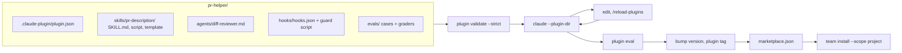

# 21 — Guide: build and ship a plugin

In this last workshop guide you package the `diff-reviewer` subagent from [chapter 19](19-guide-write-a-subagent.md) and the `pr-description` skill from [chapter 20](20-guide-write-a-skill.md), plus a guard hook that blocks force-pushes to the default branch, into one plugin called `pr-helper`. You then validate it, write an eval suite for it, tag a release and ship it to a team through a marketplace. Allow about 90 minutes.

**Prerequisites:** the demo repo from chapters 19 and 20 (`~/scratch/pr-helper-demo`, with `.claude/agents/diff-reviewer.md`, `.claude/skills/pr-description/` and `evals/` committed on `main`), Claude Code v2.1.269 or later (`claude plugin eval` needs it; this guide was run on v2.1.332, as of Nov 2026), `git`, `bash`, `python3` and `jq`, and the concepts from [Hooks](16-hooks.md) and [Plugins and marketplaces](17-plugins-and-marketplaces.md). This guide uses the built-in tooling wherever it exists and links to those chapters for the theory.

## Mental model

What you will build: one plugin folder. Only the manifest goes in `.claude-plugin/`; every component sits at the plugin root. The development loop runs from the shell (validate, details, eval) and from a session started with `--plugin-dir` (reload, inspect). Commands were run in a scratch directory; a block says so when its output is illustrative.



## Step 1 — Scaffold with `claude plugin init`

`claude plugin init <name>` scaffolds a plugin, and `--with` adds component folders (`skills`, `agents`, `hooks`, `mcp`, `lsp`, `output-style`, `channel`). Its help says it writes to `~/.claude/skills/<name>/`, a skills-directory plugin that "auto-loads next session as `<name>@skills-dir`", and the command has no flag for another location. That is a change to your real configuration, so redirect it first. In the run for this guide, setting `CLAUDE_CONFIG_DIR` to a scratch folder moved the output there:

```text
$ mkdir -p ~/scratch/pr-helper-work && cd ~/scratch/pr-helper-work
$ CLAUDE_CONFIG_DIR="$PWD/config" claude plugin init pr-helper --with skills agents hooks \
    --description "Writes PR descriptions, reviews diffs, guards force-pushes"
✔ Created plugin "pr-helper" at /…/pr-helper-work/config/skills/pr-helper
  It will auto-load next session as pr-helper@skills-dir. Run /reload-plugins to load it now.
  Disable: claude plugin disable pr-helper@skills-dir. Remove: delete the directory.
```

It wrote `.claude-plugin/plugin.json` (`$schema`, `name`, `version` 0.1.0, `description`, `"skills": ["./"]`), a root `SKILL.md` and `skills/example/SKILL.md` with `TODO` descriptions, `agents/example.md`, `hooks/hooks.json` (a `SessionStart` hook run with `bun`) and `hooks-handlers/on-session-start.ts`. Three things to notice. The manifest's `"skills": ["./"]` makes the root `SKILL.md` a skill invoked as `/pr-helper`. The scaffold fills `author` from your `git config user.name` and `user.email` (its help says so; with neither set it only warned `No author information provided`), so check that field before you publish. And the sample hook needs `bun`; its own comment says to swap in `node` or `python3` if your users lack it.

Copy the scaffold to where the plugin will live (a project folder, or the repo you will publish), then delete the scratch copy:

```bash
mkdir -p repo && cp -R config/skills/pr-helper repo/pr-helper && rm -rf config/skills/pr-helper
cd repo/pr-helper && rm -rf SKILL.md skills/example agents/example.md hooks-handlers
```

**Check:** `find . -type f` lists only `.claude-plugin/plugin.json` and `hooks/hooks.json`, and `config/skills/` is empty. A leftover `pr-helper@skills-dir` copy clashes with the one you load later: `claude plugin list` reports it as "Not loaded — the name "pr-helper" is already taken by a session-only plugin".

## Step 2 — Add the components, the manifest and the guard hook

Copy the final files from chapters 19 and 20 to the plugin root, unchanged. The skill keeps its whole folder, so `scripts/collect-diff.sh` (still executable) and `references/pr-template.md` travel with it, and so does the eval case drafted in chapter 20:

```bash
demo=~/scratch/pr-helper-demo
mkdir -p agents skills
cp "$demo/.claude/agents/diff-reviewer.md" agents/
cp -R "$demo/.claude/skills/pr-description" skills/
cp -R "$demo/evals" .
```

Nothing inside them needs to change. In a plugin, `${CLAUDE_SKILL_DIR}` is "the skill's subdirectory within the plugin", and the script still writes `.pr-helper/diff.patch` at the root of whatever repo it runs in. Then take the project copies out of the demo repo, on `main` as before, so sessions there load the plugin's copies instead of two of each:

```bash
cd ~/scratch/pr-helper-demo
git switch main
git rm -r -q .claude evals
git commit -m "chore: move the PR helper into the pr-helper plugin"
git switch feature/bulk-discount
git rebase main
cd ~/scratch/pr-helper-work/repo/pr-helper
```

Replace `.claude-plugin/plugin.json`, dropping `"skills": ["./"]` now that the skill sits in the default `skills/` folder ([chapter 17](17-plugins-and-marketplaces.md#the-manifest) lists every field):

```json
{
  "$schema": "https://anthropic.com/claude-code/plugin.schema.json",
  "name": "pr-helper",
  "version": "0.1.0",
  "description": "Writes PR descriptions from the diff, reviews them read-only, and blocks force-pushes to the default branch",
  "author": { "name": "Your Team" },
  "license": "MIT"
}
```

Now the hook. A plugin's hooks live in `hooks/hooks.json`, under a top-level `"hooks"` key shaped like `hooks` in a settings file. `${CLAUDE_PLUGIN_ROOT}` points at the installed copy, which changes on every update, so never hard-code a cache path:

```json
{ "hooks": { "PreToolUse": [ { "matcher": "Bash", "hooks": [
  { "type": "command", "command": "\"${CLAUDE_PLUGIN_ROOT}/hooks/guard-force-push.sh\"" } ] } ] } }
```

The script blocks with `exit 2` and writes the reason to stderr, which becomes the block message ([chapter 16](16-hooks.md#output-the-exit-code-comes-first) explains why `exit 1` would not block). The named override variable, `PR_HELPER_ALLOW_FORCE_PUSH`, is a consent channel: the message tells Claude to stop and ask you first. A `+` in front of a refspec forces that one ref ("The `+` is optional and does the same thing as `--force`", says the git push reference), so `git push origin +HEAD:main` counts as a force-push too.

```bash
#!/usr/bin/env bash
# hooks/guard-force-push.sh — PreToolUse guard: block a force-push to the default branch.
# Override, only after the user says yes: PR_HELPER_ALLOW_FORCE_PUSH=1 (env or command prefix).
input=$(cat)
cmd=$(jq -r '.tool_input.command // empty' <<<"$input" 2>/dev/null) \
  || { echo "pr-helper: unreadable hook payload, blocking" >&2; exit 2; }   # fail closed
dir=$(jq -r '.cwd // "."' <<<"$input" 2>/dev/null)
default=${PR_HELPER_DEFAULT_BRANCH:-main}

[[ "$PR_HELPER_ALLOW_FORCE_PUSH" == 1 || "$cmd" == *PR_HELPER_ALLOW_FORCE_PUSH=1* ]] && exit 0
# A leading + on a refspec (+HEAD:main, +main) forces that ref exactly like --force.
grep -Eq 'git[^;&|]*push[^;&|]*(--force([^-]|$)|[[:space:]]-f([[:space:]]|$)|[[:space:]]\+[^[:space:]])' \
  <<<"$cmd" || exit 0

current=$(git -C "$dir" branch --show-current 2>/dev/null)
if grep -Eq "(^|[[:space:]:+/])$default([[:space:]]|$)" <<<"$cmd" || [[ "$current" == "$default" ]]; then
  echo "pr-helper: force-push to '$default' blocked. Stop and ask the user;" \
       "only after an explicit yes, re-run with PR_HELPER_ALLOW_FORCE_PUSH=1." >&2
  exit 2
fi
exit 0
```

Make it executable (`chmod +x hooks/guard-force-push.sh`) and test it without a session by piping JSON into it, one payload per branch:

```bash
echo '{"tool_name":"Bash","tool_input":{"command":"git push --force origin main"},"cwd":"/tmp"}' \
  | hooks/guard-force-push.sh; echo "exit=$?"
```

| Command in the payload | Real result |
|---|---|
| `git push --force origin main` | stderr `pr-helper: force-push to 'main' blocked. …`, `exit=2` |
| `git push -f origin main` | blocked, `exit=2` |
| `git push origin +HEAD:main`, `+main` or `+refs/heads/main` | blocked, `exit=2` (a `+` refspec is a force-push) |
| `git push --force origin feature/login` or `git push origin +HEAD:feature` | `exit=0` |
| `git push --force-with-lease origin main` | `exit=0` (a lease is allowed by design) |
| `git push origin main && rm -f tmp.txt` | `exit=0` (the `-f` belongs to `rm`) |
| `PR_HELPER_ALLOW_FORCE_PUSH=1 git push --force origin main` | `exit=0` (override) |
| `{not json` (malformed payload) | stderr `pr-helper: unreadable hook payload, blocking`, `exit=2` |

**Check:** every block case exits 2 and every allow case exits 0. Keep the payloads as a test file next to the script. A crashed or timed-out `PreToolUse` hook does not block, so add `onFailure: "block"` (v2.1.295+) if this guard must fail closed ([chapter 16](16-hooks.md#the-configuration-shape)). `find . -type f | sort` now lists the manifest, `agents/diff-reviewer.md`, the three skill files, the eval files, `hooks/hooks.json` and `hooks/guard-force-push.sh`.

## Step 3 — Load it locally and iterate

`--plugin-dir` loads a plugin from a folder (or a `.zip`) for one session only, as `pr-helper@inline`. Shell subcommands see it only when the flag comes first: `cd ~/scratch/pr-helper-work/repo && claude --plugin-dir ./pr-helper plugin list` printed `Session-only plugins (--plugin-dir / --plugin-url):`, then `pr-helper@inline`, `Version: 0.1.0` and `Status: ✔ loaded`.

Then start a session in the demo repo, which now has no project copies, with `cd ~/scratch/pr-helper-demo && claude --plugin-dir ~/scratch/pr-helper-work/repo/pr-helper`, and use this loop:

1. Edit a file under `pr-helper/`.
2. Run `/reload-plugins`. It prints a line in this format (illustrative counts, which include your other plugins): `Reloaded: 3 plugins · 12 skills · 4 agents · 5 hooks · 0 plugin MCP servers · 0 plugin LSP servers`. If a reload would change MCP tools and invalidate the prompt cache, it warns and skips unless you pass `--force`.
3. Confirm what loaded. `/plugin` has **Installed** and **Errors** tabs. `/context` lists custom subagents with the source each loaded from, and the skills. `/hooks` is a read-only browser that labels each hook with where it comes from; select the `PreToolUse` entry to see the command it runs.
4. Try it: type `/pr-helper:pr-description` or ask "write a PR description for this branch"; expect the chapter 20 body with the `pricing.py:14` finding. Then ask Claude to force-push to `main`; the demo repo has no remote, and the guard blocks the command before it runs.

The docs say "run `/reload-plugins`" after editing a plugin's files; only plain `SKILL.md` text in a skills-directory plugin is documented as picked up live. A `claude plugin update` needs a restart.

**Check:** `/hooks` shows the `PreToolUse` hook from `pr-helper`, and `/context` lists `diff-reviewer`.

## Step 4 — Validate

`claude plugin validate <path>` checks a plugin or marketplace manifest and the components it finds. `--strict` turns warnings into exit 1 (use it in CI), and `--json` prints the same report as JSON. Exit codes: `0` passed, `1` failed, `2` the validator itself failed. Real output (abridged) for the plugin before it had a README, run from `~/scratch/pr-helper-work/repo`:

```text
$ claude plugin validate --strict ./pr-helper
Validating plugin manifest: /…/repo/pr-helper/.claude-plugin/plugin.json
Provides:
  ❯ hooks: PreToolUse Bash command "\"${CLAUDE_PLUGIN_ROOT}/hooks/guard-force-push.sh\""
  ❯ skills: pr-helper:pr-description
  ❯ agents: pr-helper:diff-reviewer
Hosts not read for: hooks (1), skills (1)
Hosts not declared: list what these parts reach under "network.hosts" in plugin.json
✘ Found 1 problem the plugin directory refuses a submission for:
  ❯ README.md: README missing (README_MISSING). …
⚠ Found 1 plugin directory warning:
  ❯ .claude-plugin/plugin.json icon: No icon (ICON_MISSING). …
✔ Validation passed
```

Read `Provides:` first: it proves the skill, agent and hook were found under their namespaced names. The "plugin directory" checks refer to Anthropic's catalog of submitted plugins and do not change the verdict. `--profile directory` makes them count. It appears in `claude plugin validate --help` but on no docs page, so treat it as subject to change. With it, the same plugin failed with `✘ Validation failed (--profile directory: the plugin directory would refuse a submission of this plugin)` and exit 1. Adding a `pr-helper/README.md` of at least 40 words (what it does, how to install it, the override variable) fixed that error; the missing icon stayed a warning, so `--profile directory` passed, while `--profile directory --strict` still failed on the icon. The `Hosts not …` lines are advice and did not fail `--strict`.

**Check:** `claude plugin validate --strict ./pr-helper; echo $?` prints `✔ Validation passed` and `0`.

## Step 5 — Evaluate with `claude plugin eval`

A validator proves the files parse, not that the skill fires or helps; `claude plugin eval` runs each case with and without the plugin and scores the difference. A case is a folder under `evals/` with a `prompt.md` (frontmatter plus the prompt) and `graders/*.md`; a `case.yaml` beside it can add setup. You already have one case, `writes-pr-body`, from [chapter 20](20-guide-write-a-skill.md). The recommended way to add more is `claude plugin eval init`, an interview that designs graders (it needs a terminal); `--bare <name>` writes a blank template offline, which is what was run here:

```text
$ cd ~/scratch/pr-helper-work/repo/pr-helper && claude plugin eval init --bare triggers-on-pr-request
Created evals/triggers-on-pr-request/prompt.md and evals/triggers-on-pr-request/graders/criteria.md
```

Both files hold `TODO` placeholders. Replace `evals/triggers-on-pr-request/prompt.md` with a request phrased the way a user would type it, without naming the skill. `Agent` lets the skill reach `diff-reviewer`:

```markdown
---
max_turns: 20
allowed_tools: [Read, Glob, Grep, Bash, Skill, Agent]
---

I'm about to open a pull request for this branch. Can you write the description?
```

Replace that case's `graders/criteria.md` with a scored check:

```markdown
---
type: llm
---

PASS if the reply is a pull request body with Summary, Changes, Review and Verification sections.
FAIL if it writes a commit message, opens a PR, or lists a check in Verification that was not run.
```

Then reuse chapter 20's trigger grader, whose optional prefix in the pattern already matches the namespaced name `pr-helper:pr-description`: `cp evals/writes-pr-body/graders/skill-fired.md evals/triggers-on-pr-request/graders/`. Each run starts in an empty folder with only your plugin loaded, so both cases need the sample repo rebuilt first. Save this as `evals/writes-pr-body/fixture.sh`; it repeats chapter 19's Step 1:

```bash
#!/usr/bin/env bash
# Rebuild the chapter 19 sample repo (planted bug at pricing.py:14) in the empty run folder.
set -euo pipefail
git init -q -b main
git config user.name "pr-helper eval" && git config user.email "eval@example.com"
cat > pricing.py <<'EOF'
"""Tiny pricing module for the PR helper workshop."""


def apply_discount(total, percent):
    """Return total reduced by percent (0-100), rounded to cents."""
    if not 0 <= percent <= 100:
        raise ValueError("percent must be between 0 and 100")
    return round(total * (100 - percent) / 100, 2)
EOF
printf '%s\n' 'import unittest' '' 'from pricing import apply_discount' '' '' 'class TestPricing(unittest.TestCase):' '    def test_apply_discount(self):' '        self.assertEqual(apply_discount(200.0, 25), 150.0)' > test_pricing.py
git add . && git commit -q -m "feat: add apply_discount"
git switch -q -c feature/bulk-discount
cat >> pricing.py <<'EOF'


def bulk_price(qty, unit_price):
    """Orders of 10 or more items get 10% off."""
    total = qty * unit_price
    if qty > 10:
        return apply_discount(total, 10)
    return total
EOF
printf '%s\n' 'import unittest' '' 'from pricing import bulk_price' '' '' 'class TestBulkPrice(unittest.TestCase):' '    def test_big_order_gets_discount(self):' '        self.assertEqual(bulk_price(20, 5.0), 90.0)' '' '    def test_small_order_pays_full_price(self):' '        self.assertEqual(bulk_price(2, 5.0), 10.0)' > test_bulk.py
git add . && git commit -q -m "feat: add bulk_price with a 10% bulk discount"
```

Point both cases at it with a `case.yaml`, and test the script by hand in an empty folder:

```bash
chmod +x evals/writes-pr-body/fixture.sh
printf 'schema_version: "1.1"\nname: writes-pr-body\ncontext:\n  scaffold_script: fixture.sh\n' > evals/writes-pr-body/case.yaml
cp evals/writes-pr-body/fixture.sh evals/triggers-on-pr-request/
sed 's/writes-pr-body/triggers-on-pr-request/' evals/writes-pr-body/case.yaml > evals/triggers-on-pr-request/case.yaml
t=$(mktemp -d) && (cd "$t" && "$OLDPWD/evals/writes-pr-body/fixture.sh" && git log --oneline && python3 -m unittest -q)
```

You should see two commits and `OK`. The script runs only when you pass `--scaffold`, as you and outside the sandbox, so pass it only for suites you wrote. Free graders are `regex`, `tool_used`, `tool_order` and `file_exists`; `llm` and `baseline` are judge-scored. There are no custom-code graders. Under the default two arms, a `tool_used: Skill` grader is a "plugin-fired indicator", not part of the score, which is why the trigger case also has an `llm` grader.

`claude plugin eval` calls the model and costs money, so it was not run for this guide. Runs never stop to ask permission, and `Bash` is removed unless you grant it with `--allow-tools`; a granted `Bash` runs in Claude Code's OS sandbox (on Linux, install `bubblewrap` and `socat` first). The other options you will use: `--ablation <none|with-without>` (default `with-without`), `--runs <n>` (default `case.runs ?? 3`), `--judge-model <model>` (CLI help says default `haiku`; the docs say the background-task model), `--threshold <0..1>` (default 1.0; exit 1 if any case scores below it), `--max-cost-usd <usd>` (exit 2 with partial results), `--json [path]` and `--case <glob>`. Put the target (`.`) before the list-taking flags. For fast iteration on one case: `claude plugin eval . --scaffold --allow-tools Bash --case triggers-on-pr-request --runs 1 --ablation none`. A full run looks like `claude plugin eval . --scaffold --allow-tools Bash --runs 3 --threshold 0.8 --max-cost-usd 5 --json results.json`.

**Reading the report.** A run's score is the fraction of graders it passed; Δ is WITH minus WITHOUT. Results go to `evals/results/<timestamp>/aggregate-result.json` plus a self-contained `report.html` (also published as a private claude.ai artifact when your account allows; `--no-publish` keeps it local). A row such as `writes-pr-body  WITH 1.00  W/OUT 0.33  Δ +0.67` (illustrative, not a real run) means the plugin earns its place; a Δ near zero means the model already does this without it. **Check:** `find evals -type f | sort` lists, for each case, `case.yaml`, `fixture.sh`, `prompt.md` and two graders.

## Step 6 — Version, tag and inspect

`version` in `plugin.json` controls delivery. Bump it on every release, or leave it out so a git-hosted plugin is versioned by commit SHA; never set it in both `plugin.json` and the marketplace entry. Forgetting to bump it is the pinned-version trap from [chapter 17](17-plugins-and-marketplaces.md#versions-and-updates): users stay on the cached copy. Set `"version": "0.2.0"` for the next release.

`claude plugin tag` creates a `{name}--v{version}` git tag and checks that `plugin.json` and any enclosing marketplace entry agree. Always try it with `--dry-run` first, and leave `--push` out of this guide entirely. In `repo/` before it was a git repository, `claude plugin tag --dry-run ./pr-helper` refused: "is not inside a git repository. Dependency tags are resolved via git ls-remote, so the plugin must live in a git repo." After `git init -b main && git add . && git commit -m "pr-helper 0.1.0"` in `repo/`, the same dry run printed `Tag:     pr-helper--v0.1.0` and `✔ Dry run — would create tag pr-helper--v0.1.0 at HEAD`, plus the `git tag -a` and `git push origin` commands it would run. Tag after the release commit lands on the default branch, and push the tag yourself once you have reviewed it. Tags matter when other plugins declare a version range on yours.

`claude plugin details` shows the component inventory and projected token cost; the plugin must be loaded. Real output (abridged), run from `repo/` (`cd ..` after Step 5):

```text
$ claude --plugin-dir ./pr-helper plugin details pr-helper
Component inventory
  Skills (1)  pr-description
  Agents (1)  diff-reviewer
  Hooks (1)  PreToolUse  (harness-only — no model context cost)
Projected token cost
  Always-on:   ~126 tok   added to every session
Per-component (rounded): pr-description ~70 always-on, ~280 on-invoke; diff-reviewer ~60, ~300
```

**Check:** the always-on cost is what every session of every teammate pays; keep descriptions short.

## Step 7 — Publish through a marketplace

A marketplace is one JSON file, `.claude-plugin/marketplace.json`, at the root of a repo. This repo holds the plugin in a subfolder:

```json
{
  "name": "team-tools", "description": "PR tooling for our team", "owner": { "name": "Your Team" },
  "plugins": [
    { "name": "pr-helper", "source": "./pr-helper", "description": "PR descriptions, diff review, force-push guard" }
  ]
}
```

Save it in `repo/` and commit it. `claude plugin validate --strict .` in `repo/` printed `Validating marketplace manifest: …` and `✔ Validation passed`; without the `description` line it failed `--strict` with `No marketplace description provided`. Install from the local path first (real output, in a scratch config):

```text
$ claude plugin marketplace add ~/scratch/pr-helper-work/repo
Adding marketplace…✔ Successfully added marketplace: team-tools (declared in user settings)
$ claude plugin install pr-helper@team-tools
Installing plugin "pr-helper@team-tools"...✔ Successfully installed plugin: pr-helper@team-tools (scope: user)
```

A directory marketplace is read from its folder: `claude plugin update` replied "nothing to update. Edits there take effect at the next session start or /reload-plugins." Then push the repo to GitHub and install from there with `claude plugin marketplace add your-org/team-tools` followed by `claude plugin install pr-helper@team-tools`, or in one step (v2.1.292+) with `claude plugin install pr-helper --marketplace your-org/team-tools`.

**Check:** `claude plugin list` shows `pr-helper@team-tools`, and a new session shows its hook in `/hooks`.

## Step 8 — Optional helpers from the official marketplace

Anthropic's `plugin-dev` plugin is not built in; install it with `/plugin install plugin-dev@claude-plugins-official` (its own README names an older marketplace that the docs call deprecated). `/plugin-dev:create-plugin [description]` runs an 8-phase guided build (discovery to documentation); its skills cover plugin structure, skills, agents, hooks, commands, MCP and settings; its agents `agent-creator`, `plugin-validator` and `skill-reviewer` draft and review; `hook-development/scripts/test-hook.sh` tests hooks. `claude plugin validate` and `claude plugin eval` stay the source of truth.

## Ship it to a team

Commit the marketplace and the plugin choice to the team repo's `.claude/settings.json` (it applies only after folder trust):

```json
{
  "extraKnownMarketplaces": {
    "team-tools": { "source": { "source": "github", "repo": "your-org/team-tools" }, "autoUpdate": true }
  },
  "enabledPlugins": { "pr-helper@team-tools": true }
}
```

`claude plugin marketplace add your-org/team-tools --scope project`, run once in the repo, writes that file for you. Check what it wrote before committing: from a local path, the real run wrote `"source": "directory"` with an absolute path that exists only on your machine. Enabling does not install. Each contributor runs, once (in the real run it also added the `enabledPlugins` entry if missing): `claude plugin install pr-helper@team-tools --scope project`. Auto-update is off by default for your own marketplace; `autoUpdate: true` turns it on.

Gate the plugin repo in CI. Validation is free; the eval costs money, so cap it. A GitHub Actions job (action pinned by SHA, as in [chapter 27](27-headless-ci-and-the-agent-sdk.md)):

```yaml
name: plugin-checks
on: pull_request
jobs:
  check:
    runs-on: ubuntu-latest
    steps:
      - uses: actions/checkout@d23441a48e516b6c34aea4fa41551a30e30af803 # v6.1.0
      - run: sudo apt-get install -y bubblewrap socat && npm install -g @anthropic-ai/claude-code@latest
      - run: claude plugin validate --strict ./pr-helper && claude plugin validate --strict .
      - run: >
          claude plugin eval ./pr-helper --scaffold --allow-tools Bash --trust-plugin --no-publish
          --threshold 0.8 --max-cost-usd 5 --json results.json
        env:
          ANTHROPIC_API_KEY: ${{ secrets.ANTHROPIC_API_KEY }}
```

Eval exit codes: `0` pass, `1` below threshold or error, `2` partial (cost ceiling or auth). In CI, `claude plugin eval init` needs a terminal, so author cases locally or with `--bare`.

## From the field

These come from the author's own repositories; the numbers are those projects' records, not benchmarks.

- **The version string is the delivery mechanism.** In the author's plugin repo, a release without a version bump never reached installed users, so the bump became a written rule with one source file for the version, and tags are created only after the squash merge lands, not before.
- **Evals cost money, so they live outside the fast gate.** A smaller plugin repo keeps behavioural eval cases (refusing to print a secret, not inventing spend, and a case that must *not* trigger on a general question) behind a separate `make eval`, deliberately left out of the everyday check because each run spends tokens.

## Common problems

| Symptom | Cause | Fix |
|---|---|---|
| `plugin list` says "Not loaded — the name … is already taken" | The `plugin init` copy still sits in the skills directory next to your `--plugin-dir` copy | Delete the scaffold copy or rename one plugin |
| Skill or agent missing from `Provides:` | It sits inside `.claude-plugin/`, or a manifest path lacks `./` | Move it to the plugin root; rerun validate |
| The guard never blocks | Script not executable, or it exits 1 | `chmod +x`; block with `exit 2`; pipe a payload to test |
| `git push origin +HEAD:main` gets through a guard | The pattern looks only for `--force` and `-f` | Treat a `+` refspec as a force-push and check its destination |
| Teammates never get your fix | `version` unchanged | Bump `version` every release ([chapter 17](17-plugins-and-marketplaces.md#versions-and-updates)) |
| CI eval exits 2 | Hit `--max-cost-usd` or missing auth | Raise the cap, cut `--runs`, check the secret |
| Committed settings point at `/Users/…` | Marketplace added from a local path with `--scope project` | Use the GitHub source in `extraKnownMarketplaces` |

## Checklist

- [ ] Scaffolded with `claude plugin init` into a scratch config, then removed the scratch copy.
- [ ] Only `plugin.json` sits in `.claude-plugin/`; components are at the plugin root.
- [ ] The guard uses `${CLAUDE_PLUGIN_ROOT}`, blocks with `exit 2` and names its override variable.
- [ ] Block and allow payloads were piped into the hook and their exit codes checked.
- [ ] `claude plugin validate --strict` passes for the plugin and the marketplace.
- [ ] An eval suite has a trigger case and a behaviour case.
- [ ] `version` is bumped per release and `claude plugin tag --dry-run` agrees.
- [ ] The team repo commits `extraKnownMarketplaces` and `enabledPlugins`, and CI runs validate and a cost-capped eval.

## Try it

1. Add a third eval case, `ignores-commit-message`, whose prompt asks for a commit message and whose `llm` grader fails if a PR body appears. Run it alone with `--case` and `--runs 1`.
2. Add `onFailure: "block"` and `"timeout": 10` to the guard in `hooks/hooks.json`, rerun `claude plugin validate --strict`, then add a `sleep 15` to the script and watch any Bash command get blocked; remove the sleep afterwards.
3. Bump `version` to `0.2.0`, run `claude plugin tag --dry-run ./pr-helper`, and confirm that the tag name and the marketplace entry agree.

## Sources

- Create a plugin, test and debug: https://code.claude.com/docs/en/plugins/create
- Plugin CLI reference (`init`, `validate`, `details`, `tag`, `install`): https://code.claude.com/docs/en/plugins/cli-reference
- Publish, host a marketplace, organisations: https://code.claude.com/docs/en/plugins/publish · https://code.claude.com/docs/en/plugins/host-marketplace · https://code.claude.com/docs/en/plugins/create-marketplace · https://code.claude.com/docs/en/plugins/org
- Plugin evals: https://code.claude.com/docs/en/plugin-evals
- Hooks guide and reference: https://code.claude.com/docs/en/hooks-guide · https://code.claude.com/docs/en/hooks
- Git `push` reference (a `+` refspec forces the update): https://git-scm.com/docs/git-push
- Official marketplace and `plugin-dev`: https://code.claude.com/docs/en/plugins/anthropic-marketplaces · https://github.com/anthropics/claude-plugins-official
- CLI help of Claude Code v2.1.332: `claude plugin init|validate|eval init|details|tag --help`, and real runs of those commands in a scratch directory (2026-11-26)

---

[← Previous: Guide: write a skill](20-guide-write-a-skill.md) · [Contents](README.md) · [Next: Explore, plan, implement, verify →](22-explore-plan-implement-verify.md)
