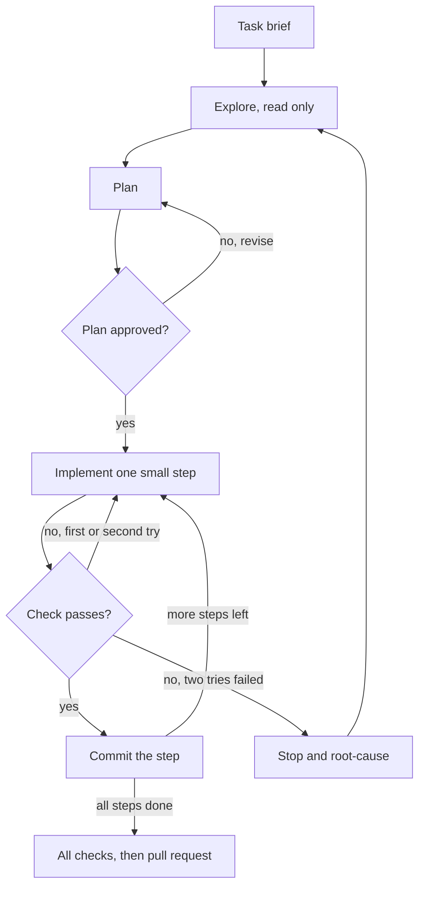
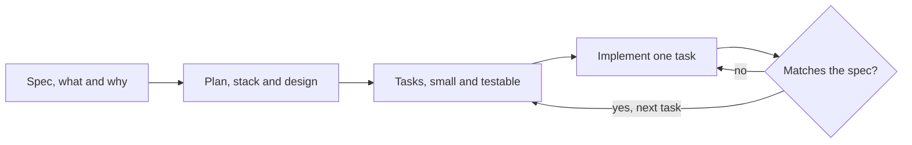

# 22 — Explore, plan, implement, verify

After this chapter you can take any non-trivial task through one repeatable loop: explore the code, agree a plan, implement in small steps, and prove the result with a check the agent can run before anything is committed. You can write a task brief that carries its own definition of done, choose how much ceremony a task deserves, and recover cleanly when a session goes off course.

## Mental model

An agent produces changes quickly and has no built-in way to know whether a change is right. The loop supplies the two things it lacks: knowledge of the code *before* it writes (explore, plan) and a pass/fail signal *after* it writes (verify). The rest is bookkeeping.



| Phase | What happens | Claude Code feature | What you keep |
|---|---|---|---|
| Explore | The agent reads code and runs read-only commands | Plan mode, plain questions, a research subagent | Files involved, patterns to copy, open questions |
| Plan | Ordered steps, files to touch, the check to run | Plan approval prompt, `Ctrl+G` to edit the plan | The plan (re-injected from disk after compaction) |
| Implement | One step at a time | Your normal permission mode | Small diffs |
| Verify | The check runs and its output is read | A proof command, `/goal`, a `Stop` hook, `/verify` | Command plus output |
| Commit | The step is recorded | Git | A commit, later a pull request ([chapter 24](24-git-prs-and-code-review.md)) |

> **Note:** The loop is for non-trivial work. The official docs say that "in most cases, your first plain prompt in a fresh session already does the right thing, without any setup on your part." A typo fix needs a prompt, not a process. The decision table later in this chapter tells you when to step up.

## What the official guidance says now

The official best-practices page has been rewritten, so advice from older tutorials may no longer match it (this book read it on 2026-11-25). Its subtitle is the whole message: "tell Claude what it can't see, give it a check to run, and enforce the rules that can't have exceptions." It lists four ways a session goes wrong and one remedy for each:

| What went wrong (quoted from the page) | Remedy |
|---|---|
| "Claude built something different from what you had in mind, or it has to rediscover the same fact at the start of every session" | Tell Claude what it can't see |
| "Claude said it was done and it wasn't quite" | Give Claude a check to run |
| "Claude did something that must never happen in this repo, or skipped a step that must always happen" | Enforce the rules that can't have exceptions |
| "Claude got it right, but it took more time, tokens, or permission prompts than the task was worth" | Change a default |

This chapter covers the first two rows. Rows three and four are [chapter 16](16-hooks.md) and [chapter 9](09-settings-and-permissions.md).

### Give Claude a check to run

The page explains why verification is the centre of the loop:

> "Claude stops when the work looks done. If it has nothing to run that tells it whether the work actually *is* done, "looks done" is all it has to go on. In practice that makes you the test suite, and every mistake sits there until you happen to notice it."

A check is anything that "comes back pass or fail": a test file, a build's exit code, a linter, a script that diffs output against a fixture, or "A browser screenshot next to the mockup". The page adds: "If your repo already has one of these, the single most useful line in your `CLAUDE.md` is the command that runs it."

There are four strictness levels, from "Claude decides" to "someone else decides":

| Level | How you set it | Who enforces it |
|---|---|---|
| 1. In the prompt | "run the auth tests after, and keep going until they pass" | Claude, by choice |
| 2. `/goal <condition>` | Claude keeps working across turns; "a separate model checks against the conversation after every turn" | An evaluator model |
| 3. A `Stop` hook | A script runs when Claude tries to stop; exit code 2 sends Claude back | "enforced by Claude Code (the harness)" |
| 4. "By someone who didn't write the code" | `/code-review`, which runs in "a fresh subagent that never saw your conversation" | An independent reviewer |

Two more tools sit beside the ladder: ask for *evidence* ("the command it ran and its output, or the screenshot"), and `/verify`, a skill that builds and runs the app and looks at the result. [Chapter 23](23-testing-and-verification-loops.md) goes deep on checks, evidence and `Stop` hooks; `/code-review` is in [chapter 24](24-git-prs-and-code-review.md).

### What you can stop doing

The same page retires advice you will still find in older tutorials. Its words: "Every one of these was good advice when it was written. Most were workarounds for something the model couldn't reliably do yet, and the models have since caught up."

| "The old advice" | "Why it's gone" |
|---|---|
| "The context window is your main constraint, manage it aggressively" | "Most current models have a 1M-token window and compaction happens on its own, so running out is rare. `/clear` between tasks is still worth doing, because a focused context gets you better answers and costs less." |
| "Add IMPORTANT or ALL CAPS to instructions Claude keeps missing" | "Current ones follow a plainly worded line, and piling on emphasis mostly makes Claude over-apply the rule. If it's a rule that can't bend, turn it into a hook or a deny rule." |
| "`think hard`, `think harder`, `be thorough` in the prompt" | "Effort is the control for that." Use `/effort`; the keyword `ultrathink` still works |
| "Tell Claude to keep going, loop until done, don't be lazy" | "lines like that are more likely to cause over-work than fix a stall"; for unattended runs, "`/goal` or a `Stop` hook enforces it" |
| "Describe your architecture and file layout in `CLAUDE.md`" | "Claude reads the repo itself. Only write down what isn't in there." |
| "Delegate to a subagent for a better answer" | "Handing the same task to a subagent doesn't make the answer any better. A fresh reviewer does help, because it hasn't seen your reasoning" |

## Explore before you change anything

Exploring means asking questions and reading code with no edits. The common-workflows page gives these starter prompts:

```text
give me an overview of this codebase
find the files that handle user authentication
trace the login process from front-end to database
```

For anything larger than a small fix, explore in **plan mode**. In plan mode, "Claude reads files, runs shell commands to explore, and writes a plan, but does not edit your source." Enter it in one of three ways:

```bash
claude --permission-mode plan      # start a session in plan mode
```

```text
/plan fix the auth bug
```

The third way is `Shift+Tab` until the status bar shows plan mode on. When the plan is ready Claude presents it and asks how to proceed:

| Option | Effect |
|---|---|
| **Yes, and use auto mode** | Approves and starts editing. Reads **Yes, auto-accept edits** when auto mode is not available to your session |
| **Yes, manually approve edits** | Approves; you review each edit |
| **No, keep planning** | Stays in plan mode; tell Claude what to change |

Press `Ctrl+G` to open the plan in your text editor and change it directly. To leave plan mode without approving, press `Esc` first: at the approval prompt `Shift+Tab` approves the plan. The setting `showClearContextOnPlanAccept` (default `false`) adds an option that approves the plan, clears the conversation and implements "from the plan alone". Details are in [chapter 10](10-plan-mode-checkpoints-and-context-management.md).

> **Warning:** Plan mode is not a security boundary in every setup. The docs say: "In interactive terminal sessions with bypass permissions available, don't rely on plan mode's blocks."

A useful exploration prompt asks for the things a plan needs, not for a tour:

```text
Do not edit anything yet. For "limit failed logins", list:
1. the files you would touch and why
2. an existing pattern in this repo you would copy
3. the command that will prove the change works
4. questions only I can answer
```

For a noisy investigation, hand it to a subagent: "use a subagent to investigate how our auth system handles token refresh". The docs are clear about what that buys: "You get parallelism or a fresh pair of eyes out of it, but not a smarter answer." See [chapter 14](14-subagents.md).

Why plan at all? The costs page gives the reason in one line: plan mode helps by "preventing expensive re-work when the initial direction is wrong."

## Write the task brief

A task brief is the prompt for a non-trivial task. It has four required parts: the goal, the constraints, the definition of done and the proof command (the command that exits 0 only when the work is done). Two more are worth adding when they apply: context the repo does not show, and a budget. The docs put it briefly: "name the file, describe the symptom, and say what "fixed" looks like up front".

```markdown
## Goal
Failed logins are limited to 5 per account per 15 minutes; the 6th returns HTTP 429.

## Context the repo does not show
Support wants this before the next release. Do not add a dependency; the cache client in `src/cache.js` is approved.

## Constraints
- Change only `src/auth/` and its tests.
- Out of scope: the password-reset flow, even though it has the same gap. Mention it in your report.

## Definition of done
- A test proves the 6th failed attempt returns 429 and that the counter resets after 15 minutes.
- Successful logins behave as before (existing tests still pass).

## Proof command
`npm test -- auth && npm run lint` exits 0. Paste the command and its output in the final report.

## Budget
60 minutes. Tell me at 30 if you will miss it.
```

| Part | The question it answers | Typical failure when missing |
|---|---|---|
| Goal | What is observably true when this is finished? | The agent builds something adjacent |
| Context | What can the agent not learn by reading the repo? | It rediscovers, or guesses |
| Constraints | What must not change? What is out of scope? | Scope creep into neighbouring code |
| Definition of done | Which behaviours must hold? | "Looks done" |
| Proof command | What exits 0 only when it is done? | You become the test suite |
| Budget | When should it stop and report? | A "small" task that runs all day |

The field data in this book supports the shape. The prompts that worked had four ingredients in common: an observable end state, the constraint that rules out the obvious answer, what is already approved, and how success will be shown. The same data shows what the short version costs:

| Prompt that caused rework | Improved version |
|---|---|
| "Fix it" plus a log path, four rounds over two days | "Expected X, got Y, log attached. First reproduce it and show me the failing test or trace. Then fix. Then prove it with the same reproduction." |
| "Add the watchdog auto-restart" on a host shared by two projects | "In project A's repo only, add …; do not modify anything owned by another project on that host. Name the owning repo before each edit." |
| One message with half a dozen asks and eight screenshots | "Turn these into issues with acceptance criteria and show me the list. I'll rank them; implement the top three and demo each against its criteria." |
| "Why is it all so slow?" asked after 13 hours | "Budget: 90 minutes. One PR. Two review rounds at most; later findings become issues. Tell me at the halfway point if you will miss." |

## Spec-driven development

Spec-driven development (SDD) moves the brief into files. You write what to build and why as a specification, turn it into a technical plan, split the plan into tasks, then implement the tasks one by one.



The worked reference is **GitHub Spec Kit**, an open-source toolkit that describes SDD as: "Define what to build and why, then turn the specification into a plan, tasks, and working code." The blog post that introduced it names four phases:

| Phase | Content | Review question |
|---|---|---|
| Specify | User journeys and outcomes, not the technical stack | Is this what we want? |
| Plan | Stack, architecture, constraints | Is this how we want it built? |
| Tasks | Units small enough to implement and test in isolation | Can each be checked on its own? |
| Implement | One task at a time | Does this focused change do its task? |

Install and initialise (as the README showed it on 2026-11-25):

```bash
uv tool install specify-cli
specify init my-project --integration copilot
```

Then run the steps in your agent's chat, "one at a time, reviewing each result before continuing":

| Step | Command (Copilot skills syntax) | Purpose |
|---|---|---|
| 1 | `/speckit-constitution` | Project principles, once per project |
| 2 | `/speckit-specify` | What and why |
| 3 | `/speckit-plan` | Stack and architecture choices |
| 4 | `/speckit-tasks` | Task breakdown |
| 5 | `/speckit-implement` | Build the tasks |
| 6 | `/speckit-converge` | "Repeat implement and converge until convergence reports `Converged`." |

> **Note:** Command spelling differs per agent and from 2025 write-ups. Check the Spec Kit command reference for your agent before you copy these.

Claude Code needs no toolkit for the lightweight version. The best-practices page suggests asking Claude to interview you:

```text
Interview me until you could write the spec, then write it to SPEC.md.
```

Then "start a fresh session to build from it, so the build begins with a clean context and a written definition of done." When the work is finished, review against the spec in a fresh context: "use a subagent to review the rate limiter diff against SPEC.md ... report gaps that affect correctness and skip style" (abridged). The page warns: "Don't drop the `skip style` part of that prompt."

A taxonomy from a martinfowler.com article is useful for deciding how far to go: **spec-first** (the spec is written first and used for this task), **spec-anchored** (the spec is kept and maintained afterwards) and **spec-as-source** (humans edit only the spec). The tools that article tried were all spec-first; few commit to the other two.

> **Warning:** The evidence for SDD is reasoning and anecdote. No source this book read offers a controlled comparison of spec-first work against direct prompting. Practitioner critiques are specific: one tool turned a small bug into four user stories with sixteen acceptance criteria, and long generated specs can take more effort to review than the code would. Treat a spec as a review target, not a guarantee, and keep it short enough that you actually read it.

## Scale the ceremony to the task

| Task | Explore | Plan | Spec | Check | Delivery |
|---|---|---|---|---|---|
| One-line fix: typo, log line, rename | None | None | None | Existing tests or linter | One commit |
| Small bug with a reproduction | Reproduce it first | In the prompt | None | A test that fails, then passes | One commit or a small PR |
| Feature across several files | Plan mode | Approved plan | Optional `SPEC.md` from an interview | Tests plus the repo's gate command (the one command that runs every required check) | One PR, several commits |
| Change in an unfamiliar area or platform | Research first, then plan mode | Approved plan, with a pilot step | Short spec | Gate plus a run of the real feature | Pilot PR, then the rest |
| Multi-day objective | Research phase | Task breakdown as issues | Spec with acceptance criteria | Gate, CI and a fresh-context review | One PR per task or objective ([chapter 26](26-multi-agent-orchestration.md)) |

Step **up** a level when you cannot state "done" in one sentence, when the change touches authentication, schema, infrastructure or money, or after two failed attempts. Step **down** when the spec is longer than the diff will be, or when reviewing the documents takes longer than reviewing the code.

## Implement in small steps

1. Take one step from the plan. A step is one behaviour and its check.
2. Let the agent implement it. Watch the first minute: this is when a wrong direction is cheapest to catch.
3. Run the narrow check for that step (one test file, not the whole suite).
4. Commit when it passes.
5. Repeat. Run the full gate once at the end, before the pull request.

The common-workflows page gives the same advice for refactoring: "Do refactoring in small, testable increments".

Commit after every green step because Git is your only durable undo. Checkpoints are session-level and have gaps (see the next section). A commit per step also gives the reviewer a readable history.

```bash
git add -A && git commit -m "feat(auth): count failed logins per account"
npm test -- auth          # narrow check for the next step
```

## When the agent goes off course

The official rule is short: "Watch the first minute, press `Esc` the moment Claude drifts, and after two failed corrections run `/clear` and write a better prompt instead of a third."

1. **Stop.** Press `Esc`. A wrong direction does not improve with more turns.
2. **Rewind.** Run `/rewind` (aliases `/checkpoint`, `/undo`), or press `Esc` twice on an empty prompt. The menu offers **Restore code and conversation**, **Restore conversation**, **Restore code**, **Summarize from here**, **Summarize up to here** and **Never mind**.
3. **Check what rewind missed.** Run `git status` and `git diff`.
4. **Diagnose.** Which of the four rows in the official table was it: missing information, no check, a rule that needed enforcing, or a default?
5. **Re-brief.** Run `/clear` and write a better prompt that carries what you learned: what was tried, why it failed, and the constraint that was missing.

> **Warning:** `/rewind` does not restore everything. "A file that only Bash commands changed isn't tracked and stays as it is. To revert it, use version control, such as Git." Edits made by subagents are usually not captured, and "Actions that affect remote systems (databases, APIs, deployments) can't be checkpointed."

### Two failed attempts, then root-cause

Brute force is the agent's most expensive habit: the same fix with small variations, each one costing a full build or deploy. The author's global `CLAUDE.md` has a rule for it, and every repo in the product workspace repeats it:

> "**Recovery rule:** after **2 failed attempts** on the same thing, STOP brute-forcing — root-cause it."

Root-causing means going back to explore: reproduce the failure, read the real error, form one hypothesis, apply one fix, verify. A prompt that worked in the field data:

```text
Why is X happening when we already have Y? Understand why it happened
and fix it so it won't happen again unless necessary.
```

Precise questions get better answers than frustrated ones. In the field data, "How did you determine that number?" produced a real root cause (the figure came from a code comment, not a measurement), while "why is it slow?" produced apologies first.

Three warning signs, from an essay on augmented coding: the agent is looping, it is adding functionality nobody asked for, or it is disabling or deleting tests.

## From the field

> **Field note:** All numbers below come from about four weeks of one developer's Claude Code transcripts (37 substantive sessions) and that developer's repos. Counts are regex-based; read each as ±30%. They are not benchmarks.

**The repo gate is the definition of done.** In a product workspace of several repos, each repo names one gate command and states "done" in terms of it. The backend repo's instruction file says: "`yarn build` succeeds, `yarn lint` is clean (`--max-warnings 0`), and `yarn test` passes. Never claim done without running the check and citing the result." The name differs per repo (`make ci`, `make agent-check`, `npm run agent:check`). The survey also found the trap: three documents in the workspace repo told agents to run a `make` target that did not exist, and the command returned `No rule to make target`. Run your proof command yourself before you put it in a brief.

**The working agreements are the loop, written down.** The author's global `CLAUDE.md` and most repo instruction files repeat the same lines: plan before implementing; state the proving check first, run it and cite the output; after two failed attempts stop and root-cause; a script counts as verified only when it has been run. The definition-of-done line reads: "before non-trivial work, state the check that will prove success (which command/test/URL); run it and cite the output. **Never claim success without evidence.**"

**What skipping the loop cost.** The transcripts contain 60 agent self-corrections ("my mistake", "I was wrong") in 20 of 37 sessions and "too slow" complaints in about 10. One session ran over 13 hours; a retro on another long session measured about 12 hours against roughly 4 reachable. The median human prompt in the corpus was 27 characters; the long briefs were the exceptions, and they were the ones that paid off. One prompt that changed a session was a research gate: "That was too fast. Start with online research into what is needed and how it behaves on each platform's latest version, then plan."

## Common problems

| Symptom | Cause | Fix |
|---|---|---|
| The agent edits at once and builds the wrong thing | No explore step; the brief lacks what the repo does not show | Start in plan mode; add a "context the repo does not show" section |
| "Done", but the feature does not work | Nothing to run that says pass or fail | Put a proof command in the brief and in `CLAUDE.md`; ask for command plus output |
| The change spreads into neighbouring code | No out-of-scope line | Add constraints; have the agent name the file's owner before each edit |
| You are typing a third correction | The context is full of failed attempts | `/clear` and re-brief with what you learned |
| The same fix is retried with small variations | Brute force without a hypothesis | Two-attempt rule; ask a root-cause question |
| `/rewind` left files changed | Bash-only changes and subagent edits are not checkpointed | Use Git; commit after each green step |
| The spec is longer than the code and nobody read it | Ceremony too heavy for the task | Drop a level in the decision table |
| The proof command in the brief fails for an unrelated reason | The command was never run by a human | Run it yourself first; fix the docs if they name a target that does not exist |

## Checklist

- [ ] I can state "done" in one sentence before I start.
- [ ] The brief has a goal, constraints, a definition of done and a proof command.
- [ ] I ran the proof command myself and it exists in this repo.
- [ ] For anything beyond a small fix, the agent explored and I approved a plan first.
- [ ] Each step is small enough to check alone, and is committed when green.
- [ ] The final report shows the command and its output, not only "all tests pass".
- [ ] After two failed attempts or two failed corrections I stop, rewind and re-brief.
- [ ] The amount of ceremony matches the task size.

## Try it

1. **Brief a real bug.** Pick a small open bug in a repo you know. Write the six-part brief from this chapter. Run the proof command yourself first and confirm that it fails today. Then give the brief to Claude Code and compare its final report against your definition of done.
2. **Plan, edit the plan, build.** Start `claude --permission-mode plan`, ask for a plan for a two-file change, press `Ctrl+G` and remove one step you disagree with. Approve with **Yes, manually approve edits** and check that the removed step stays removed.
3. **Practise recovery.** In a scratch repo, give a deliberately vague prompt ("make the tests better"). Press `Esc` after one minute, run `/rewind`, then check `git status` to see what was and was not restored. Rewrite the prompt as a brief and run it again.

## Sources

- [Claude Code best practices](https://code.claude.com/docs/en/best-practices)
- [Claude Code common workflows](https://code.claude.com/docs/en/common-workflows)
- [Permission modes and plan mode](https://code.claude.com/docs/en/permission-modes)
- [Checkpointing and rewind](https://code.claude.com/docs/en/checkpointing)
- [Commands reference](https://code.claude.com/docs/en/commands)
- [Costs](https://code.claude.com/docs/en/costs)
- [GitHub Spec Kit README](https://github.com/github/spec-kit)
- [Spec-driven development with AI: get started with a new open source toolkit, GitHub Blog, Sep 2025](https://github.blog/ai-and-ml/generative-ai/spec-driven-development-with-ai-get-started-with-a-new-open-source-toolkit/)
- [Article comparing three spec-driven development tools, martinfowler.com, Oct 2025](https://martinfowler.com/articles/exploring-gen-ai/sdd-3-tools.html)
- [Augmented Coding: Beyond the Vibes, Jun 2025](https://newsletter.kentbeck.com/p/augmented-coding-beyond-the-vibes)
- Field data: the author's repos, global `CLAUDE.md` and about four weeks of session transcripts (October to November 2026)

---

[← Previous: Guide: build and ship a plugin](21-guide-build-and-ship-a-plugin.md) · [Contents](README.md) · [Next: Testing and verification loops →](23-testing-and-verification-loops.md)
