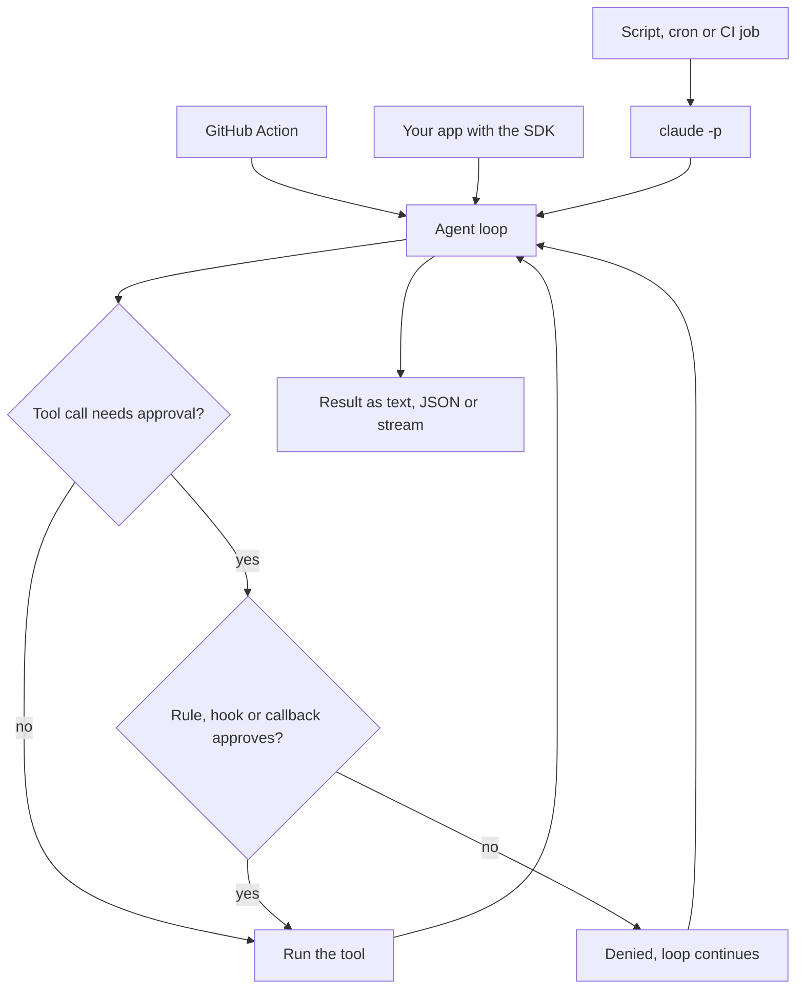

# 22 — Headless mode, CI and the Agent SDK

After this chapter you can run Claude Code from a script, a cron job or a CI pipeline, read its answer as text or JSON, and decide in advance which tools the run may use. You will also know when the GitHub Action or the Agent SDK fits better than the CLI, and how to keep an unattended run from loading a stranger's configuration or spending without a ceiling.

## Mental model

*Headless* means no person is at the keyboard. The agent loop from [chapter 3](03-the-agentic-loop-and-tool-use.md) is the same one; three things around it change:

- **Nobody answers a permission prompt.** Every approval is decided before the run starts, by a rule, a hook or a callback. A call that still needs approval is denied and the loop carries on without it.
- **Nobody sees a trust dialog.** That is the prompt an interactive session shows before it uses a new folder's configuration ([chapter 8](08-settings-and-permissions.md)). A headless run uses the repository's hooks and MCP servers without asking, so you choose what loads.
- **A program reads the output.** You pick a format the next step in the script can parse.

There are three ways in and one engine behind them. The docs call `claude -p` "the Agent SDK via the CLI", describe the GitHub Action as "built on the SDK", and say the SDK gives you "the same tools, agent loop, and context management that power Claude Code".



## Run it once with `claude -p`

Add `-p` (or `--print`) to any `claude` command and it runs non-interactively: it does the work, prints the result and exits.

```bash
claude -p "What does the auth module do?"
cat build-error.txt | claude -p 'concisely explain the root cause of this build error' > output.txt
claude -p "Now focus on the database queries" --continue    # continue the most recent conversation
```

What a script needs to know:

- **Exit code.** `0` on success, non-zero when the run fails; a `SIGTERM` gives 143. A failure inside the run, such as missing authentication, is printed "as the result on stdout", so check the output and not only the status.
- **Input.** Piped stdin is capped at 10 MB; for more, write a file and name its path in the prompt.
- **Background work.** `--bg` is rejected with `-p`. When a subagent's long command moves to the background at its timeout, the run "can exit with code 0 before the command finishes".
- **Skills and flags.** User-invoked skills work: put `/skill-name` in the prompt string. `--max-turns`, `--max-budget-usd` and `--json-schema` exist only in print mode, and the CLI reference warns that "`claude --help` does not list every flag".

### Output formats

| `--output-format` | What you get | Good for |
|---|---|---|
| `text` (default) | The final answer as plain text | Pipes, and logs a person reads |
| `json` | One object with the result, the session ID and metadata, including `total_cost_usd` and a per-model cost breakdown | Scripts that branch on the answer or record cost |
| `stream-json` | Newline-delimited JSON events while the run is in progress | Live UIs, relays, long runs |

```bash
out=$(claude -p "Summarize this project" --output-format json)
echo "$out" | jq -r '.result'          # the answer text
echo "$out" | jq '.total_cost_usd'     # a client-side estimate, not an invoice
claude -p "Explain recursion" --output-format stream-json --verbose --include-partial-messages
```

The JSON also carries `session_id`; pass it to `--resume` to continue that exact conversation. In a stream, the first event is normally `system/init` (model, tools, MCP servers, plugins); find the `result` message by its `type` rather than assuming it is the last line. `--input-format` also accepts `stream-json`, so a wrapper can write user messages as JSON lines and read events back.

### Structured output with a JSON schema

Parsing prose with `grep` breaks the first time the wording changes. Pass a JSON Schema with `--json-schema` together with `--output-format json`, and the data that matches the schema arrives in a `structured_output` field.

```bash
schema='{"type":"object","required":["risk","reasons"],"properties":{
  "risk":{"type":"string","enum":["low","medium","high"]},
  "reasons":{"type":"array","items":{"type":"string"}}}}'
git diff origin/main...HEAD |
  claude -p "Rate the risk of merging this diff." --output-format json --json-schema "$schema" |
  jq -e '.structured_output' > verdict.json || { echo "no structured output" >&2; exit 1; }
```

Three rules from the docs: an invalid schema makes `claude` exit with an error; the `format` keyword is accepted but not enforced; and the field is **absent** when the run ends without valid structured output, for example because Claude declined. `jq -e` turns that absence into a failed step.

## Start clean with `--bare`

`--bare` skips auto-discovery of hooks, skills, custom commands, subagents, installed plugins, MCP servers, auto memory and `CLAUDE.md`. Without it, `claude -p` loads them "as an interactive session would", including whatever is configured in the working directory. The docs recommend bare mode for scripted and SDK calls and say it "will become the default for `-p` in a future release". Your `CLAUDE.md` conventions are then not in context; if the job needs a few of them, pass them with `--append-system-prompt-file`.

| In bare mode | Detail |
|---|---|
| Still available | Bash, file read and file edit tools; settings files and their permission rules are still read |
| Off | Hooks, even when passed with `--settings` or inside a plugin you load by flag; system reminders; background tasks |
| Load on purpose | `--append-system-prompt[-file]`, `--settings`, `--mcp-config`, `--agents`, `--plugin-dir` |
| Authentication | OAuth and keychain credentials are never read. Set `ANTHROPIC_API_KEY`, or an `apiKeyHelper` (a settings key naming a command that generates the credential) in the `--settings` JSON. Amazon Bedrock, Google Cloud's Agent Platform and Microsoft Foundry keep reading their own credentials |

## Permissions when nobody can answer

New interactive sessions start in `auto` mode (v2.1.283 or later). Headless runs do not: with no mode set, `claude -p` and the Agent SDK start in `default` (Manual). From v2.1.302 the docs spell out the consequence: "Calls needing approval are denied unless you approve them with an allow rule, hook, `canUseTool` callback, or `--permission-prompt-tool`". The run does not stop; the denied call does not happen, and Claude works around it or reports it.

So you allow tools explicitly. The docs' recipe for CI with an exact allowlist is `claude -p "run the test suite" --permission-mode dontAsk --allowedTools "Bash(npm test)" "Read"`.

| Flag | What it does | Trap |
|---|---|---|
| `--allowedTools` | Listed calls run without asking; permission rule syntax | It does not limit which tools exist. `Bash(git diff *)` needs the space before `*`, or it also matches `git diff-index` |
| `--tools` | Restricts built-in tools: `""` for none, or names like `"Bash,Edit,Read"` | Does not affect MCP tools |
| `--disallowedTools` | Deny rules: a bare name removes the tool; `Bash(rm *)` denies matching calls | Deny wins in every mode |
| `--permission-prompts none` | Denies anything that would wait for an approver (v2.1.259 or later) | Lasts one run; `permissions.denyInsteadOfPrompting` makes it permanent |

| `--permission-mode` | A call that needs approval... | Use it for |
|---|---|---|
| `default` | is denied unless a rule, hook or callback approves it | Jobs where you list every allowed call |
| `dontAsk` | is denied; reads in the working directories and pre-approved tools still run | Locked-down CI with an exact allowlist |
| `acceptEdits` | file writes and common filesystem commands (`mkdir`, `touch`, `mv`, `cp`) run; other shell commands still need a rule | Jobs that change files |
| `auto` | goes to a classifier; when repeated blocks reach a threshold "the action doesn't run and Claude keeps working" | Runs where you list nothing beforehand |
| `bypassPermissions` | runs immediately | Only a container, VM or sandbox runtime, as a non-root user |

> **Warning:** `--dangerously-skip-permissions` equals `--permission-mode bypassPermissions`, which "offers no protection against prompt injection or unintended actions". Deny rules still apply. On Linux and macOS it refuses to start as root or under `sudo`, which matters in CI containers that run as root.

## Shell recipes

**Pipe a log or history in.** `git log --oneline -20 | claude -p "summarize these recent commits"` is the docs' own example. Piping also means Claude needs no Bash permission to read the data.

**Review a diff, read-only.** This combines the flags the best-practices page lists for scripts:

```bash
git diff origin/main...HEAD |
  claude -p "Review this diff for bugs. Give file, line and problem. Say 'no findings' if clean." \
    --bare --permission-mode dontAsk --allowedTools "Read" \
    --max-turns 10 --output-format json | jq -r '.result'
```

**Batch over files.** One short session per file keeps each context small and keeps one failure local:

```bash
mkdir -p reports
git ls-files 'docs/*.md' | while IFS= read -r f; do
  claude -p "Check the code examples in $f. Reply 'ok' or list the broken ones." \
    --bare --tools "Read" --permission-mode dontAsk --max-turns 5 \
    --max-budget-usd 0.50 < /dev/null > "reports/$(basename "$f").txt"
done
```

`< /dev/null` stops `claude` from consuming the rest of the file list as its own stdin. Put the prompt directly after `-p`, as the docs' examples do: `--allowedTools` accepts several values, so a prompt placed after it can be read as one more rule. Each iteration is a separate paid session, so cap every one.

## The GitHub Action

`anthropics/claude-code-action@v1` runs the same engine inside GitHub Actions.

1. **Fast setup:** in Claude Code run `/install-github-app` (github.com repositories only; needs `gh` signed in and repository admin rights). It installs the Claude GitHub App, saves the secret and pushes a branch with `claude.yml` (and `claude-code-review.yml` if selected) for you to merge as a pull request.
2. **Manual setup:** store one secret and pass it as an input: `ANTHROPIC_API_KEY` as `anthropic_api_key`, or `CLAUDE_CODE_OAUTH_TOKEN` as `claude_code_oauth_token` (create it with `claude setup-token`; runs then use your Claude subscription instead of API billing).
3. **No stored secret:** workload identity federation, where the action exchanges the workflow's short-lived GitHub OpenID Connect (OIDC) token for API access (`anthropic_federation_rule_id`, `anthropic_organization_id`, plus `id-token: write`), or a cloud provider over OIDC with `use_bedrock`, `use_vertex` or `use_foundry`.

The app needs read and write access to Contents, Issues and Pull requests. The action has two modes. Without a `prompt` input it waits for the trigger phrase (`trigger_phrase`, default `@claude`) and replies in a comment. With `prompt` it runs immediately, and results stay in the workflow run log unless the prompt and a tool post them.

| Input | Purpose |
|---|---|
| `prompt` | Plain text or a skill invocation. With plain text, "Claude has no shell or GitHub API access until you grant the tools" |
| `claude_args` | Any CLI argument: `--max-turns`, `--model`, `--mcp-config`, `--allowedTools`, `--debug` |
| `settings` | Claude Code settings, as a JSON string or a path to a settings JSON file |
| `github_token` | Token for GitHub operations; when omitted, the action authenticates as the Claude GitHub App |

On issue and pull request events the triggering user must have write access (`allowed_non_write_users` plus your own `github_token` overrides that), and bot actors are rejected unless listed in `allowed_bots`. The full input list is in the action repository's `docs/usage.md`.

> **Note:** The docs print these workflows with `actions/checkout@v6` and `anthropics/claude-code-action@v1`. The copies below pin each action to a full commit SHA and keep the version in a comment: a tag can be moved by the action's owner, a SHA cannot, and Dependabot updates both when it proposes a bump. Everything else is as documented.

**Workflow 1: answer `@claude` mentions** (as documented)

```yaml
name: Claude Code
on:
  issue_comment:
    types: [created]
  pull_request_review_comment:
    types: [created]
jobs:
  claude:
    if: contains(github.event.comment.body, '@claude')
    runs-on: ubuntu-latest
    permissions:
      contents: write
      pull-requests: write
      issues: write
      id-token: write
      actions: read
    steps:
      - uses: actions/checkout@d23441a48e516b6c34aea4fa41551a30e30af803 # v6.1.0
        with:
          fetch-depth: 1
      - uses: anthropics/claude-code-action@9c5ddab2e6d17b83ea679153b31f1d5f023cf636 # v1.0.217
        with:
          anthropic_api_key: ${{ secrets.ANTHROPIC_API_KEY }}
```

**Workflow 2: review every pull request** (as documented)

```yaml
name: Code Review
on:
  pull_request:
    types: [opened, synchronize, ready_for_review, reopened]
jobs:
  review:
    runs-on: ubuntu-latest
    permissions:
      contents: read
      pull-requests: read
      issues: read
      id-token: write
    steps:
      - uses: actions/checkout@d23441a48e516b6c34aea4fa41551a30e30af803 # v6.1.0
        with:
          fetch-depth: 1
      - uses: anthropics/claude-code-action@9c5ddab2e6d17b83ea679153b31f1d5f023cf636 # v1.0.217
        with:
          anthropic_api_key: ${{ secrets.ANTHROPIC_API_KEY }}
          plugin_marketplaces: "https://github.com/anthropics/claude-plugins-official.git"
          plugins: "code-review@claude-plugins-official"
          prompt: "/code-review:code-review --comment ${{ github.repository }}/pull/${{ github.event.pull_request.number }}"
          claude_args: '--allowedTools "mcp__github_inline_comment__create_inline_comment"'
```

In workflow 2, `--comment` makes Claude post the review; without it the findings stay in the run log. The `claude_args` line is required because the action only starts the inline-comment MCP server when `--allowedTools` names it. `id-token: write` is "required for the Claude Code GitHub Action's default GitHub App authentication". On public repositories, pull requests from forks get no secrets, so the review does not run for them. If you come from `@beta`: change to `@v1`, remove `mode`, rename `direct_prompt` to `prompt`, and move `max_turns` and `model` into `claude_args`.

## The Agent SDK

The SDK is the same agent as a library, for a process you operate. For TypeScript, `npm install @anthropic-ai/claude-agent-sdk` (Node.js 18.14+). For Python, `pip install claude-agent-sdk` or `uv add claude-agent-sdk`, imported as `claude_agent_sdk` (Python 3.10+).

Both packages bundle a native Claude Code binary. Authenticate with `ANTHROPIC_API_KEY` in the process environment (the SDK "doesn't load `.env` files automatically") or a cloud provider switch such as `CLAUDE_CODE_USE_BEDROCK=1`. A product built on the SDK may not offer claude.ai login to its users, and may call itself "Claude Agent" or "Powered by Claude", not "Claude Code".

The quickstart's minimal agent, in TypeScript:

```typescript
import { query } from "@anthropic-ai/claude-agent-sdk";

// Agentic loop: streams messages as Claude works
for await (const message of query({
  prompt: "Review utils.py for bugs that would cause crashes. Fix any issues you find.",
  options: {
    allowedTools: ["Read", "Edit", "Glob"], // Auto-approve these tools
    permissionMode: "acceptEdits" // Auto-approve file edits
  }
})) {
  // Print human-readable output
  if (message.type === "assistant" && message.message?.content) {
    for (const block of message.message.content) {
      if ("text" in block) {
        console.log(block.text); // Claude's reasoning
      } else if ("name" in block) {
        console.log(`Tool: ${block.name}`); // Tool being called
      }
    }
  } else if (message.type === "result") {
    console.log(`Done: ${message.subtype}`); // Final result
  }
}
```

The same call in Python (the quickstart also prints each `AssistantMessage` block, as the TypeScript version does):

```python
import asyncio
from claude_agent_sdk import query, ClaudeAgentOptions, ResultMessage

async def main():
    async for message in query(
        prompt="Review utils.py for bugs that would cause crashes. Fix any issues you find.",
        options=ClaudeAgentOptions(
            allowed_tools=["Read", "Edit", "Glob"],  # Auto-approve these tools
            permission_mode="acceptEdits",  # Auto-approve file edits
        ),
    ):
        if isinstance(message, ResultMessage):
            print(f"Done: {message.subtype}")  # Final result

asyncio.run(main())
```

Options map onto the CLI features you already know:

| CLI feature | TypeScript | Python | Note |
|---|---|---|---|
| `--allowedTools` | `allowedTools` | `allowed_tools` | "This does not restrict Claude to only these tools" |
| `--disallowedTools`, `--tools` | `disallowedTools`, `tools` | `disallowed_tools` | A scoped rule like `"Bash(rm *)"` denies in every mode |
| `--permission-mode` | `permissionMode`, `canUseTool` | `permission_mode`, `can_use_tool` | The callback approves or denies each call in your code |
| `--mcp-config` | `mcpServers`, `strictMcpConfig` | `mcp_servers` | Python also accepts a config-file path |
| `--agents`, hooks | `agents`, `hooks` | `agents`, `hooks` | Hooks are callbacks per hook event |
| `--resume`, `--continue` | `resume`, `continue`, `forkSession` | `resume`, `continue_conversation`, `fork_session` | `resume` takes a session ID |
| `--setting-sources` | `settingSources` | `setting_sources` | Omitted means user, project and local, as in the CLI; `[]` disables all three |
| `--max-turns`, `--max-budget-usd` | `maxTurns`, `maxBudgetUsd` | `max_turns`, `max_budget_usd` | The budget is a client-side estimate and can pass the cap |

With `settingSources` omitted, `query()` reads user, project and local settings, `CLAUDE.md` files and `.claude/` skills, agents and commands. Managed policy and `~/.claude.json` are read whatever you pass.

| You want | Use |
|---|---|
| A one-off task, a shell script, a CI step, or a language other than Python or TypeScript | `claude -p`, as a subprocess with `--output-format json` |
| The agent inside your own Python or TypeScript application, with approval callbacks and native message objects | Agent SDK |
| A plain model call, or a tool loop you write yourself | The Claude API through a client SDK |

## Security for unattended runs

The docs are direct: "A `-p` session shows no workspace trust dialog and no per-server approval prompt". In a folder you never trusted, a `-p` or SDK run still **uses** the repository's hooks, its settings `env` block and helper commands such as `apiKeyHelper`, and connects the servers in `.mcp.json` "without asking, approved or not". Its `permissions.allow` rules are among the few things held back.

Repository-supplied configuration is how real advisories happened in interactive mode: project hooks that ran without meaningful consent, `.mcp.json` servers that started before the trust dialog was answered (CVE-2025-59536), and an `ANTHROPIC_BASE_URL` in repository settings that sent the API key to an attacker's endpoint (CVE-2026-21852). The two CVEs are patched (in 1.0.111 and 2.0.65), and the trust warning for hooks was clarified in 1.0.87. In CI there is no dialog to patch, so you close the gap yourself:

| Risk | Control |
|---|---|
| Repository settings, hooks and `.mcp.json` load | `--setting-sources user` (SDK: `settingSources` without project) reads neither the project's settings files nor its `.mcp.json` |
| Repository hooks, skills, plugins, MCP servers load | `--bare`; the project's `env` block still applies, so combine it with the row above. For hooks alone: `--settings '{"disableAllHooks": true}'` |
| Unknown MCP servers | `--strict-mcp-config` with your own `--mcp-config`; `disabledMcpjsonServers` to reject one by name |
| Token can do more than the job | Minimal workflow `permissions` (workflow 2 only reads); credentials in GitHub Secrets or OIDC, never committed |
| Untrusted text steers the agent | Issue bodies, PR descriptions and diffs are data. The docs say "Avoid piping untrusted content directly to Claude" |

A hardened call for a repository you did not write:

```bash
claude -p "$PROMPT" --bare --setting-sources user \
  --strict-mcp-config --mcp-config ci/mcp.json \
  --permission-mode dontAsk --allowedTools "Read" "Bash(npm test)" \
  --max-turns 15 --max-budget-usd 2
```

Least privilege applies to the agent's token as much as to its tools. An agent that can read private data, reads untrusted content and can send data out has all three parts of what one widely cited post calls the "lethal trifecta"; remove one of them per job. In one vendor's 2025 incident, attacker-committed code shipped inside a coding-assistant release, and the stated root cause was an "inappropriately scoped GitHub token". [Chapter 24](24-security-and-guardrails.md) goes deeper.

## Cost control in CI

- **Cap every run.** `--max-turns` has no limit by default. `--max-budget-usd` stops the run when the client-side estimate reaches the amount; it counts subagent spend, and "Spend can pass the cap", so leave headroom. In the action, pass both through `claude_args`.
- **Cap the job.** The docs' list: workflow-level timeouts, and GitHub's concurrency controls to limit parallel runs.
- **Trigger less, send less.** Reviewing on every `synchronize` pays for a review per push; make re-review opt-in if pushes come in bursts. A concise `CLAUDE.md` is read on every run, and a specific `@claude` request needs fewer turns.
- **Choose the model on purpose** with `--model` in `claude_args` (the docs' example pins `claude-sonnet-5`, as of Nov 2026), and revisit pinned IDs: of nine workflows in the author's repositories, five still named an older Opus model than three others.
- **Record the estimate.** Log `total_cost_usd` per job. With `--continue` or `--resume` it reports the conversation's whole total.

## From the field

**A session service that drives `claude -p`.** One of the author's services keeps agent sessions in its own event log and runs Claude Code as a sandboxed subprocess. Its driver builds this command line (trimmed):

```go
a := []string{"-p", "--input-format", "stream-json", "--output-format", "stream-json", "--verbose"}
// ... --model, then --resume <id> or --session-id <sid> ...
a = append(a, "--setting-sources", "user", "--disable-slash-commands",
	"--permission-mode", cliPermissionMode(ts.permMode), "--permission-prompt-tool", wire.ApprovalToolName,
	"--mcp-config", s.mcpConfig(sid), "--strict-mcp-config")
```

The source comment gives the reason: only user settings load, so "a cloned repo cannot add permission rules, hooks or env". Approvals go to a loopback MCP tool through `--permission-prompt-tool`, models are reached only through a gateway, and credentials never enter the sandbox. (`--disable-slash-commands` is in the CLI reference: "Disable all skills and commands for this session".)

**Sometimes the right headless tool is not an agent.** Across the 16 repositories surveyed, no Agent SDK import was found; unattended work either drives the CLI or goes through a gateway. One pipeline that turns past bug fixes into lint rules calls the Messages API directly: a streamed request with `thinking={"type": "adaptive"}`, an effort setting, and a system prompt marked `"cache_control": {"type": "ephemeral"}`, behind a concurrency semaphore. Its own comment notes that the cache marker "is a no-op for short prompts". If a step is one generation with no tools, a direct call is simpler to cap and to test than an agent loop.

**CI rules in a product workspace.** The Claude action runs in only one repository there, a public one: an `@claude` mention trigger restricted to owners, members and collaborators, on a GitHub-hosted runner with read-only permissions. Private repositories use self-hosted runners; public ones must stay on `ubuntu-latest`, because a self-hosted runner on a public repository lets any fork pull request run code on your own hardware. The written rule: "The exemption keys on repo **visibility**, not on size or traffic." Pull request runs cancel in progress "so agent push bursts do not queue stale runs on the runner fleet", and every job has an explicit `timeout-minutes`. The AI reviewer is non-gating but not silent: a run that produced no review posts a comment and a `neutral` check, because "a job that exits 0 is `success`".

> **Field note:** In a rolling window of about four weeks of one developer's transcripts, 32 of the 76 sessions that had at least one response were automated or headless, with a median of 2 responses each. That is one person's usage, not a benchmark, but it shows the usual shape: many small runs.

## Common problems

| Symptom | Cause | Fix |
|---|---|---|
| Run exits 0 but nothing was changed | A call that needed approval was denied in `default` mode | Add `--allowedTools` rules or `--permission-mode acceptEdits`; in `stream-json` output look for `permission_denied` messages and `permission_denials` in the result |
| The captured output is an authentication error, not an answer | In-run failures are printed as the result on stdout; `--bare` never reads OAuth or keychain credentials | Check the exit status and the result text; set `ANTHROPIC_API_KEY` or an `apiKeyHelper` in `--settings` |
| Script crashes reading `structured_output` | The field is absent when no valid structured output was produced | Test for it first (`jq -e`) |
| A hook or MCP server you never approved ran in CI | `-p` uses project hooks and `.mcp.json` with no dialog | `--setting-sources user`, `--bare`, `--strict-mcp-config` |
| An MCP server is silently missing | Invalid `--mcp-config` entries are skipped and the run exits cleanly | Fail the job when `mcp_server_errors` (or `plugin_errors`) is present in the `system/init` event |
| CI does not run on Claude's commits | GitHub does not trigger workflows on commits made with the default `GITHUB_TOKEN` | Remove that `github_token` input so the action authenticates as the Claude GitHub App, or pass a custom app token |
| `@claude` gets no reply | App not installed, secret missing, commenter lacks write access, or the phrase is not a whole word | Check each; `@claude-bot` does not match |

## Checklist

- [ ] Every headless call sets a permission mode or an explicit `--allowedTools` list; nothing waits for a prompt.
- [ ] CI calls use `--bare`, add `--setting-sources user` in repositories you did not write, and take MCP servers only from your own `--mcp-config` with `--strict-mcp-config`.
- [ ] Scripts parse `--output-format json`, test for `structured_output` before using it, and check the result text as well as the exit code.
- [ ] Every run has `--max-turns` and `--max-budget-usd`; every workflow has a timeout and a concurrency group.
- [ ] Workflow `permissions` are the minimum the job needs, and self-hosted runners never serve public repositories.
- [ ] A person reviews what an unattended run produced before it merges.

## Try it

1. In a scratch repository run `claude -p "Create notes.txt containing the word hello" --output-format stream-json --verbose`. Find the denial in the output, then rerun with `--permission-mode acceptEdits` and compare.
2. Write a two-field JSON Schema, extract those fields from your README with `--json-schema`, and make the script exit non-zero when `structured_output` is missing.
3. Add a `.mcp.json` whose server command appends a line to a log file. Run `claude -p "hi"` and check the log; repeat with `--bare` (it needs `ANTHROPIC_API_KEY` set), then with `--setting-sources user`. Note which runs started the command.

## Sources

- https://code.claude.com/docs/en/headless and https://code.claude.com/docs/en/cli-reference
- https://code.claude.com/docs/en/permission-modes and https://code.claude.com/docs/en/permissions#what-runs-before-you-trust-a-folder
- https://code.claude.com/docs/en/github-actions and https://github.com/anthropics/claude-code-action
- https://code.claude.com/docs/en/agent-sdk/overview and https://code.claude.com/docs/en/agent-sdk/quickstart
- https://code.claude.com/docs/en/agent-sdk/typescript#options and https://code.claude.com/docs/en/agent-sdk/python#claudeagentoptions
- https://code.claude.com/docs/en/agent-sdk/claude-code-features and https://code.claude.com/docs/en/mcp#project-scope
- https://code.claude.com/docs/en/security, https://code.claude.com/docs/en/best-practices and https://code.claude.com/docs/en/costs
- https://research.checkpoint.com/2026/rce-and-api-token-exfiltration-through-claude-code-project-files-cve-2025-59536/, https://simonwillison.net/2025/Jun/16/the-lethal-trifecta/ and https://aws.amazon.com/security/security-bulletins/AWS-2025-015/
- Field data: a session service, a bug-pattern pipeline and a product workspace's CI rules in the author's repositories, plus session transcripts over a rolling window of about four weeks, read on 2026-11-25.

---

[← Previous: Multi-agent orchestration](21-multi-agent-orchestration.md) · [Contents](README.md) · [Next: One repo, many agents: AGENTS.md and cross-tool setups →](23-cross-tool-agents-md-cursor-codex-gemini.md)
