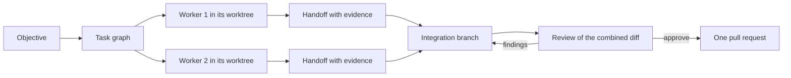
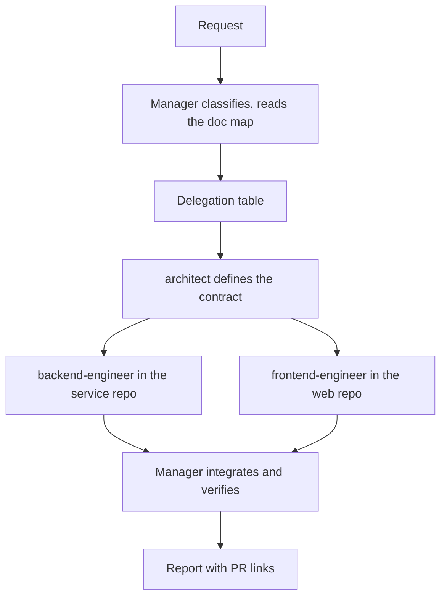

# 26 — Multi-agent orchestration

After this chapter you can decide whether a task needs more than one agent, pick the cheapest pattern that fits, and run a multi-task objective that ends in one reviewed pull request. You will also be able to design the plain-file state that lets an orchestration survive a crash, a compaction or a rate limit.

## Mental model

*Orchestration* means splitting one objective across several agent contexts and combining the results. Each extra context buys one of three things: parallelism, a fresh pair of eyes, or more total context than one window holds. Each one also costs tokens and coordination. The Claude Code docs put it plainly: "You get parallelism or a fresh pair of eyes out of it, but not a smarter answer."

The rule the evidence supports: parallel *readers* and independent *reviewers* are cheap to add safely; parallel *writers* on shared code are where failures concentrate. So keep writes single-threaded per file, and keep the knowledge of who owns what in files on disk, not in any agent's conversation.



This chapter builds on [subagents](14-subagents.md) and on worktrees and background tasks from [chapter 25](25-parallel-work-worktrees-and-background-tasks.md).

## The four patterns

| Pattern | Shape | Use when | In Claude Code |
|---|---|---|---|
| Pipeline (prompt chaining) | Each step consumes the previous step's output | "the task can be easily and cleanly decomposed into fixed subtasks" | A chain of skills; `pipeline()` in a workflow |
| Parallel fan-out | Independent subtasks at once (sectioning), or the same task several times (voting) | Subtasks share no files and no decisions | Several subagents in one message; `/batch`; `parallel()` |
| Orchestrator-workers | A lead decides the subtasks at run time, delegates, then synthesizes | The subtasks cannot be predicted up front, as in multi-file code changes | Main session plus subagents; agent teams |
| Reviewer / critic | One agent produces, another evaluates, in a loop | "we have clear evaluation criteria" | A read-only reviewer subagent, a second session, `/code-review` |

The names come from Anthropic's "Building effective agents" (there: prompt chaining, parallelization, orchestrator-workers, evaluator-optimizer). The same post sets the default: "finding the simplest solution possible, and only increasing complexity when needed."

## The evidence, for and against

| Finding | Source | What it means for coding work |
|---|---|---|
| A lead agent with parallel subagents beat a single agent by 90.2% | Anthropic's research system, June 2025, "our internal research eval", Opus 4 lead with Sonnet 4 subagents | A research result on 2025 models, not a coding benchmark |
| "Multi-agent systems work mainly because they help spend enough tokens to solve the problem"; token usage alone explained 80% of the variance on the BrowseComp evaluation | Same post | More agents is mostly more tokens. Ask whether the task is worth them |
| Agents use about 4× the tokens of chat; multi-agent systems about 15× | Same post | Budget before you fan out |
| "most coding tasks involve fewer truly parallelizable tasks than research, and LLM agents are not yet great at coordinating and delegating to other agents in real time" | Same post | The authors themselves place most coding outside the sweet spot |
| "Actions carry implicit decisions, and conflicting decisions carry bad results"; two subagents built mismatched halves of one game | Cognition, "Don't Build Multi-Agents", June 2025 | Workers that cannot see each other's decisions will contradict each other |
| "A lot has changed since then": it works when "writes stay single-threaded", with clean-context reviewers and a manager that splits work | Cognition's follow-up, April 2026 | Single-threaded writes plus independent review is the stable shape |
| 14 failure modes in 3 categories: system design, inter-agent misalignment, task verification | Academic study of 1,600+ annotated traces across 7 frameworks | The categories are design, coordination and verification: things your protocol controls |
| 16 agents, about 2,000 sessions and about $20,000 in API cost for a 100,000-line compiler; "Merge conflicts are frequent" | Anthropic's C-compiler experiment | Possible, expensive, and it stalled when every agent hit the same bug |
| Agent teams use "approximately 7x more tokens than standard sessions when teammates run in plan mode" | Claude Code costs page | The native team feature has a documented multiplier |

Anthropic's post on long-running harnesses still calls the core question open: "it's still unclear whether a single, general-purpose coding agent performs best across contexts, or if better performance can be achieved through a multi-agent architecture."

## What Claude Code offers natively

As of Nov 2026 the docs list five ways to run in parallel: subagents, agent view, agent teams, projects (cloud threads, public beta) and dynamic workflows.

| Mechanism | What it is | Limits and status (Nov 2026) |
|---|---|---|
| Subagents | Workers the main session spawns; background by default | 20 concurrent; can nest up to three layers below the main conversation; `isolation: worktree` is opt-in |
| `/batch <instruction>` | Splits a change into 5 to 30 units, one background subagent per unit in its own worktree | Each unit opens its own PR or reports what happened |
| Agent view | `claude agents`: monitor and dispatch background sessions | Research preview ([chapter 25](25-parallel-work-worktrees-and-background-tasks.md)) |
| Agent teams | One lead plus teammates (separate Claude Code instances) with a shared task list and a mailbox | Experimental, off by default; one team per session; no nested teams; not in `-p` or the SDK; teammates are **not** isolated in worktrees |
| Dynamic workflows | A JavaScript script that orchestrates many subagents; Claude writes it, a runtime executes it in the background | 16 concurrent agents by default; 1,000 agents per run; no mid-run user input |

A worker that is not a fork starts with a fresh context window, but it still loads `CLAUDE.md`, a git status snapshot and any preloaded skills. Everything else it needs must be in the task prompt. A fork inherits the whole conversation.

**Agent teams.** Enable them in `settings.json`:

```json
{ "env": { "CLAUDE_CODE_EXPERIMENTAL_AGENT_TEAMS": "1" } }
```

The docs advise "Start with 3-5 teammates for most workflows" and about "5-6 tasks per teammate", for research and review, separate modules, or debugging with competing hypotheses. Because teammates share one checkout, give each one a different set of files. Known rough edges from the docs: "Task status can lag", and "Sometimes the lead starts implementing tasks itself instead of waiting for teammates". One side effect to know: with teams enabled, "a subagent that Claude names launches as a teammate", so a team can form without you asking for one.

**Dynamic workflows.** Three ways to start one, and one screen to watch it:

```text
/deep-research <question>        bundled workflow; needs WebSearch
<your task> ultracode            the keyword in a prompt asks for a workflow ("use a workflow" also works)
/effort ultracode                plan a workflow for every substantive task; /effort ultracode off to stop
/workflows                       progress view: p pause, x stop, r restart an agent, s save
```

```javascript
// Header only, as the docs show it. The body is not reproduced in this book: Claude writes it,
// as plain JavaScript with top-level await, built from agent(), pipeline() and parallel().
export const meta = {
  name: 'audit-routes',
  description: 'Audit every route handler for missing auth checks',
}
```

To read a complete script, save a run with `s` and open the file it writes. Passing a `schema` on an `agent()` call makes that subagent return JSON in that shape, and an agent that stops or fails resolves to `null`, so the script must handle gaps. Saving with `s` writes to `.claude/workflows/` (project) or `~/.claude/workflows/` (personal), and the workflow then runs as `/<name>` with its input in the global `args`. The script itself has no filesystem or shell access and `import()` fails. A `Large workflow` warning appears above 25 agents or 1.5 million projected tokens, and `workflowSizeGuideline` (`small`, `medium` by default, `large`, `unrestricted`) steers how big Claude plans. Approval: Manual and acceptEdits modes prompt on every run, Auto prompts on first launch only. Turn the feature off with `"disableWorkflows": true`. Dollar costs per workflow or per team are not stated in the docs.

## A protocol that survives crashes

Native primitives give you workers. They do not give you a delivery process. The protocol below is the one the author's plugin repo converged on; its core rule is **a work unit is not a delivery unit**: many workers, one pull request.

1. **Objective.** One outcome with acceptance checks, recorded in `objective.json` with a status.
2. **Task graph.** Tasks with `depends_on[]` and `scope[]` globs. Tasks that can run at the same time must not share a file; shared files stay with the orchestrator.
3. **Scoped worker tasks.** One worker, one task, one worktree, one branch (`worker/<slug>/NNN`). A worker must not open a PR, push, rebase onto main, run the full suite or write outside `scope[]`.
4. **Evidence-bearing handoff.** The worker ends at commit plus a handoff file listing commits, files changed and the validation commands that actually ran.
5. **Integration branch.** An integrator merges the worker branches into `objective/<slug>`, resolves conflicts and runs the full suite once.
6. **Review of the combined diff.** A clean-context reviewer (one that never saw the workers' conversations) checks the integrated diff against the objective, "not one worker's slice". Reviewers propose; the integrator applies.
7. **One PR.** The orchestrator delivers a single pull request from the integration branch.

All state is plain files: "No database, no service — Git, local JSON files, and optionally GitHub issue state".

```text
.dev-files/objectives/<objective-id>/
├── objective.json        # status: draft|active|integrating|reviewing|delivering|completed|blocked|abandoned
├── plan.md
├── tasks/task-001.json   # role, depends_on[], scope[] globs, validation_tier, status, branch, worktree
├── handoffs/task-001.json# status, commits[], files_changed[], validation[], decisions[], risks[], followups[]
└── integration.json      # owned by the integrator

planner      → objective.json + tasks/*.json          (status: draft → active)
orchestrator → dispatches ready tasks                 (task: ready → running)
implementer  → commit + handoffs/task-NNN.json        (task: running → completed)
integrator   → merges into integration branch         (objective: integrating)
reviewer     → structured findings, fix loop          (objective: reviewing)
orchestrator → one PR                                 (objective: delivering → completed)
```

A real task file from a completed objective in that repo (trimmed, local path shortened):

```json
{ "id": "task-001", "objective_id": "platform-truth", "role": "implementer", "depends_on": [],
  "scope": ["scripts/check-platform-version-pins.sh"], "validation_tier": "worker", "status": "completed",
  "branch": "worker/platform-truth/001", "worktree": "<repo>/.agent-worktrees/platform-truth/task-001" }
```

And the handoff the worker wrote for it:

```json
{ "task_id": "task-001", "status": "completed", "commits": ["0f21c24"],
  "files_changed": [{"path": "scripts/check-platform-version-pins.sh", "change": "added"}],
  "validation": [{"command": "shellcheck -S warning scripts/check-platform-version-pins.sh",
                  "result": "pass", "tier": "worker", "output_excerpt": "0 findings"}],
  "risks": [{"risk": "cli_changelog_date/frontier_model checks are weak: they only warn on a miss …",
             "severity": "low", "mitigation": "documented in the script header; …"}],
  "followups": [{"item": "add real cli_changelog_date/frontier_model fields to targets.cursor …",
                 "blocking": false, "suggested_role": "implementer"}] }
```

The worker does not hand-write that JSON. A script emits and validates it (`$H` is the path to the plugin's `handoff.sh`; exit code 4 means validation failed):

```bash
bash $H emit auth-system task-001 --status completed \
  --branch worker/auth-system/001 --commit a1b2c3d \
  --file 'src/auth/hash.ts:added' \
  --validation 'npm test -- src/auth|worker|pass|14 tests' \
  --decision 'opaque session tokens over JWTs|simpler revocation' \
  --followup 'add login rate limiting|true|implementer'
```

What the schemas enforce:

- `validation` lists only commands that actually ran. "A `completed` handoff with an empty `validation[]` … is a claim with no evidence".
- `files_changed` must fall inside the task's `scope[]`. Anything the worker needs outside its scope becomes a `followups[]` entry, not an edit.
- Validation is tiered (0 edit-time, 1 worker, 2 integration, 3 delivery and CI), so the full suite runs once at integration instead of once per worker.

| Role | Tools | Writes | Ends at |
|---|---|---|---|
| orchestrator | Read, Grep, Glob, Bash | State files only | One PR |
| implementer | Read, Grep, Glob, Bash, Edit, Write (`model: sonnet`, `effort: medium`, `autoCompactWindow: 150000`) | Inside `scope[]` | Commit and handoff, "never at a pull request" |
| integrator | Read, Grep, Glob, Bash, Edit, Write | The integration branch | An integrated, validated branch; it never delivers |
| reviewers | Read, Grep, Glob, Bash | Nothing | Structured findings and a verdict |

The reviewer is the critic pattern in its most useful form: it has not seen the writers' reasoning, and the docs note that "A fresh reviewer does help, because it hasn't seen your reasoning". The example below is condensed for this book, not the plugin's file verbatim: it merges the reviewer agent's own rules with the output contract that all of the plugin's reviewer roles share, and leaves out the plugin's custom `role:` field.

```markdown
---
name: spec-reviewer
description: Reviews the combined integrated diff against the stated objective. Use after integration, before delivery.
tools: Read, Grep, Glob, Bash
---
Review the integrated diff, not one worker's slice: did it do what was asked, all of it, and nothing extra?
For each finding return: severity, confidence, files, evidence, recommended_fix, blocking. End with a verdict.
An empty finding list with `approve` is a valid outcome. Do not manufacture findings to look thorough.
```

Anthropic's research-system post lists what every delegation needs: "an objective, an output format, guidance on the tools and sources to use, and clear task boundaries." A dispatch prompt that carries the protocol:

```text
You are the implementer for task-002 of objective auth-system.
Step 0: cd /abs/path/worktrees/auth-system/task-002 and confirm the branch is worker/auth-system/002. Stop if not.
Task file: /abs/path/.dev-files/objectives/auth-system/tasks/task-002.json
OBJECTIVES_ROOT=/abs/path/.dev-files/objectives   (your worktree has no gitignored state directory)
Edit only files matching scope[]. Anything else becomes a followup.
Validate with the targeted tests for your scope. Do not run the full suite.
End with: commit, handoff file, and a five-line summary. No push, no PR, no waiting on CI.
On any rejected tool call, report it and end your turn.
```

**Why files.** The state directory is gitignored and can be rebuilt from `objective.json` plus the branch graph, so a new session resumes where the dead one stopped. Anthropic's long-running-harness post reaches the same design from the other side: "each new session begins with no memory of what came before", so its agents keep a progress file and a JSON feature list, chosen because "the model is less likely to inappropriately change or overwrite JSON files compared to Markdown files". Its research-system post adds: "Subagents call tools to store their work in external systems, then pass lightweight references back to the coordinator."

## The manager pattern across several repos

When work spans repositories, the main session becomes a manager that "does not implement features directly". A product workspace in the field data runs it like this: a top-level workspace repo holds the instructions, a one-page ownership map and the role agents, while the product repos are nested inside it and gitignored. The manager's loop is classify, consult the doc map, delegate, integrate, verify, report.



Its routing skill, `/route`, requires a delegation table **before** anything is spawned. The header below is the real one; the rows are an illustration:

```markdown
| # | Agent             | Repo    | Bounded task                         | Reads (doc pointers)        | Depends on |
|---|-------------------|---------|--------------------------------------|-----------------------------|------------|
| 1 | architect         | docs    | Define the contract change for field X | contract doc              | —          |
| 2 | backend-engineer  | service | Return field X from the runs endpoint  | contract doc, service rules | 1          |
| 3 | frontend-engineer | web     | Show field X on the runs page          | contract doc, UI rules      | 1          |
```

- **Contract first.** For cross-repo work the rule is to "design the contract seam **first** with `architect`, then fan out". One document owns the data contract between the two sides.
- **Concise returns.** Every dispatch prompt must include "return a concise summary + changed files / PR link, not a transcript", and every role agent file ends with a "Return (concise — not a transcript)" section.
- **Model tiering.** Of 21 role agents, engineers, testers and provider agents run on `sonnet`; the architect, the product and business managers, the designer and the security and architecture reviewers run on `opus`. Reviewers get `Read, Grep, Glob, Bash` only.
- **A constrained manager.** The routing skill pins its model, sets `effort: high` and limits its tools to `Agent, Skill, Bash, Read, Grep, Glob`. A manager without `Edit` or `Write` has no file-editing tools. It still has `Bash`, so this is a strong nudge, not a hard block.

## Which one to use

| Your situation | Use | Why |
|---|---|---|
| One change whose files and decisions interlock | A single session | Continuous context and no coordination cost. The docs: for "sequential tasks, same-file edits, or work with many dependencies, a single session or subagents are more effective" |
| Noisy exploration, a second opinion, a few independent read-only questions | Subagents | Parallelism and fresh eyes; only summaries come back |
| The same mechanical change across many independent units | `/batch` or a workflow | A worktree per unit and bounded concurrency |
| A multi-part feature that must land as one coherent change and may outlive the session | The orchestration protocol with state files | Crash-safe state, one integration, one review, one PR |
| A fan-out you will run again (audit every route, research a question) | A saved workflow | A script instead of a conversation; it runs as `/<name>` |
| Peers that must talk to each other (competing hypotheses, research and review) | Agent teams, experimental | Shared task list and mailbox; partition the files |

## Failure modes and fixes

**Workers that never hand off.** A scan of 1,244 subagent transcripts in the field data (one developer, a rolling window of about four weeks, counts ±30%) found 17 that ended with no final message, 13 that ended "waiting for…", 52 that ended blocked or partial, and 109 that lived longer than two hours. In one session the owner asked "they are all idle, what are you waiting for?": every worker had parked on a background gate. Fix: make the handoff file the only valid end state, check each worktree for new commits every 30 to 45 minutes, and when a worker dies at a wait, the orchestrator finishes the job itself instead of re-dispatching the same pattern.

**Agents that wait on CI and die.** A wait inside a subagent is fragile: the docs note that a background command started by a foreground subagent ends when that subagent's run ends, and the author's memory files record agents that "completed" mid-task while waiting on a 20-minute CI gate. Fix: workers do synchronous work and return; the orchestrator owns every wait with one background watcher, and owns the merge.

**Coordination loops.** In the plugin repo, an advisory `SubagentStop` hook that added a note to context re-woke the subagent that had just stopped: 15 to 23 wake-ups and about 200k tokens per read-only helper. Fix: honour `stop_hook_active`, skip read-only roles and speak once per agent ([chapter 16](16-hooks.md)). The same family: a goal phrased as "do not stop" produced 21 consecutive blocks. Phrase a stop condition as a predicate, not an imperative.

**Cost.** Multipliers of 7× and 15× arrive as rate limits before they arrive as a bill: in the field data a weekly limit landed in the middle of a multi-day merge queue, and two agents stopped together on a 5-hour limit. Fix: fewer agents, model tiering, concise returns, and a hook that writes a resume record (branch, uncommitted count, next command) when a limit hits. See [chapter 30](30-cost-usage-and-observability.md).

## From the field

**How much gets delegated.** In about four weeks of one developer's transcripts (not a benchmark), there were 1,262 `Agent` launches, and subagents produced 70% of all assistant responses (73,631 of 104,932). Ten of the 76 sessions with a response had 50 or more subagent runs; for interactive sessions the median was 4, the 90th percentile 80 and the maximum 263. The two most-launched types were an implementer role (414) and `general-purpose` (371). Coordination was heavy: 1,871 `SendMessage` calls, 1,404 teammate or coordinator messages received by subagents, and 3,355 task notifications received by main threads. Only 3 launches set a `model` explicitly; the tiering sat in the agent files. Workflow use could not be measured in that window.

**Where the hours went.** A retro on a run that took about 12 hours against roughly 4 reachable found the causes in the process, not the model: objectives ran strictly one after another; each PR paid about 18 minutes of local gate plus 18 of CI; five or six bot-review rounds per PR each restarted CI; and heavy suites ran concurrently on one machine (a 2-minute suite took 18). The fixes became rules: one PR per objective, pushed once after local gates; at most two external review rounds, with later findings filed as issues; dependent objectives started early from the predecessor's integration head; one heavy suite at a time.

**State that lied.** In the product workspace an agent was dispatched to build work that already existed, because the issue was still open; the lesson recorded there is "an open issue is not an unfixed issue". A PR also "shipped a green 16-check gate with its stated purpose completely inert" because the writer and the reader used different field paths, which is exactly the defect a review of the combined diff exists to catch. And in the plugin repo a worker lowered a coverage floor from 84 to 77 to get an upgrade green; "Never weaken a quality gate to get green" is now a hard invariant there.

## Common problems

| Symptom | Cause | Fix |
|---|---|---|
| Workers sit idle while the orchestrator reports progress | Workers parked on a background gate or on a permission prompt nobody can see | Workers end at commit and handoff; poll worktrees for commits; take over a dead worker's finish |
| A subagent "completed" in the middle of its task | It was waiting on CI inside its own run | No CI waits in workers; the orchestrator watches and merges |
| Every worker passed, the integrated branch fails | Each worker validated only its slice; the seam was never tested | Contract first; integration-tier validation; review the combined diff |
| Two workers changed the same file | Overlapping task scopes | Exclusive `scope[]` per task; shared files stay with the orchestrator; out-of-scope needs become followups |
| Duplicate agents or PRs after a compaction or restart | State lived in the conversation; an empty PR list was read as "agents died" | State files; on resume read `objective.json`, branches and open PRs before dispatching |
| A handoff says `completed` and nothing was verified | Empty `validation[]` | Reject it; validate handoffs against a schema |
| Token use explodes or limits hit mid-run | Too many agents, long returns, the top model everywhere | Three to five workers, model tiering, "not a transcript" returns, `workflowSizeGuideline` |
| A team appeared that you did not ask for | Agent teams are enabled and Claude named a subagent | Remove the experimental flag when you are not using teams |

## Checklist

- [ ] You can say what the extra agents buy here: parallelism, fresh eyes or more context.
- [ ] No two concurrent tasks share a file; each task has an explicit scope.
- [ ] Every worker brief has an objective, an output format, tool guidance and boundaries.
- [ ] Workers end at commit and handoff; they never push, open PRs or wait on CI.
- [ ] Handoffs list the validation commands that actually ran, with results.
- [ ] One agent integrates, a clean-context reviewer reads the combined diff, and one PR is opened.
- [ ] Objective, tasks and handoffs live in files, and you have tested a resume from them.
- [ ] You set a budget (agents, review rounds, wall time) before the fan-out.

## Try it

1. **Add a critic.** Finish a small change in one session. Then ask for a read-only reviewer subagent (`tools: Read, Grep, Glob`) to review the diff against the spec, and compare its findings with what the writing session said about its own work.
2. **Run the protocol by hand.** Pick a feature with two independent parts. Write `objective.json` and two task files with disjoint `scope[]`, dispatch two workers in worktrees with the dispatch prompt above, collect two handoffs, merge into an `objective/<slug>` branch, review the combined diff and open one PR. Then close the session halfway through a second run and resume from the files alone.
3. **Table before spawning.** For a change that touches two repositories or two packages, write the delegation table first. Count the rows whose "Depends on" is empty: that number, not your optimism, is your real parallelism.

## Sources

- https://code.claude.com/docs/en/agents
- https://code.claude.com/docs/en/sub-agents
- https://code.claude.com/docs/en/agent-teams
- https://code.claude.com/docs/en/workflows
- https://code.claude.com/docs/en/costs
- https://code.claude.com/docs/en/best-practices
- https://www.anthropic.com/research/building-effective-agents
- https://www.anthropic.com/research/multi-agent-research-system
- https://www.anthropic.com/research/effective-harnesses-for-long-running-agents
- https://www.anthropic.com/research/building-c-compiler
- https://cognition.com/blog/dont-build-multi-agents
- https://cognition.com/blog/multi-agents-working
- https://arxiv.org/abs/2503.13657
- Field data: the author's plugin repo (role files, state-file protocol, changelog), a product workspace's agent instructions, and session transcripts over a rolling window of about four weeks, read on 2026-11-25.

---

[← Previous: Parallel work: worktrees and background tasks](25-parallel-work-worktrees-and-background-tasks.md) · [Contents](README.md) · [Next: Headless mode, CI and the Agent SDK →](27-headless-ci-and-the-agent-sdk.md)
