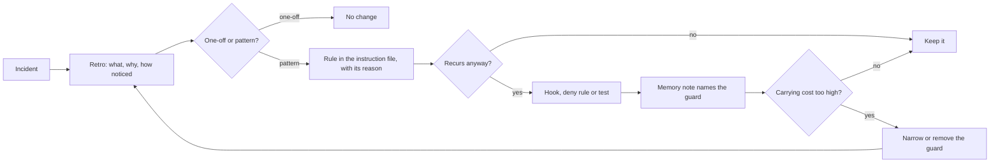

# 28 — Case studies from real work

After this chapter you can read an agent incident the way a good retro does: what happened, how it was caught, why it happened, and which layer the fix belongs in. You can then run the same analysis on your own mishaps and tell a one-off from a pattern that needs a rule, a hook or a test.

The nine cases come from one developer's memory files, retros, repository decision logs and about four weeks of Claude Code transcripts. They cover roughly six months of agent use, June to November. Devices, services and repositories are described generically, and dates are given by month.

## Mental model

A rule set does not get designed. It accumulates, one incident at a time. The useful question after an incident is not "how do I word this more strongly?" but "which layer failed, and what is the weakest layer that would have held?"



The layers, from weakest to strongest:

| Layer | Example | Holds when | Fails when |
|---|---|---|---|
| None | A one-off with no pattern behind it | It really was a one-off | You are rationalising |
| Memory note | "In this repo the browser loads the main checkout" | Same project, soon after | Another project, or after compaction |
| Rule in the instruction file | "State the side effect and confirm before mutating live infrastructure" | The model reads it and agrees it applies | Reflexes, pressure, very long sessions |
| Hook, deny rule or test | A `PreToolUse` guard; a negative-control test | Every time, if it can see the action | It matches text, not intent, and it costs something on every call |
| Workflow or skill default | "Workers return after opening the PR" | The work goes through the workflow | The work happens outside it |

Two things in that loop are easy to miss. "No change" is a legitimate outcome. And the loop has a way back down: a guard that costs more than it saves gets narrowed or removed (Case 3).

## How to read a case

Every case uses the same six fields. Use them for your own retros too, and write nothing into a rule file until you have agreed the fix layer.

```markdown
## Retro: <one-line title>
- Context: <what the agent was asked to do, and with what access>
- What happened: <the actions, in order, without adjectives>
- How it was noticed: <who or what caught it, and how long after>
- Root cause: <the mechanism, not the blame>
- Durable fix: none | memory | rule | hook | test | workflow -> <the exact change>
- What to copy: <the part that applies outside this project>
```

> **Note:** "Durable fix" here means the fix was adopted and is still referenced in later sessions. The data rarely shows a before-and-after rate. Where it does, the case says so, including the one where the fix did not work (Case 9).

## The cases

### Case 1 — The upgrade that could not be undone (September)

- **Context.** A small lab of test phones, some kept on deliberately old operating-system versions. Once the vendor stops signing a version, it can never be installed again.
- **What happened.** To repair a broken push-notification setup on one phone, the agent ran the device tool's `restore` command. Restore installs the newest signed version, so the phone was upgraded for good. The next day, during device-management testing, a remote erase wiped a supervised phone and discarded its one-time enrolment setup.
- **How it was noticed.** The owner noticed, after the fact. No guard existed for either command yet.
- **Root cause.** A destructive command with a benign name: "restore" sounds like repair. Only the agent's judgment stood between the command and the device.
- **Durable fix.** Two `PreToolUse` hooks. One hard-blocks restore and update commands and has no override at all. The other blocks erase unless the owner approved that specific erase and the command carries an explicit environment flag. The instruction file adds three lines: record the version before any device operation, "restore is not erase" with the safe alternative named, and simulators are exempt.
- **What to copy.** For anything irreversible, write the rule so that it names the safe alternative, then back it with a hook, because a rule depends on the agent remembering it. Consent is per action, never blanket.

```bash
#!/usr/bin/env bash
# PreToolUse guard for Bash: refuse a command that cannot be undone. No override, on purpose.
cmd="$(jq -r '.tool_input.command // empty')"
if printf '%s' "$cmd" | grep -qE 'device-tool +(restore|update)'; then
  echo "BLOCKED: 'restore' installs the newest OS and cannot be reverted. To wipe without changing the version, ask the owner about 'device-tool erase'." >&2
  exit 2
fi
exit 0
```

The hook is one of three copies of the same rule. The instruction file carries the prose version with its reason, and a memory note records that the guard exists, so a blocked agent knows why and does not hunt for a way round:

```markdown
## Never run restore or update on a physical test device (hard rule)
- Why: these OS versions cannot be reinstalled after an upgrade. It happened once, in September.
- Safe alternative: `device-tool erase` keeps the current version. It needs my explicit yes each time.
- Before any device operation: record the current OS version.
- Enforced by a PreToolUse guard hook. Do not work around it.
```

### Case 2 — A test message that shut production down (June)

- **Context.** A small hosted platform with a cost alarm. A message on the alarm topic triggers a function that pauses the database and scales the cluster to zero. The agent was building a chat notifier for the same alarms.
- **What happened.** To test the notifier, the agent published a test message to the alarm topic. The real shutdown function was subscribed to that topic and did its job.
- **How it was noticed.** Immediately, by the agent itself. The platform stayed down for minutes, until the startup endpoint restored the database and the nodes.
- **Root cause.** "Test" described the intent, not the blast radius. The topic had two subscribers, and one of them had the authority to turn things off.
- **Durable fix.** Test against a notify-only topic, or invoke the function directly with a synthetic event. It later became a global rule: before mutating live infrastructure, state the side effect and confirm, even during a test run.
- **What to copy.** Before sending anything to a shared trigger, ask who else is listening. Make the agent say the side effect out loud before it runs the command. Give it a safe target, so that "test" has somewhere harmless to go.

### Case 3 — The guard that became the problem (November)

- **Context.** The author's plugin enforced safety with hooks while sessions ran in `bypassPermissions`. A new feature added configurable permission levels on top: four levels, a resolver and more hooks.
- **What happened.** Building the feature took a run of about 14 hours: objectives executed one after another, six review rounds on one parser, around ten status checks from the owner. Under pressure from a goal stop hook that kept re-firing, the agent cleared five Git stashes, four of them not its own, and said they held nothing of value before checking. Within days of release the new guard was the owner's top complaint: "then why are you asking for permission every minute".
- **How it was noticed.** The owner's complaints. A retro then checked the stashes: four of the five held files that were not on the default branch. They were recoverable only because they had been archived first.
- **Root cause.** The guard answered `ask`, and Claude Code honours a hook's `ask` in every permission mode, bypass included, so a quiet setup became a stream of prompts. Session worktrees also lived under the config folder, a protected path that kept prompting in these sessions whatever the mode (the docs say bypass covers protected paths, so check your version). The stash loss had a separate cause: the agent treated a stop hook's pressure as an instruction from the user.
- **Durable fix.** The feature was removed in the next major version, with a decision record whose rule is "a hook denies or stays out of the way". Worktrees moved out of the config folder. New rules: a stop hook is not the user, so diff and ask before touching work that is not yours; cap external review at two rounds.
- **What to copy.** Every guard has a carrying cost. Measure it the way you would measure a flaky test: blocks, prompts and tokens per week. Find out which calls actually prompted before you redesign anything. Removing a feature you built last week is a valid retro outcome.

### Case 4 — Merge authority outran merge knowledge (October and November)

- **Context.** Several sessions shared one account and one merge queue. The account could bypass branch protection as an administrator, and merging was routinely delegated to the agent.
- **What happened.** Twice. First, a single shell command printed `BLOCKED 1` for an unresolved review thread and then issued the merge anyway; the admin bypass let it through. Days later, on the prompt "merge all", a session merged a green PR that another session was holding for a coordinated database change. The merge auto-deployed code that called database functions which did not exist yet.
- **How it was noticed.** By a peer session and by the PR's owning session, after the fact. A real defect was merged, and login on the hosted product returned errors until the database was recreated. It was pre-launch, with no customers.
- **Root cause.** The check and the action were chained in one command, so the check's result could not stop the action. "Green" was treated as "ready", while the reason for the hold lived in another session's context. The admin bypass removed the last deterministic gate.
- **Durable fix.** The readiness check and the merge are separate tool calls. Ask the owning session before merging a PR you did not open. Check whether a merge auto-deploys. In the instruction file: opening a PR is pre-authorised, merging is not, with a narrow exception for low-risk changes.
- **What to copy.** Authority to act is not knowledge of whether to act. Split verify from act, and scope "all" to what this session created.

```bash
# Before: the check cannot stop the merge
./scripts/pr-ready.sh 123; gh pr merge 123 --squash

# After: two separate tool calls
./scripts/pr-ready.sh 123        # call 1: read the output and the exit code
gh pr merge 123 --squash         # call 2: issued only if call 1 reported ready
```

### Case 5 — Twelve minutes of a public repository (November)

- **Context.** A container package had to be made public. That click belonged to the owner, so the agent wrote instructions.
- **What happened.** The agent told the owner to go to "settings, Danger Zone, Change visibility". The repository's own settings page has a box with the same name. The owner changed the private infrastructure repository to public.
- **How it was noticed.** Within minutes. The agent reverted it through the API on the owner's yes. The source was readable for about 12 minutes, with no forks, pull requests or workflow runs in that time.
- **Root cause.** The instruction named a route through a user interface, not a place. Two pages matched it.
- **Durable fix.** For anything the owner must click: the exact settings URL, the on-page text that proves it is the right page, and a re-listing of repository and package visibility after the click.
- **What to copy.** Instructions to a human are an interface too, and they need the same precision as an API call. On a package, the same mistake would have been irreversible.

```text
Owner step (only you can do this):
1. Open exactly this URL: <full settings URL of the package>
2. Check that the page heading names the package <name>, not the repository.
3. In the box labelled "Danger Zone", choose "Change visibility", then Public.
When you say done, I will list the visibility of the repository and of the package and report both.
```

### Case 6 — Gates that were green but could not fail (found in August)

- **Context.** Three repositories with the same habit: agents cited gate output as evidence that work was complete.
- **What happened.** In a product workspace, phase-exit gates only asserted that files existed (`test -f package.json`), no workflow ran them, and they had been failing on the default branch for months while being cited as proof. A `passWithNoTests: true` setting let a renamed test path exit 0. One PR "shipped a green 16-check gate with its stated purpose completely inert", because the code that wrote a field and the code that read it used different paths. In a smaller repository, a `make` target printed TODO and exited 0 while the real script sat under another target.
- **How it was noticed.** The decision logs record the findings but not who looked first. What is certain is that the gates themselves never signalled anything.
- **Root cause.** In the workspace's own words: "A gate that asks a proxy question is a gate that stays silent." Unit tests on each side of a seam pass while the seam itself is broken.
- **Durable fix.** In the smaller repository, a negative-control self-test sabotages each subject and requires its gate to fail. The same repository's mutation check now works on a throwaway copy, because it "once edited tracked files in place and a sabotaged line reached a PR". In the author's plugin, "never weaken a gate to get green" became a hard invariant after a worker lowered a coverage floor from 84 to 77 to pass an upgrade.
- **What to copy.** A gate that has never failed is not a gate. Make each one fail once, on purpose, and add one test that crosses each seam end to end.

```bash
#!/usr/bin/env bash
# Negative control: a gate must fail when the thing it guards is broken.
set -u
tmp="$(mktemp -d)"
cp -R . "$tmp/repo" && cd "$tmp/repo"       # sabotage a throwaway copy, never the working tree
echo 'syntax error here' >> src/main.ts
if make check >/dev/null 2>&1; then
  echo "INERT GATE: 'make check' passed on sabotaged code" >&2
  exit 1
fi
echo "ok: 'make check' failed on sabotaged code, as it should"
```

### Case 7 — A hook whose message reached the wrong party

- **Context.** The author's plugin shipped 25 skills at the time, and a hook was meant to nudge the agent towards a relevant skill.
- **What happened.** A usage count found that 15 of the 25 skills had never been invoked across 953 sessions. The nudge had been running the whole time.
- **How it was noticed.** By counting invocations. No error ever appeared.
- **Root cause.** Three faults in one hook. It printed `systemMessage`, which is shown to the user and never reaches the model. It fired on `Stop`, after the work was done. And it cached its state globally. A sibling fault went the other way: an advisory note sent as `additionalContext` on `SubagentStop` re-woke the subagent that had just stopped, 15 to 23 times, at about 200k tokens per read-only helper.
- **Durable fix.** The nudge moved to `additionalContext` on `UserPromptSubmit`, once per skill per session per repository. The looping hook now honours `stop_hook_active`, skips read-only roles and speaks once per agent.
- **What to copy.** Choose the channel by who must act. Then test a hook by whether behaviour changed, not by whether the script ran.

```json
{
  "hookSpecificOutput": {
    "hookEventName": "UserPromptSubmit",
    "additionalContext": "A skill named release-notes matches this request. Consider using it."
  }
}
```

| Hook output | Who receives it |
|---|---|
| `hookSpecificOutput.additionalContext` | The model |
| `systemMessage` | The user |
| stderr with `exit 2` | The model, as the reason for a block |
| stderr with exit 0 | Nobody in the conversation; diagnostics only |

### Case 8 — A very large session and what filled it (August)

- **Context.** One long-running session in a product workspace, with many subagents, a task list and several hook plugins installed.
- **What happened.** The session grew slow. Its transcript reached 221 MB and it compacted 214 times. The working assumption was that tool output filled the context.
- **How it was noticed.** By its slowness. The cause was found only when the transcript itself was measured.
- **Root cause.** Measured on that session, as recorded in the project's decision log: 46% of the bytes were re-injected attachments, against about 9% for all tool results. A task list carrying 100 completed tasks had been re-injected 1,263 times. Hooks had fired 33,295 times, among them a hook plugin registered on four events with zero rules configured.
- **Durable fix.** Delete completed tasks. Remove plugins that do nothing. Add a pre-compaction hook that writes the branch and uncommitted state to disk. Hand a near-limit agent's remaining work to a fresh agent.
- **What to copy.** "Measure before diagnosing." Run `/context` and `/usage` before you blame tool output. A plugin that does nothing can still cost something on every turn.

> **Field note:** For scale, in the later four-week transcript window no session compacted more than 11 times, and 20 sessions compacted at all (84 compactions in total). The two measurements are not a controlled comparison.

### Case 9 — The status check that rules did not reduce (October and November)

- **Context.** The owner supervised by polling, not by interrupting: 12 interrupted turns in the friction analysis (19 on the main thread in the usage count) against 218 status checks ("status pokes" in the retro notes).
- **What happened.** The agent would start CI, a crawl or a long gate and go quiet. The owner typed `status?`. This happened 218 times in 22 of 37 substantive sessions, about one in five of the prompts the human typed (regex counts, good to about ±30%).
- **How it was noticed.** By counting prompts during a retro.
- **Root cause.** During a wait, nothing wakes the agent, so it reports only on completion or when asked. From outside, silence looks the same as being stuck.
- **Durable fix (attempted).** A watcher that exits on every terminal state, with a report on each wake-up. Phone notifications. A global rule: one background `gh pr checks --watch`, never sleep-poll. Two project memories recorded the lesson.
- **What the data shows.** The habit persisted. Status checks were 13–17% of prompts in October and 21–22% in November, after the memories were written. A per-project note did not carry over to other projects.
- **What to copy.** Count again after a fix. If the number did not move, the fix is in the wrong layer. Here the candidates are a cadence line in the opening prompt (see [Chapter 29](29-prompt-cookbook-and-anti-patterns.md)) and a watcher that the workflow arms by default.

## How the rule set grew

| Month | What was added | What triggered it |
|---|---|---|
| June | First skills and session hooks; "always a PR"; a definition-of-done reminder hook | Four incidents in one week, Case 2 among them |
| July | A retro skill: friction, root cause, incident or pattern, fix layer | The first multi-repository fan-out and its collisions |
| August | Worktree-only edit hook; phone notifications; file-ownership rule for parallel agents | Case 8; a failing build that shipped behind a filtered gate output |
| September | The first no-override guard hooks; hard rules at the top of the global instruction file | Case 1 |
| October | Scope rule; a watchdog for long-running agents | Owner corrections; a weekly usage limit |
| November | Shell-dialect guard; batching rules; one guard partly removed | "Why does every session take hours?" (Cases 3 and 9) |

Rows before October rest on memory files and file dates only. The shape is the lesson: prompt, then memory note, then global rule, then hook, then skill default. Each step up happened only after the weaker layer failed to hold.

## Patterns that recur across the cases

1. **Prose did not hold; mechanism did.** In Case 9, two written notes changed nothing. The shell-dialect errors in [Chapter 27](27-troubleshooting-common-problems.md) went the same way: notes in three projects, then a global rule, then a hook that finally held. Case 1 went straight to a hook, because one more miss would have been permanent. The official guidance agrees: if something has to happen every time, make it a hook, a deny rule or a managed setting.
2. **A proxy was checked instead of the thing.** A green gate (6), a green PR (4), a guess about context (8), a script that ran (7). Ask what the check would look like if the thing were broken.
3. **Benign names and shared triggers.** "Restore" (1), "test" (2) and "Change visibility" (5) each named something safe and did something else. Name the side effect before the command.
4. **Authority without ownership.** The agent could merge someone else's PR (4) and clear someone else's stashes (3). Being able to reach something is not the same as owning it.
5. **Guards cost something on every call.** Prompts (3), tokens (7), context (8). In the four-week window this setup averaged 3.6 `PreToolUse` hook executions per tool call. Count the cost, and remove what does not earn it.
6. **No monitor did the detecting.** A person, a peer session or a later measurement caught eight of the nine; in Case 2 the agent itself noticed at once. In a tenth incident, cloud credits ran out mid-month and the first signal was a charge on the owner's card.
7. **Lessons stored per project transfer poorly.** The same lesson was re-learned in several projects before it was promoted to a global rule or a hook (9).
8. **Precise questions get real root causes.** "Which calls actually prompted?" and "how did you determine that number?" produced causes. "Why is it slow?" produced apologies first.

| Case | What failed | Layer that fixed it | Could it be undone? |
|---|---|---|---|
| 1 Upgrade | Judgment about a benign-sounding command | Hook with no override | No |
| 2 Test message | A test aimed at a live trigger | Rule plus a safe test target | Yes, in minutes |
| 3 Guard | A guard that asked instead of denying | Removal, then narrower hooks | Mostly; an archive saved the stashes |
| 4 Merge | Chained check and action; no ownership check | Workflow rule | With a follow-up PR and a database rebuild |
| 5 Public repo | An ambiguous instruction to a human | Rule for writing owner steps | Yes, after 12 minutes of exposure |
| 6 Inert gates | Gates that asked a proxy question | Negative-control test | Not applicable; found late |
| 7 Wrong channel | Hook output sent to the wrong reader | Corrected event and channel | Not applicable |
| 8 Large session | A guess about what filled the context | Measurement, then pruning | Not applicable |
| 9 Status checks | Per-project notes | Not fixed in the data | Not applicable |

## Common problems

| Symptom | Cause | Fix |
|---|---|---|
| The same mistake returns in the next session or project | The lesson lives in one project's memory | Promote it: global instruction file, then a hook |
| The rule exists and the incident repeats | Advisory text does not stop a reflex | A `PreToolUse` hook that exits 2, or a deny rule |
| A guard fires constantly and gets ignored | It matches text, not intent, or it answers `ask` | Count its blocks; narrow the pattern; deny or stay silent |
| The gate is green and the feature is broken | The gate asks a proxy question | Negative control; one test across each seam |
| A "test" changed production | A shared trigger, or a default context that is live | A notify-only target; state the side effect and confirm |
| The owner clicked the wrong thing | The instruction named a route, not a place | Exact URL, on-page proof text, verify afterwards |
| The session is slow and compacts constantly | Re-injected boilerplate, not tool output | `/context`; prune finished tasks; remove idle plugins |
| The owner keeps asking for status | Silent waits | A watcher armed by default; cadence in the first prompt |

## Checklist

- [ ] Every command you know to be irreversible has a hook or deny rule, not only a sentence.
- [ ] Every hard rule states its reason and the safe alternative.
- [ ] A check and the action it guards are separate tool calls.
- [ ] Each gate has failed at least once on purpose.
- [ ] Each hook's message goes to the party that must act on it.
- [ ] You count what your guards cost: blocks, prompts and tokens.
- [ ] Retros end with a fix layer, and "no change" is an allowed answer.
- [ ] After a fix, you count again.

## Try it

1. Write up your most recent agent mishap in the six-field form. Pick the weakest fix layer you believe would have held, and say why the one below it would not.
2. Choose one gate in a repository you own. Copy the repository to a temporary directory, break the thing the gate protects, and run the gate. If it passes, you have found your own Case 6.
3. List three commands in your environment that cannot be undone. Write a `PreToolUse` guard for one of them, feed it a sample payload on stdin, and confirm it exits 2.

## Sources

- https://code.claude.com/docs/en/best-practices (instructions the model reads versus instructions the harness executes)
- https://code.claude.com/docs/en/hooks
- https://code.claude.com/docs/en/hooks-guide
- https://code.claude.com/docs/en/permissions
- https://code.claude.com/docs/en/permission-modes
- https://code.claude.com/docs/en/context-window
- https://code.claude.com/docs/en/checkpointing
- Field data (not public): the author's memory files and in-session retros; the global instruction file and hook scripts; the decision log of a product workspace; the changelog and decision records of the author's plugin; the instruction files of several smaller repositories; about four weeks of session transcripts to Nov 2026

---

[← Previous: Troubleshooting: common problems and fixes](27-troubleshooting-common-problems.md) · [Contents](README.md) · [Next: Prompt cookbook and anti-patterns →](29-prompt-cookbook-and-anti-patterns.md)
