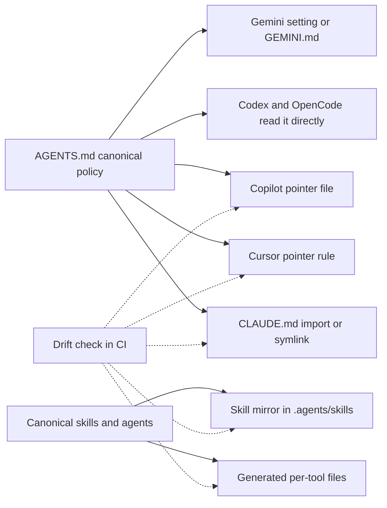
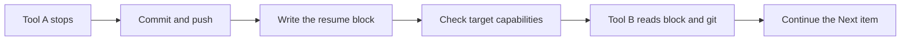

# 28 — One repo, many agents: AGENTS.md and cross-tool setups

After this chapter you can set up one repository so that Claude Code, Cursor, Codex CLI, Gemini CLI, OpenCode and GitHub Copilot all work from the same rules, and prove in CI that they still do. You will also know which parts of an agent setup port between tools and which do not, and how to move a half-finished task from one tool to another without losing it.

## Mental model

Every coding agent loads a project instruction file when a session starts. The file names, the load order and the extension points differ per tool. If you write the rules once per tool, the copies drift apart, and each agent ends up working to a slightly different policy without anyone noticing.

The fix is one **canonical source** and thin **adapters**. Policy lives in `AGENTS.md`. Every other instruction file is either a pointer to it, a line or two long, or a generated file that CI can regenerate and compare. Where a tool lacks a capability, you write down the fallback instead of pretending. The author's repositories state the aim as "capability parity, not file parity".



## What `AGENTS.md` specifies

`AGENTS.md` is "a simple, open format for guiding coding agents": plain Markdown with no schema and no required fields. The site says "Use any headings you like; the agent simply parses the text you provide."

- **Placement.** One file at the repository root; in a monorepo, another inside each package.
- **Precedence, as the format states it.** "The closest AGENTS.md to the edited file wins; explicit user chat prompts override everything."
- **Commands.** Agents run the test commands you list in the file.
- **Governance.** It is "stewarded by the Agentic AI Foundation under the Linux Foundation". The site's own adoption figure is "over 60k open-source projects".
- **Readers named on the site** include Codex, Cursor, Gemini CLI, opencode, the GitHub Copilot coding agent, Aider, Zed and Windsurf. Claude Code was not on that list when checked on 2026-11-25, but its own docs document native reading (next section).

A workable section set, taken from the template the author uses across 16 repositories:

```markdown
# AGENTS.md
## Overview                  <!-- what this repo is, in three lines -->
## Layout                    <!-- where things live -->
## Commands                  <!-- table: install, lint, test, the gate command -->
## Conventions
## Architecture invariants
## Branch, commit and PR rules
## Off limits                <!-- what an agent must never touch -->
## Key files
```

Keep it lean, because every tool loads it into every session. [Chapter 8](08-claude-md-and-memory.md) covers what belongs in an instruction file at all.

## How Claude Code reads `AGENTS.md`

Most older tutorials say Claude Code ignores `AGENTS.md`. Since v2.1.277 it reads the file natively, with rules worth knowing:

- **The default is either/or.** "By default, Claude reads `AGENTS.md` only when you have no `CLAUDE.md` in your working directory or above it." A `CLAUDE.md`, `.claude/CLAUDE.md` or `CLAUDE.local.md` on that path suppresses it. Your `~/.claude/CLAUDE.md`, a managed `CLAUDE.md` and `.claude/rules/` keep loading alongside it.
- **A setting changes that.** `/config`, then **Project instructions**: `claude-md-or-agents-md` (default), `claude-md-and-agents-md` (both, each directory's `CLAUDE.md` first, no double load), `claude-md`, or `managed-only`.
- **Nested files load on demand.** A subdirectory's `AGENTS.md` loads when Claude reads a file there and that directory has no `CLAUDE.md` of its own. `@path` imports inside `AGENTS.md` are expanded.
- **Not read:** `AGENTS.local.md`, `AGENTS.override.md`, or anything under a `.agents/` directory.
- **Two differences from `CLAUDE.md`.** `InstructionsLoaded` hooks do not fire for an `AGENTS.md` read through the setting, and `--add-dir` directories do not load theirs.
- **Check it.** Run `/memory` and look for the file's path in the list.

> **Warning:** Adding a `CLAUDE.local.md` for personal notes stops Claude Code from reading `AGENTS.md` under the default setting. And if you once used a `SessionStart` hook to print `AGENTS.md`, remove it: the file now loads twice.

## Six tools, one table

All facts below are from each vendor's docs as read on 2026-11-25; treat them as "as of Nov 2026". The last four columns are the extension points from Part III: skills ([chapter 15](15-skills.md)), hooks ([chapter 16](16-hooks.md)), MCP ([chapter 12](12-mcp-how-it-works.md)) and subagents ([chapter 14](14-subagents.md)).

| Tool | Instruction file | Scoping | Skills / commands | Hooks | MCP | Subagents |
|---|---|---|---|---|---|---|
| **Claude Code** | `CLAUDE.md` (+ `CLAUDE.local.md`); `AGENTS.md` natively (v2.1.277+) when no `CLAUDE.md` or `CLAUDE.local.md` is on the path | Managed → user → project → local; nested files on demand; `.claude/rules/*.md` with `paths:` globs | `.claude/skills/<name>/SKILL.md`, run as `/name` or auto-invoked; custom commands merged into skills | Settings-file hooks: `PreToolUse`, `PostToolUse`, `Stop`, `SessionStart`, ... | Local, project and user scopes | `.claude/agents/*.md`; built-in Explore and Plan; forks |
| **Cursor** | `.cursor/rules/*.mdc`; `AGENTS.md` in the root and subdirectories | `alwaysApply`, `globs`, `description`, or @-mention; Team → Project → User | `.cursor/skills/`, `.agents/skills/`; also loads `.claude/skills/` and `.codex/skills/` | `.cursor/hooks.json`, `~/.cursor/hooks.json`: `beforeShellExecution`, `afterFileEdit`, `preToolUse`, `stop`, ... | `.cursor/mcp.json`, `~/.cursor/mcp.json` | `.cursor/agents/` (also reads `.claude/agents/`) |
| **Codex CLI** | `AGENTS.md` (+ `AGENTS.override.md`) | `~/.codex`, then Git root → working directory; one file per directory; 32 KiB cap | `.agents/skills` (cwd, parent, repo root), `~/.agents/skills`; `/skills` or `$name` | `hooks.json`, or `[hooks]` in `config.toml` | `[mcp_servers.<name>]` in `config.toml`; `codex mcp add` | Built-in `default`, `worker`, `explorer`; custom TOML in `.codex/agents/` |
| **Gemini CLI** (consumer tiers: Antigravity CLI since 2026-06-18) | `GEMINI.md`; file name configurable to include `AGENTS.md`; Antigravity reads both | Global → workspace and parents → each accessed directory; all concatenated | `.gemini/skills/` or `.agents/skills/`; TOML commands in `.gemini/commands/` | `settings.json`: `BeforeTool`, `AfterTool`, `BeforeAgent`, `AfterAgent`, `SessionStart`, ... | `mcpServers` in `settings.json`; `gemini mcp add` | `.gemini/agents/*.md`; `@name` to force one |
| **OpenCode** | `AGENTS.md`; falls back to `CLAUDE.md` | Global plus every `AGENTS.md` up the tree, concatenated; `instructions` globs or URLs | `.opencode/skills`, plus `.claude/skills` and `.agents/skills`; Markdown commands in `.opencode/commands/` | No feature named "hooks" on the pages read; plugins in `.opencode/plugins/` can add them | `mcp.servers` with `type: local` or `remote` | Primary and subagent modes; `.opencode/agents/*.md` |
| **GitHub Copilot** | `.github/copilot-instructions.md`; `AGENTS.md` anywhere; or one root `CLAUDE.md` or `GEMINI.md` | `.github/instructions/*.instructions.md` with `applyTo` globs; nearest `AGENTS.md` wins | `.github/skills`, `.claude/skills`, `.agents/skills`; personal `~/.copilot/skills` | `.github/hooks/*.json`: `sessionStart`, `preToolUse`, `postToolUse`, `agentStop`, ... | Built-in GitHub MCP server; organization policy off by default | Custom agents (Markdown with a YAML profile) |

Details the table cannot hold:

- **Codex CLI** reads at most one file per directory (`AGENTS.override.md` first, then `AGENTS.md`) and "concatenates files from the root down", so text closer to your working directory wins by appearing later. It stops adding files at `project_doc_max_bytes`, 32 KiB by default.
- **Gemini CLI** concatenates every `GEMINI.md` it finds and sends the result with every prompt. For unpaid-tier and Google One users it "was replaced by Antigravity CLI on June 18th, 2026"; paid API-key and enterprise access is unchanged. Antigravity still reads `GEMINI.md`, also reads a project `AGENTS.md`, and moves workspace skills to `.agents/skills/`.
- **OpenCode** reads `CLAUDE.md` in any directory that has no `AGENTS.md`; where both exist, the `AGENTS.md` wins. It combines the files it finds and "does not resolve conflicts between them".
- **Cursor** ignores a plain `.md` file in `.cursor/rules`: "Project rules must use the `.mdc` extension."

> **Note:** Not confirmed on the pages read for this book, so check before you rely on them: OpenCode's hook event names, whether Cursor still loads a legacy `.cursorrules` file, the file path for Copilot custom agents, and a default for Codex subagent concurrency.

## What converges and what does not port

Three convergence points are real:

1. **`AGENTS.md`** can be read by all six tools: natively, as a fallback, or in Gemini CLI through the one-line `context.fileName` setting.
2. **`SKILL.md` folders** are a shared format. The Agent Skills spec says it "was originally developed by Anthropic, released as an open standard", and Cursor, Copilot and OpenCode load `.claude/skills/` explicitly. The standard requires `name` and `description`; "all fields optional" is true only inside Claude Code ([chapter 15](15-skills.md)).
3. **`.agents/skills/`** is emerging as the neutral skills directory (Codex, Cursor, Gemini and Antigravity, OpenCode, Copilot). Claude Code keeps skills in `.claude/skills/` and lists `.agents/` among the places it does not read for instructions, which is why cross-tool repositories keep both and check that they match.

Slash commands are also converging: they are being folded into skills in Claude Code, Cursor and Antigravity. The rest does not port:

| What | How the tools differ | What to do |
|---|---|---|
| Precedence | The format says the nearest file wins. Codex concatenates root-down, so later text wins. OpenCode concatenates and resolves nothing. Claude Code treats files as additive and "uses judgment to reconcile them" | Nested files add detail; they never contradict the root |
| Hook events | `PreToolUse` in Claude Code, `beforeShellExecution` in Cursor, `BeforeTool` in Gemini CLI, `preToolUse` in Copilot | One guard script, a thin registration per tool, and an honest statement of where it is enforced |
| Tool allowlists | The same list can mean "only these tools" in one format and "these, plus everything not mentioned" in another | Translate the meaning, emit explicit deny rules, test the result per tool |
| Skill auto-invocation | In the author's plugin, triggering from a skill's description was measured as reliable only on Claude Code | Name the skill in `AGENTS.md` at the moment it applies |
| Skill discovery | Measured in the same repo: one tool finds skills one level deep and follows symlinks, another recurses | Treat the install layout as something you measure per tool |

## The canonical-source pattern

1. **Write policy once, in `AGENTS.md`.**
2. **Point Claude Code at it.** Either a `CLAUDE.md` whose first line is `@AGENTS.md`, followed by Claude-only addenda, or `ln -s AGENTS.md CLAUDE.md`. A symlink cannot drift, but Edit and Write "refuse to write through a symlink" (Claude is told to edit `AGENTS.md` instead), and on Windows Git can check a committed symlink out as a plain text file. Use the import if anyone works on Windows or you need Claude-only lines.
3. **Give every other tool a pointer, not a copy** (table below).
4. **Mirror skills** from `.claude/skills/` to `.agents/skills/` and check that the two trees are identical.
5. **Generate what cannot be a pointer**, such as per-tool agent definitions, command stubs and hook registrations. Commit the output and give the generator a `--check` mode.
6. **Fail CI on drift**, and prove once that the check can fail.

| Tool | Adapter | What it contains |
|---|---|---|
| Claude Code | `CLAUDE.md` | `@AGENTS.md` plus addenda, or a symlink |
| Cursor | `.cursor/rules/000-project.mdc` | `alwaysApply: true` and one line pointing at `AGENTS.md` |
| GitHub Copilot | `.github/copilot-instructions.md` | A short pointer back to `AGENTS.md` |
| Codex CLI | `.codex/config.toml` | CLI overrides only, such as `project_doc_max_bytes = 32768`; no policy |
| Gemini CLI | `.gemini/settings.json` | `{ "context": { "fileName": "AGENTS.md" } }` |
| OpenCode | none needed | Optional `instructions` array in `opencode.json` for extra files |

Cursor and Copilot now read `AGENTS.md` themselves, so their pointer files are optional. Keep one only when you need a tool-specific line, and keep it a pointer. The two adapters most repositories need look like this (`CLAUDE.md` first, then the Cursor rule):

```markdown
@AGENTS.md

## Claude Code addenda
- Use the `run-app` skill to start the dev server.
```

```markdown
---
description: Project policy pointer
alwaysApply: true
---
See @AGENTS.md for all project rules. This file deliberately does not restate them.
```

A drift check is a short script. Save this one as `scripts/check-agent-drift.sh`. It was run against a clean fixture (exit 0) and a fixture with three planted problems (exit 1, three `DRIFT:` lines):

```bash
#!/usr/bin/env bash
# Fail when an adapter stops pointing at AGENTS.md or the skill mirror differs.
set -euo pipefail
fail=0
err() { echo "DRIFT: $*" >&2; fail=1; }

[ -f AGENTS.md ] || err "AGENTS.md is missing"
for f in CLAUDE.md .github/copilot-instructions.md .cursor/rules/000-project.mdc; do
  if [ -L "$f" ]; then
    [ "$(readlink "$f")" = "AGENTS.md" ] || err "$f is a symlink to something else"
  elif [ ! -f "$f" ]; then
    err "$f is missing"
  elif ! grep -q 'AGENTS\.md' "$f"; then
    err "$f does not reference AGENTS.md"
  fi
done
if find .cursor/rules -name '*.md' 2>/dev/null | grep -q .; then
  err ".cursor/rules contains .md files (Cursor only loads .mdc)"
fi
if [ -d .agents/skills ] && ! diff -r .claude/skills .agents/skills >/dev/null; then
  err ".claude/skills and .agents/skills differ"
fi
exit "$fail"
```

The loop treats all three adapters as required; if you dropped an optional pointer file, remove it from the `for` list. Then add a job under `jobs:` in your CI workflow:

```yaml
  agent-drift:
    runs-on: ubuntu-latest
    permissions:
      contents: read
    steps:
      - uses: actions/checkout@d23441a48e516b6c34aea4fa41551a30e30af803 # v6.1.0
      - run: bash scripts/check-agent-drift.sh
      # Only if you generate adapters (step 5); "generate" stands for your own target.
      - run: make generate && git diff --exit-code
```

The check has a limit that the field version states in its own comments: it "proves the pointer exists, not that the surrounding prose is still true — which is exactly why the adapter must stay thin".

For generated files, the author's plugin follows one contract: the output is committed; it starts with a `GENERATED FILE — DO NOT EDIT` header that names the source, the generator and the command to regenerate; the generator has a `--check` mode that regenerates into a temporary directory and diffs; and a test plants drift to prove the check fails. A generated command stub there is itself only a pointer: "read `skills/toolkit/retro/SKILL.md` and follow it exactly — it is authoritative and this command deliberately does not restate it."

Going the other way, Claude Code's `/init` folds existing Cursor rules and `.github/copilot-instructions.md` into a new `CLAUDE.md`, and `/import` brings in another agent's instructions, MCP servers, commands, subagents and skills.

## A capability registry

Pointer files answer "what are the rules". A registry answers "what can this tool actually do here". It is one JSON file that records, per tool and capability, a `status` (`native`, `adapter`, `emulated`, `partial`, `unknown` or `unsupported`), a `last_verified` date, `notes` and a `fallback`. This is a convention from the author's repositories, not a standard format. The entry below is an illustration with a simplified shape; the real file nests one level deeper (tool, then *surface*, meaning one product of that vendor such as its CLI, then capability):

```json
{
  "<tool>": {
    "subagents": {
      "status": "unsupported",
      "last_verified": "YYYY-MM-DD",
      "notes": "what was tested, and how",
      "fallback": "Run the role inline in the main session, sequentially, with a narrowed scope"
    }
  }
}
```

Two rules make it useful. `unknown` counts as absent: "an unverified capability is not a capability". And every capability has a written degradation line, one sentence that says what to do when it is missing, so a gap produces "a stated fallback or an explicit 'unsupported'". Skills then declare `capabilities.required` and `capabilities.optional`, so a skill either degrades in a stated way or says it is unsupported.

The registry in the author's plugin held these values for each tool's primary surface when it was read on 2026-11-25:

| Capability | Claude Code | Codex | Cursor | Gemini | OpenCode |
|---|---|---|---|---|---|
| `skills` | native | native | native | adapter | native |
| `skill_auto_invocation` | native | unknown | partial | unknown | unknown |
| `subagents` | native | unknown | native | adapter | adapter |
| `parallel_subagents` | native | unknown | partial | unsupported | unknown |
| `hooks` | native | native | partial | unknown | adapter |
| `mcp` | native | native | native | native | native |
| `worktree_isolation` | native | emulated | emulated | emulated | emulated |

> **Note:** This is what one maintainer had verified in one repository, not a vendor comparison. `unknown` means "not tested here": the Codex docs do describe subagents, for example. The value of the table is that it never claims more than was checked.

## Handing a task to another tool mid-flight

You switch tools mid-task because a usage limit ended the turn, or because another tool suits the next step. The conversation does not come with you. Git does, and so does anything you wrote down.



1. **Commit and push.** The next agent can only see pushed work.
2. **Write a resume block** in a file under a gitignored state directory, or in the issue if other people need to see it.
3. **Check the target tool's registry row** and name any degradation in the note, for example "no parallel subagents: run the remaining tasks sequentially".
4. **Start the new tool with a resume prompt:** read the block, continue the **Next** item, do not redo anything under **Done**.
5. **If the note and git disagree, git wins.** Say which one you used.

In the author's setup a hook also writes a minimal resume record (branch, number of uncommitted files, next command) whenever a rate limit ends a turn, so a note exists even when nobody had time to write one.

There is no standard format for this note. As one example, this is the block the author's handoff skill writes, trimmed (the full template also has **Objective** and **Task** lines) and filled with made-up values:

```markdown
## Resume
- **Done:** token validation middleware and its unit tests
- **Next:** wire the middleware into the three admin routes
- **Decisions:** used library A over library B (maintained, ESM-native)
- **Blocked:** none
- **Branch:** feat/auth-middleware
- **Worktree:** .agent-worktrees/auth/task-002
- **Last agent:** claude, 2026-11-25T14:10Z
```

**Next** is one concrete action, not a plan. **Decisions** is the field that matters most, because choices and their reasons are exactly what a session's context loses. The tool name is metadata: it never goes into a branch name or a worktree path, so the same branch works from any tool. [Chapter 26](26-multi-agent-orchestration.md) uses the same idea for handoffs between agents inside one tool.

## From the field

**One policy file, a symlink and a 123-line check.** A product workspace keeps a 511-line `AGENTS.md` as its canonical cross-repo policy. `CLAUDE.md` is a symlink to it, the Copilot adapter is 15 lines, the Cursor pointer rule 10, and `.codex/config.toml` holds 13 lines of CLI overrides. CI runs a 123-line drift script that also fails when `.cursor/rules/` contains a `.md` file and when the two skill trees differ. The survey still found drift the script could not see. The README, the contributing guide and the PR template all told agents to run a `make` target that the Makefile did not have (`No rule to make target`). And an AI pull-request reviewer had been given a stale Copilot instruction file that contradicted a hard rule, because "the drift check AGENTS.md advertised did not exist". That one was fixed together with a negative-control test of the new check: a test that plants drift and expects the check to fail.

**A translated allowlist that granted write access.** The author's plugin supports five tools from one source: agent definitions become TOML for one tool and Markdown for two others, skills become command stubs and flat symlink mirrors, and each generator has a `--check` mode. One generator copied the canonical `tools:` allowlist into another tool's format. There, unlisted tools stayed enabled, so the copy "silently handed a read-only reviewer write access". The generator now emits explicit `deny` rules, and the lesson is recorded as "translate meaning, not syntax". The same repo states its hook support honestly: "enforced on Claude Code and Cursor; documented and CI-checked everywhere else".

**The same template in 16 of 17 project directories.** `AGENTS.md` holds policy; `CLAUDE.md` starts with `@AGENTS.md` and adds 1 to 29 lines of Claude-only notes (one outlier has 60); a Cursor pointer rule exists in 15 of them; `.claude/skills/` and `.agents/skills/` are identical copies checked by a make target. One commit message shows the rule in use: "fix(agents): make the Cursor pointer rule point, not restate".

## Common problems

| Symptom | Cause | Fix |
|---|---|---|
| Claude Code ignores `AGENTS.md` | A `CLAUDE.md` or `CLAUDE.local.md` is on the path (default is either/or), or the version is older than v2.1.277 | Import it with `@AGENTS.md`, or set **Project instructions** to `claude-md-and-agents-md`; confirm with `/memory` |
| Cursor ignores a rule file | It has a `.md` extension in `.cursor/rules` | Rename to `.mdc`; let the drift check reject `.md` there |
| A read-only reviewer can edit files on another tool | The allowlist was translated by syntax and unlisted tools stayed enabled | Emit explicit deny rules; test the role on each tool |
| Codex misses nested instructions | The combined files hit the 32 KiB `project_doc_max_bytes` cap | Shorten the files, or raise the cap in `.codex/config.toml` |
| Two tools follow different rules in one directory | Precedence differs, and a nested file contradicts the root | Rewrite nested files so they only add detail |
| A pointer file gives outdated advice | It restated policy and nobody updated the copy | Reduce it to a pointer; add the drift check |
| A guard works in one tool and not in another | Hook event names and registration files are not portable | One script, one registration per tool, and a written support statement |
| The second tool redoes finished work after a switch | No written state, or commits were not pushed | Push first; write a resume block with **Done** and one **Next** |

## Checklist

- [ ] `AGENTS.md` exists at the root and holds the policy; no other file restates it.
- [ ] `CLAUDE.md` is `@AGENTS.md` plus addenda, or a symlink, and `/memory` shows what loaded.
- [ ] Every other adapter is a pointer or a generated file with a `DO NOT EDIT` header.
- [ ] Nested instruction files add detail and never contradict the root.
- [ ] A drift check runs in CI and has been seen to fail on planted drift.
- [ ] Skills are mirrored to `.agents/skills/` and the mirror is checked.
- [ ] A capability registry records a status and a fallback per tool; `unknown` is treated as absent.
- [ ] Tool permissions were translated by meaning and tested on each tool.

## Try it

1. In a repository with an `AGENTS.md`, create a `CLAUDE.md` that contains only `@AGENTS.md`, start Claude Code and run `/memory`. Then remove `CLAUDE.md`, restart, and check that `AGENTS.md` loads directly. Add a one-line `CLAUDE.local.md` and check again.
2. Add the drift script and the CI job. Plant drift by replacing the Cursor pointer with three restated rules, and confirm the job fails before you fix it.
3. Stop a task halfway, write a resume block, open a second tool (or a fresh session), and give it only the resume prompt. Check that it continues at **Next** and leaves **Done** alone.

## Sources

- AGENTS.md: https://agents.md/ and https://github.com/agentsmd/agents.md
- Claude Code: https://code.claude.com/docs/en/memory, https://code.claude.com/docs/en/features-overview, https://code.claude.com/docs/en/skills, https://code.claude.com/docs/en/hooks, https://code.claude.com/docs/en/sub-agents
- Cursor: https://cursor.com/docs/rules, https://cursor.com/docs/skills, https://cursor.com/docs/hooks, https://cursor.com/docs/mcp, https://cursor.com/docs/subagents
- Codex CLI: https://learn.chatgpt.com/docs/agent-configuration/agents-md, https://learn.chatgpt.com/docs/config-file/config-basic, https://learn.chatgpt.com/docs/build-skills, https://learn.chatgpt.com/docs/hooks, https://learn.chatgpt.com/docs/agent-configuration/subagents
- Gemini CLI and Antigravity: https://geminicli.com/docs/cli/gemini-md/, https://geminicli.com/docs/cli/skills/, https://geminicli.com/docs/hooks/, https://geminicli.com/docs/core/subagents/, https://antigravity.google/docs/cli/gcli-migration, https://developers.googleblog.com/an-important-update-transitioning-gemini-cli-to-antigravity-cli/
- OpenCode: https://opencode.ai/docs/instructions/, https://opencode.ai/docs/config/, https://opencode.ai/docs/skills/, https://opencode.ai/docs/plugins/, https://opencode.ai/docs/mcp-servers/, https://opencode.ai/docs/agents/
- GitHub Copilot: https://docs.github.com/en/copilot/how-tos/copilot-on-github/customize-copilot/add-custom-instructions/add-repository-instructions, https://docs.github.com/en/copilot/concepts/customizations/agent-skills, https://docs.github.com/en/copilot/concepts/customizations/hooks, https://docs.github.com/en/copilot/concepts/customizations/mcp
- Agent Skills standard: https://agentskills.io/home and https://agentskills.io/specification
- Field data: the author's plugin repo (generated adapters, capability registry, handoff skill), a product workspace's instruction files and drift script, and a template shared by 16 smaller repositories, read on 2026-11-25.

---

[← Previous: Headless mode, CI and the Agent SDK](27-headless-ci-and-the-agent-sdk.md) · [Contents](README.md) · [Next: Security and guardrails →](29-security-and-guardrails.md)
