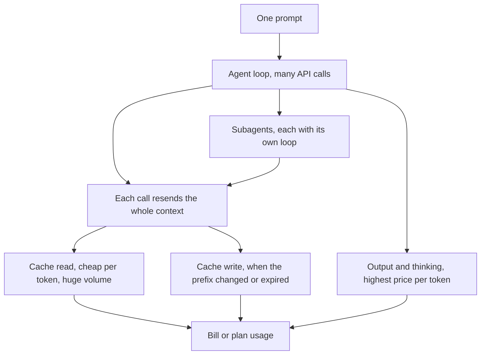
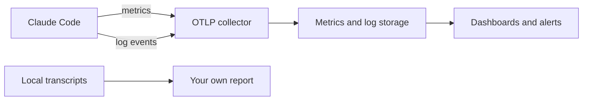
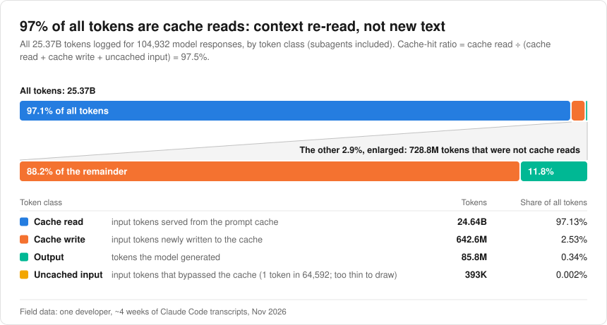
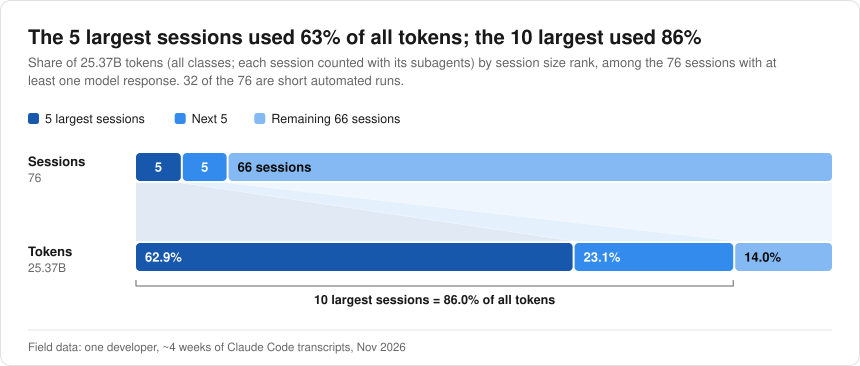

# 30 — Cost, usage and observability

After this chapter you can say what a session cost and why, pick a model and effort level per task, and tell which limit you hit when work stops. You can also export usage with OpenTelemetry, build a report from your own transcripts, and run a monthly review that finds the few sessions that matter.

## Mental model

You do not pay per prompt. You pay per **API call**, and one prompt starts a loop of many calls (see [The agentic loop and tool use](03-the-agentic-loop-and-tool-use.md)). Every call carries the whole conversation so far. The docs say it plainly: ["Claude Code sends your full conversation with every request"](https://code.claude.com/docs/en/costs).

So the bill has three parts:

1. **Re-reading the context.** Most of it comes from the prompt cache at a small fraction of the input price, but it is re-read on every call, so the volume is enormous.
2. **Writing the cache.** Whenever the start of the conversation changes or the cache expires, the context is written again at more than the normal input price.
3. **Output and thinking.** The fewest tokens and the highest price per token. ["Thinking tokens are billed as output tokens"](https://code.claude.com/docs/en/costs).



Two consequences shape everything below. A long conversation makes *every later call* dearer, not just the next one. And anything that sits in the context on every turn (instruction files, skill descriptions, hook reminders) is paid for on every call of every session.

The mechanics of caching and compaction are in [Prompt caching, compaction and cost](04-prompt-caching-compaction-and-cost.md). This chapter is about measuring and steering.

## See it: the commands that report cost

| Where | What you get | Notes |
|---|---|---|
| `/usage` | ["Show session cost, plan usage limits, and activity stats"](https://code.claude.com/docs/en/commands). `/cost` and `/stats` are aliases | The dollar figure is computed locally ["from token counts at list price"](https://code.claude.com/docs/en/costs). Totals reset on `/clear` |
| `/usage`, subscription | Plan usage bars plus an attribution breakdown by skills, subagents, plugins and MCP servers, with recommendations | The Session cost block ["is intended for API users"](https://code.claude.com/docs/en/costs) |
| `/usage`, cache line | A `Prompt cache (main)` line with [a likely cause when the cache missed](https://code.claude.com/docs/en/prompt-caching) | First place to look after a surprisingly slow or costly turn. It covers the main conversation only, not subagents |
| `/context` or `/context all` | ["Visualize current context usage as a colored grid"](https://code.claude.com/docs/en/commands) | Also suggests fixes for context-heavy tools and memory bloat; `all` expands the per-item breakdown |
| `claude -p … --output-format json` | `total_cost_usd` and [a per-model cost breakdown](https://code.claude.com/docs/en/headless) in the result | Both are client-side estimates. See [chapter 27](27-headless-ci-and-the-agent-sdk.md) |
| Organisation views | Teams and Enterprise spend report; Console workspaces and the Claude Code Analytics API; [OpenTelemetry](https://code.claude.com/docs/en/monitoring-usage) | For anything beyond one person |

A baseline to compare yourself against, from [the costs page](https://code.claude.com/docs/en/costs) as of Nov 2026: "around $13 per developer per active day and $150-250 per developer per month, with costs remaining below $30 per active day for 90% of users".

> **Note:** On a subscription the dollar figure is an estimate of what the tokens would cost at API list prices. It is not a bill. It is still the best single number for comparing one session with another.

## What drives spend

| Driver | Why it costs | How to see it | Lever |
|---|---|---|---|
| Context length | [The full history is resent on every call](https://code.claude.com/docs/en/costs) | `/context`; total tokens in `/usage` | `/clear` between unrelated tasks ("`/clear` costs nothing"); `/compact <focus>` |
| Cache misses | [A cache write costs 1.25x the input price](https://platform.claude.com/docs/en/build-with-claude/prompt-caching) (5-minute cache) or 2x (1-hour cache); a read costs 0.1x on most models | `Prompt cache (main)` line in `/usage` | Avoid the invalidators below; do not leave a huge session idle and then ask a one-line question |
| Output and thinking | [Output costs five times the input price](https://platform.claude.com/docs/en/about-claude/pricing) on every current model; thinking is on by default | Output tokens per session | Lower `/effort`; ask for a diff or a summary, not a full file |
| Subagent fan-out (one session launching many subagents) | Each subagent runs its own loop with its own context and cache | Attribution in `/usage` | Fewer, well-scoped subagents; a cheaper model for simple ones |
| Verbose tool output | A 5,000-line test log is re-read on every later call | `/context` | Trim output before it enters context; delegate noisy work to a subagent |
| Always-on boilerplate | Instruction files, the name and description of every enabled skill and agent, and text hooks inject are in context on every turn | `/context all`; attribution by plugin | Short `CLAUDE.md`; path-scoped rules; disable unused plugins and MCP servers |
| Idle spend | `/loop` tasks, messages from other sessions and background agents keep making calls | Activity in `/usage` | Stop loops you no longer need |

**Cache lifetime.** As of Nov 2026 [the docs give the prompt cache](https://code.claude.com/docs/en/best-practices) about "an hour on a subscription and five minutes on an API key, cloud provider, or usage credits. Subagents get five minutes unless you change it." A break longer than that means the next call rewrites the whole context.

**Cache invalidators.** The [prompt-caching page](https://code.claude.com/docs/en/prompt-caching) lists actions that discard the cache mid-session: "Switching models", "Changing effort level", "Connecting or removing an MCP server", "Compacting the conversation" and "Upgrading Claude Code". Each is fine at the start of a task and expensive in the middle of a long one. `/compact` is itself ["a large request"](https://code.claude.com/docs/en/costs).

**Fan-out multipliers.** [Anthropic's figures](https://www.anthropic.com/research/multi-agent-research-system): agents use "about 4× more tokens than chat interactions, and multi-agent systems use about 15× more tokens than chats"; agent teams (several full sessions working as teammates, see [Multi-agent orchestration](26-multi-agent-orchestration.md)) use ["approximately 7x more tokens than standard sessions when teammates run in plan mode"](https://code.claude.com/docs/en/costs). [The best-practices page](https://code.claude.com/docs/en/best-practices) is blunt about what you buy: "You get parallelism or a fresh pair of eyes out of it, but not a smarter answer."

## Reduce it: the documented list

These come from [the Claude Code costs page](https://code.claude.com/docs/en/costs). None needs a tool you do not already have.

1. **`/clear` between unrelated tasks.** A focused context is cheaper and gives better answers.
2. **`/compact` with a focus**, for example `/compact Focus on code samples and API usage`, and add a `# Compact instructions` section to `CLAUDE.md` so automatic compaction keeps the right things.
3. **Keep `CLAUDE.md` short.** ["Aim to keep CLAUDE.md under 200 lines."](https://code.claude.com/docs/en/costs) Move procedures into skills, which load only when used, and path-specific rules into `.claude/rules/` with a `paths:` filter (that last tip is from the memory page; see [CLAUDE.md and memory](08-claude-md-and-memory.md)).
4. **Prefer CLI tools** (`gh`, `aws`, `gcloud`) over MCP servers where both exist, and disable unused servers in `/mcp`.
5. **Pre-filter noisy output** with a hook, so a failing test run contributes the failures and not the whole log.
6. **Install code-intelligence plugins**, which report type errors after edits instead of leaving Claude to discover them by running things.
7. **Delegate verbose work to subagents** so the noise stays out of the main context. This saves main-thread context, not total tokens.
8. **Write specific prompts, plan first, interrupt early.** A wrong direction caught in the first minute costs one minute.
9. **Lower `/effort`.** `MAX_THINKING_TOKENS=8000` [helps only on older models with a fixed thinking budget](https://code.claude.com/docs/en/costs); the current models reason adaptively, so effort is the control.

A compact-instructions block for step 2. The heading is the documented hook; the wording is yours:

```markdown
# Compact instructions
When compacting, keep the current plan, the list of changed files, failing test names and open questions.
Drop tool output and file contents that can be re-read from disk.
```

## Choose a model and an effort level per task

**Effort** is a setting (`low`, `medium`, `high`, `xhigh`, `max`) that [steers how many tokens Claude spends](https://platform.claude.com/docs/en/build-with-claude/effort) on a response, thinking included; see [Thinking and effort](04-prompt-caching-compaction-and-cost.md). Prices below are per million tokens, as published on 2026-11-25. [Check the pricing page](https://platform.claude.com/docs/en/about-claude/pricing) before you budget.

| Model | Input | Output | 5-min cache write | 1-hour cache write | Cache read | API default effort |
|---|--:|--:|--:|--:|--:|---|
| Claude Fable 5.2 | $8 | $40 | $10 | $16 | $0.20 | `high` |
| Claude Opus 5.5 | $4 | $20 | $5 | $8 | $0.20 | `medium` |
| Claude Sonnet 5.5 | $2 | $10 | $2.50 | $4 | $0.10 | `high` |
| Claude Haiku 5.5, prompt up to 100,000 tokens | $0.10 | $0.50 | $0.125 | $0.20 | $0.01 | `medium` |
| Claude Haiku 5.5, prompt over 100,000 tokens | $0.50 | $2.50 | $0.625 | $1 | $0.05 | |

Three things in that table are easy to miss. [Cache reads are discounted by a different factor per model](https://platform.claude.com/docs/en/about-claude/pricing) (0.025x on Fable 5.2, 0.05x on Opus 5.5 and Sonnet 5.5, 0.1x on Haiku 5.5). Haiku 5.5 costs five times more once a request's prompt passes 100,000 tokens, and cache reads count toward that length. And [the effort column is the API's default](https://platform.claude.com/docs/en/models/overview): Opus 5.5 runs at `medium` there, one level lower than earlier Opus models, while Claude Code itself starts all four current models at `medium` (as of Nov 2026).

**Tiering** means matching the model and effort to the task instead of using one setting for everything.

| Task | Reasonable setting | Why |
|---|---|---|
| Lookups, log summaries, simple search subagents | Haiku 5.5 with a small context, or `low` effort | The docs' use for `low`: ["Simpler tasks that need the best speed and lowest costs, such as subagents"](https://platform.claude.com/docs/en/build-with-claude/effort) |
| Everyday implementation, tests, refactors | Sonnet 5.5, or Opus 5.5 at its default | See the note below |
| Architecture, hard debugging, security review | Opus 5.5 at `high`, or Fable 5.2 at `high` | [Fable guidance](https://platform.claude.com/docs/en/build-with-claude/effort): "Start with `high`. Most of the gain in capability is already present at `high`" |
| Unattended multi-hour objectives | `xhigh` | Described as for long-running agentic tasks ["with token budgets in the millions"](https://platform.claude.com/docs/en/build-with-claude/effort) |

> **Note:** The official pages disagree on the default. [The Claude Code costs page](https://code.claude.com/docs/en/costs) recommends Sonnet for most work and `model: haiku` for simple subagents. The API models page says ["start with Claude Opus 5.5 for most workloads"](https://platform.claude.com/docs/en/models/overview). The API's model-selection guide adds a method that fits either default: ["Tuning effort is often a better lever than switching models."](https://platform.claude.com/docs/en/about-claude/models/choosing-a-model)

How to set it:

- In a session: `/model` and `/effort high` (or `low`, `xhigh`). "Save `max` for [a hard problem you want Claude to work through without you](https://code.claude.com/docs/en/best-practices)."
- As defaults: the `model`, `effortLevel` and `modelSettings` keys in `settings.json`. These are read only at session start.
- For subagents: a `model` field in the agent definition, or the `CLAUDE_CODE_SUBAGENT_MODEL` environment [variable](https://code.claude.com/docs/en/env-vars) as the fallback.
- Choose at the start of a task. Switching model or effort mid-session [discards the prompt cache](https://code.claude.com/docs/en/prompt-caching).

A subagent pinned to the cheap tier, saved as `.claude/agents/log-summariser.md`:

```markdown
---
name: log-summariser
description: Summarises long test or build logs. Use for any log longer than one screen.
tools: Read, Grep, Glob
model: haiku
---
Return the failing test names and the first error line for each. Nothing else.
```

## Rate limits and usage caps

Work can stop for four different reasons. Know which one you hit before you change anything. The limits below are as documented in Nov 2026.

| What you see | What it is | What to do |
|---|---|---|
| A usage-limit message on a subscription | Seat allowances reset on ["a rolling five-hour window and a weekly window"](https://code.claude.com/docs/en/costs). ["The session and weekly limits are shared across all models"](https://code.claude.com/docs/en/errors) | Wait for the reset, or reduce fan-out. Switching model does not open a second allowance |
| `429` on an API key | The rate limit configured for your API key or cloud project | The costs page gives [per-user guidance](https://code.claude.com/docs/en/costs) by team size, from 200k-300k tokens per minute for 1-5 users down to 10k-15k for 500+ |
| `529 Overloaded` | Server load. ["A 529 is not your usage limit"](https://code.claude.com/docs/en/errors) | Retry later |
| Limits far lower than your plan | A stray `ANTHROPIC_API_KEY` in the environment. When set, it ["is used instead of your Claude Pro, Max, Ultra, Team, or Enterprise subscription even if you are logged in"](https://code.claude.com/docs/en/env-vars) | Unset it, or use it on purpose |

Caps you set yourself:

- **Unattended runs:** `--max-turns` and `--max-budget-usd` in print mode (`claude -p`, see [chapter 27](27-headless-ci-and-the-agent-sdk.md)). [The docs warn](https://code.claude.com/docs/en/cli-reference): "Spend can pass the cap, so leave headroom".
- **Organisations on the API:** [workspace spend limits and per-member limits](https://code.claude.com/docs/en/costs).
- **Plans:** [weekly caps were introduced on Pro and Max plans in August 2025](https://techcrunch.com/2025/07/28/anthropic-unveils-new-rate-limits-to-curb-claude-code-power-users/) for heavy background use; they are a reason to schedule large fan-outs, not to run them on a whim.

```bash
claude -p "Fix the failing tests in tests/api" --max-turns 30 --max-budget-usd 5 --output-format json
```

> **Field note:** In one developer's transcripts, a rolling window of about four weeks (see From the field), usage-limit messages surfaced at least 15 times: 11 on the weekly window and 4 on the multi-hour one. One landed in the middle of a multi-day merge queue. The author's plugin now writes a handoff record (branch, uncommitted file count, next command) when a limit ends a turn, so work resumes cleanly after the reset.

## OpenTelemetry export

Claude Code can [export metrics and events](https://code.claude.com/docs/en/monitoring-usage) over OpenTelemetry (OTel), the open standard for telemetry; OTLP is its wire protocol, and a collector is the service that receives it. Use it when you need history, more than one person, or alerts.



**A first look with no collector.** [The docs list](https://code.claude.com/docs/en/monitoring-usage) `console` as an exporter option. Try it on a one-off run:

```bash
export CLAUDE_CODE_ENABLE_TELEMETRY=1
export OTEL_METRICS_EXPORTER=console       # options: otlp, prometheus, console, none
export OTEL_LOGS_EXPORTER=console          # options: otlp, console, none
export OTEL_METRIC_EXPORT_INTERVAL=10000   # default 60000 ms
claude -p "say hi"
```

**[The documented quick start](https://code.claude.com/docs/en/monitoring-usage)** for a real collector:

```bash
export CLAUDE_CODE_ENABLE_TELEMETRY=1
export OTEL_METRICS_EXPORTER=otlp
export OTEL_LOGS_EXPORTER=otlp
export OTEL_EXPORTER_OTLP_PROTOCOL=grpc
export OTEL_EXPORTER_OTLP_ENDPOINT=http://localhost:4317
export OTEL_EXPORTER_OTLP_HEADERS="Authorization=Bearer your-token"
```

| Signal | Names | Use |
|---|---|---|
| Metrics | `claude_code.cost.usage` (USD), `claude_code.token.usage` (with `type` = `input`, `output`, `cacheRead`, `cacheCreation`), `claude_code.session.count`, `claude_code.active_time.total`, `claude_code.lines_of_code.count`, `claude_code.commit.count`, `claude_code.pull_request.count`, `claude_code.code_edit_tool.decision` | Trends and budgets |
| Events (logs) | `claude_code.api_request`, `api_error`, `tool_result`, `tool_decision`, `user_prompt`, `skill_activated`, `subagent_completed`, `compaction`, `hook_execution_start` and `complete`, `mcp_server_connection`, `permission_mode_changed` and more, all prefixed `claude_code.` | Per-request detail; correlate with `prompt.id` |
| Traces (beta) | Enabled with `CLAUDE_CODE_ENHANCED_TELEMETRY_BETA=1` plus `OTEL_TRACES_EXPORTER` | Timing; treat as unstable |

Things to know before you roll it out:

- **Content is off by default.** Prompts, responses and tool details are [exported only if you opt in](https://code.claude.com/docs/en/monitoring-usage) with `OTEL_LOG_USER_PROMPTS`, `OTEL_LOG_ASSISTANT_RESPONSES`, `OTEL_LOG_TOOL_DETAILS`, `OTEL_LOG_TOOL_CONTENT` or `OTEL_LOG_RAW_API_BODIES`. Leave them off unless you have a reason and consent.
- **A repository cannot turn it on.** [Exporter variables](https://code.claude.com/docs/en/monitoring-usage) in a project's `.claude/settings.json` are ignored. Set them in managed settings, the shell, or `~/.claude/settings.json`.
- **Identity attributes** such as `user.email` and `session.id` are standard. `OTEL_METRICS_INCLUDE_SESSION_ID`, `OTEL_METRICS_INCLUDE_VERSION` and `OTEL_METRICS_INCLUDE_ACCOUNT_UUID` control how much detail the metrics carry.
- **Do not sum metrics and events.** The author's telemetry repo found that the token and cost metrics describe the same requests as the `api_request` events. Pick one signal as your source of totals.

## Build your own report from transcripts

Claude Code [keeps transcripts as JSONL files](https://code.claude.com/docs/en/data-usage) (one JSON object per line) under `~/.claude/projects/`, with subagent transcripts in a `subagents/` folder beside each session. They hold the token usage of every response, so a short script gives you a per-model report with no telemetry at all. This one counts each response once per `message.id`, as the field analysis below does, and prints totals only.

```python
#!/usr/bin/env python3
"""Sum token usage per model from Claude Code transcripts. Prints totals only."""
import collections, glob, json, os, sys

root = os.path.expanduser(sys.argv[1] if len(sys.argv) > 1 else "~/.claude/projects")
FIELDS = ("input_tokens", "output_tokens", "cache_read_input_tokens", "cache_creation_input_tokens")
calls = {}  # message id -> (model, usage): one API call is written as several lines
for path in glob.glob(os.path.join(root, "**", "*.jsonl"), recursive=True):
    with open(path, encoding="utf-8", errors="replace") as fh:
        for line in fh:
            if '"usage"' not in line:
                continue
            try:
                event = json.loads(line)
            except json.JSONDecodeError:
                continue
            msg = event.get("message") or {}
            usage, mid = msg.get("usage"), msg.get("id")
            if event.get("type") != "assistant" or not usage or not mid:
                continue
            seen = calls.get(mid)
            if seen is None or (usage.get("output_tokens") or 0) > (seen[1].get("output_tokens") or 0):
                calls[mid] = (msg.get("model", "unknown"), usage)

totals = collections.defaultdict(lambda: dict.fromkeys(FIELDS, 0))
for model, usage in calls.values():
    for f in FIELDS:
        totals[model][f] += usage.get(f) or 0
print(f"{'model':22}{'calls':>8}{'input':>10}{'output':>14}{'cache read':>16}{'cache write':>14}{'hit':>7}")
for model, t in sorted(totals.items(), key=lambda kv: -sum(kv[1].values())):
    n = sum(1 for m, _ in calls.values() if m == model)
    prompt = t["input_tokens"] + t["cache_read_input_tokens"] + t["cache_creation_input_tokens"]
    hit = t["cache_read_input_tokens"] / prompt if prompt else 0
    print(f"{model:22}{n:>8,}{t['input_tokens']:>10,}{t['output_tokens']:>14,}{t['cache_read_input_tokens']:>16,}"
          f"{t['cache_creation_input_tokens']:>14,}{hit:>7.1%}")
```

Three traps the field analysis hit, all handled above or worth knowing:

- **One response, several lines.** A single API response is written as one line per content block, each repeating the same `usage`. Count once per `message.id` or you will multiply your totals.
- **It is a rolling window.** Transcripts are [deleted after 30 days by default](https://code.claude.com/docs/en/data-usage) (`cleanupPeriodDays`). A report is "the last month", never "lifetime".
- **The format is not a published interface.** Field names are as observed in Nov 2026. Re-check after an upgrade, and treat anything the harness does not write to a transcript as missing.

Multiply the four token columns by the price table and you have a list-price estimate per model. [Cache writes have two prices](https://platform.claude.com/docs/en/build-with-claude/prompt-caching); the split is in each response's `usage.cache_creation` object (`ephemeral_5m_input_tokens` and `ephemeral_1h_input_tokens`).

## A monthly review routine

1. **Pull the numbers:** `/usage` for the plan view, your transcript report or OTel dashboard for totals by model and by session.
2. **Sort sessions by total tokens and read the top five.** Ask what each was doing and whether its length was needed.
3. **Check the cache-hit ratio** (cache read ÷ all prompt tokens). A drop points to mid-session model or effort switches, MCP reconnects or long idle gaps.
4. **Check the model mix.** Is the expensive model doing lookups? Is any subagent pinned to a cheaper tier?
5. **Run `/context all` in your main repository** and read what loads before the first prompt. Remove what you would not miss.
6. **List enabled plugins, MCP servers and hooks.** Disable anything unused for a month.
7. **Write down one change and its expected effect**, then check it next month. One change at a time keeps the cause visible.

## From the field

The numbers below come from one developer's transcripts over a rolling window of about four weeks (89 sessions and 1,249 subagent runs). They show how to read a report. They are not a benchmark.



| Token class | Tokens | Share of all tokens |
|---|--:|--:|
| Cache read | 24.64B | 97.1% |
| Cache creation ("cache write" in the chart) | 642.6M | 2.5% |
| Output | 85.8M | 0.3% |
| Uncached input | 393k | under 0.01% |
| **Total** | **25.37B** | |

**Reading 1: the context is the bill.** The cache-hit ratio, cache read ÷ (uncached input + cache read + cache creation), was 97.5%. A worked example shows what that means in money. It is this book's arithmetic at the list prices above, not a bill. The Opus 5.5 row held 15.20B cache-read tokens, 241.4M cache-creation tokens (158.8M on the 5-minute cache and 82.5M on the 1-hour cache) and 41.5M output tokens. Counting in millions of tokens, that is 15,200 × $0.20 = $3,040 of cache reads, 158.8 × $5 + 82.5 × $8 = about $1,454 of cache writes and 41.5 × $20 = $830 of output: about $5,324 in total. Cache reads are 57% of the dollars even at a 95% discount, and output, 0.3% of the tokens, is about 16%. The same 15.20B tokens at the uncached input price would be $60,800, which is why one cache miss in a long session hurts. Two caveats: usage-limit messages suggest the sessions ran on a subscription, and the harness's own estimate for the window, $5,916 to $6,594 across all models, covers only 75% to 85% of the measured output and cache tokens, so it is a floor.

**Reading 2: a few sessions are the whole story.** The five largest sessions held 62.9% of all tokens and the ten largest 86.0%. The median session used 1.8M tokens (87.0M among the 44 interactive ones; short automated runs pull the overall median down); the largest used 7.75B. Reviewing five sessions covered nearly two thirds of the tokens. With only 76 sessions that produced a response, anything above the 90th percentile is one or two sessions, so read the shape, not the decimals.



**Reading 3: subagents are over half of it, and they cache worse.** Subagents produced 70% of responses and 53.7% of tokens. Their cache-hit ratio was 96.1% against 99.0% on the main thread, and they wrote 525.6M cache tokens against 117.1M: each one starts fresh and builds its own cache on the 5-minute lifetime. The cheapest tier was barely used. Opus 5.5 took 61.0% of tokens, Sonnet 5.5 35.0% and Haiku 5.5 0.03%; 70% of responses ran at `high` effort; only 3 of 1,262 subagent launches named a model explicitly (a `model` field in an agent definition does not show up in that count).

**Boilerplate, measured.** In a product workspace, one session grew to a 221 MB transcript with 214 compactions. The owner's analysis found that 46% of its content was re-injected attachments and about 9% was tool results. A task list holding 100 completed tasks had been re-injected 1,263 times, and hooks had fired 33,295 times, some from a plugin registered on four events with no rules configured. The fix was to prune completed tasks and disable unused plugins. The decision-log entry says: "Measure before diagnosing." The same workspace found sessions loading about 7k tokens of instructions before the first prompt, and cut its instruction file by roughly 40% by moving detail into path-scoped rules and skills.

> **Field note:** An ablation (switching parts off and measuring the difference) in the author's plugin repo attributed about 82% of the plugin's token overhead to skill `description` and `when_to_use` text and about 9% to all its hooks. Trimming those descriptions by 28% *raised* correct triggering from 84% to 94%. The repo now fails CI if always-on text passes a token ceiling. A small usage-telemetry repo by the same author runs a loopback-only OTLP receiver, folds the `claude_code.api_request` event (and the beta trace span, when enabled) into one row per request, appends one JSONL file per day and stores people as salted hashes. It deliberately ignores the metrics signal, because "ingesting them alongside these would double every total".

## Common problems

| Symptom | Cause | Fix |
|---|---|---|
| A one-line question costs a lot late in the day | The whole conversation is resent, and the cache expired or was invalidated | `/clear` between tasks; avoid mid-session model and effort switches; read the cache line in `/usage` |
| Usage limit hit much earlier than expected | Subagent or team fan-out, idle loops, a very long context. Once, [a client bug that caused cache misses](https://www.anthropic.com/research/april-23-postmortem) | Smaller fan-out, cheaper subagents, stop loops, update Claude Code |
| An unattended run overspends | No ceiling on turns or dollars | `--max-turns`, `--max-budget-usd` with headroom, workspace spend limits |
| Compaction happens again and again | Boilerplate or one giant tool result refills the window | `/context all`, prune injected content, read big files in chunks |
| Dashboard totals are double the invoice | Metrics and events were summed for the same requests | Use one signal for totals |
| Telemetry never arrives | Exporter variables were set in a project settings file, where they are ignored | Set them in the shell, user settings or managed settings |
| Limits look like a low API tier | `ANTHROPIC_API_KEY` is set and overrides the subscription | Unset it |
| A Haiku subagent costs more than planned | Its prompt passed 100,000 tokens and moved to the higher price | Keep cheap-tier subagents on small, scoped contexts |

## Checklist

- [ ] You have run `/usage` and `/context all` in your main repository this month.
- [ ] You know your cache lifetime (subscription or API) and avoid model and effort switches mid-task.
- [ ] `CLAUDE.md` is under 200 lines; procedures live in skills and path-scoped rules.
- [ ] Unused plugins, MCP servers and hooks are disabled.
- [ ] At least one simple subagent is pinned to a cheaper model.
- [ ] Every unattended run has `--max-turns` and `--max-budget-usd`.
- [ ] You have one report (transcripts or OTel) that ranks sessions by tokens.
- [ ] A monthly review is on the calendar, with one change recorded each time.

## Try it

1. **Price a session.** Finish a normal task, run `/usage`, and note the token classes. Multiply each by the price table for your model. Which class dominates?
2. **Run the report.** Save the transcript script, run it on `~/.claude/projects`, and find your cache-hit ratio per model. Then find your three largest sessions by file size and recall what they were doing.
3. **Cut one always-on cost.** Run `/context all`, pick the largest item you did not expect, remove or scope it, and compare the before and after.

## Sources

- https://code.claude.com/docs/en/costs
- https://code.claude.com/docs/en/monitoring-usage
- https://code.claude.com/docs/en/commands
- https://code.claude.com/docs/en/prompt-caching
- https://code.claude.com/docs/en/best-practices
- https://code.claude.com/docs/en/errors
- https://code.claude.com/docs/en/cli-reference and https://code.claude.com/docs/en/headless
- https://code.claude.com/docs/en/env-vars and https://code.claude.com/docs/en/data-usage
- https://platform.claude.com/docs/en/about-claude/pricing
- https://platform.claude.com/docs/en/models/overview
- https://platform.claude.com/docs/en/about-claude/models/choosing-a-model
- https://platform.claude.com/docs/en/build-with-claude/effort
- https://platform.claude.com/docs/en/build-with-claude/prompt-caching
- https://www.anthropic.com/research/multi-agent-research-system
- https://www.anthropic.com/research/april-23-postmortem
- https://techcrunch.com/2025/07/28/anthropic-unveils-new-rate-limits-to-curb-claude-code-power-users/
- Field data: the author's plugin repo, a product workspace, a usage-telemetry repo and session transcripts over a rolling window of about four weeks, read on 2026-11-25.

---

[← Previous: Security and guardrails](29-security-and-guardrails.md) · [Contents](README.md) · [Next: Repo standards and team adoption →](31-repo-standards-and-team-adoption.md)
