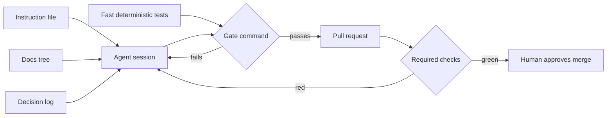
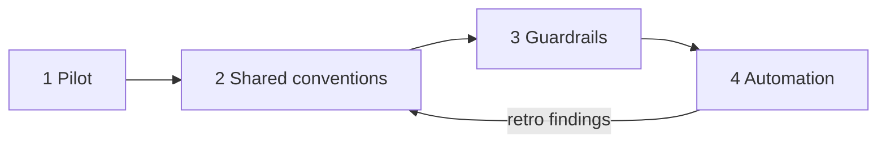
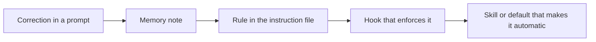

# 31 — Repo standards and team adoption

After this chapter you can make a repository agent-ready with five pieces, write a gate command and prove that it and its documentation are true, and set branch protection so a person and a deterministic check have the last word. You can also plan a staged team rollout with a measure for each stage, and run the loop that turns every incident into a rule, a hook and a memory.

## Mental model

A repository is an interface, and an agent is a new kind of user of it. It reads everything it is pointed at, carries nothing from one session to the next except what is written to a file, and stops when the work *looks* done. Two questions decide whether it succeeds in your repository:

- **Can it find the rules?** One instruction file, a docs tree with an index, and a log of decisions already made.
- **Can it check its own work?** One command that exits 0 only when the change is acceptable, backed by tests that give the same answer every time.

A team raises the stakes. Ten people with agents produce more pull requests, in more styles, than ten people without. The standards in this chapter are what keep that volume reviewable.



## The minimum kit

| Piece | Smallest useful version | What it prevents |
|---|---|---|
| Canonical instruction file | One `AGENTS.md`; every tool-specific file is a pointer to it | Each tool following different rules |
| One gate command | `make agent-check`, documented as the definition of done | "Done" meaning "looks done" |
| Fast deterministic tests | No network, no wall-clock dependence, a minute or two to run | Flaky reds that teach the agent to ignore failures |
| A navigable docs tree | `docs/README.md` as an index, plus a "where to look first" table | Rediscovering the architecture every session |
| A decision log | One dated file per decision under `docs/decisions/` | Re-arguing settled questions; undoing deliberate choices |

### The instruction file

Keep policy in one file and make everything else point at it. Claude Code reads `AGENTS.md` natively (v2.1.277 or later) only when no `CLAUDE.md` applies, so a repository that has both needs the import. Details are in [CLAUDE.md and memory](08-claude-md-and-memory.md) and [One repo, many agents](28-cross-tool-agents-md-cursor-codex-gemini.md).

```markdown
@AGENTS.md

## Claude Code addenda
- Path-specific rules live in `.claude/rules/` and load only for matching files.
- Run `make agent-check` before every commit and cite its output.
```

What belongs in the file, in the words of the official best-practices page (it speaks of `CLAUDE.md`; the same test fits the `AGENTS.md` it imports): "How to confirm work in this repo: the exact test, typecheck, and lint commands, and how to run a single test file"; "Places where the code is misleading"; "Decisions that aren't in the repo"; "Anything you've had to correct twice already". The same page's test for leaving something out: could the agent find this by reading the code, and would it actually go and look? If both are yes, leave it out. The memory guide recommends staying under 200 lines per `CLAUDE.md` file, and an import does not shrink that: imported files load together with the file that imports them.

### Tests the agent can trust

A test suite is useful to an agent only if red always means "you broke something". Three habits from the field data:

- **Block live calls.** One service preloads a guard that fails any non-localhost network call made from a test.
- **Keep the clock out.** One repo runs its suite nightly under shifted clocks and fails on any test that depends on today's date.
- **Make a missing test fail.** A manifest lists every test file, so a renamed or deleted file fails CI instead of passing under a "pass with no tests" setting.

Keep model judgement out of the per-change gate. One field repo states it as an invariant: "No release gate depends on a non-deterministic agent decision." Evals that call a model run nightly, not on every push. See [Testing and verification loops](23-testing-and-verification-loops.md).

### The decision log

One file per decision, named by date, never numbered from a shared counter (parallel agents collide on counters). Each entry says when to reopen it:

```markdown
# 2026-11-25 — One gate command
Status: accepted
Context: three "run this before a PR" commands were documented; one did not exist.
Decision: `make agent-check` is the only definition of done. Docs name no other.
Consequence: the gate fails if any doc names a make target that make cannot run.
Reopen when: the build system changes.
```

## The gate command

The gate is **one command whose exit code is the definition of done**. It is the same for a human, an agent and CI.

```makefile
.PHONY: agent-check lint typecheck test docs-check
agent-check: lint typecheck test docs-check   ## the definition of done for any change

lint:
	npm run lint -- --max-warnings 0
typecheck:
	npm run typecheck
test:
	npm test
docs-check:
	bash scripts/check-doc-commands.sh
```

State the rule next to the command, in `AGENTS.md`:

```markdown
## Definition of done
A change is done when `make agent-check` exits 0 on the committed tree.
State the check before you start, run it, and cite its output. Never claim success without it.
After two failed attempts at the same failure, stop and find the root cause.
```

Design rules for a gate:

1. **One name, everywhere.** The README, the contributing guide, the PR template and CI all name the same command.
2. **Exit code, not output.** Never judge a gate by grepping its output. One field incident shipped a broken build because a `grep` filter missed the word `error:`.
3. **Fast enough to run every time.** One field repo splits it: a gate of about one minute before every commit, and a full local CI run of 20 to 25 minutes before every push.
4. **A contract, not a suggestion.** A product workspace's rule: gate scripts "are contracts. Never edit them to make them pass — fix the underlying issue."

### Keep the documentation true

> **Field note:** In a product workspace, the README, the contributing guide and the pull request template all told agents to run one `make` target. The Makefile had no such target. Asking make for it returned `No rule to make target`. The working entry point was an npm script with the same name. Nothing had failed, because nothing checked the docs against the Makefile. A sibling repo documents a related trap: a colon in a target name breaks GNU make parsing, so the runnable target is spelled with a hyphen.

The fix is to make the docs part of the gate. This script fails when any doc names a `make` target that make cannot run. It was run on a fixture repository both ways: red with the wrong name in the README, green after the fix.

```bash
#!/usr/bin/env bash
# scripts/check-doc-commands.sh
# Every `make <target>` the docs show as a command must be a target make can actually run.
set -uo pipefail
status=0
while read -r target; do
  if ! make -n "$target" >/dev/null 2>&1; then
    echo "DOC DRIFT: docs say 'make $target' but make has no such target"
    status=1
  fi
done < <(grep -rhoE '(^[[:space:]]*(\$ )?|`|run: |&& )make [a-z][a-z0-9:_-]+' \
           README.md AGENTS.md docs .github 2>/dev/null | awk '{print $NF}' | sort -u)
exit "$status"
```

The pattern reads `make` only where a command would stand: at the start of a line, after a backtick, after `run:` or after `&&`. That keeps prose such as "make sure" out, unless a wrapped line happens to begin with it. One more limit: `make -n` also succeeds for a name that is an existing file or folder, so a stale `make docs` passes wherever a `docs/` folder exists.

### Prove the gate can fail

A gate that has never been seen red is not known to be a gate. A product workspace audited its own and found about 40 recorded cases of a gate that existed, was green, and could not detect what it named, against zero cases of a gate that was too strict. Examples: checks that only asserted a file existed, and a test command that exited 0 when it found no tests. Its rule since then: "Every new gate ships with a demonstrated failure".

```bash
#!/usr/bin/env bash
# scripts/negative-gate.sh
# Prove the gate can fail: sabotage a throwaway copy and require a non-zero exit.
set -uo pipefail
tmp=$(mktemp -d); trap 'rm -rf "$tmp"' EXIT
cp -R . "$tmp/repo" && cd "$tmp/repo" || exit 2
echo 'Run `make no-such-target` first.' >> README.md   # the sabotage: one change the gate must catch
if make agent-check >/dev/null 2>&1; then
  echo "GATE CANNOT FAIL: the sabotage went through green"; exit 1
fi
echo "ok: gate went red on sabotage"
```

Work on a copy, never the working tree. One field repo learned this when a self-test edited tracked files in place and a sabotaged line reached a pull request.

## Drift checks

Drift is two files that should agree and no longer do: an adapter (a tool-specific instruction file whose only job is to point at `AGENTS.md`) that restates old policy, a doc that names a removed command, a mirrored skill folder that fell behind. Make each pair a check.

```bash
#!/usr/bin/env bash
# scripts/check-agent-drift.sh
# Adapters must point at AGENTS.md and stay thin. They never restate policy.
set -uo pipefail
status=0
[ -f AGENTS.md ] || { echo "AGENTS.md is missing"; status=1; }
for adapter in CLAUDE.md .github/copilot-instructions.md .cursor/rules/000-project.mdc; do
  [ -e "$adapter" ] || continue
  grep -q 'AGENTS.md' "$adapter" || { echo "$adapter does not reference AGENTS.md"; status=1; }
  lines=$(wc -l < "$adapter" | tr -d ' ')
  [ "$lines" -le 40 ] || { echo "$adapter has $lines lines; adapters stay thin"; status=1; }
done
exit "$status"
```

The field version of this script also checks that mirrored skill directories are identical and that retired files have not come back. It is honest about its limit in a comment: it "proves the pointer exists, not that the surrounding prose is still true — which is exactly why the adapter must stay thin". Whatever you do not check will drift. In the same workspace, a mirrored set of agent definitions for another tool pointed at a directory that did not exist, and nothing noticed.

Other pairs worth a check: version pins against the docs that quote them, generated files against their generator (a `--check` mode), and counts quoted in docs against the tree.

## Branch protection and required checks

The official best-practices page lists who has the last word. The non-deterministic answer is "Claude's summary of what it did". The deterministic one is "Branch protection, a person who approves the merge". Set it up so the second always wins.

1. **Protect the default branch.** No direct pushes; changes arrive by pull request.
2. **Require one check that always reports.** Use a single fan-in job that depends on every other job, and require only that job. A field repo recorded what happens otherwise: a ruleset (GitHub's newer form of branch rules) "required a context named `CI` that no workflow reported", a failure that by its own record "has already cost this repo months".
3. **Treat skipped as failure** in the fan-in job, so a path filter cannot turn a required check into a silent pass.
4. **Read the rules, do not guess them:** `gh api repos/OWNER/REPO/branches/main/protection` for classic branch protection, and `gh api repos/OWNER/REPO/rules/branches/main` for rulesets, which the first call does not show.
5. **Keep merge authority with a person.** The field rule is "PR open ≠ PR merge": agents open pull requests, and merge only with an explicit instruction, with a narrow exception for docs-only, test-only and dependency-bump changes.

```yaml
name: ci
on: [pull_request]
permissions:
  contents: read
concurrency:
  group: ci-${{ github.ref }}
  cancel-in-progress: true          # agent push bursts do not queue stale runs
jobs:
  gate:
    runs-on: ubuntu-latest
    timeout-minutes: 15
    steps:
      - uses: actions/checkout@d23441a48e516b6c34aea4fa41551a30e30af803 # v6.1.0
      - run: make agent-check
  CI:                                # the only required status check
    if: always()
    needs: [gate]
    runs-on: ubuntu-latest
    steps:
      - run: |
          for r in ${{ join(needs.*.result, ' ') }}; do
            [ "$r" = "success" ] || { echo "a required job ended as $r"; exit 1; }
          done
```

AI review is advice, not a gate. The managed Code Review docs say: "By itself, a review doesn't approve or block the pull request." See [Git, pull requests and code review](24-git-prs-and-code-review.md).

> **Note:** Green is not the same as watched. The product workspace added two watchdog workflows after a required gate sat red on the default branch for about 14.5 hours unnoticed, and another went four days without running: one asks "is the default branch red right now?", the other "has each required gate run recently?".

## CI capacity

Agents push in bursts, and every push costs CI time. In the field window of about four weeks, 948 distinct pull requests across 26 repositories were linked to sessions (one developer; what triggers a link was not verified). A retro measured each pull request paying about 18 minutes of local gate plus about 18 minutes of CI, with five or six bot-review rounds each restarting CI.

| Pressure | Control |
|---|---|
| Superseded runs pile up | `concurrency` with `cancel-in-progress`, and an explicit `timeout-minutes` on every job |
| Too many pushes per change | One pull request per objective, pushed once after the local gate passes |
| Review rounds restart CI | Cap automated review at two rounds; turn the rest into issues |
| Agents wait on CI with the turn open | End the turn and start one background `gh pr checks <n> --watch`. The workspace measured about 10 hours of sleep-polling in three weeks before this rule |
| Runners on a laptop | Move them to a dedicated machine. A local gate plus a CI job once failed 12 test files on timeouts alone |
| Self-hosted runner on a public repo | Do not. A fork's pull request then runs code on your hardware. Public repos stay on hosted runners |
| Everything red within a minute | Suspect the host or a platform throttle before the commit. Do not keep re-running |

## Managed settings and shared plugins

Settings have four scopes: user, shared project (`.claude/settings.json`, committed), project local, and **managed**, which an organisation deploys and users cannot override. The best-practices page adds: "keep the enforced set small".

| Managed settings file | Path |
|---|---|
| macOS | `/Library/Application Support/ClaudeCode/managed-settings.json` |
| Linux and WSL | `/etc/claude-code/managed-settings.json` |
| Windows | `C:\Program Files\ClaudeCode\managed-settings.json` |

Other delivery channels are server-managed settings from the claude.ai admin console and device management (MDM). The docs' example, reformatted:

```json
{
  "permissions": {
    "deny": ["Read(./.env)", "Read(./secrets/**)"],
    "disableBypassPermissionsMode": "disable"
  },
  "allowManagedPermissionRulesOnly": true
}
```

Confirm it applied with `/status`, which shows `Enterprise managed settings (file)`. Keys that only a managed source can set include `allowManagedPermissionRulesOnly`, `allowManagedHooksOnly`, `allowManagedMcpServersOnly`, `strictKnownMarketplaces`, `blockedMarketplaces` and `sandbox.network.allowManagedDomainsOnly`. Scopes and precedence are in [Settings and permissions](09-settings-and-permissions.md); the security reasoning is in [Security and guardrails](29-security-and-guardrails.md).

**Shared plugins.** Package the team's skills, agents and hooks as a plugin in a marketplace repository, then name both in the project's `.claude/settings.json`:

```json
{
  "extraKnownMarketplaces": {
    "your-marketplace": {
      "source": { "source": "git", "url": "https://git.example.com/your-org/your-marketplace.git", "ref": "main" }
    }
  },
  "enabledPlugins": { "code-formatter@your-marketplace": true }
}
```

Three facts decide whether this works in practice. Committing the file enables the plugin for collaborators "but doesn't download it": each person still runs `claude plugin install <name>@<marketplace> --scope project`. Auto-update is off by default for every marketplace except Anthropic's official ones. And a manifest that pins a `version` string keeps every user on the cached copy until the author changes that string, however many commits are pushed. The author's plugin repo states the consequence in its release rule: "Pushing commits without bumping `version` does not deliver changes to installed users." More in [Plugins and marketplaces](17-plugins-and-marketplaces.md).

## A staged rollout

This plan, with its stages, measures and exit criteria, is this book's own suggestion. No source cited here prescribes or tested it. Its order mirrors how the field workflow grew: scaffolding first, enforcement after the first incidents, automation last. Measure review time from the start, because that is where the cost of faster generation lands.



| Stage | What you do | What to measure | Move on when |
|---|---|---|---|
| 1. Pilot | Two or three volunteers, one or two repos, interactive use only | Cost per active day against the docs' baseline (see [chapter 30](30-cost-usage-and-observability.md)); pull request size; corrections you had to make twice | The volunteers can name what the agent keeps getting wrong |
| 2. Shared conventions | `AGENTS.md`, a gate command, a docs index and a drift check in every active repo | Share of repos with a working gate; share of agent pull requests green on first CI run | A new joiner's first agent pull request passes the gate without help |
| 3. Guardrails | Managed settings, deny rules, hooks for irreversible actions, branch protection with one required check | Hook blocks per week and how many were false; permission prompts per session; incidents | A month with no incident that a rule or hook should have stopped |
| 4. Automation | Headless jobs, advisory review bots, scheduled runs (see [chapter 27](27-headless-ci-and-the-agent-sdk.md)) | CI queue time; cost per run; review rounds per pull request; rework after merge | Review time per pull request is flat or falling as volume grows |

## The team problems, and what the sources support

| Problem | What the evidence says | Its limits | What helps |
|---|---|---|---|
| Review bottleneck | Telemetry from 10,000+ developers on 1,255 teams: high-adoption teams merged 98% more pull requests while review time rose 91% and pull request size 154%. No significant link to company-level results | Vendor-published telemetry; correlations, not experiments; data to June 2025 | Machine checks before human review; small pull requests (Google's guidance: about 100 lines is reasonable, 1,000 is usually too large); a fresh-context AI pass scoped to correctness |
| More defects per pull request | 470 open-source pull requests (320 AI-co-authored, 150 human-only): the AI-co-authored ones carried about 1.7 times more findings | The vendor sells AI review; authorship was inferred, and the authors "cannot guarantee" the human set is human-only | Linters, formatters and required tests in CI |
| Felt speed versus measured speed | A randomised trial by the research group METR, published in July 2025: 16 experienced open-source developers took 19% longer on 246 issues when AI tools were allowed, after predicting a 24% speed-up | Small (n=16), early-2025 tools, large mature repositories; the authors now call it out of date, and could not produce a clean follow-up | Measure your own cycle time; do not rely on impressions |
| Inconsistent conventions | Support for `AGENTS.md` is the most-reacted issue on the Claude Code tracker (about 6,700 reactions on 2026-11-25) | A tracker count, not a study | One canonical file; `/doctor prompt-audit` flags contradictions; managed settings |
| Skill atrophy | A randomised trial run by Anthropic with 52 mostly junior engineers: the AI group scored 50% against 67% on a comprehension quiz, with no significant speed gain. The largest gap was on debugging questions | One study, by an AI vendor; 52 participants, mostly junior | Ask for explanations, not only code; keep humans on review of critical paths; roll out deliberately |
| Licensing and IP | Under Anthropic's Commercial Terms the customer "owns its Outputs", and Anthropic "will defend Customer" against third-party IP claims on paid use, with exclusions. Free, Pro, Max and Ultra fall under the Consumer Terms instead | Not legal advice. The US Copyright Office's report on AI outputs exists; its conclusions were not read for this book | Use a commercial plan for company code; ask counsel about the exclusions |

The 2025 DORA survey of nearly 5,000 respondents, published by Google Cloud, says AI can act as a "mirror and a multiplier": "In cohesive organizations, AI boosts efficiency. In fragmented ones, it highlights weaknesses." Survey answers are self-reported and the links are correlations. With that limit, it is the case for doing stage 2 before stage 4.

## The learning loop

Every incident is a chance to move a lesson to a stronger layer. The field data shows one path, taken only when the weaker layer failed to hold:



A hard rule ends up existing three times: **a rule** in prose with its reason and date, **a hook** that enforces it, and **a memory** that names the hook so the next session knows why a command was blocked. Each time a lesson moves up, delete the old copy or leave a pointer.

Run a retrospective after any rough session. The format that survived in the field:

```markdown
## Retro: <date>, <one-line title>
- What happened:
- Root cause:
- Incident or pattern: one-off, or seen before?
- Fix layer: none / memory / rule / hook / skill
- Proposed change: exact text or diff. Nothing is written until a human approves.
```

"None" is a valid fix layer. Not every one-off deserves a rule, and every rule and hook has a carrying cost.

## From the field

**One template, checked by machines.** Sixteen of the author's seventeen personal repositories follow one layout: `AGENTS.md` as policy, a `CLAUDE.md` that starts with `@AGENTS.md` plus 1 to 29 lines of addenda (one outlier has 60), a Makefile with the same core targets, a `docs/` tree split into user, engineering and agent guidelines, and a CI workflow whose single fan-in job is the only required check. A drift script fails the build when an adapter stops referencing `AGENTS.md`.

**A lesson climbing the ladder.** The shell the agent used does not split unquoted variables the way the agent expected. Notes in three projects' memories did not stop the mistake, and it came back after a compaction. It became a global rule, then a `PreToolUse` hook, then a shell-profile setting. Errors of that class fell from 19 in the first half of November to 4 in the second (confounded by volume). The hook's own header gives the reason: the rule "still recurred in the next session, because advisory text does not stop a reflex. This guard does."

**Lessons do not transfer by themselves.** The owner typed "status?" during silent waits about once in every five prompts. Two project memories recorded the fix, and the rate was still 21 to 22% in November against 13 to 17% in October. A note in one project's memory does not reach another project. Promote what recurs.

**The ladder has a way down.** One guard was partly removed in November because its prompts cost more than they saved. Measure a guard's carrying cost the way you would measure a flaky test.

> **Field note:** The product workspace's decision log holds 1,222 entries from June to November 2026, one file each. Entries were first numbered from a shared counter, which collided three times in one day once agents wrote in parallel; they are now named by date.

## Common problems

| Symptom | Cause | Fix |
|---|---|---|
| The agent runs a documented command that does not exist | Docs and Makefile drifted | Put `check-doc-commands.sh` in the gate |
| The gate is green and the bug shipped | The gate asks a proxy question, or cannot fail | Sabotage test; assert the behaviour, not that a file exists |
| A pull request merged with no CI | The required check name matches no job, or a path filter skipped it | One fan-in job that always reports; treat skipped as failure |
| Each tool follows different rules | Adapters restate policy and went stale | One `AGENTS.md`, thin pointers, a drift check |
| The review queue grows and reviews get shallow | More and larger pull requests, same reviewers | Smaller pull requests, machine checks first, a cap on review rounds |
| Teammates do not get a shared plugin update | The manifest's version string was not bumped, or auto-update is off | Bump the version on every release; tell people to update and `/reload-plugins` |
| The same mistake returns in another repo | The lesson lives in one project's memory | Promote it to a shared rule or a hook |
| The team ships code it cannot debug | Generation was delegated without comprehension | Explanation-first prompts; humans own critical-path review |

## Checklist

- [ ] One `AGENTS.md` holds policy; every other instruction file points to it and stays thin.
- [ ] One gate command is the written definition of done, and the docs name only that command.
- [ ] The gate has been seen to fail on a deliberate sabotage.
- [ ] Tests run without the network or the wall clock.
- [ ] The default branch is protected by one required fan-in check and a human merge decision.
- [ ] CI cancels superseded runs and every job has a timeout.
- [ ] Managed settings carry the small set of rules nobody may override.
- [ ] Every incident gets a retro entry with a named fix layer, including "none".

## Try it

1. **Audit your docs against your build.** Run `check-doc-commands.sh` in a real repository. Fix what it finds, then add it to your gate.
2. **Sabotage your gate.** Pick one thing the gate claims to protect, break it in a throwaway copy, and confirm the gate goes red. If it stays green, you found a gate that cannot fail.
3. **Write one retro.** Take the last time an agent surprised you. Fill in the template and choose a fix layer. If you chose "hook", write its block message first.

## Sources

- https://code.claude.com/docs/en/best-practices
- https://code.claude.com/docs/en/memory
- https://code.claude.com/docs/en/settings and https://code.claude.com/docs/en/managed-settings
- https://code.claude.com/docs/en/plugins/install and https://code.claude.com/docs/en/plugins/marketplace-reference
- https://code.claude.com/docs/en/plugins/org and https://code.claude.com/docs/en/plugins/loading
- https://code.claude.com/docs/en/code-review and https://code.claude.com/docs/en/security
- https://code.claude.com/docs/en/legal-and-compliance and https://www.anthropic.com/legal/commercial-terms
- https://www.anthropic.com/research/AI-assistance-coding-skills
- https://www.faros.ai/blog/ai-software-engineering
- https://www.coderabbit.ai/blog/state-of-ai-vs-human-code-generation-report
- https://metr.org/blog/2025-07-10-early-2025-ai-experienced-os-dev-study/
- https://blog.google/innovation-and-ai/technology/developers-tools/dora-report-2025/
- https://google.github.io/eng-practices/review/developer/small-cls.html
- https://github.com/anthropics/claude-code/issues/6235 and https://www.copyright.gov/ai/

---

[← Previous: Cost, usage and observability](30-cost-usage-and-observability.md) · [Contents](README.md) · [Next: Troubleshooting: common problems and fixes →](32-troubleshooting-common-problems.md)
