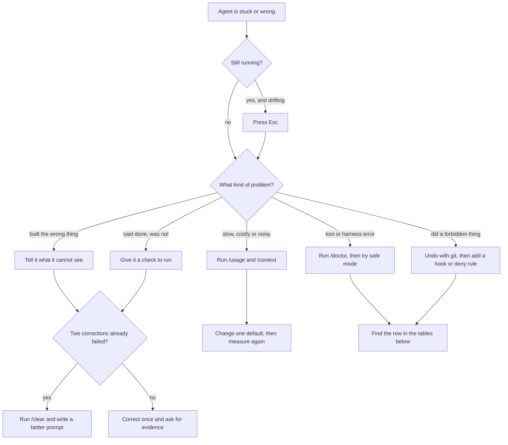
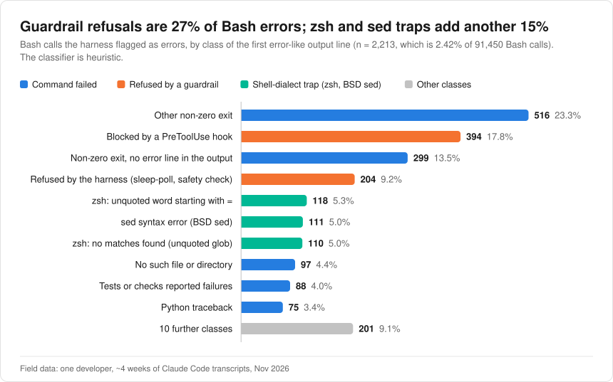
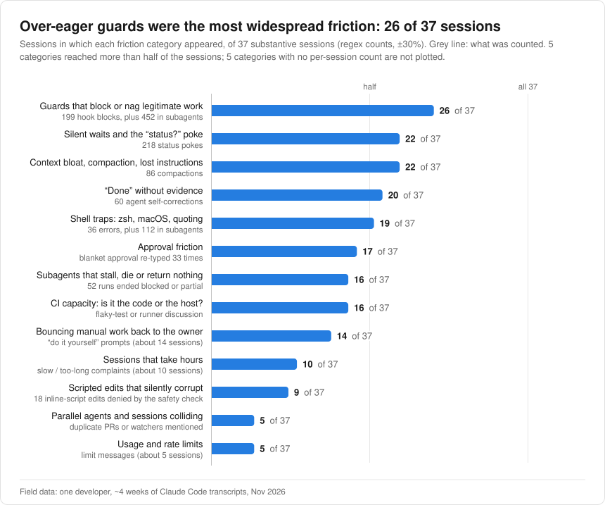

# 32 — Troubleshooting: common problems and fixes

After this chapter you can take a session that is stuck, wrong, slow or blocked, name the kind of problem in under a minute, and apply a concrete fix: a command, a setting, a hook or a prompt habit. Use it as a lookup: find the group, find the symptom, then follow the link to the chapter that explains the mechanism.

## Mental model

Almost every bad session is one of four things. The official best-practices page lists them: Claude built something different from what you had in mind; Claude said it was done and it wasn't quite; Claude did something that must never happen in this repo; or Claude got it right, but it took more time, tokens or permission prompts than the task was worth. Each has its own class of fix.

| What went wrong | Class of fix | Who carries it out |
|---|---|---|
| Built the wrong thing | Tell it what it cannot see: a better prompt, a line in `CLAUDE.md`, a spec | The model reads it |
| Said done, was not | Give it a check that comes back pass or fail | The model, or a `Stop` hook |
| Did a forbidden thing | A hook, a deny rule or a managed setting | The harness, every time |
| Right, but expensive | Change one default: mode, model, effort or context | You, guided by `/usage` |

A fifth kind sits beside these: the harness itself is misconfigured. An MCP server will not connect, a hook never fires, the shell behaves differently from your terminal. That is ordinary debugging, and the tables below cover it.

The distinction that matters most while troubleshooting is between an instruction the model *reads* (a prompt, `CLAUDE.md`, a skill) and one the harness *executes* (a hook, a deny rule, a managed setting). The first kind is advice, and the model may decide it does not apply. If you keep rewording a rule and the agent still misses it, stop rewording: the rule belongs in the second kind.



## First aid: five moves that resolve most situations

1. **Stop it.** Press `Esc` the moment the agent drifts. Watching the first minute of a task is cheaper than reading a wrong diff at the end.
2. **Look before you guess.** `/context` shows what fills the window. `/usage` shows what the session cost and why the cache missed. `/hooks` and `/mcp` show what is registered and connected. `/doctor` checks the setup and proposes fixes.
3. **Reset the conversation, not the work.** `/rewind` (or `Esc` twice on an empty prompt) goes back to a checkpoint. After two failed corrections, run `/clear` and write a better prompt instead of a third correction, because the failed attempts stay in context and get re-read.
4. **Give it a check and ask for evidence.** Name a command that passes or fails, then ask for "the command you ran and its output". A bare "all tests pass" tells you very little.
5. **Rule out your own customisations.** `claude --safe-mode` starts a session with your customisations disabled, which separates a model problem from a plugin, MCP server or hook problem.

```bash
claude doctor        # check the installation from the shell when Claude Code will not start
claude --safe-mode   # a session with your customisations disabled
claude --debug       # write a debug log; read it under ~/.claude/debug/
claude --debug=mcp   # the same, focused on MCP servers
claude --resume      # pick the session up again after closing a frozen terminal
```

> **Warning:** `/rewind` restores edits made by Claude's file tools. A file that only a Bash command changed is not restored, most subagent edits are not, and nothing done to a remote system is. For those, use Git and your backups.

> **Note:** If the same problem comes back in a later session, move the fix up one layer: from a prompt to a line in `CLAUDE.md`, and from there to a hook or a deny rule. Chapter 33 shows that ladder in real incidents.

## The catalogue

Eleven groups. Each opens with why the problem exists, because a fix you understand is one you can adapt. The last column links to the chapter that explains the mechanism, or to the closest one when a detail appears only here. Version numbers and defaults are as of Nov 2026; check yours with `/help` and `claude --help`.

### 1. Context and memory

**Why this happens.** The context window is a finite attention budget: recall drops as it fills, long before anything overflows. When it does fill, Claude Code compacts, which means it replaces the conversation with a summary, and a summary is lossy ("detailed instructions from early in the conversation may be lost"). Of your instruction files, only the project-root `CLAUDE.md`, unscoped rules and auto memory are re-injected from disk afterwards. Current models have a 1M-token window, so running out is rare; drift and cost are the usual symptoms.

| Symptom | Cause | Fix | Chapter |
|---|---|---|---|
| A rule is followed early and ignored later | It lived only in the conversation, in a rule with `paths:` frontmatter or in a nested `CLAUDE.md`, and compaction summarised it away | Put it in the project-root `CLAUDE.md` and keep that file under 200 lines; drop `paths:` for a rule that must persist; if it cannot bend, make it a hook or deny rule | [Ch 8](08-claude-md-and-memory.md) |
| `Autocompact is thrashing: the context refilled to the limit...` | One oversized file or tool result refills the window after every summary | Read the file in chunks; `/compact keep only the plan and the diff`; move the work to a subagent; or `/clear`, then compare rows in `/context` | [Ch 10](10-plan-mode-checkpoints-and-context-management.md) |
| A large share of the window is used before your first prompt | MCP tool definitions and long instruction files load up front | Leave tool search on (the default); `/mcp disable <name>` for unused servers; prefer a CLI such as `gh`; move procedures from `CLAUDE.md` into skills; inspect with `/context all` | [Ch 13](13-mcp-in-practice.md) |
| Answers get vaguer and the agent repeats itself late in a long session | Too much unrelated history in the window | `/clear` between unrelated tasks; `/compact <focus>`; `/rewind`, then "Summarize from here" | [Ch 10](10-plan-mode-checkpoints-and-context-management.md) |
| After compaction the agent has lost the branch, the plan or a hook's reminder | Context that hooks added is summarised with everything else | A "Compact Instructions" section in `CLAUDE.md`; a `SessionStart` hook that matches the `compact` source and re-injects the state | [Ch 10](10-plan-mode-checkpoints-and-context-management.md) |
| `/rewind` did not undo a change | Bash-only changes, most subagent edits and remote actions are not checkpointed | Revert files with Git; treat remote side effects as permanent | [Ch 10](10-plan-mode-checkpoints-and-context-management.md) |
| A resumed session is missing MCP servers or tool limits | Resume does not restore flags such as `--mcp-config`, `--add-dir` and `--allowedTools` | Pass the flags again with `claude --resume` | [Ch 7](07-cli-slash-commands-and-shortcuts.md) |

### 2. Wrong or invented code

**Why this happens.** A model completes the most plausible continuation, and a plausible package or method name is not always a real one. In one study of 16 code models, 19.7% of package references pointed at packages that do not exist (at least 5.2% on average for the commercial models), and 43% of the invented names came back on all ten re-runs of the same prompt. That is predictable enough for an attacker to register the name first, which is called slopsquatting. Training data is also frozen while libraries move on. The fix always has the same shape: ground the agent in the real code, and let a tool that cannot be argued with (compiler, type checker, test) have the last word.

| Symptom | Cause | Fix | Chapter |
|---|---|---|---|
| Import or install of a package that does not exist | The model completed a plausible name | Vet every new dependency; add an `ask` rule on install commands, for example `Bash(npm install *)`; review manifest and lockfile diffs like code | [Ch 29](29-security-and-guardrails.md) |
| A real package with a near-miss name runs unexpected code | Slopsquatting | Dependency-vetting tooling; be suspicious of new packages with install scripts | [Ch 29](29-security-and-guardrails.md) |
| Code calls a removed or deprecated API | Training cutoff versus the library version you have | Prompt habit: "open the installed version's source or docs before you use it"; typecheck, build and tests as the gate; a code intelligence plugin that reports type errors after edits | [Ch 23](23-testing-and-verification-loops.md) |
| Confident statements about code it never opened | Speculation from names and memory | Add the line "Never speculate about code you have not opened."; hand over the file with `@path` | [Ch 34](34-prompt-cookbook-and-anti-patterns.md) |
| It built something different from what you meant | The prompt left out what the agent could not see | Name the file, describe the symptom, say what "fixed" looks like; for larger work, let it interview you, write `SPEC.md`, then build in a fresh session | [Ch 22](22-explore-plan-implement-verify.md) |
| A correct analysis of the wrong state | A stale checkout, a reused dev server or a cached status | `git fetch` before auditing; verify at a commit SHA; re-query remote state when you report | [Ch 24](24-git-prs-and-code-review.md) |

### 3. Over-eager and destructive behaviour

**Why this happens.** Prose limits are not enforcement: with a prompt or `CLAUDE.md` there is no guarantee the instruction is followed, and an obstacle invites a shortcut (delete the thing in the way, force the push). Public incidents have the same shape: a production database deleted during a declared code freeze, a `terraform destroy` run from an old state archive. Auto mode's classifier blocks several of these by default (force pushes, production deploys and migrations, destroying files that existed before the session), yet in Anthropic's own test it missed 17% of real over-eager actions. It lowers the risk; it does not remove it.

| Symptom | Cause | Fix | Chapter |
|---|---|---|---|
| Data or files destroyed "to fix" a blocker | A destructive shortcut with only prose in the way | `permissions.deny` rules plus a `PreToolUse` hook that exits 2; the sandbox; deletion protection and tested backups the agent cannot reach | [Ch 29](29-security-and-guardrails.md) |
| A force push, or plain `--force` after a safer flag failed | The same: obstacle, then shortcut | Deny rules such as `Bash(git push --force *)` and `Bash(git push -f *)`; branch protection on the server | [Ch 29](29-security-and-guardrails.md) |
| The diff is far larger than the request | Models tend to over-engineer: extra files, abstractions and options | Prompt line: "Only make changes that are directly requested or clearly necessary."; review the diff against the request | [Ch 34](34-prompt-cookbook-and-anti-patterns.md) |
| The same failed fix is tried again and again | Failed attempts stay in context and get re-read | `/clear` after two failed corrections; give it a pass/fail check; cap unattended runs with `--max-turns` | [Ch 22](22-explore-plan-implement-verify.md) |
| It edited a neighbouring project, repo or account | A shared host or a single login makes everything reachable | Prompt habit: "in this repo only; name the owning repo before each edit"; one repository per session | [Ch 29](29-security-and-guardrails.md) |
| A "test" changed something real | The test went to a live trigger, or the default context was production | Rule: state the side effect and confirm before touching live infrastructure, even in a test; give tests a notify-only target | [Ch 33](33-case-studies-from-real-work.md) |

### 4. False "done" claims

**Why this happens.** "Claude stops when the work looks done. If it has nothing to run that tells it whether the work actually *is* done, 'looks done' is all it has to go on." A summary is a claim, not a control. Tests are a proxy too: when the short way to green is to edit the test, some runs take it. Studies of prompt-only remedies are mixed; a check the harness enforces does not depend on the model agreeing.

| Symptom | Cause | Fix | Chapter |
|---|---|---|---|
| "Tests pass" with no run, or a stale one | Nothing forced a run; the summary is self-reported | Ask for the command and its output; a `Stop` hook such as `pnpm tsc --noEmit 1>&2 \|\| exit 2`; CI as the real gate | [Ch 23](23-testing-and-verification-loops.md) |
| Green suite, wrong behaviour | Tests were edited, special-cased or mocked until they passed | Prompt line: "It is unacceptable to remove or edit tests because this could lead to missing or buggy functionality."; `/code-review` in a fresh context; `/verify` to build and run the app | [Ch 23](23-testing-and-verification-loops.md) |
| The turn ends with items still open | The agent stops when the work looks done | `/goal <condition>` written as a checkable condition; a `Stop` hook; a reviewer subagent that compares the diff with `SPEC.md` | [Ch 23](23-testing-and-verification-loops.md) |
| A gate "passed" but the build is broken | Output was piped through `grep` or `tail`, so the exit code was lost | Judge by exit code; never `cmd 2>/dev/null; echo done`; ask for the unfiltered output of the failing step | [Ch 23](23-testing-and-verification-loops.md) |
| "Released" or "deployed", but you cannot see it | A proxy was checked: an API field or a "processed" state | Define done as the thing the user touches ("installable on my device"); verify in the context the user launches from | [Ch 23](23-testing-and-verification-loops.md) |
| A check is green only in a fresh worktree | Dependencies were missing, so the check printed SKIP and exited 0 | Install dependencies in the worktree first; make checks fail closed in CI | [Ch 23](23-testing-and-verification-loops.md) |

### 5. Permissions and prompts

**Why this happens.** There are two bad extremes. Approve everything by hand and "after the tenth prompt you start approving without reading" (Anthropic reports that users accept 93% of prompts anyway). Skip everything with `bypassPermissions` and you have "no protection against prompt injection or unintended actions". The middle paths are allow, ask and deny rules, the sandbox, and auto mode. Two facts cause most of the confusion. Rules are evaluated deny first, then ask, then allow, and they match the text of a tool call, not its intent. And since v2.1.283 a new interactive session starts in `auto` mode, while `claude -p` starts in `default`.

| Symptom | Cause | Fix | Chapter |
|---|---|---|---|
| You approve prompts without reading them | Volume | Auto mode; `/fewer-permission-prompts`; `/sandbox` with auto-allow for sandboxed commands | [Ch 9](09-settings-and-permissions.md) |
| A new session edits files without asking | New interactive sessions start in `auto` mode | Set `permissions.defaultMode` in settings; switch modes with `Shift+Tab`; review rules in `/permissions` | [Ch 9](09-settings-and-permissions.md) |
| Tool calls are denied in `claude -p` or the SDK after an update | No mode was set, so the run starts in `default`, where a call that needs approval is denied | Pass `--permission-mode` (`dontAsk`, `acceptEdits` or `auto`) and `--allowedTools` | [Ch 27](27-headless-ci-and-the-agent-sdk.md) |
| A `Bash(rm *)` deny rule does not stop `/bin/rm` | Bash rules match the literal command string | A `PreToolUse` hook that inspects the command, or the sandbox's filesystem boundary | [Ch 29](29-security-and-guardrails.md) |
| Prompts keep appearing in `bypassPermissions` | Explicit `ask` rules, hooks that return `ask` and recognised critical-path `rm` or `rmdir` removals survive bypass | Find out which calls prompted before changing anything; delete leftover `ask` rules; make hooks deny or stay silent. In the field data, worktrees under `.claude` also prompted until they were moved out, although the docs say bypass covers protected paths | [Ch 9](09-settings-and-permissions.md) |
| An allow rule does not silence a compound command | Every subcommand joined by `&&`, `;` or a pipe must be allowed | Allow each subcommand, or have the agent run them as separate calls | [Ch 9](09-settings-and-permissions.md) |
| A cloned repository changes how your session behaves | Project settings, hooks and `.mcp.json` are executable configuration | Keep Claude Code updated; read `.claude/` and `.mcp.json` before you trust a folder; open untrusted repos in a VM or container | [Ch 29](29-security-and-guardrails.md) |

### 6. Cost and limits

**Why this happens.** Claude Code sends the whole conversation with every request, so a long session makes every turn expensive unless the prompt cache hits. The cache lasts about an hour on a subscription and about five minutes on an API key, cloud provider or usage credits. It is invalidated by switching model, changing effort, connecting or removing an MCP server, compacting, and upgrading Claude Code. Fan-out multiplies everything, because each subagent and teammate sends its own requests against the same limits. For calibration, the docs quote around $13 per developer per active day.

| Symptom | Cause | Fix | Chapter |
|---|---|---|---|
| A one-line question costs a lot late in the day | The whole conversation is re-sent; the cache expired during a break or was invalidated | `/clear` between tasks; avoid model or effort switches mid-task; read the `Prompt cache (main)` line in `/usage` | [Ch 4](04-prompt-caching-compaction-and-cost.md) |
| The usage limit arrives much earlier than expected | Subagent fan-out, idle loops and scheduled check-ins, long context | Fewer and smaller agents; `model: haiku` for simple subagents; stop idle `/loop` and `/goal` runs; read the attribution in `/usage` | [Ch 30](30-cost-usage-and-observability.md) |
| An unattended run overspends | No ceiling on turns or dollars | `--max-turns` and `--max-budget-usd` in print mode; leave headroom, because spend can pass the cap | [Ch 27](27-headless-ci-and-the-agent-sdk.md) |
| `529 Overloaded`, and you assume you are out of quota | A 529 is not your usage limit | Wait and retry; your own limits reset on a rolling five-hour window and a weekly window | [Ch 30](30-cost-usage-and-observability.md) |
| Requests go through an API key although you have a subscription | A stray `ANTHROPIC_API_KEY` in the environment ranks above the subscription login | `claude auth status --text` shows the active method; unset the variable, or switch off "Use custom API key" in `/config` | [Ch 6](06-install-and-first-session.md) |
| Every worker stops at once in the middle of a queue | The limit landed during a wide fan-out | After the reset, inspect where each worker stopped (branch, uncommitted files) before resuming; keep a handoff note per worker | [Ch 26](26-multi-agent-orchestration.md) |
| High CPU or memory in a long session | A long-lived process, large build directories, or a plugin, MCP server or hook | Restart between major tasks and `claude --continue`; add build directories to `.gitignore`; `claude --safe-mode` to rule out a plugin | [Ch 7](07-cli-slash-commands-and-shortcuts.md) |

### 7. MCP

**Why this happens.** An MCP server is a separate program, and three things go wrong between it and Claude Code. Framing: a stdio server must write nothing to stdout except protocol messages, so one stray log line corrupts the stream. Authentication: OAuth needs a browser, which a headless run does not have. Budget: tool definitions and tool results both spend context, and results are capped at 25,000 tokens by default. The protocol also changed in revision 2026-07-28, so an old client and a new server can disagree.

| Symptom | Cause | Fix | Chapter |
|---|---|---|---|
| "Needs authentication", or a daily "Connection expired" | The token was rejected or not refreshed; a headless run cannot open a browser | `/mcp`, then Authenticate; `claude mcp login <name>` before headless runs; `--callback-port` for a pre-registered redirect; `--client-id` and `--client-secret` when the server has no dynamic registration | [Ch 13](13-mcp-in-practice.md) |
| "Connection timed out at startup" | The server took longer than the 30-second startup timeout | `MCP_TIMEOUT=60000 claude`; run the server command by hand to see the real error | [Ch 13](13-mcp-in-practice.md) |
| Connected, but zero tools or a corrupted stream | A stdio server printed logs to stdout | Log to stderr; run `claude --debug=mcp` and read `~/.claude/debug/<session-id>.txt` | [Ch 12](12-mcp-how-it-works.md) |
| A result is cut off or replaced by a file path | It passed the result cap | Paginate in the server; raise `MAX_MCP_OUTPUT_TOKENS` only when you must | [Ch 13](13-mcp-in-practice.md) |
| The wrong tool is chosen among similar names | Too many servers and near-duplicate tools | Keep tool search on; `/mcp disable <name>`; clearer tool names and descriptions | [Ch 13](13-mcp-in-practice.md) |
| `/mcp` shows `tools fetch failed` | A client older than v2.1.302 talking to a server on revision 2026-07-28 | Update Claude Code | [Ch 12](12-mcp-how-it-works.md) |
| Edits to `.mcp.json` have no effect | The file is read at startup; a path such as `~/.claude/mcp.json` is never read | Restart the session; check the file location | [Ch 13](13-mcp-in-practice.md) |
| A call dropped mid-flight | The connection broke, and the tool may have run | Check whether it ran before you repeat it; `/mcp reconnect all` (v2.1.284+) | [Ch 13](13-mcp-in-practice.md) |

### 8. Hooks

**Why this happens.** A hook is a program the harness runs at a lifecycle event (34 events as of Nov 2026). It runs with your full user permissions, and its contract is easy to get slightly wrong. Only exit code 2 blocks. Exit code 1, the usual Unix failure code, is a non-blocking error and the action goes ahead. A mistyped path, a timeout and malformed JSON fail open as well, unless you set `onFailure: "block"`. And a `Stop` hook fires every time Claude finishes responding, not only when the task is complete.

```bash
#!/usr/bin/env bash
# PreToolUse hook on the Bash tool. The payload arrives as JSON on stdin.
cmd="$(jq -r '.tool_input.command // empty')"
if printf '%s' "$cmd" | grep -qE 'git push .*(--force|-f)( |$)'; then
  echo "Blocked: force push. Stop and ask the user." >&2
  exit 2        # exit 1 here would be a non-blocking error: the push would run
fi
exit 0
```

| Symptom | Cause | Fix | Chapter |
|---|---|---|---|
| A "blocking" hook lets the action through | It exits 1, has a bad path, timed out or printed malformed JSON, and all of those are non-blocking | `exit 2` with the reason on stderr, or exit 0 with JSON `permissionDecision: "deny"` inside `hookSpecificOutput` (one approach per hook); add `onFailure: "block"` (v2.1.295+) | [Ch 16](16-hooks.md) |
| The hook never fires | A matcher typo or wrong case; `matcher` written as an array; hooks placed in `~/.claude.json` | `/hooks` to confirm it is registered; `matcher` is a string such as `"Edit\|Write"` with exact tool names; define hooks under `"hooks"` in `settings.json` | [Ch 16](16-hooks.md) |
| The agent never stops, or loops on a reminder | A `Stop` hook blocks every turn end | Exit early when `stop_hook_active` is true; treat the eight-blocks-in-a-row cap as a backstop, not a design | [Ch 16](16-hooks.md) |
| The hook's JSON is ignored | Your shell profile printed text first (`Hook output does not start with {`) | Guard profile output with `if [[ $- == *i* ]]`; print only JSON on stdout | [Ch 16](16-hooks.md) |
| A guard on `Edit` and `Write` is bypassed | The same file can be written through Bash (`sed -i`, `tee`, a heredoc) | Match `Bash` too and check the path being written; pair it with sandbox filesystem rules | [Ch 29](29-security-and-guardrails.md) |
| A guard blocks ordinary commands and the agent retries variations | Guards match text, not intent | Make the block message state the remedy; reword the command instead of disabling the guard; show a repeated notice once per session | [Ch 29](29-security-and-guardrails.md) |
| A hook breaks in a worktree, or on a path with a space | Hook paths do not follow the worktree; the path is unquoted | Absolute paths or `${CLAUDE_PROJECT_DIR}`; quote the path; `chmod +x` | [Ch 16](16-hooks.md) |
| A hook's message changes nothing | It went to the wrong reader | `additionalContext` reaches the model; `systemMessage` reaches the user; stderr with exit 0 is diagnostics only | [Ch 16](16-hooks.md) |

### 9. Subagents and parallel work

**Why this happens.** Each agent has its own context window. A subagent that is not a fork starts fresh: it gets the delegation message, your `CLAUDE.md` files, a git status snapshot and any preloaded skills, but not your conversation. A fork inherits the whole conversation. Either way its tool calls stay out of your context and a summary comes back. Parallel agents share one more thing unless you separate them: the filesystem. Two writers in one checkout do not produce a merge conflict; the last write wins, silently. Waits are fragile too. A worker parked on CI, or on a prompt nobody answered, looks exactly like one that is working.

| Symptom | Cause | Fix | Chapter |
|---|---|---|---|
| Agents overwrite each other's edits | A shared checkout, or the same files in several worktrees | One worktree per writer (`claude --worktree <name>`, or `isolation: worktree` in the subagent's frontmatter); give each agent files that only it may edit | [Ch 25](25-parallel-work-worktrees-and-background-tasks.md) |
| Two agents do the same job, or leave a gap | Vague delegation and no task claim | Brief each worker with an objective, an output format, the tools to use and clear boundaries; use fewer agents | [Ch 26](26-multi-agent-orchestration.md) |
| A subagent ignores a decision you made earlier | It started fresh and never saw the conversation | Put the decision in the brief, or start a fork with `/subtask` | [Ch 14](14-subagents.md) |
| A worker is "idle" for an hour | It parked on a background wait or on a prompt nobody answered | Workers do synchronous work and return; the orchestrator watches CI; brief line: "on any rejected tool call, report and end the turn" | [Ch 26](26-multi-agent-orchestration.md) |
| `Concurrent subagent limit reached` | 20 subagents are already running (the default) | Wait for some to finish; raise `CLAUDE_CODE_MAX_CONCURRENT_SUBAGENTS` only with a reason | [Ch 14](14-subagents.md) |
| A fresh worktree fails immediately | It has no `.env` and no installed dependencies | List gitignored files to copy in `.worktreeinclude`; install dependencies as step one | [Ch 25](25-parallel-work-worktrees-and-background-tasks.md) |
| The disk fills with stale worktrees and branches | `-p` runs and crashed runs skip cleanup, and locks persist | `git worktree remove`, after `git worktree unlock` if it is locked; a periodic sweep | [Ch 25](25-parallel-work-worktrees-and-background-tasks.md) |
| After compaction, work is dispatched a second time | "No open PR" was read as "the agents died" | On resume, before writing code: `git log origin/main -5` and the list of open PRs | [Ch 26](26-multi-agent-orchestration.md) |

### 10. Shell and environment

**Why this happens.** The Bash tool runs each command in a separate, non-interactive shell process. Nothing carries over between calls except files on disk: an `export` is gone on the next command, and there is no terminal for a program to ask a question on. On macOS the shell is usually zsh, while the agent tends to write bash idioms. zsh does not split an unquoted variable into words, and it aborts on a glob that matches nothing. Add the BSD versions of `sed` and friends, plus a sandbox whose network allowlist starts empty, and "works in my terminal" stops being evidence.

| Symptom | Cause | Fix | Chapter |
|---|---|---|---|
| `zsh: no matches found` | An unquoted `*`, `?` or `[` matched no file | Quote globs, URLs with query strings and patterns such as `--include='*.ts'` | [Ch 8](08-claude-md-and-memory.md) |
| A loop runs once; several arguments arrive as one | zsh does not word-split an unquoted variable | Arrays, or `${=var}` to force splitting | [Ch 8](08-claude-md-and-memory.md) |
| An `export`, a virtualenv or a `cd` is gone on the next command | Each command is a new process | Activate environments before launching Claude Code; set `CLAUDE_ENV_FILE`; or use a `SessionStart` hook | [Ch 16](16-hooks.md) |
| A command sits for two minutes, then moves to the background | It waits for input, or it is simply long; the default timeout is two minutes | Non-interactive flags; `run_in_background: true` for servers; raise `BASH_DEFAULT_TIMEOUT_MS` | [Ch 25](25-parallel-work-worktrees-and-background-tasks.md) |
| A `sleep`-then-check chain is refused | The harness blocks sleep-then-poll commands | One background watcher that exits on a result, then end the turn; `/tasks` lists and stops background work | [Ch 25](25-parallel-work-worktrees-and-background-tasks.md) |
| `sed` errors, or `command not found: timeout`, on macOS | GNU-only syntax against BSD tools | Use the Edit tool for file edits; note the platform in `CLAUDE.md` | [Ch 8](08-claude-md-and-memory.md) |
| A scripted one-liner edits more than intended | An inline script used as an editor, with no check on the match count | Edit or Write for tracked files; if scripted, assert the number of matches; put scripts in a file, not in a nested heredoc | [Ch 3](03-the-agentic-loop-and-tool-use.md) |
| It works in your terminal and fails under the agent | The sandbox proxy and allowlist; `docker` and `watchman` are incompatible with the sandbox | `excludedCommands` such as `docker compose *`; hosts in `allowedDomains`; `jest --no-watchman` | [Ch 9](09-settings-and-permissions.md) |
| `exec: node: not found`, or slow search, on WSL | WSL picked up Windows Node; the project lives under `/mnt/c` | Install Node inside Linux; keep the project on the Linux filesystem; `wsl --set-version <DistroName> 2` | [Ch 6](06-install-and-first-session.md) |

### 11. CI and review

**Why this happens.** Agents made generation faster; review and CI did not speed up with it. One industry report covering more than 10,000 developers found that high-adoption teams "complete 21% more tasks and merge 98% more pull requests", and the same report puts the rise in review time at about 91%. A queue under that pressure fails in two ways: people skim, and gates are trusted without anyone checking that they can fail. CI adds one more trap: a `claude -p` run shows no workspace trust dialog, so a repository's hooks and `.mcp.json` servers run even in a folder nobody has trusted.

| Symptom | Cause | Fix | Chapter |
|---|---|---|---|
| The PR queue grows and reviews get shallow | More and larger PRs, the same reviewers | Linters and tests before humans; `/code-review` first; small scoped PRs; branch protection with a person approving the merge | [Ch 24](24-git-prs-and-code-review.md) |
| An AI reviewer never runs out of findings | "A reviewer that's asked to find problems will always find *something*" | Keep "skip style" in the review prompt; cap the review rounds and turn the rest into issues | [Ch 24](24-git-prs-and-code-review.md) |
| A gate is always green | It asserts a proxy (a file exists), runs zero tests, or prints TODO and exits 0 | A negative control: break the subject on a throwaway copy and require the gate to fail | [Ch 31](31-repo-standards-and-team-adoption.md) |
| A required check never reports | The ruleset requires a check name that no workflow produces | One fan-in job whose name is the required check | [Ch 31](31-repo-standards-and-team-adoption.md) |
| Every job fails in about a minute at `Set up job` | The CI host or an external throttle, not your commit | Stop re-running; check runner health, capacity and account limits first | [Ch 24](24-git-prs-and-code-review.md) |
| The agent spends an hour polling CI | It waits inside its turn | End the turn and use one background `gh pr checks --watch` | [Ch 24](24-git-prs-and-code-review.md) |
| A merge went through although the readiness check failed | Check and merge were chained in one command | Two separate tool calls; no admin bypass on protected branches | [Ch 24](24-git-prs-and-code-review.md) |
| `@claude` gets no reply on GitHub | The app is not installed, workflows are disabled, the secret is missing, the mention is not exactly `@claude`, or the commenter lacks write access | Check each, in that order | [Ch 27](27-headless-ci-and-the-agent-sdk.md) |
| A headless run in CI executes the repository's hooks and MCP servers | `-p` shows no trust dialog | `--bare` to skip them; least-privilege tokens | [Ch 27](27-headless-ci-and-the-agent-sdk.md) |

## From the field

The numbers below come from one developer's Claude Code transcripts over a rolling window of about four weeks: 89 sessions and 111,557 tool calls, with heavy use of subagents. They describe one setup. They are not a benchmark.



Bash was 82% of all tool calls, and 2.4% of Bash calls ended in an error (2,213 of 91,450). The harness's error flag misses failures hidden behind a pipe or a trailing `; echo`, so read that rate as a floor.

| Error class | Share of Bash errors | What it is |
|---|--:|---|
| Non-zero exit, other | 23.3% | Ordinary failures with an error line |
| Blocked by a `PreToolUse` hook | 17.8% | The owner's own guards |
| Non-zero exit, no recognisable error line | 13.5% | Unclassified |
| Refused by the harness | 9.2% | Sleep-then-poll chains, worktree isolation, the built-in safety check |
| zsh `=word` not found | 5.3% | Shell dialect |
| `sed` syntax error | 5.0% | BSD versus GNU |
| zsh `no matches found` | 5.0% | Shell dialect |

Two readings. More than a quarter of the errors (27%) were a guard refusing a command, not a command failing, so guard design is a first-order cost. About 15% were dialect errors, which a plain instruction did not prevent: memory notes in three projects and then a global rule both failed to stop them. A `PreToolUse` guard plus one shell-profile setting did better, with zsh-class errors falling from 19 in the first half of November to 4 in the second (confounded by volume).



A separate qualitative pass sorted the friction in 37 substantive sessions into 18 categories. Its counts are regex hits, good to about ±30%. The chart ranks categories by how many of the 37 sessions they appeared in: guards that block or nag legitimate work lead, at 26 sessions. By raw count, the most frequent were status pokes (218 prompts, about one in five the human typed), hook blocks (199 in main threads and 452 more inside subagents), compactions (86 across 22 sessions), agent self-corrections of the "I was wrong" kind (60 in 20 sessions) and shell traps (36, plus 112 in subagents). What barely appeared is as useful: `Prompt too long` and overloaded errors did not surface once, and the most common API-level interruption was the laptop going to sleep mid-response (14 times), ahead of weekly usage limits (11).

> **Field note:** 660 hook runs ended as non-blocking errors, and 579 of those were exit code 127, the shell's "command not found". A hook that cannot find its interpreter fails open by default. Use absolute paths, and set `onFailure: "block"` on any hook you rely on.

> **Field note:** The opposite cost is real too. 43 calls were blocked because a guard hook timed out with `onFailure: "block"` set. Failing closed is a trade: give guards a short `timeout` and keep them fast.

## Checklist

- [ ] You can name the four kinds of bad session and the class of fix for each.
- [ ] `/context`, `/usage`, `/hooks`, `/mcp` and `/doctor` are your first look, before any rewording.
- [ ] After two failed corrections you run `/clear` and rewrite the prompt.
- [ ] Every "done" arrives with a command and its output.
- [ ] Rules that cannot bend live in hooks or deny rules, and blocking hooks use `exit 2`.
- [ ] You know what `/rewind` does not restore, and you commit often enough that Git can.
- [ ] Unattended runs carry `--max-turns` or `--max-budget-usd`.
- [ ] Each writing agent has its own worktree and its own files.

## Try it

1. Break a hook on purpose. Register the force-push guard above with `exit 1`, ask the agent to run a matching command in a scratch repo with no remote, and watch it go through. Change it to `exit 2`, confirm it under `/hooks`, and try again.
2. Run `/context all` and `/usage` in a session that is at least an hour old. Find the largest single item in each and decide whether it should be there.
3. Pick the three rows in this chapter you have hit most often. For each, write down which layer your current fix lives in (prompt, `CLAUDE.md`, hook or setting) and whether it has held.

## Sources

- https://code.claude.com/docs/en/troubleshooting
- https://code.claude.com/docs/en/best-practices
- https://code.claude.com/docs/en/context-window
- https://code.claude.com/docs/en/checkpointing
- https://code.claude.com/docs/en/permissions
- https://code.claude.com/docs/en/permission-modes
- https://code.claude.com/docs/en/sandboxing
- https://code.claude.com/docs/en/costs
- https://code.claude.com/docs/en/errors
- https://code.claude.com/docs/en/mcp
- https://code.claude.com/docs/en/mcp-quickstart
- https://code.claude.com/docs/en/debug-your-config
- https://code.claude.com/docs/en/hooks
- https://code.claude.com/docs/en/hooks-guide
- https://code.claude.com/docs/en/sub-agents
- https://code.claude.com/docs/en/worktrees
- https://code.claude.com/docs/en/tools-reference
- https://code.claude.com/docs/en/headless
- https://code.claude.com/docs/en/github-actions
- https://code.claude.com/docs/en/troubleshoot-install
- https://platform.claude.com/docs/en/build-with-claude/prompt-engineering/claude-prompting-best-practices
- https://www.anthropic.com/research/claude-code-auto-mode
- https://www.anthropic.com/research/multi-agent-research-system
- https://arxiv.org/abs/2406.10279 (package hallucination study)
- https://www.faros.ai/blog/ai-software-engineering
- https://zsh.sourceforge.io/FAQ/zshfaq03.html
- https://www.theregister.com/2025/07/21/replit_saastr_vibe_coding_incident and https://aishippingblog.com/p/how-i-dropped-our-production-database (the two public incidents in group 3)
- Field data: the author's session transcripts, about four weeks to Nov 2026 (not public)

---

[← Previous: Repo standards and team adoption](31-repo-standards-and-team-adoption.md) · [Contents](README.md) · [Next: Case studies from real work →](33-case-studies-from-real-work.md)
