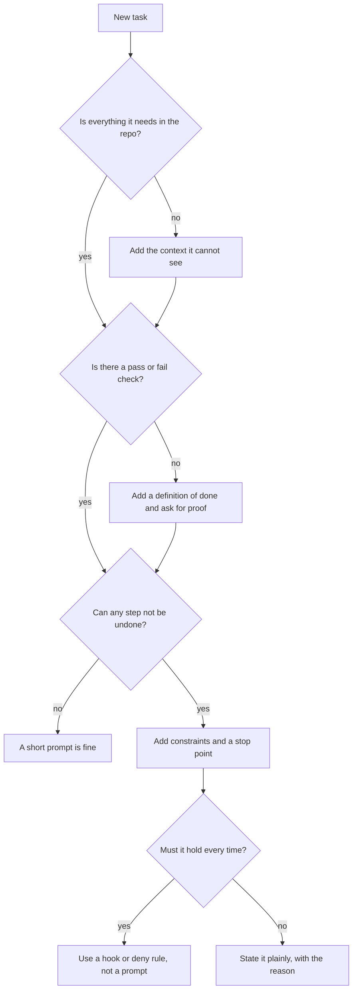
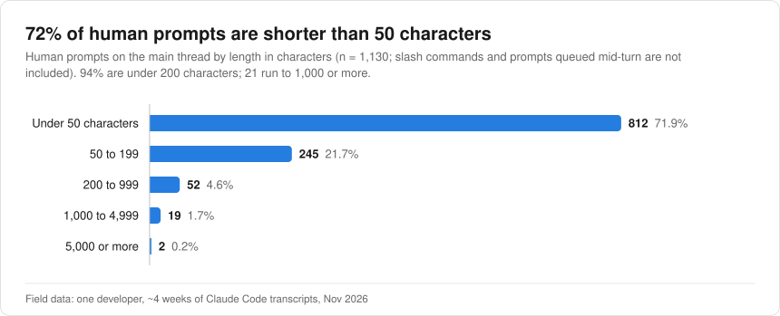

# 34 — Prompt cookbook and anti-patterns

After this chapter you can write a prompt that an agent can finish without you, pick a ready template for the most common jobs, and spot the ten prompt habits that cause rework. You will also know when a five-word prompt is the right one.

## Mental model

A prompt is a brief to a capable colleague who has read the repository but cannot read your mind. The official guidance starts from an encouraging place: "in most cases, your first plain prompt in a fresh session already does the right thing". What you add on top is whatever the agent cannot find for itself: the goal behind the task, the facts that are not in the repo, the limits, and the check that says it is finished.

A prompt is also the weakest layer of control. The model reads it and may decide a line does not apply. So a prompt is for direction, and a hook or deny rule is for anything that has to hold every time (see [Chapter 16](16-hooks.md) and [Chapter 29](29-security-and-guardrails.md)).



## What a strong prompt contains

| Part | The question it answers | Example line |
|---|---|---|
| Goal | What is true when this is finished? | "The checkout test passes 20 runs in a row." |
| Context | What can the agent not learn from the repo? | "It fails about one run in five on CI and never locally. CI runs tests in parallel." |
| Constraints | What is out of bounds, including the obvious shortcut? | "Do not add retries or raise timeouts." |
| Definition of done | Which check comes back pass or fail? | "Twenty consecutive runs of `npm test -- checkout` pass." |
| Proof | What must the reply show? | "Show the root cause, the diff, and the command with its output." |

[Chapter 22](22-explore-plan-implement-verify.md) calls this a task brief and sorts the parts by need: goal, constraints, definition of done and a proof command are required; context the repo does not show and a budget are added when they apply.

The same request, before and after:

```text
fix the flaky checkout test
```

```text
Goal: tests/checkout.spec.ts passes 20 runs in a row.
Context: it fails about 1 run in 5 on CI and never on my laptop. CI runs tests in parallel. Log: @logs/ci-failure.txt
Constraints: do not add retries or raise timeouts. Do not change the checkout API.
Done: 20 consecutive runs of `npm test -- checkout` pass.
Proof: show the root cause, the diff, and the test command with its output.
```

The constraint line does the most work. Without it, a retry wrapper is the shortest route to green. In the field data, the prompts that paid off shared four ingredients: an observable end state, the constraint that rules out the obvious answer, what is already approved, and how success will be shown.

## Wording: what the current guidance says

Much prompt advice from 2024 and 2025 was a workaround for weaker models. The current best-practices page retires it explicitly (as of Nov 2026).

| Older habit | Current guidance |
|---|---|
| IMPORTANT, capitals or "YOU MUST" on a rule the model keeps missing | Write the line plainly. Piling on emphasis "mostly makes Claude over-apply the rule". If the rule cannot bend, make it a hook or a deny rule. |
| "think hard", "think harder", "be thorough" | Effort is the control: `/effort high` or `/effort xhigh`. Those phrases are ordinary prompt text. `ultrathink` still works. |
| "keep going", "don't be lazy", "loop until done" | More likely to cause over-work than to fix a stall. If a run stops short, say `continue`. For unattended runs use `/goal` or a `Stop` hook. |
| Describing the architecture and file layout | Claude reads the repo. Write down only what is not in it. |
| "Hand it to a subagent for a better answer" | Delegating does not improve the answer. A fresh reviewer helps because it has not seen your reasoning. |

Three lines from the vendor's own prompting guide show the house style: a plain sentence, and where it matters, the reason.

- "Avoid over-engineering. Only make changes that are directly requested or clearly necessary."
- "Never speculate about code you have not opened."
- "It is unacceptable to remove or edit tests because this could lead to missing or buggy functionality."

> **Note:** If you keep adding emphasis to a line and the agent still misses it, the docs say that is the sign the line belongs in a hook. Emphasis is not an enforcement mechanism.

## Templates

Seventeen templates, grouped by job. Replace everything in `<angle brackets>` and delete the lines that do not apply. Templates marked *docs* follow an official example; the rest are paraphrased from prompts that worked in one developer's sessions.

### Explore and explain

**1. Overview and trace** (docs). Read-only, so it is safe as a first prompt in an unfamiliar repo.

```text
Give me an overview of this codebase: what it does, how it is laid out, how to build and test it.
Then trace <one user action, for example the login process> from <entry point> to <data store>.
List the files involved in order, with one line on what each does. Do not change any files.
```

**2. Research before planning.** For when the obvious answer is ruled out and the right one depends on current facts.

```text
Problem: <symptom, with a number if you have one>.
Constraint: <the obvious fix we cannot use, and why>.
Resource: <what we do have>.
Research first: read the current official docs for <tools and versions>. Do not rely on memory.
Then propose two or three options with trade-offs and your recommendation. No code until I approve one.
```

### Bug fix

**3. Reproduce, fix, prove.**

```text
Bug: expected <X>, got <Y>. Evidence: <@path/to/log, or the command that shows it>.
1. Reproduce it first and show me the failing test or trace.
2. Fix the cause, not the symptom. Change only what the fix needs.
3. Prove it with the same reproduction: show the command and its output.
If you cannot reproduce it, stop and tell me what you tried.
```

**4. Root cause plus prevention.** In the field this produced a cause analysis, a migration and a guard hook from one prompt.

```text
<X> happened even though we already have <Y, the thing that should have prevented it>.
Find out why <Y> did not catch it. Show evidence for the cause, not a guess.
Then fix it so it cannot recur unless someone decides it should. Propose the smallest change,
and say whether it belongs in a test, a hook or a line in CLAUDE.md.
```

### Feature

**5. Interview to a spec** (docs). The second line is the official wording. Then start a fresh session to build from the file.

```text
I want to build <feature, in one sentence>.
Interview me until you could write the spec, then write it to SPEC.md.
Ask one question at a time. Cover: who uses it and why, what is out of scope, edge cases,
acceptance criteria I can check, and anything you could not learn from the repo.
```

**6. Build from the spec, with a budget.**

```text
Implement SPEC.md.
Constraints: <do not change X>; <no new dependencies>; <keep the old path as a fallback>.
Done means: <command> passes, and every acceptance criterion in SPEC.md has a test or a demo.
Budget: <90 minutes, one PR>. Tell me at the halfway point if you will miss it.
Finish with: what you built, the commands you ran with their output, and anything not done.
```

### Refactor

**7. Small steps behind an invariant.**

```text
Refactor <module> to <target shape>. Behaviour must not change.
Work in small steps. After each step run <test command>, and commit when it passes.
Do not change the public interface of <X>. Do not edit tests to make them pass.
If a step needs a behaviour change, stop and ask.
```

### Tests

**8. Red, then green.** Seeing the test fail first proves that it exercises the new code.

```text
Use red/green TDD for <behaviour>.
1. Write the tests first. Run them and show me that they fail for the right reason.
2. Implement until they pass. Do not edit the tests after step 1; if a test is wrong, stop and say why.
3. Run the full suite with <command> and show the output.
```

**9. Close a coverage gap** (docs).

```text
Find functions in <file or module> that are not covered by tests.
Add tests for the three riskiest, including edge cases and error paths.
Run the new tests. If one fails because the code is wrong, report it; do not weaken the assertion.
```

### Review

**10. Fresh-context review against the spec** (docs). Keep "skip style": a reviewer asked to find problems will always find something.

```text
Use a subagent to review the <feature> diff against SPEC.md.
Report gaps that affect correctness and skip style.
For each finding give the file and line, why it is wrong, and how you would check it.
```

**11. Bottleneck audit.**

```text
<Process> is too slow: <what you observe, with numbers>. We already tried <Y>.
Audit it end to end and measure where the time goes before proposing anything.
Give me the top three bottlenecks with evidence. For each: the change you propose and the time you expect it to save.
```

### Delegation brief for a subagent

**12. Worker brief.** A subagent that is not a fork starts without your conversation, so the brief must stand alone ([Chapter 14](14-subagents.md)). The four parts Anthropic's own multi-agent write-up asks for are an objective, an output format, guidance on tools, and clear boundaries.

```text
Objective: <one outcome, in one sentence>.
Context you do not have: <decisions already made>; <files that matter>; <what was ruled out>.
Step 0: work in <worktree path>. Run `git remote -v` and confirm the repository before editing.
Scope: you own <files or directory>. Edit nothing else; if you need a change elsewhere, report it.
Check: use <test command>. Do not wait on CI or other long jobs.
Stop conditions: on any rejected tool call or blocker, report it and end your turn.
Return: files changed, commands run with their results, what is not done, open questions.
```

### Handoff note

**13. Hand off to a fresh session.** Use it before a break, near a usage limit, or when the context has drifted.

```text
Write a handoff note to <path> so that a fresh session can continue without this conversation.
Include: the goal and the definition of done; the branch and last commit; uncommitted changes;
what is verified (command and result) and what is only assumed; decisions made and why;
the next three steps, starting with the exact next command; open questions for me.
```

### Incident follow-up

**14. Turn this into a rule and a hook.** The retro form from [Chapter 33](33-case-studies-from-real-work.md), as a prompt.

```text
<What happened, in one or two sentences>. Run a retro on it. Do not change any file yet.
Report: what happened; how it was noticed; the root cause (mechanism, not blame); one-off or pattern.
Propose the weakest fix that would hold: none, a memory note, a rule, a hook or a test.
For a rule: the exact line, with its reason and the safe alternative.
For a hook: the event, the matcher, what it blocks, the message it prints, and how you will test that it blocks.
Wait for my approval before writing anything.
```

### Status and wrap-up

**15. Long-running work with a cadence.** Say this at the start, not after an hour of silence.

```text
While this runs, report every <15> minutes and on every terminal event (pass, fail, timeout).
Arm a watcher now. Do not sleep-poll.
Start each report with three lines: running / finished / next step and ETA.
```

**16. Standing authorisation, written once.** This one goes in `CLAUDE.md`, not in a prompt, so that you stop retyping it.

```markdown
## Standing authorisation
- Without asking: commit, push to a branch, open pull requests.
- Merge only when required checks are green on the current head and no review thread is open.
- Always wait for me: anything that touches behaviour, auth, infrastructure, schema or money.
- A pull request this session did not open: ask its owner before merging.
```

**17. Wrap-up with evidence.**

```text
Wrap up. Report only what this session created or changed.
- Done: <item> -> evidence (command and output, PR link, or screenshot).
- Not done or deferred: <item> -> why, and the next step.
- Needs me: only the steps that only I can do, each with the exact URL or command.
Re-check remote state now (PRs, CI, deploys). Do not report from memory.
```

## Anti-patterns: ten before-and-after pairs

Each "before" is a real prompt from the field data, lightly paraphrased. Each one led to visible rework, repeated turns or a recorded incident.

| # | Before | After | Why the first version costs rework |
|--:|---|---|---|
| 1 | "status?" or "keep me updated" | Template 15: a cadence, a watcher and a report format | Nothing wakes the agent during a wait, so every update costs you a turn |
| 2 | "All approved, don't yield for me", retyped each session | Template 16, once, with edges | Without edges the agent either asks too often or reaches too far |
| 3 | "Merge all." | "Merge the PRs this session opened once they are green with no open threads. For anyone else's PR, ask the owning session first, and tell me which ones you skipped and why." | A green PR that another session was holding on purpose got merged and auto-deployed |
| 4 | "Fix it." Then: "again, same thing", plus a log path | Template 3, plus "add a one-click diagnostics export so one file is enough next time" | Four rounds over two days with the human as the test harness |
| 5 | "Can you release the new version so I can download it?" | "Release it and confirm it is installable on my device: check that the build reached the tester group, not just that it was processed." | "Released" was reported twice before anything reached the device |
| 6 | "Add the watchdog auto-restart." (on a host shared by two projects) | "In project A's repo only, add ... Do not modify anything owned by another project on that host. Name the owning repo before each edit." | The agent edited and deployed the other project's script; all of it was reverted |
| 7 | One message with half a dozen asks and eight screenshots | "Turn these into issues with acceptance criteria and show me the list. I'll rank them; implement the top three and demo each against its criteria." | Rounds of corrections, because nothing said what done meant for each ask |
| 8 | Credentials pasted into the prompt | "The credentials are in the secret store. Read them from there, write them only to a git-ignored env file, and never echo the values." | The values now sit in a plaintext transcript on disk |
| 9 | "Do them all, on every repo, don't stop until it's all done." | "Do one repo end to end as the pilot and show me every setting it changes. After I confirm, fan out to the rest, one agent per repo." | A fleet-wide policy change had to be partly undone the same day |
| 10 | "Why is it all so slow?" (asked after 13 hours) | "Budget: 90 minutes. One PR. Two review rounds at most; later findings become issues. Tell me at the halfway point if you will miss." | The question arrived after the cost was already paid |

## From the field

**Prompt length and the status-check habit.** These numbers come from one developer's transcripts over a rolling window of about four weeks. They describe one working style. They are not a benchmark.



| Length of a human prompt | Count | Share |
|---|--:|--:|
| Under 50 characters | 812 | 72% |
| 50 to 199 | 245 | 22% |
| 200 to 999 | 52 | 5% |
| 1,000 to 4,999 | 19 | 2% |
| 5,000 or more | 2 | under 1% |

The friction analysis puts the median prompt at 27 characters. Of the 1,130 prompts in the table, 682 were typed, 240 were prompt suggestions the human accepted, 182 were queued while the agent was busy, and 26 arrived through the SDK with a human origin. An interactive session had a median of 14 human prompts (90th percentile 63), and each human prompt was followed, on average, by about 88 model responses and 93 tool calls.

Read that with care. Short prompts dominate because most prompts steer work that already has its context: an approval, a ruling, a nudge. That is healthy. What the long prompts did was open work, and the templates above are drawn from them. The friction analysis calls them "the exceptions that paid off".

The unhealthy part is a single habit. A separate pass over 37 substantive sessions counted 218 status checks, 195 of them literally `status?`, which is about one in five prompts the human typed (regex counts, good to about ±30%). The same pass found only 12 interrupted turns (the usage count finds 19 on the main thread), so supervision was by polling. Writing the lesson into two project memories did not help: the share was 13–17% in October and 21–22% in November. The blanket approval "all approved, don't yield for me" was retyped 33 times across 17 sessions until it became a standing rule in `CLAUDE.md`.

> **Field note:** The questions that produced real root causes were precise ones: "how did you determine that number?" and "which calls actually prompted?". The vague "why is it slow?" produced apologies first.

## When a short prompt is fine

- **The context is already in the session.** `continue`, "yes, do option 2", or a numbered reply to numbered questions.
- **The repo carries the definition of done.** If `CLAUDE.md` names the test command, "add a `--json` flag to the export command" is enough.
- **You are asking, not changing.** "How does logging work here?" needs no constraints.
- **Everything is reversible.** A local edit that Git or `/rewind` can undo.

Write the longer prompt when you open work that will run for a long time, when a step cannot be undone, when someone else's work is in reach ("merge all"), and when you brief a subagent that starts fresh. And when two corrections have failed, do not send a third short one: run `/clear` and write one better prompt.

A numbered reply is the best short prompt there is. It answers the agent's questions one by one, separates blockers from recommendations, and closes the loop:

```text
1. Yes.
2. Default off, unless configured per repo.
3. The minimum version is fine; go higher only if needed.
4. Do what you recommend. If something truly needs me, explain it step by step;
   if it is a recommendation and not a blocker, continue.
Plan approved.
```

## Common problems

| Symptom | Cause | Fix |
|---|---|---|
| The agent builds something other than what you meant | The prompt left out what it could not see | Name the file, the symptom and what "fixed" looks like; or use template 5 first |
| A rule is applied where it should not be | Emphasis piled on a guideline | Reword it plainly, with the reason; move a no-exceptions rule to a hook |
| The agent does far more than you asked | "Don't stop until it's all done"; no scope line | State the scope and a budget; "only make changes that are directly requested or clearly necessary" |
| The third correction fails like the first two | The failed attempts stay in context | `/clear`, then one better prompt |
| A subagent does the wrong thing | The brief assumed your conversation | Template 12, or a fork that inherits the conversation |
| "Done" arrives without evidence | The prompt did not ask for proof | Name the check; ask for the command and its output |
| A `/goal` run never ends | The condition was an imperative such as "do not stop" | Phrase a condition that can be checked as true or false |
| You type `status?` every few minutes | No cadence was set | Template 15 at the start of long work |

## Checklist

- [ ] The prompt states the end state, not the activity.
- [ ] It says what the agent cannot learn from the repo.
- [ ] It names the constraint that rules out the obvious shortcut.
- [ ] It names a pass-or-fail check and asks for the output.
- [ ] It says what is already approved and what waits for you.
- [ ] Long work has a cadence and a budget.
- [ ] No capitals for emphasis, no "think harder", no secrets.
- [ ] Every subagent brief can be understood without the conversation.

## Try it

1. Take a recent prompt of yours that led to more than two corrections. Rewrite it with the five parts, run it in a fresh session, and compare the number of turns.
2. Before your next long task, paste template 15. Afterwards, count how many times you still asked for status.
3. Find an approval you retype often. Write it once as a standing rule with edges (template 16), and note the first time the agent stops at an edge.

## Sources

- https://code.claude.com/docs/en/best-practices
- https://code.claude.com/docs/en/common-workflows
- https://platform.claude.com/docs/en/build-with-claude/prompt-engineering/claude-prompting-best-practices
- https://code.claude.com/docs/en/sub-agents
- https://www.anthropic.com/research/multi-agent-research-system (what a delegation brief needs)
- https://simonwillison.net/guides/agentic-engineering-patterns/red-green-tdd/ (red/green TDD with agents)
- Field data (not public): one developer's session transcripts, memory files and retros, about four weeks to Nov 2026

---

[← Previous: Case studies from real work](33-case-studies-from-real-work.md) · [Contents](README.md) · [Next: Cheat sheet →](A-cheat-sheet.md)
