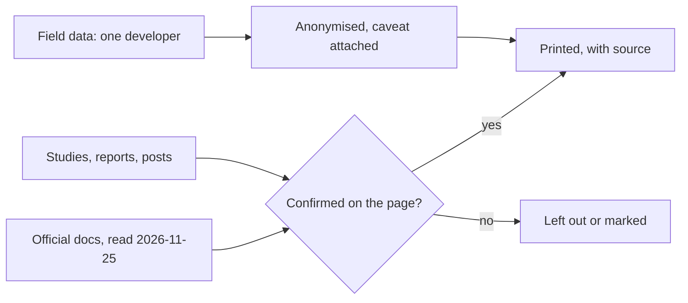

# Appendix D — Sources and further learning

Every source the chapters cite, grouped by kind, with what each one is good for and which chapters use it; then the community canon and a note on how the book was sourced.

**How to read the tables.** "Chapters" lists the chapters whose Sources section cites the page, and each number links to that chapter. A row with several links covers pages the book uses together; its chapter list is the union. Titles are the pages' own, shortened in places.

> **Note:** Link check on 2026-11-25, extended on 2026-11-26 for chapters 05, 11 and 19 to 21: the 34 chapters cite 231 unique URLs. 219 answered directly, 12 redirected to a new address and none failed. The 14 in-page anchors the chapters cite all exist. Addresses that moved are printed here in their new form and listed once under [Moved addresses](#moved-addresses). Docs move fast, so expect that list to grow.

## Official Claude Code docs

All at `code.claude.com/docs/en/`. A machine-readable index of the whole site is at <https://code.claude.com/docs/llms.txt>.

### Start here

| Source | Good for | Chapters |
|---|---|---|
| [Best practices for Claude Code](https://code.claude.com/docs/en/best-practices) | The official working advice, rewritten since most tutorials were made: give Claude a check to run, say what it cannot see, enforce what must never bend. Read it before any older tutorial. | [01], [02], [04], [06], [07], [08], [09], [10], [14], [16], [22], [23], [24], [26], [27], [29], [30], [31], [32], [33], [34] |
| [How Claude Code works](https://code.claude.com/docs/en/how-claude-code-works) | The agentic loop, what the harness adds to the model, and what happens when context fills up. | [01], [02], [04], [05], [08], [10], [14] |
| [Explore the .claude directory](https://code.claude.com/docs/en/claude-directory) | Where every file Claude Code reads and writes lives: settings, transcripts, file history, plugin cache. | [05] |
| [Overview](https://code.claude.com/docs/en/overview) · [Advanced setup](https://code.claude.com/docs/en/setup) · [Authentication](https://code.claude.com/docs/en/authentication) · [Platforms and integrations](https://code.claude.com/docs/en/platforms) | Installing, signing in and choosing a surface. | [06] |
| [Common workflows](https://code.claude.com/docs/en/common-workflows) | Step-by-step recipes for everyday tasks. | [01], [06], [07], [22], [24], [34] |
| [CLI reference](https://code.claude.com/docs/en/cli-reference) | Every `claude` subcommand and flag. The page to check before you copy a flag from anywhere else. | [05], [06], [07], [19], [25], [27], [30] |
| [Commands](https://code.claude.com/docs/en/commands) | The slash-command list, with aliases. | [07], [08], [10], [11], [14], [15], [18], [19], [20], [22], [23], [24], [25], [30] |
| [Interactive mode](https://code.claude.com/docs/en/interactive-mode) | Keyboard shortcuts, input prefixes and multiline input. | [06], [07], [10], [18], [25] |
| [Manage sessions](https://code.claude.com/docs/en/sessions) | Naming, continuing and resuming sessions. | [05], [06], [07], [10] |
| [Tools reference](https://code.claude.com/docs/en/tools-reference) | The built-in tools, their limits and how the Bash tool behaves. | [03], [05], [25], [32] |

### Context, memory, settings and permissions

| Source | Good for | Chapters |
|---|---|---|
| [How Claude remembers your project](https://code.claude.com/docs/en/memory) | `CLAUDE.md` locations and imports, `.claude/rules/`, auto memory, and how `AGENTS.md` is read. | [02], [05], [06], [08], [11], [20], [28], [31] |
| [Explore the context window](https://code.claude.com/docs/en/context-window) | What loads at session start, what each item costs, and what survives compaction. | [02], [04], [05], [08], [10], [14], [15], [18], [32], [33] |
| [Checkpointing](https://code.claude.com/docs/en/checkpointing) | What `/rewind` restores and what it does not: Bash-only changes and subagent edits. | [05], [06], [10], [14], [22], [25], [32], [33] |
| [Model configuration](https://code.claude.com/docs/en/model-config) · [Speed up responses with fast mode](https://code.claude.com/docs/en/fast-mode) | Model aliases, effort levels and fast mode. | [02], [04], [07], [10] |
| [Settings files and precedence](https://code.claude.com/docs/en/settings) · [All settings](https://code.claude.com/docs/en/settings-reference) | The settings scopes, how they merge, and the full key list. | [05], [09], [10], [16], [31] |
| [Configure permissions](https://code.claude.com/docs/en/permissions) | Rule syntax, the deny, ask, allow order, MCP tool rules, and what runs before you trust a folder. | [03], [05], [06], [09], [13], [27], [29], [32], [33] |
| [Choose a permission mode](https://code.claude.com/docs/en/permission-modes) | The six modes, which one a session starts in, and what auto mode blocks. | [03], [05], [06], [07], [09], [10], [22], [27], [29], [32], [33] |
| [Configure the sandboxed Bash tool](https://code.claude.com/docs/en/sandboxing) | Operating-system limits on Bash commands, and what runs outside them. | [05], [09], [18], [29], [32] |
| [Deploy managed settings](https://code.claude.com/docs/en/managed-settings) · [Control MCP server access for your organization](https://code.claude.com/docs/en/managed-mcp) | Organisation-wide policy that individual users cannot override. | [09], [16], [29], [31] |
| [Environment variables](https://code.claude.com/docs/en/env-vars) | The variables Claude Code reads. | [13], [30] |

### Extending the harness

| Source | Good for | Chapters |
|---|---|---|
| [Extend Claude Code](https://code.claude.com/docs/en/features-overview) | A map of the extension points and when to use which. | [11], [19], [20], [28] |
| [Connect Claude Code to tools via MCP](https://code.claude.com/docs/en/mcp) · [Connect to MCP servers](https://code.claude.com/docs/en/mcp-quickstart) | Adding servers, scopes, `.mcp.json`, authentication, output limits and tool search. | [03], [05], [11], [12], [13], [27], [32] |
| [Create custom subagents](https://code.claude.com/docs/en/sub-agents) | Agent files and their frontmatter, what a subagent starts with, forks, preloaded skills. | [02], [05], [08], [11], [14], [15], [19], [25], [26], [28], [32], [34] |
| [Extend Claude with skills](https://code.claude.com/docs/en/skills) | `SKILL.md` layout, frontmatter and invocation control. States that custom commands were merged into skills. | [07], [11], [15], [20], [28] |
| [Hooks reference](https://code.claude.com/docs/en/hooks) · [Automate actions with hooks](https://code.claude.com/docs/en/hooks-guide) | Events, handler types, input and output, exit codes. The guide has examples you can copy. | [03], [05], [11], [16], [21], [23], [28], [29], [32], [33] |
| [Plugins overview](https://code.claude.com/docs/en/plugins/overview) · [Create a Claude Code plugin](https://code.claude.com/docs/en/plugins/create) · [Add components to a plugin](https://code.claude.com/docs/en/plugins/components) | Building a plugin from an empty directory. | [11], [17], [20], [21] |
| [Plugin manifest reference](https://code.claude.com/docs/en/plugins/manifest-reference) · [Plugin loading reference](https://code.claude.com/docs/en/plugins/loading) · [Plugin commands reference](https://code.claude.com/docs/en/plugins/cli-reference) | `plugin.json` fields, path variables, load rules and the `claude plugin` commands. | [05], [13], [17], [18], [19], [21], [31] |
| [Create a marketplace](https://code.claude.com/docs/en/plugins/create-marketplace) · [Marketplace reference](https://code.claude.com/docs/en/plugins/marketplace-reference) · [Install and manage plugins](https://code.claude.com/docs/en/plugins/install) | Publishing and installing plugins; how versions and updates resolve. | [17], [21], [31] |
| [Manage Claude Code plugins for your organization](https://code.claude.com/docs/en/plugins/org) · [Plugin security and trust](https://code.claude.com/docs/en/plugins/security) | Team distribution, and what to review before you install someone else's plugin. | [17], [21], [29], [31] |
| [Publish and distribute a plugin](https://code.claude.com/docs/en/plugins/publish) · [Host and maintain a marketplace](https://code.claude.com/docs/en/plugins/host-marketplace) · [Anthropic's marketplaces](https://code.claude.com/docs/en/plugins/anthropic-marketplaces) | Releasing a plugin, running a team marketplace, and the official marketplace that ships `plugin-dev` and `skill-creator`. | [21] |
| [Test plugins with evals](https://code.claude.com/docs/en/plugin-evals) | Eval suites for skills and plugins. | [15], [17], [20], [21], [23] |
| [Output styles](https://code.claude.com/docs/en/output-styles) · [Customize your status line](https://code.claude.com/docs/en/statusline) | Changing how Claude replies, and what the status line script receives. | [11], [18] |
| [Customize keyboard shortcuts](https://code.claude.com/docs/en/keybindings) · [Configure your terminal for Claude Code](https://code.claude.com/docs/en/terminal-config) · [Voice dictation](https://code.claude.com/docs/en/voice-dictation) | Keybindings, terminal setup and voice input. | [07], [18] |

### Parallel work, automation and the Agent SDK

| Source | Good for | Chapters |
|---|---|---|
| [Run parallel sessions with worktrees](https://code.claude.com/docs/en/worktrees) | `--worktree`, worktree isolation for subagents, and cleanup. | [14], [25], [32] |
| [Run agents in parallel](https://code.claude.com/docs/en/agents) · [Manage multiple agents with agent view](https://code.claude.com/docs/en/agent-view) · [Orchestrate teams of Claude Code sessions](https://code.claude.com/docs/en/agent-teams) | The native ways to run several agents at once. | [25], [26] |
| [Orchestrate subagents at scale with dynamic workflows](https://code.claude.com/docs/en/workflows) | Scripted fan-out over many subagents. | [26] |
| [Run prompts on a schedule](https://code.claude.com/docs/en/scheduled-tasks) · [Automate work with scheduled tasks](https://code.claude.com/docs/en/routines) · [Use Claude Code in the cloud](https://code.claude.com/docs/en/claude-code-on-the-web) | `/loop`, scheduled tasks and cloud sessions. | [25] |
| [Configure cloud environments](https://code.claude.com/docs/en/cloud-environments) | What a cloud session reads from the repository, and what never enters its VM. | [05] |
| [Run Claude Code programmatically](https://code.claude.com/docs/en/headless) | `claude -p`: output formats, `--bare`, and permissions when nobody can answer a prompt. | [05], [08], [09], [27], [29], [30], [32] |
| [Claude Code GitHub Actions](https://code.claude.com/docs/en/github-actions) | The official action, its inputs and the documented workflows. | [05], [24], [27], [32] |
| [Code Review](https://code.claude.com/docs/en/code-review) · [Review locally with /code-review](https://code.claude.com/docs/en/code-review-local) · [Find bugs with ultrareview](https://code.claude.com/docs/en/ultrareview) | Managed pull request review, local review and ultrareview, with pricing. | [24], [31] |
| [Agent SDK overview](https://code.claude.com/docs/en/agent-sdk/overview) · [Quickstart](https://code.claude.com/docs/en/agent-sdk/quickstart) · [Python reference](https://code.claude.com/docs/en/agent-sdk/python) · [TypeScript reference](https://code.claude.com/docs/en/agent-sdk/typescript) · [Use Claude Code features in the SDK](https://code.claude.com/docs/en/agent-sdk/claude-code-features) | Running the same loop from your own code. | [05], [27] |
| [How the agent loop works](https://code.claude.com/docs/en/agent-sdk/agent-loop) · [Configure permissions (SDK)](https://code.claude.com/docs/en/agent-sdk/permissions) · [Modifying system prompts](https://code.claude.com/docs/en/agent-sdk/modifying-system-prompts) | The loop step by step, the full six-step permission pipeline (hooks, deny, ask, mode, allow, callback), and the system-prompt presets. | [05] |

### Security, cost and operations

| Source | Good for | Chapters |
|---|---|---|
| [Security](https://code.claude.com/docs/en/security) | The security model: what Claude Code protects against and what stays your job. | [05], [06], [09], [12], [17], [27], [29], [31] |
| [Data usage](https://code.claude.com/docs/en/data-usage) · [Legal and compliance](https://code.claude.com/docs/en/legal-and-compliance) | What is sent and kept, and which terms apply to which plan. | [05], [29], [30], [31] |
| [Manage costs effectively](https://code.claude.com/docs/en/costs) | What drives spend and the documented ways to reduce it. | [04], [10], [11], [13], [22], [26], [27], [30], [32] |
| [How Claude Code uses prompt caching](https://code.claude.com/docs/en/prompt-caching) | Cache lifetime and the actions that invalidate the cache mid-session. | [04], [05], [30] |
| [Monitoring](https://code.claude.com/docs/en/monitoring-usage) | Exporting usage metrics and events with OpenTelemetry. | [30] |
| [Troubleshooting](https://code.claude.com/docs/en/troubleshooting) · [Troubleshoot installation and login](https://code.claude.com/docs/en/troubleshoot-install) | The official fixes for common runtime and install problems. | [02], [04], [06], [07], [10], [32] |
| [Error reference](https://code.claude.com/docs/en/errors) · [Debug your configuration](https://code.claude.com/docs/en/debug-your-config) | What each error means, and how to find which file a setting, hook or server came from. | [06], [11], [13], [16], [19], [30], [32] |

### Official repositories and tracker

| Source | Good for | Chapters |
|---|---|---|
| [anthropics/claude-code-action](https://github.com/anthropics/claude-code-action) | The GitHub Action itself; the full input list is in its `docs/usage.md`. | [27] |
| [anthropics/claude-plugins-official](https://github.com/anthropics/claude-plugins-official) · [anthropics/claude-plugins-community](https://github.com/anthropics/claude-plugins-community) | The two marketplaces Anthropic publishes. | [17], [21] |
| [plugin-dev](https://github.com/anthropics/claude-plugins-official/tree/main/plugins/plugin-dev) · [skill-creator](https://github.com/anthropics/claude-plugins-official/tree/main/plugins/skill-creator) | The two optional authoring plugins in the official marketplace: a guided plugin build with an agent creator and validators, and a skill drafter with its own eval format. | [19], [20] |
| [Issue 6235, "Feature Request: Support AGENTS.md."](https://github.com/anthropics/claude-code/issues/6235) | How much demand there was for cross-tool instruction files. | [31] |
| [Issue 22507, fabricated test results in a PR description](https://github.com/anthropics/claude-code/issues/22507) | A public report of a false "tests pass" claim. | [23] |

## Claude API and platform docs

All at `platform.claude.com/docs/en/` except the last row. Prices, limits and model names here are the ones to re-check: the book's copies are "as of Nov 2026".

| Source | Good for | Chapters |
|---|---|---|
| [Glossary](https://platform.claude.com/docs/en/about-claude/glossary) | Short definitions of tokens and related terms. | [02] |
| [Token counting](https://platform.claude.com/docs/en/build-with-claude/token-counting) | Counting tokens before you send a request. | [02], [03] |
| [Context windows](https://platform.claude.com/docs/en/build-with-claude/context-windows) | Window sizes, what counts against them, and context rot. | [02], [04], [10] |
| [Models overview](https://platform.claude.com/docs/en/models/overview) · [Choosing the right model](https://platform.claude.com/docs/en/about-claude/models/choosing-a-model) · [Model IDs and versioning](https://platform.claude.com/docs/en/about-claude/models/model-ids-and-versions) | The current lineup, how to pick, and how IDs and aliases work. | [02], [30] |
| [Pricing](https://platform.claude.com/docs/en/about-claude/pricing) | Per-token prices, cache multipliers and size examples. | [02], [03], [04], [30] |
| [Vision](https://platform.claude.com/docs/en/build-with-claude/vision) | How images are counted in tokens. | [02] |
| [Thinking](https://platform.claude.com/docs/en/build-with-claude/thinking) · [Effort](https://platform.claude.com/docs/en/build-with-claude/effort) | Reasoning tokens, and the setting that trades depth for cost. | [02], [03], [04], [10], [30] |
| [How tool use works](https://platform.claude.com/docs/en/agents-and-tools/tool-use/how-tool-use-works) · [Parallel tool use](https://platform.claude.com/docs/en/agents-and-tools/tool-use/parallel-tool-use) · [Stop reasons and fallback](https://platform.claude.com/docs/en/build-with-claude/handling-stop-reasons) | The request and response shapes behind the agentic loop. | [03] |
| [Manage tool context](https://platform.claude.com/docs/en/agents-and-tools/tool-use/manage-tool-context) · [Tool search tool](https://platform.claude.com/docs/en/agents-and-tools/tool-use/tool-search-tool) | Keeping tool definitions from filling the window. | [03] |
| [Prompt caching](https://platform.claude.com/docs/en/build-with-claude/prompt-caching) · [Tool use with prompt caching](https://platform.claude.com/docs/en/agents-and-tools/tool-use/tool-use-with-prompt-caching) | Cache breakpoints, lifetimes, prices, and what invalidates a prefix. | [04], [30] |
| [Compaction overview](https://platform.claude.com/docs/en/build-with-claude/compaction) · [Compaction on demand](https://platform.claude.com/docs/en/build-with-claude/compaction-on-demand) · [Compaction at a token threshold](https://platform.claude.com/docs/en/build-with-claude/compaction-threshold) · [Context editing](https://platform.claude.com/docs/en/build-with-claude/context-editing) | Server-side ways to shrink a long conversation. | [04] |
| [Prompting best practices](https://platform.claude.com/docs/en/build-with-claude/prompt-engineering/claude-prompting-best-practices) | Current wording guidance for prompts. | [23], [32], [34] |
| [Skill authoring best practices](https://platform.claude.com/docs/en/agents-and-tools/agent-skills/best-practices) | Writing skill descriptions and bodies, and testing them. | [15], [23] |
| [Python SDK](https://platform.claude.com/docs/en/cli-sdks-libraries/sdks/python) | Installing and calling the `anthropic` Python package that the API examples use. | [03] |
| [Commercial Terms of Service](https://www.anthropic.com/legal/commercial-terms) | Ownership of outputs and the intellectual-property terms for paid commercial use. | [31] |

## Anthropic posts

Engineering posts now live at `anthropic.com/research/<slug>`. Each post describes the tools of its date, and the oldest carries a banner saying so. The last row is press coverage of an Anthropic announcement, not a post.

| Source | Good for | Chapters |
|---|---|---|
| [Building effective AI agents (Dec 2024)](https://www.anthropic.com/research/building-effective-agents) | The workflow-versus-agent vocabulary, five workflow patterns and the "start simple" rule. | [01], [03], [26] |
| [Effective context engineering for AI agents (Sep 2025)](https://www.anthropic.com/research/effective-context-engineering-for-ai-agents) | The attention budget, and four techniques: just-in-time retrieval, compaction, note-taking, sub-agents. | [01], [02], [03] |
| [How we built our multi-agent research system (Jun 2025)](https://www.anthropic.com/research/multi-agent-research-system) | Orchestrator-worker design and its token cost. Its results are for research tasks, not coding. | [01], [04], [14], [26], [30], [32], [34] |
| [Effective harnesses for long-running agents (Nov 2025)](https://www.anthropic.com/research/effective-harnesses-for-long-running-agents) | Keeping work going across many sessions: a progress file, a feature list, a clean state at each stop. | [23], [26] |
| [Writing effective tools for AI agents (Sep 2025)](https://www.anthropic.com/research/writing-tools-for-agents) | Design rules for tools an agent will call. | [13] |
| [Introducing advanced tool use (Nov 2025)](https://www.anthropic.com/research/advanced-tool-use) | How much context tool definitions consume, and tool search as the answer. | [13] |
| [Demystifying evals for AI agents (Jan 2026)](https://www.anthropic.com/research/demystifying-evals-for-ai-agents) | Building evaluations for agents, prompts and skills. | [15], [23] |
| [How we built Claude Code auto mode](https://www.anthropic.com/research/claude-code-auto-mode) | How the auto-mode classifier works, with its measured acceptance and miss rates. | [05], [09], [29], [32] |
| [Making Claude Code safer with sandboxing](https://www.anthropic.com/research/claude-code-sandboxing) | The sandbox design and the reduction in permission prompts it reports. | [09], [29] |
| [An update on Claude Code quality reports](https://www.anthropic.com/research/april-23-postmortem) | A postmortem of a harness bug that surfaced as forgetfulness and repetition, which is easy to mistake for a context problem. | [30] |
| [Building a C compiler with parallel Claudes (Feb 2026)](https://www.anthropic.com/research/building-c-compiler) | A large parallel-agent project: what the tests had to be, and what it cost. | [26] |
| [How AI assistance impacts the formation of coding skills](https://www.anthropic.com/research/AI-assistance-coding-skills) | A controlled study of comprehension when learning with AI help. | [31] |
| [Steering Claude Code: when to use CLAUDE.md, skills, hooks, and subagents](https://claude.com/resources/articles/steering-claude-code-skills-hooks-rules-subagents-and-more) | When each extension point is the right tool, from the Claude blog. | [11] |
| [Anthropic unveils new rate limits to curb Claude Code power users (TechCrunch, Jul 2025)](https://techcrunch.com/2025/07/28/anthropic-unveils-new-rate-limits-to-curb-claude-code-power-users/) | Press coverage of the weekly usage limits announced for August 2025. | [30] |

## Model Context Protocol: specification and SDKs

Revision `2026-07-28` is current as of Nov 2026. Material that mentions an `initialize` handshake or an SSE endpoint describes the legacy protocol.

| Source | Good for | Chapters |
|---|---|---|
| [Architecture overview](https://modelcontextprotocol.io/docs/2026-07-28/learn/architecture) | Hosts, clients, servers and the primitives on one page. | [12] |
| [Key Changes](https://modelcontextprotocol.io/specification/2026-07-28/changelog) | What the stateless revision changed from `2025-11-25`. | [12] |
| [Versioning and Compatibility](https://modelcontextprotocol.io/specification/2026-07-28/basic/versioning) | How date-named versions work and how modern and legacy peers coexist. | [12] |
| [Transports](https://modelcontextprotocol.io/specification/2026-07-28/basic/transports) | stdio and Streamable HTTP. | [12] |
| [Discovery](https://modelcontextprotocol.io/specification/2026-07-28/server/discover) | `server/discover`, which replaced the handshake. | [12] |
| [Tools](https://modelcontextprotocol.io/specification/2026-07-28/server/tools) | `tools/list`, `tools/call`, the two kinds of error and the human-in-the-loop guidance. | [12], [13], [29] |
| [Resources](https://modelcontextprotocol.io/specification/2026-07-28/server/resources) | Resources; the prompts page sits next to it. | [12] |
| [Pagination](https://modelcontextprotocol.io/specification/2026-07-28/server/utilities/pagination) | Cursors for list results. | [12] |
| [Multi Round-Trip Requests](https://modelcontextprotocol.io/specification/2026-07-28/basic/patterns/mrtr) | How a server asks the client for more input. | [12] |
| [Authorization](https://modelcontextprotocol.io/specification/2026-07-28/basic/authorization) | Authorization for remote servers. | [12] |
| [Build an MCP server](https://modelcontextprotocol.io/docs/2026-07-28/develop/build-server) | The Python and TypeScript quickstart. | [13] |
| [Inspector CLI client](https://modelcontextprotocol.io/docs/2026-07-28/tools/inspector/cli) | Testing a server from the command line and in CI. | [13] |
| [Python SDK: Testing](https://py.sdk.modelcontextprotocol.io/get-started/testing/) · [Python SDK: Handling errors](https://py.sdk.modelcontextprotocol.io/servers/handling-errors/) | In-process tests and the SDK's error conventions. | [13] |

## Other tools and standards

| Source | Good for | Chapters |
|---|---|---|
| [AGENTS.md](https://agents.md/) · [agentsmd/agents.md](https://github.com/agentsmd/agents.md) | What the cross-tool instruction file does and does not specify. | [08], [28] |
| [Agent Skills overview](https://agentskills.io/home) · [Specification](https://agentskills.io/specification) | The cross-tool `SKILL.md` standard. | [15], [28] |
| [Cursor: Rules](https://cursor.com/docs/rules) · [Agent Skills](https://cursor.com/docs/skills) · [Subagents](https://cursor.com/docs/subagents) · [Hooks](https://cursor.com/docs/hooks) · [MCP](https://cursor.com/docs/mcp) | How Cursor names and loads the same five building blocks. | [15], [28] |
| [Codex CLI: AGENTS.md](https://learn.chatgpt.com/docs/agent-configuration/agents-md) · [Build skills](https://learn.chatgpt.com/docs/build-skills) · [Subagents](https://learn.chatgpt.com/docs/agent-configuration/subagents) · [Hooks](https://learn.chatgpt.com/docs/hooks) · [Config basics](https://learn.chatgpt.com/docs/config-file/config-basic) | The Codex CLI equivalents. | [15], [28] |
| [Gemini CLI: GEMINI.md](https://geminicli.com/docs/cli/gemini-md/) · [Agent Skills](https://geminicli.com/docs/cli/skills/) · [Subagents](https://geminicli.com/docs/core/subagents/) · [Hooks](https://geminicli.com/docs/hooks/) | The Gemini CLI equivalents. | [15], [28] |
| [Antigravity CLI: transition announcement](https://developers.googleblog.com/an-important-update-transitioning-gemini-cli-to-antigravity-cli/) · [Migration guide](https://antigravity.google/docs/cli/gcli-migration) | What changed for Gemini CLI users in 2026, and which context files are still read. | [28] |
| [OpenCode: Instructions](https://opencode.ai/docs/instructions/) · [Skills](https://opencode.ai/docs/skills/) · [Agents](https://opencode.ai/docs/agents/) · [Plugins](https://opencode.ai/docs/plugins/) · [MCP servers](https://opencode.ai/docs/mcp-servers/) · [Config](https://opencode.ai/docs/config/) | The OpenCode equivalents. | [15], [28] |
| [GitHub Copilot: repository instructions](https://docs.github.com/en/copilot/how-tos/copilot-on-github/customize-copilot/add-custom-instructions/add-repository-instructions) · [Agent skills](https://docs.github.com/en/copilot/concepts/customizations/agent-skills) · [Hooks](https://docs.github.com/en/copilot/concepts/customizations/hooks) · [MCP](https://docs.github.com/en/copilot/concepts/customizations/mcp) | The Copilot equivalents. | [15], [28] |
| [GitHub Copilot code review](https://docs.github.com/en/copilot/concepts/agent-capabilities/agent-powered-workflows-and-operations/code-review) | What an automated review does and does not count for. | [24] |
| [github/spec-kit](https://github.com/github/spec-kit) · [Spec-driven development with AI (GitHub Blog, Sep 2025)](https://github.blog/ai-and-ml/generative-ai/spec-driven-development-with-ai-get-started-with-a-new-open-source-toolkit/) | The reference spec-driven toolkit and the reasoning behind it. | [22] |
| [git-worktree](https://git-scm.com/docs/git-worktree) | The Git feature underneath `--worktree`. | [25] |
| [Z-Shell FAQ, chapter 3](https://zsh.sourceforge.io/FAQ/zshfaq03.html) | Why zsh does not split unquoted variables, and why an unmatched glob is an error. | [32] |

## Studies, reports and security research

Read each with its caveat. Vendor reports sell something; surveys are self-reported; trials are small and date quickly.

### Productivity and quality

| Source | Good for | Chapters |
|---|---|---|
| [DORA: State of AI-assisted Software Development 2025](https://dora.dev/research/2025/dora-report/) · [Google Cloud announcement](https://cloud.google.com/blog/products/ai-machine-learning/announcing-the-2025-dora-report) · [Google blog summary](https://blog.google/innovation-and-ai/technology/developers-tools/dora-report-2025/) | Adoption, trust and the link to delivery stability. A survey of about 5,000 people. | [01], [24], [31] |
| [METR: early-2025 AI and experienced open-source developers (Jul 2025)](https://metr.org/blog/2025-07-10-early-2025-ai-experienced-os-dev-study/) | A randomized trial whose lasting value is the gap between felt and measured speed. METR marks it out of date. | [01], [24], [31] |
| [METR: changing the experiment design (Feb 2026)](https://metr.org/blog/2026-02-24-uplift-update/) | Why a clean 2026 measurement could not be produced. | [01] |
| [How much does AI impact development speed? (arXiv 2410.12944)](https://arxiv.org/abs/2410.12944) | An enterprise randomized trial on one task, with a wide confidence interval. | [01] |
| [The AI Productivity Paradox Research Report (Faros AI)](https://www.faros.ai/blog/ai-software-engineering) | Vendor telemetry: more pull requests, larger ones, longer reviews. | [01], [24], [31], [32] |
| [AI vs Human Code Generation Report (CodeRabbit)](https://www.coderabbit.ai/blog/state-of-ai-vs-human-code-generation-report) | Issue counts in AI-co-authored and human-only pull requests. A vendor report. | [01], [24], [31] |
| [Stack Overflow Developer Survey, AI section: 2025](https://survey.stackoverflow.co/2025/ai) · [2026](https://survey.stackoverflow.co/2026/ai) | Usage and trust figures from self-selected respondents. | [01] |
| [Context Rot (Chroma)](https://www.trychroma.com/research/context-rot) | A study of 18 models: reliability falls as input grows. | [02] |
| [Why Do Multi-Agent LLM Systems Fail? (arXiv 2503.13657)](https://arxiv.org/abs/2503.13657) | A taxonomy of failure modes in multi-agent systems. | [26] |
| [ImpossibleBench (arXiv 2510.20270)](https://arxiv.org/html/2510.20270v1) | How often models game the tests when a task cannot be done honestly. | [23] |
| [Recent Frontier Models Are Reward Hacking (METR, Jun 2025)](https://metr.org/blog/2025-06-05-recent-reward-hacking/) | Measured cases of models cheating on evaluation tasks. | [23] |
| [Copyright and Artificial Intelligence (U.S. Copyright Office)](https://www.copyright.gov/ai/) | The Office's reports on copyright and AI-generated output. | [31] |

### Security research and public incidents

| Source | Good for | Chapters |
|---|---|---|
| [Caught in the Hook (Check Point Research)](https://research.checkpoint.com/2026/rce-and-api-token-exfiltration-through-claude-code-project-files-cve-2025-59536/) | Code execution and API key theft through project files: CVE-2025-59536 and CVE-2026-21852. | [27], [29] |
| [Claude Code security advisories](https://github.com/anthropics/claude-code/security/advisories) · [GHSA-pq7j-f95f-qfcv](https://github.com/anthropics/claude-code/security/advisories/GHSA-pq7j-f95f-qfcv) | The published advisory list. The second link is a plugin pinned-commit bypass. | [17], [29] |
| [The lethal trifecta for AI agents](https://simonwillison.net/2025/Jun/16/the-lethal-trifecta/) | Private data, untrusted content and external communication: the three ingredients of data theft. | [27], [29] |
| [MCP Security Notification: Tool Poisoning Attacks (Invariant Labs)](https://invariantlabs.ai/blog/mcp-security-notification-tool-poisoning-attacks) | Instructions hidden in tool descriptions, rug pulls and shadowing. | [12], [29] |
| [GitHub MCP Exploited (Invariant Labs)](https://invariantlabs.ai/blog/mcp-github-vulnerability) | A malicious issue leading an agent to leak private-repository data through a trusted server. | [29] |
| [ToxicSkills study (Snyk)](https://snyk.io/blog/toxicskills-malicious-ai-agent-skills-clawhub/) | A scan of published agent skills for flaws and malicious payloads. | [17], [29] |
| [Claude Code Automatically Loads .env Secrets (Knostic)](https://www.knostic.ai/blog/claude-loads-secrets-without-permission) · [Claude Code ignores ignore rules meant to block secrets (The Register, Jan 2026)](https://www.theregister.com/software/2026/01/28/claude-code-ignores-ignore-rules-meant-to-block-secrets/4336684) | Why a `.env` file needs a deny rule, and why an ignore file is not one. | [29] |
| [AWS security bulletin AWS-2025-015](https://aws.amazon.com/security/security-bulletins/AWS-2025-015/) | A coding-assistant extension that shipped attacker-committed code. | [27] |
| [OWASP GenAI Security Project: LLM risk list](https://genai.owasp.org/llm-top-10/) | The standard risk list for LLM applications. | [29] |
| [We Have a Package for You! (arXiv 2406.10279)](https://arxiv.org/abs/2406.10279) | Rates of invented package names across code-generating models. | [29], [32] |
| [AI bots hallucinate software packages and devs download them (The Register, Mar 2024)](https://www.theregister.com/security/2024/03/28/ai-bots-hallucinate-software-packages-and-devs-download-them/858011) | An invented package name that was registered and then downloaded. | [29] |
| [Vibe coding service Replit deleted production database (The Register, Jul 2025)](https://www.theregister.com/software/2025/07/21/vibe-coding-service-replit-deleted-production-database/719783) · [How I Dropped Our Production Database](https://aishippingblog.com/p/how-i-dropped-our-production-database) | Two public accounts of an agent destroying production data. | [29], [32] |

### Practitioner writing

| Source | Good for | Chapters |
|---|---|---|
| [Red/green TDD, Agentic Engineering Patterns](https://simonwillison.net/guides/agentic-engineering-patterns/red-green-tdd/) | Test-first work with an agent, and why you confirm the test fails first. | [23], [34] |
| [Augmented Coding: Beyond the Vibes (Jun 2025)](https://newsletter.kentbeck.com/p/augmented-coding-beyond-the-vibes) | The difference between caring only about behaviour and caring about the code. | [22] |
| [Understanding Spec-Driven-Development: Kiro, spec-kit, and Tessl (martinfowler.com)](https://martinfowler.com/articles/exploring-gen-ai/sdd-3-tools.html) | Spec-first, spec-anchored and spec-as-source, with a critical look at three tools. | [22] |
| [AI writes code faster. Your job is still to prove it works. (Jan 2026)](https://addyosmani.com/blog/code-review-ai/) | Reviewing AI-written code, and what a pull request should prove. | [24] |
| [Small CLs (Google engineering practices)](https://google.github.io/eng-practices/review/developer/small-cls.html) | Why small changes are reviewed faster and better. | [24], [31] |
| [Don't Build Multi-Agents (Cognition, Jun 2025)](https://cognition.com/blog/dont-build-multi-agents) | The case against: agents that do not share context make conflicting decisions. | [26] |
| [Multi-Agents: What's Actually Working (Cognition, Apr 2026)](https://cognition.com/blog/multi-agents-working) | The same author's revision: what works when writes stay single-threaded. | [26] |

## Community canon

Repositories, guides and talks that practitioners point to. Star counts were read on 2026-11-25 and are rounded. Popularity is not a quality audit.

> **Warning:** Community skills, plugins and MCP servers run with your permissions. Review one before you install it ([chapter 17](17-plugins-and-marketplaces.md), [chapter 29](29-security-and-guardrails.md)).

### Repositories

| Repository | Stars | What it is good for |
|---|---|---|
| [anthropics/claude-code](https://github.com/anthropics/claude-code) | 157k | The official home of Claude Code: issues and changelog. |
| [anthropics/skills](https://github.com/anthropics/skills) | 200k | Anthropic's reference skills. Read them for the house style of a `SKILL.md`. |
| [anthropics/claude-plugins-official](https://github.com/anthropics/claude-plugins-official) | 48k | The default marketplace, added on first interactive start. |
| [anthropics/claude-plugins-community](https://github.com/anthropics/claude-plugins-community) | 5k | The second Anthropic-published marketplace, a read-only mirror of community plugins. |
| [anthropics/claude-code-action](https://github.com/anthropics/claude-code-action) | 10k | The GitHub Action behind Claude in CI and pull request workflows. |
| [anthropics/claude-cookbooks](https://github.com/anthropics/claude-cookbooks) | 55k | Notebooks with worked API and agent patterns. |
| [modelcontextprotocol/servers](https://github.com/modelcontextprotocol/servers) | 92k | Reference MCP servers to learn the protocol from. |
| [modelcontextprotocol/modelcontextprotocol](https://github.com/modelcontextprotocol/modelcontextprotocol) | 10k | The MCP specification and its documentation. |
| [agentskills/agentskills](https://github.com/agentskills/agentskills) | 28k | The specification for the cross-tool Agent Skills standard. |
| [agentsmd/agents.md](https://github.com/agentsmd/agents.md) | 26k | The source of the AGENTS.md format. |
| [github/spec-kit](https://github.com/github/spec-kit) | 151k | The reference toolkit for spec-driven development. |
| [hesreallyhim/awesome-claude-code](https://github.com/hesreallyhim/awesome-claude-code) | 59k | The main community index: skills, agents, status lines, tooling, plugins. Not affiliated with Anthropic. |
| [obra/superpowers](https://github.com/obra/superpowers) | 327k | A skills framework and development method; the most-starred skills collection seen. |
| [affaan-m/ECC](https://github.com/affaan-m/ECC) | 311k | A large cross-tool configuration collection. Listed for popularity; quality not assessed. |
| [wshobson/agents](https://github.com/wshobson/agents) | 43k | Plugins, agents and skills written once in Markdown and adapted per tool: a worked example of write-once, generate-per-tool. |
| [VoltAgent/awesome-claude-code-subagents](https://github.com/VoltAgent/awesome-claude-code-subagents) | 27k | A collection of subagent definitions to read as examples. |
| [punkpeye/awesome-mcp-servers](https://github.com/punkpeye/awesome-mcp-servers) | 99k | The largest community index of MCP servers. |
| [github/awesome-copilot](https://github.com/github/awesome-copilot) | 42k | The Copilot-side equivalent; it shows the same building blocks. |
| [openai/codex](https://github.com/openai/codex) · [google-gemini/gemini-cli](https://github.com/google-gemini/gemini-cli) · [anomalyco/opencode](https://github.com/anomalyco/opencode) | 136k · 109k · 229k | The three open-source CLI peers. Read them to see how other harnesses solve the same problems. |

### Guides and a course

| Resource | What it is good for |
|---|---|
| [Agentic Engineering Patterns](https://simonwillison.net/guides/agentic-engineering-patterns/) | A practitioner-written guide in 16 short chapters: how agents work, git, subagents, red/green TDD, manual testing, annotated prompts. |
| [Claude Code docs index](https://code.claude.com/docs/llms.txt) | About 230 pages. Start with `best-practices`, `features-overview`, `memory`, `skills`, `hooks-guide`, `sub-agents`, `agents`, `worktrees`, `plugin-evals` and `costs`. |
| [Claude Code: A Highly Agentic Coding Assistant (DeepLearning.AI)](https://www.deeplearning.ai/courses/claude-code-a-highly-agentic-coding-assistant) | A two-hour intermediate video course with three projects, taught by an Anthropic instructor. |

### Talks and videos

Titles and channels were verified; the videos were not watched. "Covers" paraphrases each video's description, or its title where marked. Speaker credits are left out of the titles.

| Video | Channel, date | Covers |
|---|---|---|
| [Mastering Claude Code in 30 minutes](https://www.youtube.com/watch?v=6eBSHbLKuN0) | Anthropic, May 2025 | Advanced features, shortcuts and workflows (28 min). |
| [Claude Code best practices](https://www.youtube.com/watch?v=gv0WHhKelSE) | Anthropic, Jul 2025 | Best practices, from the title (26 min). Recorded May 2025, so check its advice against the current docs page. |
| [Vibe coding in prod](https://www.youtube.com/watch?v=fHWFF_pnqDk) | Anthropic, Jul 2025 | Vibe coding in production, from the title (31 min). |
| [Reflecting on a year of Claude Code](https://www.youtube.com/watch?v=Hth_tLaC2j8) | Claude, Jun 2026 | A look back at the first year since general availability (18 min). |
| [Claude Code and the evolution of agentic coding](https://www.youtube.com/watch?v=Lue8K2jqfKk) | AI Engineer, Jul 2025 | A high-level view of the coding space and the Claude Code team's approach (18 min). |
| [How We Build Effective Agents](https://www.youtube.com/watch?v=D7_ipDqhtwk) | AI Engineer, Apr 2025 | The talk that accompanies "Building effective agents" (15 min). |
| [Don't Build Agents, Build Skills Instead](https://www.youtube.com/watch?v=CEvIs9y1uog) | AI Engineer, Dec 2025 | The case for skills as a small package of procedural knowledge that agents load when needed (16 min). |
| [No Vibes Allowed: Solving Hard Problems in Complex Codebases](https://www.youtube.com/watch?v=rmvDxxNubIg) | AI Engineer, Dec 2025 | Why agents struggle in large established codebases, and what to do about it (20 min). |
| [Advanced Context Engineering for Agents](https://www.youtube.com/watch?v=IS_y40zY-hc) | YC Root Access, Aug 2025 | Why naive prompting fails; spec-first work, compaction, subagents and planning (15 min). |
| [Software Is Changing (Again)](https://www.youtube.com/watch?v=LCEmiRjPEtQ) | Y Combinator, Jun 2025 | A keynote: software 1.0 to 3.0, programming in English, LLMs as an operating system (40 min). |
| [Context Is the New Code](https://www.youtube.com/watch?v=bSG9wUYaHWU) | AI Engineer, May 2026 | Prompts, rules and memory need a lifecycle of their own, like code (27 min). |
| [Agentic Engineering: Working With AI, Not Just Using It](https://www.youtube.com/watch?v=BEKc4P87XKo) | AI Engineer, Apr 2026 | Making coding agents reliable collaborators (27 min). |

## Moved addresses

Each old form still redirects as of 2026-11-25. The chapters named in the last column cite the old form in their own Sources lists.

| Old form | Now | Cited in the old form by |
|---|---|---|
| `anthropic.com/engineering/<slug>` | `anthropic.com/research/<slug>` | none; the chapters already use the new form |
| `modelcontextprotocol.io/specification/latest/…` and undated `/docs/…` paths | The dated revision, today `/specification/2026-07-28/…` and `/docs/2026-07-28/…`. `latest` is an alias and will follow the next revision | [12], [13], [29] |
| `cursor.com/docs/context/<page>`, `cursor.com/docs/agent/hooks` | `cursor.com/docs/<page>` | [15] |
| `docs.github.com/en/copilot/concepts/agents/…`, `…/concepts/context/mcp`, `…/how-tos/configure-custom-instructions/…` | `…/concepts/customizations/…`, `…/concepts/agent-capabilities/…/code-review` and `…/how-tos/copilot-on-github/customize-copilot/…` | [15] |
| `opencode.ai/docs/rules/` | `opencode.ai/docs/instructions/` | none; the chapters already use the new form |
| `agentskills.io/` | `agentskills.io/home` | [15] |
| `faros.ai/blog/ai-productivity-paradox-report-2025` | `faros.ai/blog/ai-software-engineering` | none; the chapters already use the new form |
| `blog.google/technology/developers/dora-report-2025/` | `blog.google/innovation-and-ai/technology/developers-tools/dora-report-2025/` | none; the chapters already use the new form |
| `theregister.com/2024/03/28/ai_bots_hallucinate_software_packages/`, `theregister.com/2025/07/21/replit_saastr_vibe_coding_incident`, `theregister.com/2026/01/28/claude_code_ai_secrets_files/` | Longer addresses under `/security/` and `/software/`, as linked above | [29], [32] |
| `developers.openai.com/codex/…` | `learn.chatgpt.com/docs/…` | none; the chapters already use the new form |
| `deeplearning.ai/short-courses/<course>` | `deeplearning.ai/courses/<course>` | none; community canon only |
| `claude.com/blog/<slug>` | `claude.com/resources/articles/<slug>` (checked 2026-11-26) | [11] |

## How this book was sourced

Three kinds of evidence went in, and the chapters keep them apart.

1. **Official docs, read on 2026-11-25.** The Claude Code docs, the Claude platform docs and the MCP specification were read on that date, and quoted text from the Claude Code docs was copied from the raw pages. Facts that change with releases (models, prices, limits, defaults, version numbers) carry "as of Nov 2026". Check your own version with `/help` and `claude --help` before you rely on one.
2. **Studies, reports and posts.** Each number is printed with who measured it, how, and what limits it. Many of these pages were read through a tool that fetches and condenses them, so treat their quotes as close and open the page before you quote one yourself. The videos in the community canon were not watched.
3. **Field data.** One developer's repositories (a multi-platform plugin, a multi-repo product workspace, a set of smaller projects and the machine-level configuration) and about four weeks of Claude Code session transcripts. The transcripts are not public and are quoted only in anonymised form.

What the field data can and cannot tell you:

- **It is one person, one setup, one style of work.** Read the numbers as examples of what one developer's month looked like, never as benchmarks.
- **It is a rolling window, not a history.** No main transcript in the snapshot was older than about 28 days, so nothing in it supports a month-over-month trend.
- **Several counts are floors.** Hook blocks, permission prompts and interrupts are minimum counts, Bash failures hidden inside a piped command are missed, and cost figures in the transcripts are too sparse to quote.
- **Small samples.** Session-shape figures rest on a few dozen interactive sessions; anything in the top tenth is one or two sessions.

**What was left out.** A claim that could not be confirmed on a primary page was dropped or marked as unconfirmed, with a pointer to where you can check it. That covers, among others, per-tool details the vendors' pages did not state, figures seen only in secondary coverage, and one training course whose page refused automated reading.

---

[← Previous: Templates](C-templates.md) · [Contents](README.md) · [Next: Learning path and exercises →](E-learning-path-and-exercises.md)

[01]: 01-what-is-ai-native-development.md
[02]: 02-llms-tokens-and-the-context-window.md
[03]: 03-the-agentic-loop-and-tool-use.md
[04]: 04-prompt-caching-compaction-and-cost.md
[05]: 05-inside-the-harness.md
[06]: 06-install-and-first-session.md
[07]: 07-cli-slash-commands-and-shortcuts.md
[08]: 08-claude-md-and-memory.md
[09]: 09-settings-and-permissions.md
[10]: 10-plan-mode-checkpoints-and-context-management.md
[11]: 11-the-extension-model.md
[12]: 12-mcp-how-it-works.md
[13]: 13-mcp-in-practice.md
[14]: 14-subagents.md
[15]: 15-skills.md
[16]: 16-hooks.md
[17]: 17-plugins-and-marketplaces.md
[18]: 18-output-styles-statusline-keybindings.md
[19]: 19-guide-write-a-subagent.md
[20]: 20-guide-write-a-skill.md
[21]: 21-guide-build-and-ship-a-plugin.md
[22]: 22-explore-plan-implement-verify.md
[23]: 23-testing-and-verification-loops.md
[24]: 24-git-prs-and-code-review.md
[25]: 25-parallel-work-worktrees-and-background-tasks.md
[26]: 26-multi-agent-orchestration.md
[27]: 27-headless-ci-and-the-agent-sdk.md
[28]: 28-cross-tool-agents-md-cursor-codex-gemini.md
[29]: 29-security-and-guardrails.md
[30]: 30-cost-usage-and-observability.md
[31]: 31-repo-standards-and-team-adoption.md
[32]: 32-troubleshooting-common-problems.md
[33]: 33-case-studies-from-real-work.md
[34]: 34-prompt-cookbook-and-anti-patterns.md
