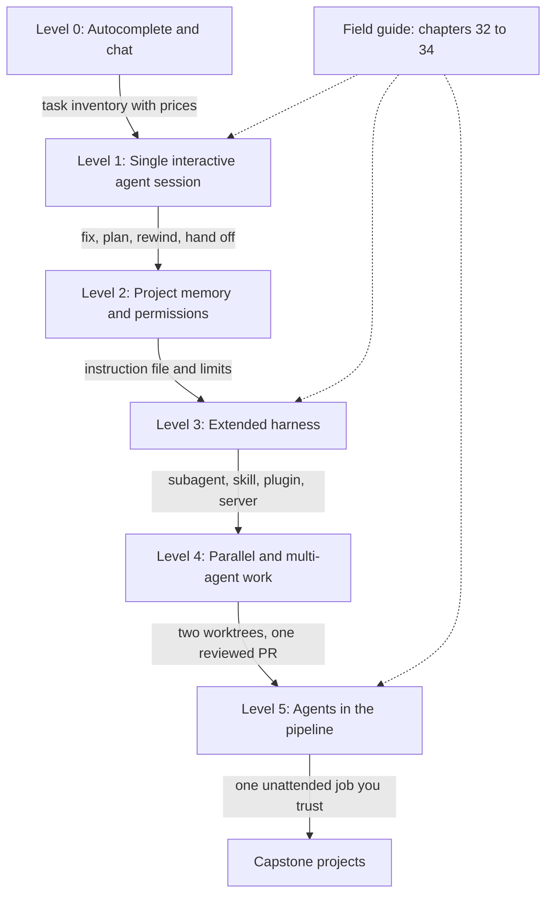

# Appendix E — Learning path and exercises

A curriculum built on the six levels from [chapter 01](01-what-is-ai-native-development.md): for each level what to read, one project with acceptance criteria and five self-check questions; then a 30-day plan, four capstone projects and an answer key.

## How to use this path

- **Find your level.** Start at the first level whose "ready to move on" line you cannot honestly sign today. Each level keeps everything below it.
- **Do the project, not only the reading.** The projects reuse the "Try it" exercises of the chapters, so a chapter you have worked through is a project step already done. An *evening* means two to three hours; a *weekend* means six to eight.
- **Acceptance criteria are checks, not intentions.** Tick a box only when you have seen the output. That habit is the subject of [chapter 23](23-testing-and-verification-loops.md).
- **Use the field guide at every level.** Read [chapter 32](32-troubleshooting-common-problems.md) when something breaks, [chapter 33](33-case-studies-from-real-work.md) before you write your first guard, and [chapter 34](34-prompt-cookbook-and-anti-patterns.md) whenever a prompt needed more than two corrections.
- **Climbing is not the goal.** Most tasks are best done at level 1 or 2. Add a skill, a hook or a second agent when a real problem asks for it.

## Level 0 — Autocomplete and chat

**You should be able to** say what a harness adds to a model, tell which of your tasks need one, estimate the tokens and the cost of a request, and quote a productivity number together with its caveat.

**Read:** [01](01-what-is-ai-native-development.md), [02](02-llms-tokens-and-the-context-window.md).

**Project (one evening): a task inventory with prices.** List ten tasks from last week and mark each A (autocomplete would do), C (a chat answer would do) or H (needs a harness). For two H tasks, fill in the five-line brief from chapter 01 and write the single command that would prove the task done. Then estimate the tokens in three of your files and price one task on two models.

- [ ] Ten tasks are classified A, C or H, with one line of reasoning each.
- [ ] Two briefs exist. Each names a proof command you have run, or names what is missing before one can be written.
- [ ] A small table gives characters and estimated tokens for a prose file, a source file and a JSON file (and counted tokens, if you have an API key).
- [ ] One task is priced for two models, 40 requests each, with the date of the price table written beside it.

**Self-check**

1. What are the four parts of a harness, and which of them is the model?
2. What separates a workflow from an agent?
3. How large is the context window of the current models, and does prompt caching make it larger?
4. What is context rot, and what does context engineering aim for?
5. Give two reasons not to quote a single productivity percentage.

**You are ready to move on when** you can look at a task, say whether it needs a harness, and write its proof command before you write its prompt.

## Level 1 — Single interactive agent session

**You should be able to** install and sign in, take a small bug from prompt to commit with a stated check, stop and redirect a turn, plan before a larger change, read `/context`, and undo a wrong turn with `/rewind` plus git.

**Read:** [03](03-the-agentic-loop-and-tool-use.md), [04](04-prompt-caching-compaction-and-cost.md), [05](05-inside-the-harness.md), [06](06-install-and-first-session.md), [07](07-cli-slash-commands-and-shortcuts.md), [10](10-plan-mode-checkpoints-and-context-management.md).

**Project (one evening): fix, extend and hand off a small CLI.** Use the sample project from chapter 06. Fix its failing test. Add a test that expects `count_words("")` to return `0`, see it fail, and have Claude fix it in Manual mode, declining the first edit with `Esc`. Add a `--json` flag through `/plan`, editing one step of the plan before you approve it. Run the rewind experiment from chapter 10 (one file changed with the edit tool, one only with `sed -i` through Bash). Finish with `HANDOFF.md`, `/clear`, and a fresh start from the file.

- [ ] `python3 -m unittest` passes, including a test you saw fail first.
- [ ] The `--json` flag works, and the plan that produced it has one step you changed.
- [ ] `git log` shows one commit per step and `git status --short` prints nothing.
- [ ] You wrote down which file `/rewind` left modified and the git command that restored it.
- [ ] A session started from `HANDOFF.md` continued the work without asking you for the goal.

**Self-check**

1. Which three JSON shapes make up the tool loop?
2. What does one `Esc` do while Claude is working, and what does `Esc` twice do on an empty prompt?
3. Which changes does `/rewind` not restore?
4. When do you run `/compact`, and when `/clear`?
5. Name three things that discard the prompt cache in the middle of a Claude Code session.

**You are ready to move on when** you state the check in the first prompt out of habit, and a wrong turn costs you one `Esc` and one rewind, not a new session.

## Level 2 — Project memory and permissions

**You should be able to** write a short instruction file that holds only what the code does not show, scope a rule to some files, say which settings file wins, write allow and deny rules, and choose a permission mode on purpose.

**Read:** [08](08-claude-md-and-memory.md), [09](09-settings-and-permissions.md).

**Project (one evening): give one repository a memory and limits.** Run `/init` in a repository you know, delete every line Claude could have found by reading the code, and add the three things you most often correct. Add `.claude/rules/tests.md` with a `paths:` glob. Commit a `.claude/settings.json` with a `deny` rule for `.env`, then try to read a dummy `.env` three ways: the Read tool, `cat` and a recursive `grep`. Repeat with the sandbox on. Finish with `/permissions`: find one allow rule you did not write on purpose and remove it.

- [ ] `CLAUDE.md` is under 200 lines, and you can defend every line as something the code does not show.
- [ ] The path-scoped rule appears in `/context all` only after Claude reads a matching file.
- [ ] `.claude/settings.json` is committed, is strict JSON and has at least one `deny` rule.
- [ ] A table records which of the three `.env` attempts were blocked, without the sandbox and with it.
- [ ] One instruction that must hold every time has left `CLAUDE.md` for a deny rule, or is marked for a hook at level 3.

**Self-check**

1. When does Claude Code read `AGENTS.md` on its own, and what quietly stops it?
2. Which instructions come back after compaction, and which do not?
3. In what order does a tool call pass hooks, permission rules and the permission mode, and can a narrow allow rescue a command from a broad deny?
4. Which permission mode does a new interactive session start in, and which does `claude -p` start in?
5. Which settings scope wins, and how do list keys such as `permissions.allow` combine across scopes?

**You are ready to move on when** a fresh session in your repository follows your conventions without being told, and you can name one rule that the harness enforces, not only the instruction file.

## Level 3 — Extended harness

**You should be able to** choose the right extension for a need, connect an MCP server and read the protocol on the wire, define a subagent, write a skill that triggers reliably, write a hook that blocks, and package them as a plugin you can validate and evaluate.

**Read:** [11](11-the-extension-model.md), then [12](12-mcp-how-it-works.md), [13](13-mcp-in-practice.md), [14](14-subagents.md), [15](15-skills.md), [16](16-hooks.md), [17](17-plugins-and-marketplaces.md), [18](18-output-styles-statusline-keybindings.md).

**Project (a weekend): build the PR helper kit with the workshop guides.** Work through [chapter 19](19-guide-write-a-subagent.md) (the read-only `diff-reviewer` subagent), [chapter 20](20-guide-write-a-skill.md) (the `pr-description` skill that delegates to it) and [chapter 21](21-guide-build-and-ship-a-plugin.md) (both packaged with a force-push guard hook, validated, evaluated and installed from a marketplace), in that order, on the sample repo they share. Then break the guard on purpose as chapter 16's second exercise does (remove `onFailure`, exit with 1) and repair it. Last, add one MCP server at local scope and write one allow rule and one deny rule for its tools.

- [ ] `diff-reviewer` reports the planted bug at `pricing.py:14` on the buggy diff and approves the fixed one, and its tool list gives it no way to edit.
- [ ] In fresh sessions `pr-description` triggers on a plain request, stays out of a near-miss such as a commit message, and its Verification section lists only commands that ran.
- [ ] `claude plugin validate --strict` passes for the plugin and the marketplace, and `/hooks` shows the guard loaded from the plugin.
- [ ] The guard's block and allow payloads pass outside a session; your notes show it with `onFailure` removed letting the call through on exit 1 and blocking it on exit 2.
- [ ] The eval suite has a trigger case and a behaviour case (run it with a cost cap, or write down why you did not).
- [ ] `claude mcp list` shows the server connected, and Claude reports the denial when asked to use the denied tool.

**Self-check**

1. Name the three MCP primitives and who decides when each is used.
2. "Never push to `main`" must hold every time. Which mechanism do you use, and why not a line in `CLAUDE.md`?
3. What does a fresh-context subagent start with, and how does a fork differ?
4. A hook exits with code 1. Is the tool call blocked?
5. Why can editing a plugin's files without changing `version` leave users on the old copy?

**You are ready to move on when** you can take a new need, choose between an instruction, a skill, a subagent, a hook and an MCP tool with the decision guide in chapter 11, and build the one you chose with a test that shows it working.

## Level 4 — Parallel and multi-agent work

**You should be able to** write a task brief with a proof command, tell a real check from an inert one, open a pull request that carries its evidence, run two agents without collisions, and say when one session is the better choice.

**Read:** [22](22-explore-plan-implement-verify.md), [23](23-testing-and-verification-loops.md), [24](24-git-prs-and-code-review.md), [25](25-parallel-work-worktrees-and-background-tasks.md), [26](26-multi-agent-orchestration.md).

**Project (a weekend): two worktrees, one reviewed pull request.** Pick a small open bug and write the task brief from chapter 22: its four required parts (goal, constraints, definition of done, proof command), plus context the repo does not show and a budget where they apply. Run the proof command and confirm it fails today. Ask for a failing test only, commit it, then ask for the fix with `tests/` off limits. In a second terminal, give an unrelated change to a second session with `claude -w`. Merge both, have a read-only reviewer subagent check the combined diff, write the "How it was verified" section, and open the pull request with `gh pr create --body-file`. Last, sabotage one gate the repository relies on.

- [ ] The proof command failed before the work and passes after it, and both outputs are in the pull request body.
- [ ] `git diff --stat <red-commit>..HEAD -- tests/` prints nothing.
- [ ] Two sessions worked at the same time in two worktrees, and neither touched the other's files.
- [ ] The reviewer's findings are sorted into "affects correctness" and "style or speculative", and only the first group was fixed.
- [ ] One gate has a recorded red-then-green pair, or you found an inert gate and fixed it.
- [ ] The agent opened the pull request and stopped. You decided the merge.

**Self-check**

1. Which four parts of a task brief are required?
2. What do you do after two failed attempts at the same fix?
3. What is an inert gate, and how does a sabotage pair expose one?
4. Why do two agents collide in one checkout, and what gives each its own?
5. When is a single session better than several agents?

**You are ready to move on when** two agents can work for you at once and what comes back is evidence you can check, and when you can also say, for a given task, why one session would have been cheaper.

## Level 5 — Agents in the pipeline

**You should be able to** run Claude Code unattended with explicit permissions and caps, keep one policy across several tools, layer guardrails around irreversible actions, report what the work costs, and give a team one gate command that can fail.

**Read:** [27](27-headless-ci-and-the-agent-sdk.md), [28](28-cross-tool-agents-md-cursor-codex-gemini.md), [29](29-security-and-guardrails.md), [30](30-cost-usage-and-observability.md), [31](31-repo-standards-and-team-adoption.md).

**Project (a weekend): one unattended job you would trust.** Write a script around `claude -p` that reads a diff and returns a verdict through `--json-schema`. Run the chapter 27 experiment with a `.mcp.json` server that appends to a log file: plain, with `--bare`, and with `--setting-sources user`. Give the repository one gate command and prove it can fail. Fill in the threat table from chapter 29. Add the drift check from chapter 28. Run the transcript report from chapter 30.

- [ ] The script sets a permission mode and an allowlist, caps the run with `--max-turns` and `--max-budget-usd`, and exits non-zero when `structured_output` is missing.
- [ ] You know from the log file which of the three invocations started the repository's server command.
- [ ] A throwaway copy with a planted defect makes the gate command exit non-zero.
- [ ] The threat table names the secrets readable from the working directory, the connected MCP servers and the commands that cannot be undone.
- [ ] The drift check fails when a tool adapter restates rules where it should point at `AGENTS.md`.
- [ ] You have your cache-hit ratio per model and your three largest sessions, with a note on what filled them.

**Self-check**

1. In a `claude -p` run, what happens to a tool call that needs approval when nobody can answer?
2. What does `--bare` skip, and what still applies?
3. Name the four doors through which injected instructions reach an agent.
4. Name three drivers of spend and the lever for each.
5. What is the gate command, and how do you know it can fail?

**You are ready to move on to the capstones when** an agent job runs without you under least privilege and a cost cap, its failure turns a pipeline red, and a monthly review of cost and retro findings is on your calendar.

## A 30-day plan

One hour of reading on weekdays and one project block a week. If you have evenings only, stretch each week to two.

| Week | Focus | Chapters | Deliverable |
|---|---|---|---|
| 1 (days 1–7) | Levels 0 and 1: how the loop and the harness work, first sessions | 01–07, 10 | The task inventory; the chapter 06 project fixed, extended and handed off |
| 2 (days 8–14) | Level 2 and the first half of level 3: memory, permissions, the extension model, MCP, subagents, skills | 08, 09, 11–15 | Instruction file and settings committed; a server connected; the chapter 19 subagent and the chapter 20 skill working |
| 3 (days 15–21) | The rest of level 3 and the first half of level 4: hooks, plugins, the plugin guide, briefs, tests, pull requests | 16–18, 21–24 | The PR helper plugin validated with its guard hook tested; one bug fixed test-first and delivered as a pull request with its evidence |
| 4 (days 22–28) | The rest of level 4 and level 5: parallel work, headless runs, security, cost, repo standards | 25–31 | Two worktrees merged into one reviewed pull request; the unattended job, the gate proof and the cost report |
| Days 29–30 | Review | 32–34 | One retro in the six-field form from chapter 33; one capstone chosen, with its brief written |

## Capstone projects

Each one is a week of evenings. Write the brief first ([chapter 22](22-explore-plan-implement-verify.md)), and treat the criteria as the definition of done.

### 1. Ship a plugin of your own: one skill, one guard hook, one reviewer agent

Repeat the workshop ([chapters 19](19-guide-write-a-subagent.md) to [21](21-guide-build-and-ship-a-plugin.md)) for a need of your own team, not the PR helper, and prove with an eval that it earns its context.

- [ ] `claude plugin validate --strict` passes.
- [ ] Loaded with `--plugin-dir`, the skill runs as `/<plugin>:<skill>`, the hook is listed under `/hooks`, and the agent answers to `<plugin>:<agent>`.
- [ ] The guard has payload tests for a blocked case and an allowed case that run without a session, and it fails closed.
- [ ] The skill's trigger prompts and near-misses, and their results, are recorded in the repository.
- [ ] `claude plugin eval` with a cost cap shows a positive WITH minus WITHOUT score on the behaviour case.
- [ ] Installed from a local marketplace, an edit reaches the installed copy only after a `version` bump, and you have seen both halves.
- [ ] The README lists every command the plugin's hooks can run.

### 2. Build and register an MCP server with pagination

Start from the notes server in [chapter 13](13-mcp-in-practice.md) and point it at data of your own.

- [ ] One task-shaped search tool with a hard page cap that no argument can raise, and an opaque cursor bound to its query.
- [ ] The Inspector CLI lists the tools in both the `modern` and the `legacy` protocol era.
- [ ] Invalid input returns an `isError` result that says what to change, and a test asserts on that text.
- [ ] With 45 matching items, Claude passes `next_cursor` back until the list is complete.
- [ ] Text the server returns from files is labelled as data, not instructions.
- [ ] Registered at project scope in `.mcp.json` with `${VAR}` expansion and no secret in the file; `claude mcp list` shows it connected.

### 3. Run a three-task objective: plan, workers, integration, one pull request

Follow the protocol in [chapter 26](26-multi-agent-orchestration.md) on a feature with three parts, at least two of them independent.

- [ ] `objective.json` holds the outcome and its acceptance checks; three task files have `depends_on[]` and disjoint `scope[]`.
- [ ] Each worker ran in its own worktree and branch, and ended at a commit plus a handoff that lists the validation commands it actually ran.
- [ ] No worker pushed, opened a pull request or wrote outside its scope.
- [ ] An integration branch merges all three, and the full suite ran there once.
- [ ] A clean-context reviewer checked the combined diff against the objective, and the integrator applied the fixes.
- [ ] One pull request was opened from the integration branch. You closed the session halfway through a run and resumed from the state files alone.

### 4. Add an agent-driven pull request review to CI, with a gate that has been seen to fail

Combine the review workflow in [chapter 27](27-headless-ci-and-the-agent-sdk.md) with the gate proof in [chapter 31](31-repo-standards-and-team-adoption.md).

- [ ] A workflow using `anthropics/claude-code-action@v1` reviews every pull request and comments on it.
- [ ] The review advises; a separate deterministic job is the required check. If a model verdict feeds that job, it arrives as `structured_output`, and a missing verdict fails the job.
- [ ] A pull request with a planted defect turned the required check red, the fix turned it green, and both runs are linked in the repository.
- [ ] Each run has a turn cap and a budget cap, and the job has a timeout and a concurrency limit.
- [ ] The workflow's `permissions` are the minimum the job needs, and credentials come from secrets or OIDC.
- [ ] Branch protection requires the gate job, and you have checked whether your own account can bypass it. Merging stays a separate, human step.

## Answer key

Short answers, then where to read the full one. Section names are in quotes.

| Q | Short answer | Where |
|---|---|---|
| 0.1 | Model, tools, loop and context management. The harness is everything except the model | [01](01-what-is-ai-native-development.md), "What a harness is" |
| 0.2 | A workflow follows predefined code paths; an agent directs its own process and tool use | [01](01-what-is-ai-native-development.md), "Workflows versus agents" |
| 0.3 | 1M tokens by default, as of Nov 2026. No: a cached prefix still occupies the window | [02](02-llms-tokens-and-the-context-window.md), "Sizes (as of Nov 2026)" |
| 0.4 | Accuracy and recall degrade as the token count grows. Aim for the smallest set of high-signal tokens | [02](02-llms-tokens-and-the-context-window.md), "Context rot and context engineering" |
| 0.5 | The studies are surveys, vendor telemetry or small trials of older tools, and people over-estimate their own speedup | [01](01-what-is-ai-native-development.md), "The productivity evidence, with its caveats" |
| 1.1 | A tool definition, a `tool_use` block and a `tool_result` block | [03](03-the-agentic-loop-and-tool-use.md), "Three pieces of JSON" |
| 1.2 | One `Esc` stops the turn and keeps the work so far. Twice on an empty prompt opens the rewind menu | [07](07-cli-slash-commands-and-shortcuts.md), "What `Esc` does" |
| 1.3 | Bash-only file changes, subagent edits, edits from your own editor, and anything outside the files such as databases and deploys | [10](10-plan-mode-checkpoints-and-context-management.md), "Checkpoints and `/rewind`" |
| 1.4 | `/compact` with a focus to continue the same task; `/clear` for an unrelated task or after two failed corrections | [10](10-plan-mode-checkpoints-and-context-management.md), "Compact, clear or new session" |
| 1.5 | Any three of: switching models, changing effort level, connecting or removing an MCP server, compacting, upgrading Claude Code | [04](04-prompt-caching-compaction-and-cost.md), "What breaks the cache" |
| 2.1 | By default, only when no `CLAUDE.md` is in the working directory or above it (v2.1.277 or later). Adding a `CLAUDE.md`, or even a personal `CLAUDE.local.md`, stops it | [08](08-claude-md-and-memory.md), "How `AGENTS.md` is handled" |
| 2.2 | Back: the project-root `CLAUDE.md`, rules without `paths:`, auto memory. Not until a matching file is touched: path-scoped rules and subdirectory files. Chat instructions are only summarised | [08](08-claude-md-and-memory.md), "What survives compaction" |
| 2.3 | `PreToolUse` hooks, then deny rules, ask rules, the permission mode and allow rules; among rules the first match decides. No | [09](09-settings-and-permissions.md), "Evaluation order: deny, ask, allow"; [05](05-inside-the-harness.md), "The permission engine in the turn" |
| 2.4 | `auto` for interactive sessions (v2.1.283 or later); `default` for `claude -p` and the Agent SDK | [09](09-settings-and-permissions.md), "The six permission modes" |
| 2.5 | Managed settings win. Lists are combined across scopes, and a deny at any level cannot be allowed elsewhere | [09](09-settings-and-permissions.md), "Settings files: scopes and precedence" |
| 3.1 | Tools: the model. Resources: the application. Prompts: the user | [12](12-mcp-how-it-works.md), "Three primitives, three owners" |
| 3.2 | A `PreToolUse` hook on `Bash`, plus server-side branch protection. An instruction is advisory: followed most of the time, not always | [11](11-the-extension-model.md), "Use cases" and "Anti-patterns" |
| 3.3 | Its own prompt, the delegation brief, the `CLAUDE.md` files, a git status snapshot and its preloaded skills, but not your conversation. A fork inherits the whole conversation | [14](14-subagents.md), "What a subagent starts with" |
| 3.4 | No. Exit 2 blocks; exit 1 is a non-blocking error unless the hook prints a valid JSON deny or its configuration sets `onFailure: "block"` | [16](16-hooks.md), "Output: the exit code comes first" |
| 3.5 | An installed copy is replaced only when the resolved version string changes | [17](17-plugins-and-marketplaces.md), "Versions and updates" |
| 4.1 | Goal, constraints, definition of done and proof command. Context the repo does not show and a budget are the two optional parts | [22](22-explore-plan-implement-verify.md), "Write the task brief" |
| 4.2 | Stop trying variations. Reproduce, read the real error, form one hypothesis, apply one fix, verify | [22](22-explore-plan-implement-verify.md), "Two failed attempts, then root-cause" |
| 4.3 | A gate that is green and cannot detect what it is named after. Break the guarded thing on purpose: the gate must go red, then green again | [23](23-testing-and-verification-loops.md), "A check that has never failed is not known to be a check" |
| 4.4 | They share one working tree, so one agent's stash or commit swallows the other's edits. A git worktree each, through `claude --worktree` | [25](25-parallel-work-worktrees-and-background-tasks.md), "Why two agents in one checkout collide" |
| 4.5 | When files and decisions interlock: sequential tasks, same-file edits, many dependencies | [26](26-multi-agent-orchestration.md), "Which one to use" |
| 5.1 | It is denied, unless an allow rule, a hook or a callback approves it | [27](27-headless-ci-and-the-agent-sdk.md), "Permissions when nobody can answer" |
| 5.2 | It skips hooks, skills, subagents, plugins, MCP servers, auto memory and `CLAUDE.md`. Settings files and their permission rules are still read | [27](27-headless-ci-and-the-agent-sdk.md), "Start clean with `--bare`" |
| 5.3 | Repository files, web pages, tool results and MCP tool descriptions | [29](29-security-and-guardrails.md), "Injection: four doors" |
| 5.4 | For example: context length (`/clear`, `/compact`), cache misses (avoid the invalidators), output and thinking (lower `/effort`) | [30](30-cost-usage-and-observability.md), "What drives spend" |
| 5.5 | One command whose exit code is the definition of done. Sabotage a throwaway copy and require a non-zero exit | [31](31-repo-standards-and-team-adoption.md), "The gate command" and "Prove the gate can fail" |

---

[← Previous: Sources and further learning](D-sources.md) · [Contents](README.md) · [Next: Contents →](README.md)
