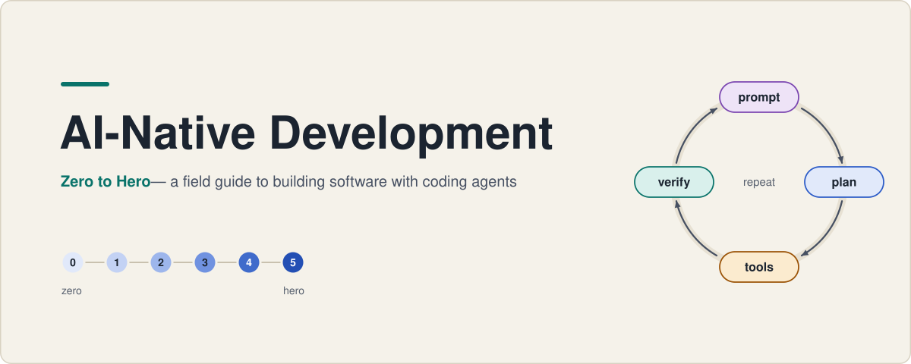
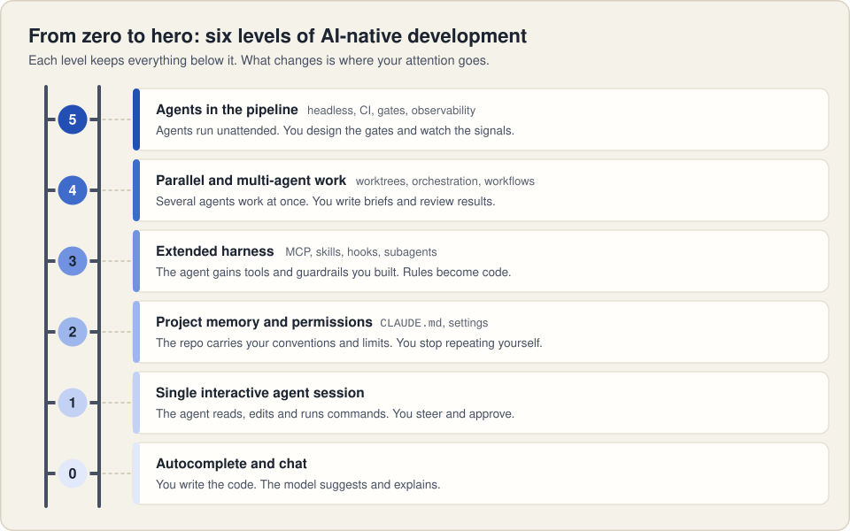

# AI-Native Development: Zero to Hero

A learning guide for developers who want to build software *with* coding agents rather than just next to them. It starts from what a token is and ends with unattended agents running behind gates in CI. Claude Code is the worked example throughout; the ideas carry over to other agentic tools, and [chapter 23](23-cross-tool-agents-md-cursor-codex-gemini.md) shows how.

The book rests on two kinds of evidence, kept apart on every page:

- **Documentation**: the official Claude Code, Claude API and Model Context Protocol docs as read on **25 November 2026**, plus Anthropic's engineering posts and a small set of studies and security reports. Version-sensitive facts are marked "as of Nov 2026".
- **Field data**: one developer's repositories, configuration and roughly four weeks of Claude Code session transcripts (about 100,000 model responses). These appear in "From the field" sections and in the charts. They are one person's numbers, not benchmarks.

<!--
TODO(author): Preface — 5 to 10 sentences in your own voice.
Why you wrote this, who you had in mind, and the one habit you most want a reader to take away.
Suggested shape: (1) where you started, (2) the incident or moment that changed how you work,
(3) what you would tell yourself on day one. Replace the paragraph below.
-->

## Preface

Most advice about coding agents is either a feature list or a success story. This book tries to be neither. It explains how the machinery works, shows the configuration that holds up in daily use, and spends as much time on what went wrong as on what went right, because the failures are where the durable practices came from: a rule written after an incident, a hook written after the rule was ignored, a test written after a green check turned out to check nothing.

## Who this is for

| You are... | Start at |
|---|---|
| New to coding agents | [Chapter 1](01-what-is-ai-native-development.md), then straight through Parts I and II |
| Using Claude Code daily, mostly by prompting | [Chapter 7](07-claude-md-and-memory.md) to [chapter 9](09-plan-mode-checkpoints-and-context-management.md), then Part III |
| Already writing skills and hooks | Parts IV and V |
| Rolling this out to a team | Chapters [8](08-settings-and-permissions.md), [24](24-security-and-guardrails.md), [25](25-cost-usage-and-observability.md), [26](26-repo-standards-and-team-adoption.md) |
| Stuck on something right now | [Chapter 27](27-troubleshooting-common-problems.md), then the [cheat sheet](A-cheat-sheet.md) |

You need a terminal, git, and basic comfort with one programming language. No machine-learning background is assumed.

## The path

Each level keeps everything below it. [Appendix E](E-learning-path-and-exercises.md) turns the ladder into a study plan with projects and self-checks.

## Contents

### Part I — Foundations

| # | Chapter | What you get |
|---|---|---|
| 1 | [What AI-native development is](01-what-is-ai-native-development.md) | The shift from typing code to specifying and verifying it; what a harness is; the evidence and its limits |
| 2 | [LLMs, tokens and the context window](02-llms-tokens-and-the-context-window.md) | How a model reads your session, what fills the window, current models and prices |
| 3 | [The agentic loop and tool use](03-the-agentic-loop-and-tool-use.md) | How an agent calls tools, a loop you can run yourself, workflows versus agents |
| 4 | [Prompt caching, compaction and cost](04-prompt-caching-compaction-and-cost.md) | Why long sessions are affordable, what breaks the cache, a worked cost example |

### Part II — Claude Code core

| # | Chapter | What you get |
|---|---|---|
| 5 | [Install and first session](05-install-and-first-session.md) | Setup, authentication, and a guided first task on a sample project |
| 6 | [CLI, slash commands and shortcuts](06-cli-slash-commands-and-shortcuts.md) | A working reference to flags, commands and interactive mode |
| 7 | [CLAUDE.md and memory](07-claude-md-and-memory.md) | How instructions load, how to write ones that work, and where instructions stop working |
| 8 | [Settings and permissions](08-settings-and-permissions.md) | Scopes, rule syntax, the six permission modes, the sandbox, a team baseline |
| 9 | [Plan mode, checkpoints and context management](09-plan-mode-checkpoints-and-context-management.md) | Steering a long session: plan, compact, clear, rewind, hand off |

### Part III — Extending the harness

| # | Chapter | What you get |
|---|---|---|
| 10 | [MCP: how the protocol works](10-mcp-how-it-works.md) | Roles, primitives, transports, wire messages, the 2026 stateless revision |
| 11 | [MCP in practice: using and building servers](11-mcp-in-practice.md) | Connecting servers, designing agent-facing tools, a server in Python and TypeScript |
| 12 | [Subagents](12-subagents.md) | What a subagent really sees, defining your own, writing a delegation brief |
| 13 | [Skills](13-skills.md) | Progressive disclosure, descriptions that trigger, a complete worked skill, evaluation |
| 14 | [Hooks](14-hooks.md) | Events, exit codes, four tested hook scripts, pairing every hard rule with a hook |
| 15 | [Plugins and marketplaces](15-plugins-and-marketplaces.md) | Packaging and sharing skills, agents, hooks and servers; versioning traps |
| 16 | [Output styles, status line and keybindings](16-output-styles-statusline-keybindings.md) | Shaping the interface to how you work |

### Part IV — Workflows

| # | Chapter | What you get |
|---|---|---|
| 17 | [Explore, plan, implement, verify](17-explore-plan-implement-verify.md) | The core loop, task briefs, spec-driven development, sizing the ceremony |
| 18 | [Testing and verification loops](18-testing-and-verification-loops.md) | Test-first with agents, false "done" claims, gates that cannot fail |
| 19 | [Git, pull requests and code review](19-git-prs-and-code-review.md) | Branches, PR bodies with evidence, automated and human review, merge authority |
| 20 | [Parallel work: worktrees and background tasks](20-parallel-work-worktrees-and-background-tasks.md) | Running several agents without collisions |
| 21 | [Multi-agent orchestration](21-multi-agent-orchestration.md) | Patterns, costs, a crash-safe task and handoff protocol, when not to bother |
| 22 | [Headless mode, CI and the Agent SDK](22-headless-ci-and-the-agent-sdk.md) | `claude -p`, structured output, GitHub Actions, the SDK, unattended-run safety |
| 23 | [One repo, many agents: AGENTS.md and cross-tool setups](23-cross-tool-agents-md-cursor-codex-gemini.md) | One canonical source, thin adapters, drift checks, handing work between tools |

### Part V — Production concerns

| # | Chapter | What you get |
|---|---|---|
| 24 | [Security and guardrails](24-security-and-guardrails.md) | A threat model, defence layers, opening untrusted repos, guards for irreversible actions |
| 25 | [Cost, usage and observability](25-cost-usage-and-observability.md) | What drives spend, how to measure it, telemetry, a review routine |
| 26 | [Repo standards and team adoption](26-repo-standards-and-team-adoption.md) | Making a repo and a team agent-ready; a staged rollout; the learning loop |

### Part VI — Field guide

| # | Chapter | What you get |
|---|---|---|
| 27 | [Troubleshooting: common problems and fixes](27-troubleshooting-common-problems.md) | A lookup catalogue: symptom, cause, fix, by area |
| 28 | [Case studies from real work](28-case-studies-from-real-work.md) | Nine incidents and what each one changed |
| 29 | [Prompt cookbook and anti-patterns](29-prompt-cookbook-and-anti-patterns.md) | Reusable prompt templates and ten before/after rewrites |

### Appendices

| | Appendix | What you get |
|---|---|---|
| A | [Cheat sheet](A-cheat-sheet.md) | The whole book as quick-reference tables |
| B | [Glossary](B-glossary.md) | Every term, defined and linked to its chapter |
| C | [Templates](C-templates.md) | Copy-ready starting files: instructions, settings, hooks, skill, agent, plugin, CI |
| D | [Sources and further learning](D-sources.md) | The bibliography, community repositories and talks |
| E | [Learning path and exercises](E-learning-path-and-exercises.md) | A level-by-level curriculum, a 30-day plan, capstone projects |

## How each chapter is built

Every numbered chapter has the same parts, so you can skim to the one you need:

1. **Mental model** — the idea in plain words, with a diagram.
2. **Core sections** — the mechanics, with examples you can copy.
3. **From the field** — what actually happened when this was used for real.
4. **Common problems** — a symptom, cause and fix table.
5. **Checklist**, **Try it** exercises, and **Sources**.

Callouts mean what they say: `Note` adds a detail, `Warning` marks something that can hurt, and `Field note` is an observation from the field data.

## Figures and charts

| Figure | Shows | Used in |
|---|---|---|
| [Maturity ladder](assets/fig-maturity-ladder.svg) | The six levels from zero to hero | 1, README |
| [Context window](assets/fig-context-window.svg) | What occupies the window in a session | 2, 9 |
| [Agent loop](assets/fig-agentic-loop.svg) | Prompt, model, tool call, checks, result | 3 |
| [Extension map](assets/fig-extension-map.svg) | The six extension surfaces compared | 7 |
| [MCP architecture](assets/fig-mcp-architecture.svg) | Application, clients, servers, transports | 10 |
| [Guardrail layers](assets/fig-guardrail-layers.svg) | Advisory versus enforced defences | 8, 24 |
| [Leverage](assets/chart-leverage.svg) | Responses and tool calls per human prompt | 1 |
| [Inbound messages](assets/chart-inbound-messages.svg) | Who talks to the main thread | 1 |
| [Tool share](assets/chart-tool-share.svg) | Tool calls by tool group | 3 |
| [Token mix](assets/chart-token-mix.svg) | Cache reads against everything else | 4, 25 |
| [Session concentration](assets/chart-session-concentration.svg) | Share of tokens in the largest sessions | 4, 25 |
| [Subagent types](assets/chart-subagent-types.svg) | Subagent launches by type | 12 |
| [Hooks](assets/chart-hooks.svg) | Hook executions against blocked calls | 14 |
| [Bash errors](assets/chart-bash-errors.svg) | Shell error classes | 27 |
| [Friction](assets/chart-friction.svg) | Friction categories by sessions affected | 27 |
| [Prompt length](assets/chart-prompt-length.svg) | Distribution of human prompt length | 29 |

Diagrams inside chapters are written in Mermaid and render on GitHub and in most Markdown viewers. The charts are static SVG files generated by the scripts in `assets/_src/`.

## Reading this book offline

Any Markdown viewer that supports Mermaid will do: GitHub, VS Code's preview with a Mermaid extension, Obsidian, or a static site generator. All links between chapters are relative, so the folder can be moved or zipped as it is.

## Accuracy and limits

- Claude Code changes quickly. Where your installed version disagrees with a chapter, trust `claude --help`, `/help` and the official docs, and treat the chapter as dated.
- Claims that could not be confirmed in a primary source were left out or marked "check in your version".
- Incidents in the case studies are told generically. Names, hosts and repositories are omitted on purpose.
- [Appendix D](D-sources.md) lists every source and explains how the book was put together.

---

[Start reading: Chapter 1 — What AI-native development is →](01-what-is-ai-native-development.md)
