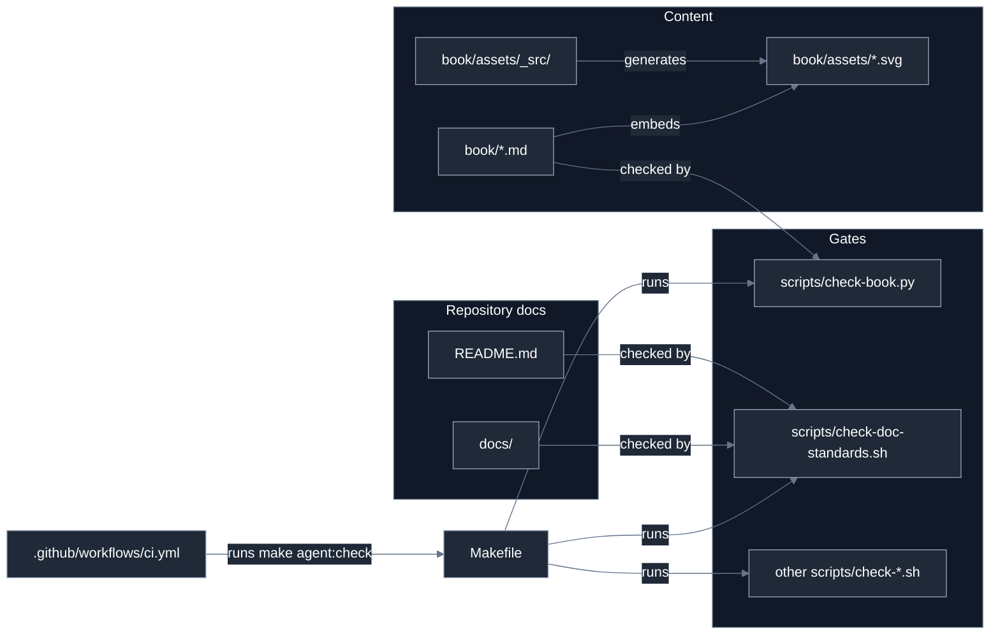
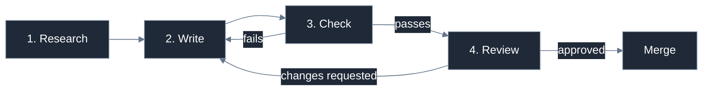
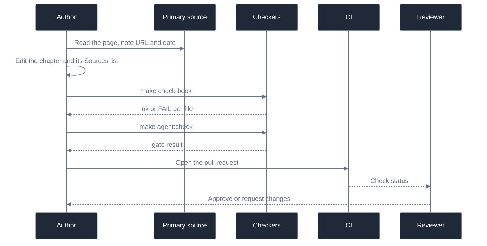

# Architecture overview

The repository is a book plus the infrastructure that keeps it correct. Nothing is compiled and nothing is deployed: the published artefact is the Markdown in `book/`, read directly on GitHub or from a clone.

## Components

```text
ai-native-dev-guide/
  book/                 the book: cover page, 29 chapters, appendices A to E
    assets/             17 SVG figures and charts
      _src/             the scripts that generate them
  scripts/              check-book.py and the repository checks
  config/docs/          data for the documentation standard
  docs/                 documentation about the repository (this tree)
  assets/               the README banner
  core/capabilities/    which coding tools the repository targets
  .github/              CI, release, issue and pull request templates
  Makefile              the command surface: lifecycle targets and checks
  AGENTS.md             canonical instructions for coding agents
```

| Component | Role | Changes when |
|---|---|---|
| `book/*.md` | The content. One file per chapter or appendix; `book/README.md` is the cover and contents page | The book is edited |
| `book/assets/*.svg` | Static figures: a cover, six concept figures, ten field-data charts | A figure script or its data changes |
| `book/assets/_src/` | `figures/build.py` builds the cover and concept figures; `make_charts.py` builds the charts from a field-data aggregate kept outside the repository | A figure needs a new shape or style |
| `scripts/check-book.py` | The gate for book content: length, fences, links, images, Mermaid rendering | The authoring rules change |
| `scripts/check-doc-standards.sh` with `config/docs/` | The gate for `README.md` and `docs/`: shared footer, themed Mermaid | The documentation standard changes |
| Other `scripts/check-*.sh` | Repository consistency: agent-instruction drift, feature equivalence, platform targets, action pinning | The scaffold contract changes |
| `AGENTS.md` with `CLAUDE.md`, `.cursor/rules/`, `.claude/` | Instructions for coding agents. `AGENTS.md` is canonical; the others are thin adapters that point at it | An agent got something wrong without a rule |
| `core/capabilities/platforms.json` | The one statement of which coding tools the repository targets and what each can do | A target is added or re-measured |
| `Makefile` | The one command surface for people, agents and CI | A check is added or renamed |
| `.github/workflows/` | CI on every push and pull request; a release on a version tag | The gate or the release process changes |
| `docs/` | How to read, contribute to and release the book | The process changes |

The diagram shows how the parts depend on each other. Arrows read "is checked by" or "runs".



## Two documentation regimes

The repository holds two kinds of Markdown, with different rules and different checkers. Keeping them apart is deliberate.

| | The book | Repository docs |
|---|---|---|
| Paths | `book/**` | `README.md`, `docs/**` |
| Audience | Readers learning the subject | People and agents working on the repository |
| Checker | `scripts/check-book.py` | `scripts/check-doc-standards.sh` |
| Length limit | Under 400 lines per file | None enforced |
| Mermaid | Plain blocks, no theme line, must render with `mmdc` | Blocks must start with the shared theme line |
| Footer | Previous, contents, next navigation | The shared two-link footer |
| Rules | [Authoring rules](../../CONTRIBUTING.md#authoring-rules) | [Documentation standard](../../agent-guidelines/documentation-standards.md) |

The documentation standard's file globs cover `README.md` and `docs/**` only, so its fixer never rewrites a chapter.

## The authoring pipeline

Every change to the book goes through four stages. The order matters: a fact is confirmed before it is written, and the text is checked before a person spends time reviewing it.



| Stage | What happens | Output | Rule that governs it |
|---|---|---|---|
| 1. Research | Open the primary page. Note the URL and the date read. For field data, take the number from the aggregate, not from memory | A source for every factual claim | Facts come from primary sources, with a date |
| 2. Write | Edit the chapter inside the fixed skeleton. Add the source to the chapter's Sources list. Update Appendix D by hand if that list changed | A chapter under 400 lines with a complete Sources section | One chapter per file; the fixed skeleton; nothing private in the text |
| 3. Check | `make check-book` locally, then `make agent:check`. CI repeats the second on the pull request, without Mermaid rendering | `0 failed`, Mermaid blocks `rendered` | The checker is the gate |
| 4. Review | A reviewer reads the diff for accuracy, clarity and private details, and opens changed figures at full size | An approved pull request | Pull request process |

Research and review are human or agent judgement; the check stage is mechanical. The sequence below shows who does what for one change.



## What the checker does not cover

The mechanical gate is narrow on purpose. These remain the reviewer's job:

- Whether a statement is true and its source supports it.
- Whether an external URL still resolves, and whether an `#anchor` exists.
- Whether text contains a private detail: a secret, a hostname, a personal or project name.
- Whether a chapter follows the skeleton and reads well.
- Whether Appendix D matches the chapters' Sources lists.

## Design decisions

The reasons behind this layout are recorded in [ADR-001](../decisions/ADR-001-initial-architecture.md).

---

<p align="center"><a href="https://github.com/TamirCohen28">Have a Question?</a>&nbsp;·&nbsp;<a href="https://github.com/TamirCohen28/ai-native-dev-guide/issues/new/choose">Open an Issue</a></p>
