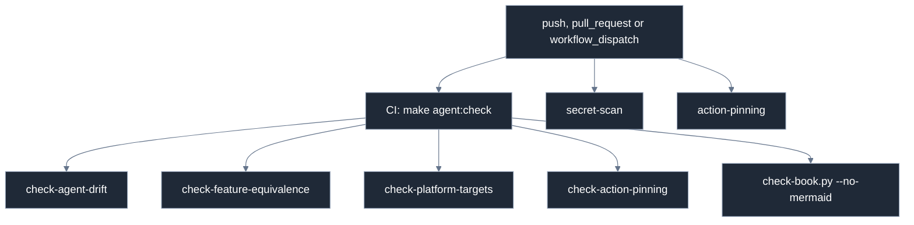
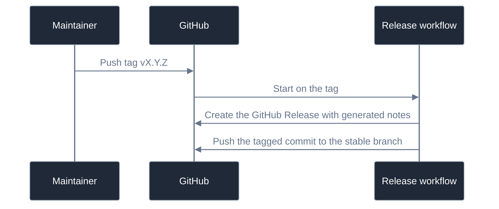

# CI workflow

What runs automatically, when, and what each job proves. The workflows are in `.github/workflows/`.

| Workflow | File | Trigger | Purpose |
|---|---|---|---|
| CI | `ci.yml` | Every push, every pull request, manual dispatch | The merge gate |
| Release | `release.yml` | A pushed tag matching `v*.*.*` | Publishes an edition |
| Claude Code | `claude.yml` | An issue or pull request comment that mentions `@claude`, or a pull request labelled `claude` | Runs a coding agent on request |

All jobs run on `ubuntu-latest`. Every action is pinned to a commit, with the version in a trailing comment.

## CI

Three jobs run in parallel. A newer run for the same pull request or branch cancels the older one.



| Job | Runs | Fails when |
|---|---|---|
| `CI` | `make agent:check` | Any of its five checks fails: agent-instruction drift, feature equivalence, platform targets, action pinning, or the book check |
| `secret-scan` | A pattern search over JSON and YAML files | A string shaped like a cloud access key or a GitHub token is found |
| `action-pinning` | `bash scripts/check-action-pinning.sh .` | A workflow refers to an action or container by a tag or branch instead of a commit |

The runner needs only bash, Python 3, jq and git, all of which are preinstalled. There is no dependency install step.

### What CI does not check

| Not checked in CI | Why | Where it is checked |
|---|---|---|
| Mermaid rendering | The runner has no Mermaid CLI or browser | Locally, with `make check-book` |
| The documentation standard for `README.md` and `docs/` | `make agent:check` does not include `check-doc-standards` | Locally, with `make lint` |
| External URLs and `#anchor` fragments | The book checker only tests that local files exist | By the author and the reviewer |
| Factual accuracy and private details | Not mechanical | In review |

Because Mermaid rendering is local only, a pull request that changes a diagram should show the `rendered` summary line from the author's own run.

### Reading a failure

Open the failed job and read from the bottom. The book check prints `FAIL <file>` with indented `ERROR:` lines; the other checks print the file and the rule that failed. Reproduce locally with the same command the job ran:

```bash
make agent:check
```

Fixes for each book-check error are in [troubleshooting](../../user/troubleshooting.md#checker-failures).

## Release

Pushing a version tag publishes an edition. Nothing is built: the release is the tag plus generated notes.



| Step | Effect |
|---|---|
| Create GitHub Release | A release named after the tag, with notes generated from the merged pull requests |
| Update `stable` | The `stable` branch is moved to the tagged commit, so it always points at the latest edition |

The steps a maintainer takes before pushing the tag are in [versioning](versioning.md#cutting-an-edition).

## Claude Code

`claude.yml` lets a maintainer ask a coding agent to work on an issue or pull request by mentioning `@claude` in a comment or adding a `claude` label. It needs the `ANTHROPIC_API_KEY` repository secret. It is a convenience, not part of the merge gate: its output goes through the same checks and review as any other change.

## Dependency updates

Dependabot watches GitHub Actions only, since the repository has no package manifest. Updates arrive monthly, grouped into one pull request, with at most two open at a time. They must pass CI like any other change.

## Changing the CI

- Keep `runs-on: ubuntu-latest`. CI for this repository does not use self-hosted runners.
- Pin any new action to a full commit hash and note the version in a comment.
- Add a check to the Makefile first, then call the `make` target from the workflow, so the same command runs locally and in CI.
- A new check must be seen to fail before it is trusted: break the thing it guards on a scratch branch and confirm the job goes red.

---

<p align="center"><a href="https://github.com/TamirCohen28">Have a Question?</a>&nbsp;·&nbsp;<a href="https://github.com/TamirCohen28/ai-native-dev-guide/issues/new/choose">Open an Issue</a></p>
