# Development workflow

The loop for any change to this repository. For a step-by-step example with commands, see the [getting-started guide](../guides/getting-started.md).

## The loop

```mermaid
%%{init: {"theme":"base","themeVariables":{"darkMode":true,"background":"#0b0e14","primaryColor":"#1f2937","primaryTextColor":"#ffffff","primaryBorderColor":"#94a3b8","secondaryColor":"#334155","secondaryTextColor":"#ffffff","tertiaryColor":"#111827","tertiaryTextColor":"#ffffff","lineColor":"#64748b","textColor":"#ffffff","edgeLabelBackground":"#1f2937","clusterBkg":"#111827","clusterBorder":"#64748b","actorBkg":"#1f2937","actorBorder":"#94a3b8","actorTextColor":"#ffffff","actorLineColor":"#64748b","signalColor":"#64748b","signalTextColor":"#64748b","labelBoxBkgColor":"#1f2937","labelBoxBorderColor":"#94a3b8","labelTextColor":"#ffffff","loopTextColor":"#ffffff","noteBkgColor":"#334155","noteTextColor":"#ffffff","noteBorderColor":"#94a3b8","activationBkgColor":"#334155","activationBorderColor":"#94a3b8"}}}%%
flowchart LR
    A["Branch from main"] --> B["Edit"]
    B --> C["Check locally"]
    C -->|"fails"| B
    C -->|"passes"| D["Commit and push"]
    D --> E["Pull request"]
    E --> F["CI"]
    F -->|"red"| B
    F -->|"green"| G["Review"]
    G -->|"changes requested"| B
    G -->|"approved"| H["Owner merges"]
```

| Step | Command or action | Notes |
|---|---|---|
| Branch | `git checkout -b fix/<slug>` or `feat/<slug>` | Never commit to `main` |
| Edit | Change files under `book/`, `docs/`, `scripts/` | Follow the [authoring rules](../../CONTRIBUTING.md#authoring-rules) for book text |
| Check | `make check-book`, then `make agent:check` | Add `make lint` when `README.md` or `docs/` changed |
| Commit | `<type>(<scope>): <description>` | One logical change per commit |
| Pull request | Fill in the template; paste check output | State the source and date for a factual change |
| CI | Runs on every push and pull request | See [CI workflow](ci-workflow.md) |
| Review | A reader checks accuracy, clarity and privacy | Open changed figures at full size |
| Merge | The repository owner merges | Not while a check is failing or skipped |

## Which check for which change

| You changed | Run | What proves it |
|---|---|---|
| A chapter or appendix | `make check-book`, `make agent:check` | `0 failed`, Mermaid blocks `rendered` |
| A Mermaid diagram in a chapter | `make check-book` with `mmdc` installed | The summary line ends with `rendered` |
| `README.md` or a page under `docs/` | `bash scripts/check-doc-standards.sh --fix .`, then `make lint` | `0 violations` |
| A figure script | The script itself, then `make check-book` | The regenerated SVG, opened and read at full size |
| A script under `scripts/` | The script against a deliberately broken input, then `make agent:check` | A non-zero exit on the broken input, zero on the real tree |
| A workflow under `.github/` | `make check-action-pinning` | No movable action references |
| An agent instruction file | `make agent:check` | The drift and equivalence checks pass |

A check that did not run is not a pass. If `mmdc` is missing, the book check still exits 0 but reports the diagrams as `NOT rendered`; say so in the pull request instead of calling the diagrams checked.

## Local tools

| Tool | Needed for | Required |
|---|---|---|
| git | Everything | Yes |
| Python 3 | `scripts/check-book.py`, the figure scripts | Yes |
| jq | The repository check scripts | Yes |
| bash | The repository check scripts | Yes |
| `mmdc` (npm `@mermaid-js/mermaid-cli`) | Rendering Mermaid in `make check-book` | Optional, but the only way to check a diagram |

`make install` reports which of these are present. It installs nothing.

## Two trees, two sets of rules

| Tree | Rules | Checker |
|---|---|---|
| `book/` | [Authoring rules](../../CONTRIBUTING.md#authoring-rules): one chapter per file, under 400 lines, fixed skeleton, sourced facts, nothing private | `scripts/check-book.py` |
| `README.md`, `docs/` | [Documentation standard](../../agent-guidelines/documentation-standards.md): themed Mermaid, shared footer | `scripts/check-doc-standards.sh` |

Do not run the documentation fixer against `book/`, and do not add the shared footer or the theme line to a chapter. The fixer's globs exclude `book/` for that reason.

## Generated files

Never edit a generated file by hand. Change its input and regenerate.

| File | Regenerate with | Input in the repository |
|---|---|---|
| `book/assets/cover.svg`, `book/assets/fig-*.svg` | `python3 book/assets/_src/figures/build.py` | Yes |
| `book/assets/chart-*.svg` | `python3 book/assets/_src/make_charts.py --data <file>` | No: the data aggregate is private |

`book/D-sources.md` is not generated. It is maintained by hand and must be updated in the same change as any chapter's Sources list.

## Working with coding agents

The repository is set up to be edited by agents as well as people. `AGENTS.md` at the root is the canonical instruction file; `CLAUDE.md` and the Cursor rule are thin adapters that point at it. The detail behind it is in [agent-guidelines](../../agent-guidelines/README.md).

Two habits matter most when an agent does the editing:

- Give it one chapter at a time. A whole-book read is too large to review well.
- Ask for the check output, not a summary of it. "Checks pass" without the last lines of `make agent:check` is not evidence.

## Changelog

Every change a reader would notice gets a line under `[Unreleased]` in `docs/CHANGELOG.md`, and the root `CHANGELOG.md` mirror is updated in the same commit. Pure tooling changes that readers never see can be left out.

---

<a href="https://github.com/TamirCohen28">Have a Question?</a>&nbsp;·&nbsp;<a href="https://github.com/TamirCohen28/ai-native-dev-guide/issues/new/choose">Open an Issue</a>

