# Versioning and release

This repository follows [Semantic Versioning 2.0.0](https://semver.org/), read for a book: the "API" is what a reader relies on, which is the chapter structure, the file names that links point at, and the advice itself. A version names an **edition**.

## Where the version is declared

There is no package manifest, so the version lives in three places that must agree:

| Place | Form |
|---|---|
| `docs/CHANGELOG.md` and the root `CHANGELOG.md` mirror | The newest `## [X.Y.Z] - YYYY-MM-DD` heading |
| `README.md` | The version badge in the first badge row |
| Git | The annotated tag `vX.Y.Z` |

The current edition is **0.1.0**, the first complete edition of the book.

## Bump rules

| Bump | When | Examples |
|------|------|----------|
| **PATCH** (`x.y.Z`) | Corrections that change no structure: fixed facts, typos, broken links, clearer wording, a repaired figure, tooling or CI fixes | `fix(ch08): correct the permission evaluation order` |
| **MINOR** (`x.Y.0`) | Backward-compatible additions: a new chapter or appendix appended, a new section, new examples or figures, a re-read of the documentation that refreshes dated facts across the book | `feat(ch30): add a chapter on evaluation` |
| **MAJOR** (`X.0.0`) | Changes that break what a reader relies on: chapters renumbered, renamed or removed so existing links break; the chapter skeleton changed; advice reversed across the book | Reordering the parts; dropping a chapter |

**Before 1.0:** while the version is `0.y.z`, a minor bump may include a breaking change such as a renamed chapter file. Say so plainly in the changelog entry.

Two cases are easy to get wrong:

- **Renaming a chapter file** breaks every external link to it. Treat it as breaking, and avoid it unless the old name is misleading.
- **A documentation re-read** changes the date the book's facts are tied to. Record the new date in the changelog entry and on the book's cover page, `book/README.md`.

## Changelog discipline

- Every change a reader would notice adds a line under `[Unreleased]` in `docs/CHANGELOG.md`.
- The root `CHANGELOG.md` is a mirror. Update both in the same commit.
- Group entries under `Added`, `Changed`, `Fixed` and `Removed`.
- Write entries for readers: "Corrected the exit code that blocks a tool call in chapter 14", not "updated ch14".

## Cutting an edition

1. Make sure `main` is green and `make check-book` ends with `0 failed` and `rendered`.
2. In `docs/CHANGELOG.md`, move the `[Unreleased]` entries under a new `## [X.Y.Z] - YYYY-MM-DD` heading and leave an empty `[Unreleased]` above it. Mirror the change in the root `CHANGELOG.md`.
3. Update the version badge in `README.md` to `X.Y.Z`.
4. Commit on a branch as `chore(release): vX.Y.Z` and merge it through a pull request.
5. Tag the merge commit and push the tag:

   ```bash
   git checkout main
   git pull --ff-only
   git tag -a vX.Y.Z -m "vX.Y.Z"
   git push origin vX.Y.Z
   ```

6. The [release workflow](ci-workflow.md#release) creates the GitHub Release with generated notes and moves the `stable` branch to the tagged commit.

```mermaid
%%{init: {"theme":"base","themeVariables":{"darkMode":true,"background":"#0b0e14","primaryColor":"#1f2937","primaryTextColor":"#ffffff","primaryBorderColor":"#94a3b8","secondaryColor":"#334155","secondaryTextColor":"#ffffff","tertiaryColor":"#111827","tertiaryTextColor":"#ffffff","lineColor":"#64748b","textColor":"#ffffff","edgeLabelBackground":"#1f2937","clusterBkg":"#111827","clusterBorder":"#64748b","actorBkg":"#1f2937","actorBorder":"#94a3b8","actorTextColor":"#ffffff","actorLineColor":"#64748b","signalColor":"#64748b","signalTextColor":"#64748b","labelBoxBkgColor":"#1f2937","labelBoxBorderColor":"#94a3b8","labelTextColor":"#ffffff","loopTextColor":"#ffffff","noteBkgColor":"#334155","noteTextColor":"#ffffff","noteBorderColor":"#94a3b8","activationBkgColor":"#334155","activationBorderColor":"#94a3b8"}}}%%
flowchart LR
    A["Entries under Unreleased"] --> B["Move under X.Y.Z with a date"]
    B --> C["Update the README badge"]
    C --> D["chore(release) pull request"]
    D --> E["Tag vX.Y.Z on main"]
    E --> F["Release workflow"]
    F --> G["GitHub Release"]
    F --> H["stable branch updated"]
```



## Validate

Check that the declared version has a tag, and that the three places agree:

```bash
VER=$(grep -m1 -oE '^## \[[0-9]+\.[0-9]+\.[0-9]+\]' docs/CHANGELOG.md | tr -d '#[] ')
echo "changelog: $VER"
grep -q "badge/version-${VER}-" README.md || echo "README badge does not say ${VER}"
git tag -l "v${VER}" | grep -q . || echo "missing tag v${VER}"
```

No output after the first line means the changelog, the badge and the tag agree. Until the first tag is pushed, the last check reports `missing tag v0.1.0`; that is expected.

## Branches

| Branch | Meaning |
|---|---|
| `main` | The working edition. Always passes CI; may be ahead of the last tag |
| `stable` | The latest tagged edition. Moved only by the release workflow |
| `feat/*`, `fix/*` | Work in progress, merged through pull requests |

Readers who want the text as last released should read `stable` or a tag. Readers who want the newest corrections should read `main`.

## Dependency updates

Dependabot covers GitHub Actions only. Automatic major-version pull requests are not merged without review against this policy.

---

<p align="center"><a href="https://github.com/TamirCohen28">Have a Question?</a>&nbsp;·&nbsp;<a href="https://github.com/TamirCohen28/ai-native-dev-guide/issues/new/choose">Open an Issue</a></p>
