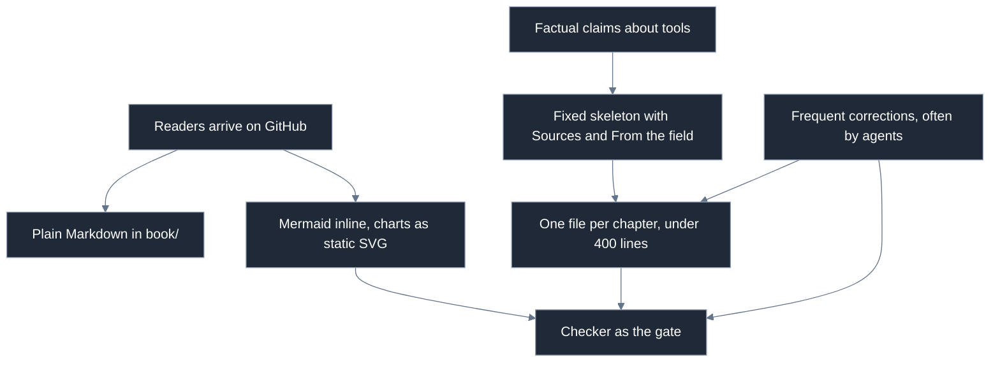

# ADR-001: Initial architecture

A book as plain Markdown in `book/`, one file per chapter, gated by a checker.

| | |
|---|---|
| Status | Accepted |
| Date | 2026-11-26 |
| Applies to | The whole repository |

## Context

The repository publishes a book of 29 chapters and five appendices about building software with coding agents. Four facts shaped its layout:

- **Readers arrive on GitHub.** Most people will read a chapter in the browser, from a link. Anything that needs a build before it can be read loses them.
- **The subject changes monthly.** Chapters will be corrected often, by people and by coding agents. Small, uniform files make a correction cheap to write and cheap to review.
- **Agents write and review much of the text.** A file that fits comfortably in one read, with a predictable shape, is one an agent can review whole. A rule that is only written down gets skipped; a rule a command enforces does not.
- **The book makes factual claims about tools.** It needs a visible line between what the documentation says and what one developer observed.

## Decision

Four choices, taken together.

### 1. The book lives in `book/`, apart from everything else

`book/` holds the content and nothing but the content: the cover page, the chapters, the appendices and `book/assets/`. Repository infrastructure (scripts, CI, these docs, agent instructions) lives outside it. The two trees have different rules and different checkers, and the documentation standard's file globs deliberately stop at `README.md` and `docs/**`.

### 2. One file per chapter, under 400 lines

Each chapter and appendix is a single Markdown file with a numeric or letter prefix that fixes its order. Chapters stay flat in `book/`, with relative links between them and a previous, contents and next line at the foot of each. A file must have fewer than 400 lines. Every numbered chapter follows the same skeleton: mental model, core sections, from the field, common problems, checklist, try it, sources.

### 3. Mermaid inline for diagrams, static SVG for charts and figures

Diagrams that explain a flow or a structure are Mermaid blocks written in the chapter, so the source sits beside the prose it explains and GitHub renders it. Charts built from the field data, and the larger concept figures, are static SVG files in `book/assets/`, generated by scripts in `book/assets/_src/` and committed.

### 4. The checker is the gate

`scripts/check-book.py` checks every file under `book/` for length, balanced code fences, local links, image paths and Mermaid rendering. `make agent:check` runs it in CI on every push and pull request, without Mermaid rendering; `make check-book` runs it locally with rendering. A change that fails the checker does not merge.

The relationship between the four choices:

## Consequences

**What this buys**

- The book is readable the moment it is cloned or opened on GitHub. There is no build to break and no site to host.
- A chapter is one reviewable unit. A reviewer, human or agent, can hold the whole file in view.
- The folder is portable: relative links and local images mean `book/` can be zipped and read offline.
- Diagrams are diffable text. A change to a diagram shows up in review as a change to a few lines.
- The mechanical rules cannot rot quietly, because a command enforces them on every pull request.

**What it costs**

- No single-file output. There is no PDF or EPUB, and no site search beyond what the host provides.
- The 400-line limit forces splits that a print book would not make, and occasionally pushes a useful example out of a chapter.
- Mermaid rendering depends on the viewer. A reader in a plain editor sees diagram source.
- CI does not render Mermaid, because the runner has no Mermaid CLI. A diagram that fails to render is caught only if the author runs `make check-book` locally with `mmdc` installed.
- The field-data charts cannot be regenerated from this repository alone: their input is private and kept outside it.
- The sources appendix is maintained by hand and can drift from the chapters' Sources lists. Nothing checks that today.
- The checker confirms that a link target exists, not that an external URL resolves or that a statement is true. Accuracy remains a review responsibility.

## Alternatives considered

| Alternative | Why it was not chosen |
|---|---|
| A static site generator (a docs site with navigation and search) | Adds a build, a theme and a host to maintain, and moves the canonical text one step away from what a contributor edits. Can be layered on later without changing `book/` |
| One long document, or one file per part | Files of several thousand lines are slow to review, produce conflicts when two changes touch the same part, and do not fit in a single agent read |
| Chapters in nested folders per part | Deeper relative links and a renumbering problem whenever a chapter moves between parts. A flat folder with prefixes keeps links one level deep |
| All figures as images, no Mermaid | Diagrams stop being diffable and every small change needs a drawing tool |
| All figures as Mermaid, no static SVG | Mermaid cannot draw the data charts legibly, and chart numbers should come from a script, not from hand-typed diagram text |
| Rules in a style guide only, no checker | The rules that matter most (length, working links, rendering diagrams) are exactly the ones that slip when nothing runs them |

## Related

- [Architecture overview](../architecture/overview.md)
- [Authoring rules](../../CONTRIBUTING.md#authoring-rules)
- [Command reference](../../user/reference/commands.md)

---

<a href="https://github.com/TamirCohen28">Have a Question?</a>&nbsp;·&nbsp;<a href="https://github.com/TamirCohen28/ai-native-dev-guide/issues/new/choose">Open an Issue</a>

