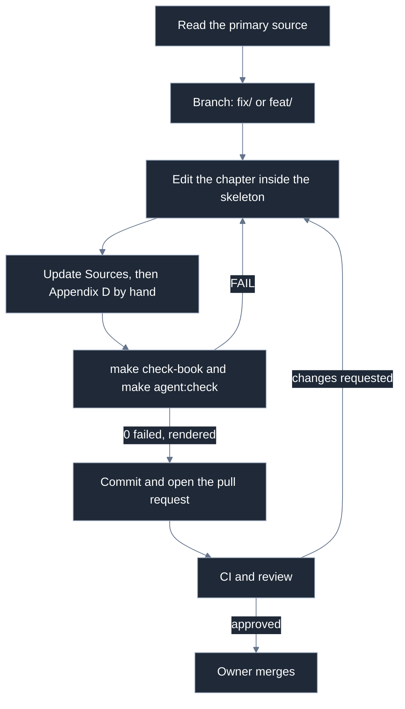

# Getting started: a chapter change, end to end

A walk through one realistic change: correcting a fact in a chapter and adding its source. The same steps apply to any change under `book/`.

The example corrects a statement in chapter 16 and adds one source. Substitute your own chapter and branch name.

## 0. Set up once

```bash
git clone https://github.com/TamirCohen28/ai-native-dev-guide.git
cd ai-native-dev-guide
make install
```

`make install` installs nothing; it reports which tools are present. If it says `mmdc` is absent, install the Mermaid CLI so the full check can render diagrams:

```bash
npm install -g @mermaid-js/mermaid-cli
```

Confirm the tree is healthy before you change anything:

```bash
make check-book
```

The last line should read `0 failed` and end with `rendered`.

## 1. Research before you write

Open the primary page that settles the fact: the official documentation, a specification, or the vendor's own post. Write down three things:

- the URL,
- the date you read it,
- the exact wording that supports the change.

If the page does not say what you expected, the change stops here. Do not write tool behaviour from memory, and do not cite a secondary summary as if it were the source.

## 2. Branch

```bash
git checkout main
git pull --ff-only
git checkout -b fix/ch14-hook-exit-codes
```

Use `fix/` for a correction and `feat/` for new content or tooling.

## 3. Edit the chapter

Open `book/16-hooks.md`. Keep to the chapter skeleton; a correction usually touches one or two of its parts.

| If your change is... | Edit this part | Also check |
|---|---|---|
| A corrected fact | The core section that states it | The Common problems table and the Checklist, which may repeat it |
| A new failure mode | Common problems | Chapter 32, which collects problems across the book |
| A new example | The relevant core section | That you ran it and printed the output you saw |
| A new observation from real use | From the field | That it is labelled as field data and carries no private detail |
| A changed diagram | The Mermaid block | That labels are in double quotes and it still renders |

While editing:

- Mark a version-sensitive fact with its date, for example "as of Nov 2026".
- Add the page from step 1 to the chapter's `## Sources` list.
- Keep names, hostnames, secrets and project names out of the text, including in code samples.
- Watch the length. The file must stay under 400 lines.

## 4. Update what depends on the chapter

| You changed | Then also update |
|---|---|
| The chapter's Sources list | `book/D-sources.md`, by hand: add or amend the row and its chapter list |
| A term's meaning | `book/B-glossary.md` |
| A command, flag or default that the cheat sheet lists | `book/A-cheat-sheet.md` |
| A chapter title or file name | `book/README.md`, the footer navigation of the two neighbouring chapters, and any link to the file |
| A figure script | Regenerate the figure and commit both |

## 5. Check

Check the files you touched first, for a fast answer:

```bash
python3 scripts/check-book.py book/14-hooks.md book/D-sources.md
```

Then the whole book, and the repository gate:

```bash
make check-book
make agent:check
```

Read the output; do not just look at the exit status. `make check-book` must end like this:

```text
check-book: 35 files, 0 failed, 53 Mermaid blocks rendered
```

If it ends with `NOT rendered`, the diagrams were not checked. Fixes for each error message are in [troubleshooting](../../user/troubleshooting.md#checker-failures).

## 6. Commit

```bash
git add book/14-hooks.md book/D-sources.md
git commit -m "fix(ch14): correct which exit code blocks a tool call"
```

One logical change per commit. Add a line under `[Unreleased]` in `docs/CHANGELOG.md` and the root `CHANGELOG.md` if a reader would notice the change.

## 7. Open the pull request

```bash
git push -u origin fix/ch14-hook-exit-codes
gh pr create --fill
```

Fill in the template. A good body for this change says:

- what was wrong and what it says now,
- the source: URL and the date you read it,
- the last lines of `make agent:check` and `make check-book`, pasted.

## 8. Review and merge

CI runs `make agent:check`, a secret scan and the action-pinning check. A reviewer reads the diff for accuracy against the source, for clarity, and for anything private. Address comments with new commits on the same branch. The repository owner merges once CI is green and every thread is resolved.

The whole path in one picture:



## Changing something other than a chapter

| Change | Differences from the path above |
|---|---|
| A page under `docs/` or the root `README.md` | Run `bash scripts/check-doc-standards.sh --fix .`, then `make lint`. Diagrams need the shared theme line, which the fixer inserts |
| A concept figure | Edit `book/assets/_src/figures/build.py`, run it, open the SVG at full size, commit the script and the figure together |
| A field-data chart | Needs the private data aggregate. If you do not have it, open an issue instead of patching the SVG |
| `scripts/check-book.py` | Prove the new check can fail: break a scratch copy of a chapter on purpose and confirm a non-zero exit |
| A workflow under `.github/` | Pin every action to a commit; `make check-action-pinning` enforces it |

## Further reading

- [Authoring rules](../../CONTRIBUTING.md#authoring-rules)
- [Development workflow](../build-and-release/development-workflow.md)
- [Architecture overview](../architecture/overview.md)

---

<p align="center"><a href="https://github.com/TamirCohen28">Have a Question?</a>&nbsp;·&nbsp;<a href="https://github.com/TamirCohen28/ai-native-dev-guide/issues/new/choose">Open an Issue</a></p>
