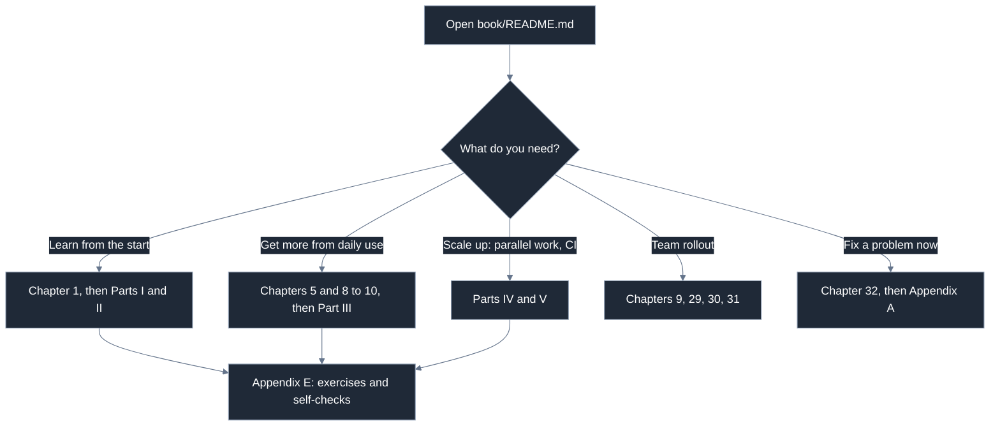

# Quick start

How to get the book, open it, and choose where to begin. Reading needs nothing installed.

## 1. Get the book

Read it on GitHub by opening [`book/README.md`](../../book/README.md), or clone it to read locally:

```bash
git clone https://github.com/TamirCohen28/ai-native-dev-guide.git
cd ai-native-dev-guide
make install
```

`make install` installs nothing. It checks that the tools the checks use are present (Python 3, jq and git, plus the optional Mermaid CLI) and tells you what is missing. You can skip it if you only want to read.

If you work with a coding agent, the repository already carries its instructions: Claude Code loads `CLAUDE.md`, which imports `AGENTS.md`; Cursor applies `.cursor/rules/000-project.mdc`, which points to `AGENTS.md`; Codex reads the root `AGENTS.md` directly.

## 2. Open the cover page

[`book/README.md`](../../book/README.md) is the cover and the contents page. It has the full chapter list with one line on what each chapter gives you, the list of figures, and a note on accuracy and limits.

## 3. Pick a path

You do not have to read front to back. Choose the row that describes you:

| You are... | Start at | Then |
|---|---|---|
| New to coding agents | [Chapter 1](../../book/01-what-is-ai-native-development.md) | Straight through Parts I and II |
| Using Claude Code daily, mostly by prompting | [Chapter 5](../../book/05-inside-the-harness.md), then [chapter 8](../../book/08-claude-md-and-memory.md) to [chapter 10](../../book/10-plan-mode-checkpoints-and-context-management.md) | Part III |
| Ready to build your own extensions | [Chapter 11](../../book/11-the-extension-model.md) | The workshop guides, chapters [19](../../book/19-guide-write-a-subagent.md) to [21](../../book/21-guide-build-and-ship-a-plugin.md) |
| Already writing skills and hooks | [Part IV](../../book/22-explore-plan-implement-verify.md) | Part V |
| Rolling this out to a team | Chapters [9](../../book/09-settings-and-permissions.md), [29](../../book/29-security-and-guardrails.md), [30](../../book/30-cost-usage-and-observability.md) and [31](../../book/31-repo-standards-and-team-adoption.md) | The [templates](../../book/C-templates.md) |
| Stuck on something right now | [Chapter 32](../../book/32-troubleshooting-common-problems.md) | The [cheat sheet](../../book/A-cheat-sheet.md) |
| Using another tool (Cursor, Codex, Gemini CLI) | [Chapter 28](../../book/28-cross-tool-agents-md-cursor-codex-gemini.md) | Parts I and IV, where most of the ideas carry over |

The diagram below shows the same choice as a flow.



## 4. Study, not just read

[Appendix E](../../book/E-learning-path-and-exercises.md) turns the book into a course: one section per level with projects and self-check questions, a 30-day plan, four capstone projects and an answer key. Each chapter also ends with a "Try it" section of exercises for your own repository.

## 5. Keep two pages open

- [Appendix A, the cheat sheet](../../book/A-cheat-sheet.md): the whole book as quick-reference tables.
- [Appendix B, the glossary](../../book/B-glossary.md): every term, defined and linked to its chapter.

## Next

- [Concepts](concepts.md) explains how the book is organised.
- [Usage](usage.md) covers offline reading and viewers.

---

<p align="center"><a href="https://github.com/TamirCohen28">Have a Question?</a>&nbsp;·&nbsp;<a href="https://github.com/TamirCohen28/ai-native-dev-guide/issues/new/choose">Open an Issue</a></p>
